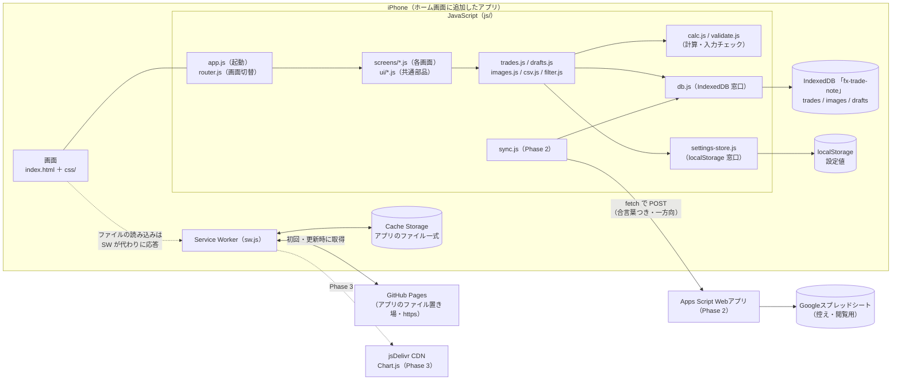

# FXトレード記録PWA 技術設計（architecture.md）

| 項目 | 内容 |
|---|---|
| 版 | v1.5（T-15 の実装結果と申し送りのオーナー決定（2026-10-16）を反映：`js/ui/theme.js`・`checkRows()` の追記、`setGroupMessages()` の出し方の変更、壊れた設定値を読むときに消さない方針（7.1）、根拠・感情・タグの初期値は T-16 で `master.js` へ移す、テスト件数を212件に更新）。v1.4（T-11 の実装結果と申し送りのオーナー決定（2026-10-16）を反映：`js/ui/` の部品ファイル・確認用ページをファイル構成に追記、`innerHTML` を一切使わない方針に変更、テスト件数を更新） |
| 作成日 | 2026-10-15 |
| 作成 | engineer |
| 対応タスク | T-08「技術設計（ファイル構成・IndexedDBスキーマ）」。T-10（プロジェクト雛形）の実装結果を v1.1、T-13（計算）を v1.2、T-12（保存処理）を v1.3、T-11（共通CSS・共通部品）を v1.4、T-15（設定画面①）を v1.5 で反映 |
| 前提 | `docs/requirements.md` v1.4（5章 機能、6章 データ項目、8章 非機能要件）、`docs/fx-rules.md` v1.5（4.5 再計算と空の値、6章 誤差対策・参照実装、8章 入力チェック、9章 テストケース、10章 通貨ペアマスタ、11章 セッション判定、14.1 追加テストケース）、`docs/analytics.md` v1.1（4章 一覧画面）、`docs/design.md` v1.7（4章 画面遷移・URL、8.4 キーボード、9章 部品、12章 CSS変数、14章 ワイヤーフレーム。12章の寸法変数の追加は designer が更新中）、`docs/roadmap.md` v1.5（Phase 1） |
| 主な読み手 | engineer（T-10〜T-29 の実装根拠）、reviewer（T-30・T-31 の確認基準）、sheets-integrator（Phase 2 の接続点）、pm（T-09 の整合チェック） |

> **このドキュメントの位置づけ**
> 「どう作るか（How）」の骨組みを決める文書です。何を作るかは `requirements.md`、見た目は `design.md`、計算の正解は `fx-rules.md` に従い、この文書はそれらを**どのファイル・どのデータ構造で実現するか**を決めます。
> T-10 で雛形（`index.html`・`css/`・`js/` の入れ物とハッシュルーティング）を実装済みです。文中の短いコード片は「形のイメージ」で、実装時に細部は変わることがあります（ただし**キー名・ストア名・URL・定数の値はこの文書が正**。コードと食い違ったときは pm が判断し、この文書かコードのどちらかを直します）。
> 20章の判断事項は 2026-10-15 にオーナーが決定しました（「確定事項」に変更）。v0.1 では T-03（通貨ペアマスタ・セッション判定）・T-04（一覧の絞り込み）の完了前で「案」だった箇所を、v1.0 で fx-rules.md 10・11章と analytics.md の確定内容に合わせて更新しています（変更点は21章）。

---

## 1. この文書で使う言葉

| 用語 | 一言説明 |
|---|---|
| ES Modules | JavaScript のファイル同士を `import` / `export` でつなぐ標準の仕組み。ビルドツールなしでブラウザがそのまま読める |
| ビルド不要 | 書いたファイルを変換・まとめる作業（ビルド）をせず、そのままサーバーに置けば動くこと |
| 相対パス | `./js/app.js` のように「今いる場所から見た位置」で書くファイルの場所。`/js/app.js`（先頭が `/`＝絶対パス）とは違い、置き場所のフォルダが変わっても壊れない |
| サブパス | `https://ユーザー名.github.io/リポジトリ名/` の「`/リポジトリ名/`」の部分。GitHub Pages ではアプリがこの下に置かれる。本アプリのリポジトリ名は **`fx-trade-note`**（2026-10-15 決定）なので `/fx-trade-note/` |
| ハッシュルーティング | URL の `#` 以降（例 `#/new`）を見て表示する画面を切り替える方式。ページを再読み込みしないので速く、サーバー側の設定も不要 |
| ストア | IndexedDB の中の「表」。本アプリでは `trades`（トレード記録）・`images`（画像）・`drafts`（下書き） |
| キー（keyPath） | ストアの中で1件を特定する項目。本アプリではどのストアも `id` などの文字列 |
| インデックス | 本の索引のように、特定の項目で素早く探したり並べたりするための仕組み |
| トランザクション | 「全部成功するか、全部なかったことにするか」の単位で行う保存処理。途中で失敗しても中途半端なデータが残らない |
| 移行処理（マイグレーション） | データ構造を変えるとき、既存のデータを新しい形に作り直す処理 |
| Service Worker（SW） | アプリのファイルを端末に保存（キャッシュ）し、オフラインでも開けるようにする裏方のプログラム |
| Cache Storage | Service Worker が使うファイル保存場所。IndexedDB とは別の領域 |
| プリキャッシュ | Service Worker のインストール時に、アプリの全ファイルを先にまとめて保存しておくこと |
| オリジン | `https://ユーザー名.github.io` のような「通信方式＋ドメイン」の組。IndexedDB・localStorage・Cache Storage は**オリジン単位**で共有される |
| デバウンス | 連続して起きる処理（1文字入力ごとの保存など）を「入力が止まって少したってから1回だけ」行う工夫 |
| Blob | 画像などのバイナリデータ（文字ではないデータ）の入れ物 |
| XSS | 悪意ある文字列が画面にHTMLとして埋め込まれ、勝手にプログラムが動く攻撃 |
| CSP | Content Security Policy。「このページで実行してよいスクリプトの出どころ」をブラウザに伝え、XSS の被害を抑える仕組み |
| SRI | Subresource Integrity。CDN から読み込むファイルが改ざんされていないかをブラウザに確認させる仕組み（`integrity` 属性） |
| CDN | ライブラリのファイルを世界中から速く配信するサービス。本アプリでは jsDelivr を想定 |
| セキュアコンテキスト | `https://` か `http://localhost` で開いている状態。Service Worker など一部の機能はこの状態でしか動かない |

---

## 2. 設計の基本方針

| # | 方針 | 理由 |
|---|---|---|
| 1 | **素の HTML / CSS / JavaScript（ES Modules）・ビルド不要** | GitHub Pages にそのまま置ける。オーナーが後で読める |
| 2 | **すべて相対パス**（先頭 `/` を使わない） | GitHub Pages のサブパス `/リポジトリ名/` でも、ローカルの `http://localhost:8000/` でも同じファイルのまま動く |
| 3 | **正のデータは IndexedDB**。localStorage は設定値のみ | 画像を保存でき、容量も大きい。`requirements.md` 6章どおり |
| 4 | **保存は「完了を確認してから」成功表示** | IndexedDB のトランザクション完了（`complete`）を待ってから「保存しました」を出す。「保存したつもりで消えていた」を防ぐ（8章 データ保護） |
| 5 | **層を分け、下の層は上の層を知らない** | 計算（calc.js）は画面を知らない、画面は IndexedDB を直接触らない。テストしやすく、壊れにくい（4.3） |
| 6 | **計算は fx-rules.md の参照実装をそのまま使う** | 誤差対策済みの「正解」を写すのが最も安全（13章） |
| 7 | **画面に出す文字は `textContent` で入れる** | XSS 対策の基本（14章） |
| 8 | **iPhone のホーム画面版を基準に設計** | 主な端末が iPhone（Q-23）。iOS 特有の制約は17章にまとめる |
| 9 | **データ構造は v1 から Phase 2 の項目まで用意** | `syncStatus` などを最初から持ち、後から作り変えるリスクを減らす（requirements 6.1 の方針） |
| 10 | **対応ブラウザの下限は iOS 16.4** | 使う機能（ES Modules、`<dialog>`、`crypto.randomUUID`、`structuredClone`、BigInt、`100dvh`）はすべて iOS 16.4 で使える |

---

## 3. 全体構成図

### 3.1 構成図



文字だけの版（図が表示されない環境向け）：

```
[iPhone のホーム画面アプリ]
  画面（index.html / css）
    └ js/app.js（起動） → router.js（#/… を見て画面を切替）
         └ screens/*.js（各画面） ─ ui/*.js（ボタン・トースト・確認シート等）
              └ trades.js / drafts.js / images.js / csv.js / filter.js（業務の処理）
                   ├ calc.js / validate.js（計算・入力チェック。画面もDBも知らない）
                   ├ db.js ──────────→ IndexedDB「fx-trade-note」（trades / images / drafts）＝正のデータ
                   └ settings-store.js → localStorage（設定値だけ）
         └ sync.js（Phase 2）── fetch POST（合言葉つき）──→ Apps Script → スプレッドシート（控え）

  Service Worker（sw.js）
    ├ 初回・更新時：GitHub Pages からアプリの全ファイルを取得して Cache Storage に保存
    ├ 2回目以降：Cache Storage から即応答（オフラインでも起動できる）
    └ Phase 3：Chart.js（CDN）も保存
```

### 3.2 データの置き場所

| 置き場所 | 入れるもの | 消えるとき | 備考 |
|---|---|---|---|
| IndexedDB `trades` | トレード記録（正のデータ） | 論理削除では消えない（`deletedAt` を付けるだけ） | 6.3 |
| IndexedDB `images` | 縮小済みのチャート画像 | 画像を個別に削除したとき（確認あり）、どの記録・下書きからも参照されなくなって1日たったとき（11.6） | 6.4。シートには同期しない |
| IndexedDB `drafts` | 入力途中の下書き | 保存・破棄したとき | 6.5、9章。requirements 6.4 に追記済み（20章 ①で確定） |
| localStorage | 設定値（1lot通貨数・選択肢・テーマ等）と、一覧の絞り込み条件の一時保存 `listFilter` | 設定を変えたとき／絞り込み条件を変えたとき | 7章。requirements 6.3 |
| Cache Storage | アプリのファイル（HTML/CSS/JS/アイコン、Phase 3 で Chart.js） | 新しい版に切り替わったとき（古い版を削除） | 12章 |
| メモリ（変数） | 一覧の絞り込み条件・スクロール位置、トレード一覧のキャッシュ | アプリを閉じたとき（絞り込み条件は `listFilter` から30分以内なら復元） | 5.5 |

### 3.3 Phase 2（Apps Script）との関係

- 方向は **アプリ → シートの一方向**（Q-19）。シートの内容がアプリに戻ってくることはない。
- 送信の対象は `trades` の記録のうち `syncStatus` が `pending`（未送信）か `error`（失敗）のもの。**未送信キューは専用ストアを作らず、`syncStatus` インデックスで取り出す**（削除も `deletedAt` 付きの記録として同じ仕組みで送れる）。
- 送信のきっかけ：保存・編集・削除の直後（`trades.js` が出す「変更通知」を `sync.js` が受け取る）、アプリ起動時、オンライン復帰時（`online` イベント）、アプリが前面に戻ったとき、手動の「今すぐ同期」。iOS には「バックグラウンド同期」の仕組みがないため、アプリが開いているときだけ送る。
- Phase 1 のコードは `sync.js` の存在を知らない（`trades.js` は変更通知を出すだけ）。Phase 2 で `sync.js` を足しても Phase 1 のファイルはほぼ変えずに済む。
- Apps Script の URL・合言葉は localStorage（`gasUrl` / `syncToken`）に保存し、コードやGitHubには含めない。
- 詳細（送るデータの形・二重登録の防ぎ方）は 16.3 と sheets-integrator の `docs/sheets-setup.md` で決める。

---

## 4. ファイル構成

### 4.1 フォルダとファイル

```
（リポジトリのルート ＝ GitHub Pages の公開ルート）
├── index.html              … 唯一のHTML。全画面の入れ物
├── manifest.json           … ホーム画面追加用の設定（T-27）
├── sw.js                   … Service Worker（ルートに置く必要がある：12.1）
├── .nojekyll               … GitHub Pages の自動変換（Jekyll）を止める空ファイル
├── css/
│   ├── variables.css       … design.md 12章のCSS変数をそのまま貼る（冒頭の注記の参照版は design.md v1.7 で確定：T-11）
│   ├── base.css            … 全体の基本設定（文字・背景・押せるものの共通設定）
│   ├── layout.css          … 画面の型A/B/C、ナビゲーションバー、タブバー、下部操作バー、セーフエリア
│   ├── components.css      … 共通部品（T-11 で作成。.icon / .btn / .list-group・.list-row / .form-row・.field-row・.field-message / .switch / .segment / .chips・.chip / .badge / .notice / .toast / .dialog（.action-sheet・.alert）/ .fab / .empty / .loading・.spinner、.kbd-nav・.is-modal-open）。冒頭に、12章に変数がない部品の寸法を名前付きでまとめている（T-15 の最初に 12章の変数へ移す：roadmap T-15）。ボトムシート .sheet は T-23、一覧の行 .trade-row は T-19 で足す
│   └── screens.css         … 画面ごとの細かい調整
├── js/
│   ├── boot-theme.js       … テーマを最初の描画前に適用する小さなスクリプト（モジュールではない）
│   ├── app.js              … 起動処理（入口）
│   ├── router.js           … ハッシュルーティング
│   ├── config.js           … 定数（アプリのバージョン、DB名、上限値など）
│   ├── master.js           … 通貨ペアマスタと getPairSpec()・選択肢の初期値・表示名（fx-rules 10章／requirements 10章）
│   ├── calc.js             … FX計算（fx-rules 6.4 の参照実装＋セッション判定 11.7＋勝敗判定 7章）
│   ├── validate.js         … 入力値の正規化・チェック（fx-rules 8章・10.4・10.5）
│   ├── datetime.js         … 日時（日本時間）の生成・変換
│   ├── format.js           … 表示用の整形（円・pips・価格・日時）
│   ├── util.js             … ID（UUID）生成・デバウンス・共通エラー AppError など小さな道具
│   ├── events.js           … アプリ内の変更通知（「記録が変わった」を知らせる）
│   ├── db.js               … IndexedDB の窓口（開く・移行・読み書き）
│   ├── settings-store.js   … localStorage の窓口（設定の読み書き・初期値）
│   ├── trades.js           … トレード記録の業務処理（新規・決済・編集・決済取消・削除・取消）。T-12 で保存の土台を作成
│   ├── drafts.js           … 下書きの自動保存・復元。T-12 で保存の土台を作成
│   ├── images.js           … 画像の縮小・圧縮・保存・表示用URL。T-12 で保存の土台を作成
│   ├── filter.js           … 一覧の絞り込み・並び順・件数/合計（analytics.md 一覧の章に従う）
│   ├── csv.js              … CSVエクスポート（Phase 2 でインポート）
│   ├── sync.js             … （Phase 2）スプレッドシート同期
│   ├── analytics.js        … （Phase 3）分析の集計
│   ├── ui/
│   │   ├── dom.js          … 安全に要素を作る道具（textContent だけを使う）。T-11 で id の道具（uniqueId など）を追加
│   │   ├── bars.js         … 画面の骨組みの部品（大タイトル・ナビゲーションバー・戻るボタン・文字ボタン・下部操作バー・新規エントリーボタン）。T-10 で追加、T-11 で線画アイコン化と新規エントリーボタンを追加
│   │   ├── icons.js        … 線画SVGアイコン（線の座標のデータから要素を1つずつ組み立てる。innerHTML は使わない：14.1）
│   │   ├── parts.js        … 表示の部品（ボタン・バッジ・グループ化されたリスト・空状態・読み込み中）。T-11 で追加
│   │   ├── fields.js       … 入力部品（フォーム行・日時欄・スイッチ・セグメント・チェックの行・チップ・エラー/注意の文）
│   │   ├── toast.js        … トースト（画面を移ったら「取り消す」付きを消す）
│   │   ├── dialog.js       … アクションシート（確認）とアラート（失敗表示）
│   │   ├── notice.js       … お知らせ行（画面の中にも #notice-area にも出せる）
│   │   ├── keyboard.js     … キーボード表示の判定（design 8.4）と、Tab キー操作中の判定
│   │   ├── theme.js        … テーマの適用（`<html data-theme>` と `<meta name="theme-color">` の切り替え）。起動時の app.js と設定画面の両方から使うため共通部品の層に置く。T-15 で追加
│   │   └── sheet.js        … ボトムシート（未作成。絞り込みシートを作る T-23 で作る）
│   └── screens/
│       ├── list.js         … S-01 一覧
│       ├── trade-form.js   … S-02/S-03/S-05 で共通の入力欄の組み立て
│       ├── entry.js        … S-02 エントリー記録
│       ├── close.js        … S-03 決済記録
│       ├── detail.js       … S-04 トレード詳細（画像の拡大表示を含む）
│       ├── edit.js         … S-05 編集
│       ├── settings.js     … S-06 設定
│       ├── choices.js      … S-06 の下位画面（よく使う通貨ペア・根拠・感情・タグの編集）
│       ├── install-guide.js… S-06 の下位画面（ホーム画面への追加方法）
│       ├── analysis.js     … S-08 分析（Phase 1〜2 は「準備中」表示）
│       └── sync-status.js  … （Phase 2）S-07 同期状態
├── icons/
│   ├── icon-192.png / icon-512.png / icon-maskable-512.png … manifest 用（T-26/T-27）
│   └── apple-touch-icon.png  … iPhone のホーム画面用 180×180
├── tests/                  … 計算・入力チェック・一覧の絞り込みのテスト（13章）。Service Worker のキャッシュ対象外
│   ├── index.html          … ブラウザで開くテストページ
│   ├── runner.js           … 小さなテスト実行の仕組み
│   ├── cases.js            … fx-rules.md 9・10.8・11.8・14.1 章と analytics.md 4.11 のテストケース（データ）
│   ├── calc.test.js / pairs.test.js / validate.test.js / datetime.test.js / filter.test.js
│   ├── db.test.js          … 保存処理のテスト（T-12。ブラウザのテストページだけで実行：13.2）
│   ├── helpers.js / test-page.js / tests.css … テストページの道具・表示（T-13・T-12）
│   ├── run-node.mjs        … 同じテストを Node.js で実行する入口
│   ├── components.html     … 共通部品の確認用ページ（T-11。自動テストではなく、design 9章の部品を js/ui/ の本物で並べて目で確かめる。テストページからリンク）
│   ├── components.js       … 確認用ページの組み立て（js/ui/ の部品を import して並べる）
│   └── components.css      … 確認用ページだけで使う見た目（部品そのものの見た目は css/components.css）
├── gas/
│   └── Code.gs             … （Phase 2）Apps Script のコード（sheets-integrator）
└── docs/                   … 設計ドキュメント（アプリの動作には関係しない）
```

- 画面ファイル名は `design.md` の画面IDと対応させる（S-01＝`list.js` …）。
- `js/settings-store.js`（設定の保存）と `js/screens/settings.js`（設定画面）は**役割が違う別ファイル**。名前の衝突を避けるため保存側に `-store` を付けた。
- 同様に `js/analytics.js`（集計の計算）と `js/screens/analysis.js`（分析画面）は別ファイル。
- **T-10 の時点で作成済みのファイル**（2026-10-15 の T-09 で確認）：`index.html`、`.nojekyll`、`css/` の5つ、`js/boot-theme.js`・`app.js`・`router.js`・`config.js`、`js/ui/dom.js`・`js/ui/bars.js`、`js/screens/` のうち `list.js`・`entry.js`・`close.js`・`detail.js`・`edit.js`・`settings.js`・`choices.js`・`install-guide.js`・`analysis.js`（中身は入れ物だけ）。それ以外は担当タスクで作る（`trade-form.js` は T-17、`sync-status.js` は Phase 2）。
- **T-13・T-12 で作成済みのファイル**（2026-10-16 確認）：T-13 で `js/master.js`・`calc.js`・`validate.js`・`format.js`、`tests/`（`index.html`・`runner.js`・`cases.js`・`helpers.js`・`test-page.js`・`tests.css`・`calc.test.js`・`pairs.test.js`・`validate.test.js`・`run-node.mjs`）、ルートの `package.json`。T-12 で `js/db.js`・`trades.js`・`images.js`・`drafts.js`・`util.js`・`events.js`・`datetime.js`（日時の生成だけ。残りは T-17）、`tests/db.test.js`。**`js/settings-store.js` は T-12 では作っていない**（T-15 で作る：4.2）。
- **T-11 で作成・作り直したファイル**（2026-10-16 確認）：新規に `js/ui/parts.js`・`icons.js`・`fields.js`・`toast.js`・`dialog.js`・`notice.js`・`keyboard.js`、`tests/components.html`・`components.js`・`components.css`。作り直し・修正は `css/components.css`（design 9章どおりに作り直し）・`css/variables.css`（注記を design v1.7 に）・`css/layout.css`、`js/ui/dom.js`・`bars.js`、`js/app.js`（お知らせを `ui/notice.js` に、キーボード監視を開始）・`router.js`（画面を表示し終えたら `syncToastWithRoute()`）・`screens/list.js`（新規エントリーボタン）、`tests/index.html`（確認用ページへのリンク）、T-14 を受けた `js/calc.js`・`validate.js`・`tests/cases.js` ほかテストのファイル（13.4）。**`js/ui/sheet.js`（ボトムシート）は T-11 では作っていない**（使うのは絞り込みシートの T-23 なので、そこで作る）。
- **`js/ui/parts.js` は v1.3 までのファイル一覧になかったファイル**（T-11 で engineer が追加、2026-10-16 オーナー決定でコードに合わせる）。入力部品は `fields.js`、トースト・確認・お知らせは `toast.js`・`dialog.js`・`notice.js` と役割で分け、それ以外の「表示の部品」を `parts.js` に集めた。

### 4.2 各ファイルの役割と主な担当タスク

| ファイル | 役割 | 依存先（import する相手） | タスク |
|---|---|---|---|
| `index.html` | 入れ物。`<main id="app">`（画面の中身が入る）、タブバー（JS が表示するまでは `hidden`）、トースト置き場 `#toast-area`、アプリ全体の問題用のお知らせ置き場 `#notice-area`（画面ごとのお知らせは各画面の中に出す：design 9.16）。CSS と `boot-theme.js`・`app.js` を読み込む | — | T-10（`manifest.json`・`apple-touch-icon` の `<link>` は T-27 で追加） |
| `js/boot-theme.js` | localStorage のテーマ設定（`fxnote:theme`）を読み、`<html data-theme>` を**最初の描画前**に付ける（白→黒のちらつき防止）。モジュールにせず `<head>` で同期読み込み。モジュールではないので接頭辞 `fxnote:` を直接書いている（`config.js` の `LS_PREFIX` と同じ値。変えるときは両方を直す） | なし | **T-10 で実装済み**。`theme-color` の切り替えと設定画面からの変更は T-15 |
| `js/app.js` | 起動：DBを開く → 設定読み込み → テーマ監視 → キーボード監視 → Service Worker 登録 → 永続化リクエスト → 下書き確認 → ルーター開始。全体のエラー受け止めもここ（T-10 で「想定外のエラーの受け止め」と「ルーター開始」、T-12 で「DBを開く」（開けない・古い版・他の画面が古い版を開いたまま・別の画面で更新されたときのお知らせ行：6.11）を実装済み。残りは各タスクでこの順に足す） | router, db, settings-store, drafts, ui/notice, ui/keyboard, config | T-10, T-12, T-15, T-17, T-28, T-29 |
| `js/router.js` | `#/…` を解析して画面モジュールを読み込み・表示・後片付け。戻る操作・保存後の遷移。画面の型を `<body data-layout>` に、画面名を `document.title`（「画面名 - FXトレードノート」）に反映。画面を表示し終えるたびに `ui/toast.js` の `syncToastWithRoute()` を呼ぶ（T-11） | ui/dom（読み込み失敗の表示用）、ui/toast | T-10, T-11 |
| `js/config.js` | **変わり得る数値を1か所に**。T-10 で定義済み：`APP_VERSION`（`'0.1.0'`。公開前は 0.x.x、最初の公開で `1.0.0`：12.3）、`DB_NAME`（`'fx-trade-note'`）、`DB_VERSION`（`1`）、`LS_PREFIX`（`'fxnote:'`）、`MAX_IMAGES_PER_TRADE`（`4`）、画像の縮小 `IMAGE_MAX_EDGE`（`1280`）・`IMAGE_FALLBACK_EDGE`（`1024`）・`IMAGE_QUALITY_STEPS`（`[0.82, 0.72, 0.62, 0.5]`）・`IMAGE_MAX_BYTES`（250KB）（11.1）、復元の期限 `DRAFT_RESTORE_MINUTES`（`30`。9.3）・`LIST_FILTER_RESTORE_MINUTES`（`30`。5.5）。Chart.js の URL は T-55 で追加 | なし | T-10 |
| `js/master.js` | 通貨ペアマスタ（fx-rules 10.7 の `PAIR_MASTER`：ペア・日本語名・価格帯 `warnMin`/`warnMax`）、`PIP_EXCEPTIONS`・`KNOWN_CURRENCIES`・`NON_FX_CODES`、pip単位・桁数を求める `derivePairSpec()`・`getPairSpec()`（10.4 手順3。pip単位はマスタに持たず `pair` から求める）。時間足・決済理由・セッション・口座区分などの選択肢と日本語の表示名、根拠・感情・タグの初期値、よく使う通貨ペアの初期値（fx-rules 10.3 の1〜6。高金利通貨は含めない） | なし | T-13, T-16 |
| `js/calc.js` | pips・損益（円）・RR（fx-rules 6.4）、セッション判定 `judgeSession()`（11.7）、勝敗判定 `judgeResult()`（7章）。**画面もDBも触らない純粋な関数だけ** | master | T-13 |
| `js/validate.js` | 入力文字の正規化（全角→半角など）、エラー E-01〜E-16・警告 W-01〜W-07 の判定（fx-rules 8章）。通貨ペア追加の `normalizePairInput()`（10.4）、価格帯の警告 `isOutOfPriceRange()`（10.5・W-06）を含む。純粋な関数だけ | master, calc | T-16, T-17, T-18, T-21 |
| `js/datetime.js` | 日本時間の日時文字列の生成（6.6）、`datetime-local` 入力欄との変換、保有時間の計算 | なし | T-12（保存に必要な `toJstString()`・`nowJst()` だけ先に作成）、T-17（入力欄との変換・保有時間・日時のテスト） |
| `js/format.js` | 画面表示用の整形（`＋2,500円`、`−37.7 pips`、`±0円`、通貨ペア別の価格桁 `formatPrice()`（fx-rules 10.7）、`10/15(木) 21:30`）。マイナスは表示だけ「−」（U+2212）、ゼロは「±0」（design 6.3） | master, datetime | T-19 |
| `js/util.js` | `newId()`（UUID 生成。`crypto.randomUUID` が使えない環境では `crypto.getRandomValues` で代用）、`debounce()`（`flush()`＝すぐ実行・`cancel()`＝取り消し付き）、**アプリ共通のエラー `AppError`**（`code` と日本語の `message`。15章）と `isAppError()`、`assertKnownKeys()`（requirements 6章にない項目が混ざっていないかの確認。プログラムの誤りなので `TypeError`）。T-12 で決定：`AppError` は db.js・業務処理・画面のどこからも使うため、一番下の層のここに置く（2026-10-16 オーナー決定：6.12） | なし | T-12 |
| `js/events.js` | アプリ内の通知の仕組み（`on`・`off`・`emit`。今ある通知は `trades-changed`＝`{ type: 'add'｜'update'｜'delete'｜'restore', id, trade }`）。`sync.js` や一覧の再描画が受け取る | なし | T-12 |
| `js/db.js` | IndexedDB を開く・移行処理・各ストアの読み書き。**業務のルールは持たない**（6.10）。ストア名・インデックス名・各ストアの項目名の定数（`STORE`・`INDEX`・`TRADE_KEYS`・`IMAGE_KEYS`・`DRAFT_KEYS`）もここに置く | config, util（`AppError` のため） | T-12 |
| `js/settings-store.js` | localStorage の読み書き、初期値、壊れた値の修復（7章）。**T-12 では作っていない。T-15 で作る**（2026-10-16 オーナー決定：6.12）。requirements 6.3 の全キーの窓口を T-15 で用意し、各キーは使うタスク（T-16 選択肢、T-17 `lastInput`、T-23 `listFilter`、T-25 `lastExportAt`、T-40 同期設定）で使い始める。**T-15 の時点では、根拠・感情・タグの初期値（`DEFAULT_CHOICES`）をこのファイルに仮置きしている。T-16 で `master.js` へ移す**（7.1：2026-10-16 オーナー決定） | config, master | T-15（初期値の移動は T-16） |
| `js/trades.js` | 記録の業務処理：新規作成（ID・日時・`lotUnitSize` コピー・`syncStatus`）、自動計算値の再計算、決済、決済取消、編集、論理削除・取消。変更通知を出す（8章）。**T-12 で「保存の土台」を作成済み**（6.12：ID・日時・`syncStatus` の自動付与、32項目へのそろえ、記録の保存＋下書きの削除、論理削除・削除の取り消し）。各タスクはこのファイルに機能を足す | db, datetime, util, events（T-17 で calc, settings-store を追加） | T-12（土台）, T-17, T-21, T-22 |
| `js/drafts.js` | 下書きの保存（デバウンス＋閉じる直前の即時保存）・復元・破棄（9章）。**T-12 で「保存の土台」を作成済み**（6.12：保存・取得・全件取得・下書きと追加画像の一括破棄、下書きキーの作成 `draftKeyOf()`） | db, util, datetime | T-12（土台）, T-17, T-21, T-22 |
| `js/images.js` | 画像の読み込み・縮小・JPEG圧縮・保存・表示用URLの発行と解放・孤立画像の掃除（11章）。**T-12 で「保存の土台」を作成済み**（6.12：保存（ID・作成日時の自動付与）・取得・トレード単位の取得・物理削除） | db, util, datetime（T-24 で config を追加） | T-12（土台）, T-24 |
| `js/filter.js` | 一覧の絞り込み・キーワード検索・並び順・日付グループ・件数/合計損益（`analytics.md` 4.10 の `buildListView` などと同じ結果）。勝敗は `calc.judgeResult` を使う。純粋な関数 | calc | T-19, T-23 |
| `js/csv.js` | CSV の作成（BOM付きUTF-8）と保存（iPhone は共有シート経由：17章 #17） | db, format, settings-store | T-25 |
| `js/ui/dom.js` | `h('div', {class:'x'}, '文字')` のように要素を作る道具。文字は必ず `textContent`（テキストノード）で入れる。`style` 属性・`javascript:` の URL・文字列のイベント属性は受け付けない。要素を空にする `clear()`（`innerHTML = ''` の代わり）、読み上げ用の id を作る・付け外しする `uniqueId()`・`addIdRef()`・`removeIdRef()`（T-11 で追加） | なし | T-10（最低限の `h()`・`clear()`）、T-11 |
| `js/ui/bars.js` | 画面の骨組みの部品：`largeTitle()`（型Aの大タイトル）、`navbar()`（型B・Cのナビゲーションバー）、`backButton()`（‹ 戻る。「‹」は線画アイコン）、`textButton()`（「キャンセル」「保存」）、`actionBar()`（下部操作バー）、`newEntryButton()`（S-01 の新規エントリーボタン。「＋」は線画アイコン：design 9.10）。見た目は `css/layout.css`・`css/components.css`（design 9章冒頭の表） | ui/dom, ui/icons | T-10 で追加、T-11 で線画アイコン化と `newEntryButton()` を追加 |
| `js/ui/icons.js` | design 9.17 の線画アイコン。**形は線の座標のデータ（`path`・`circle`・`rect`）として持ち、`icon(name, { size, className, label })` が `createElementNS` で要素を1つずつ組み立てる**（`innerHTML` は使わない：14.1）。使えるアイコン名の一覧 `ICON_NAMES`。タブバー（`index.html`）のアイコンと同じ形 | なし | T-11 |
| `js/ui/parts.js` | 表示の部品（T-11 で追加）：`button()`（主要・副・危険・文字。`href` を渡すとボタンの見た目のリンク）・`iconButton()`・`setBusy()`（「保存中」＋回転アイコン）＝design 9.1、`badge(kind)`（デモ/本番・買い/売り・保有中/決済済み・手入力・未同期）＝9.5、`listGroup()`・`listRow()`・`dangerRow()`（グループ化されたリスト・危険な操作の行）＝9.13・9.1、`emptyState()`（空状態）＝9.14、`spinner()`・`showLoadingAfter()`（読み込み中。少し待ってから出す）＝9.15 | ui/dom, ui/icons | T-11 |
| `js/ui/fields.js` | 入力部品：`numberRow()`（`type="text"`＋`inputmode="decimal"`：design 8.5）・`textRow()`・`textareaRow()`（残り文字数）・`dateTimeRow()`（「今にする」付き）・`switchRow()`、`segment()`・`sideSegment()`（買い/売り）・`accountSegment()`（デモ/本番）、`chips()`（単一/複数選択・「＋追加」）、`checkRows()`（1つだけ選ぶチェックの行：設定のテーマ。T-15 で追加：design 9.13）、`setGroupMessages()`（グループ直下のエラー①・注意②の文：design 14.1.8。**エラー文・注意文は説明文（footer）より上に出す**＝T-15 で変更：design 9.2。同じ文で複数の欄に印を付ける `targets` も T-15 で追加）。値の読み書きだけを受け持ち、入力チェックの中身は `validate.js`、文言は各画面が design 14章に従って決める | ui/dom, ui/icons | T-11 |
| `js/ui/toast.js` | トースト（design 9.6・14.7.5）：`showToast(message, { action, duration, iconName })`・`hideToast()`。成功3秒、「取り消す」付き6秒、同時に1つだけ。押している間・フォーカスがある間はカウントを止める。**`syncToastWithRoute()`：「取り消す」付きのトーストは、出したときと違う画面に移ったら消す**（`router.js` が画面を表示し終えるたびに呼ぶ。成功だけのトーストは残す）。そのため削除の「取り消す」付きトーストは、一覧の表示が終わってから出す（roadmap T-22） | ui/dom, ui/icons | T-11 |
| `js/ui/dialog.js` | `actionSheet()`・`confirmAction()`（確認：design 9.7・14.7.4）と `showAlert()`（失敗の知らせ：9.15 ③・14.7.3）。HTML 標準の `<dialog>` と `showModal()` で作り、閉じたら元の場所へフォーカスを戻す。開いている間は背後をスクロールさせない（`.is-modal-open`） | ui/dom | T-11 |
| `js/ui/notice.js` | お知らせ行（design 9.16）：`createNotice()`・`renderNotices()`（画面の中に置く。S-01 は大タイトルの下、入力画面は口座色の線の下）と、`showAppNotice(key, opts)`・`hideAppNotice(key)`（アプリ全体の問題を `#notice-area` に出す。同じ種類は1つだけ）。`app.js` の想定外のエラー・DB を開けないときの表示はこれを使う（T-11 で置き換え済み） | ui/dom, ui/icons | T-11 |
| `js/ui/sheet.js` | ボトムシート（design 9.8）。**T-11 では作っていない**（最初に使う絞り込みシートの T-23 で作る） | ui/dom, ui/icons | T-23 |
| `js/ui/keyboard.js` | `startKeyboardWatch()`：`visualViewport` の高さの変化からキーボード表示中を判定し、`<body>` に `.keyboard-open` を付け外し（design 8.4）。`startInputModalityWatch()`：Tab キーで操作している間だけ `<html>` に `.kbd-nav` を付ける（入力行のフォーカス枠をキーボード操作のときだけ出す：design 9.2）。どちらも `app.js` が起動時に開始（T-11） | なし | T-11, T-17 |
| `js/ui/theme.js` | テーマを画面に当てる部品（T-15 で追加）：`applyTheme(theme)` が `<html data-theme>`（`light`／`dark` のときだけ付け、`auto` は付けない）と `<meta name="theme-color">`（ライト用・ダーク用の2つ。`--color-bg` と同じ値。「端末に合わせる」に戻したとき元の色に戻せるよう、最初の色を `data-auto-color` に覚えておく）を切り替える。**保存はしない**（保存は `settings-store.js`、どの値を当てるかは呼び出し側が決める）。起動時（`app.js`）と設定画面（`screens/settings.js`）の両方から使うので、画面ファイルが `app.js` を import できない層のルール（4.3）に従い共通部品の層に置いた。最初の描画前の適用は `js/boot-theme.js` のまま | なし | T-15 |
| `tests/components.html` / `components.js` / `components.css` | 共通部品の確認用ページ（T-11）。design 9章の部品を `js/ui/` の本物の部品と `css/` のアプリと同じ CSS で並べ、ライト/ダークの見た目と動きを目で確かめる（自動テストではないので 13.2 の件数には入らない）。CSP はアプリと同じ。アプリからは読み込まず、Service Worker のキャッシュ対象にもしない | js/ui/*（dom・icons・parts・fields・toast・dialog・notice・bars・keyboard） | T-11 |
| `js/screens/*.js` | 各画面。表示と操作だけを担当し、保存は `trades.js` などに頼む | ui/*, trades, drafts, images, filter, format, validate, calc, settings-store | T-15〜T-25 |
| `sw.js` | プリキャッシュ・オフライン応答・古いキャッシュの削除・更新の切り替え（12章） | なし（独立） | T-28 |
| `manifest.json` | アプリ名・アイコン・全画面表示・`start_url` | — | T-27 |

### 4.3 依存関係のルール（層）

```
 ⑥ 起動・画面切替   app.js, router.js
        ↓
 ⑤ 画面            screens/*.js
        ↓
 ④ 共通部品        ui/*.js
        ↓（画面から）
 ③ 業務処理        trades.js, drafts.js, images.js, csv.js, filter.js, sync.js, analytics.js
        ↓
 ② 保存の窓口      db.js（IndexedDB）, settings-store.js（localStorage）
        ↓
 ① 基礎（純粋）    config.js, master.js, calc.js, validate.js, datetime.js, format.js, util.js, events.js
```

- **矢印の逆向き（下の層が上の層を import する）は禁止**。例：`calc.js` が画面の部品を import しない、`db.js` が `trades.js` を import しない。
- **画面（⑤）は `db.js` を直接呼ばない**。必ず ③ の業務処理を通す（保存時のルール：`updatedAt` 更新・`syncStatus` を `pending` に戻す、などを1か所に集めるため）。
- ① の `calc.js` / `validate.js` / `datetime.js` / `format.js` / `master.js` は `window` や `document` を使わない。これにより Node.js でもテストできる（13章）。
- 循環 import（A が B を、B が A を import する）を作らない。

### 4.4 相対パスのルール（GitHub Pages のサブパス対応）

公開URLは `https://<GitHubユーザー名>.github.io/fx-trade-note/`（リポジトリ名 `fx-trade-note`、2026-10-15 決定）になり、アプリは `/fx-trade-note/` の下に置かれます。先頭が `/` のパスは `https://ユーザー名.github.io/` 直下を指してしまうため、**すべて相対パス**で書きます。

| 場所 | 正しい書き方 | 間違い |
|---|---|---|
| HTML の読み込み | `<script type="module" src="js/app.js">`、`<link rel="stylesheet" href="css/base.css">` | `src="/js/app.js"` |
| JS の import | `import { openDb } from './db.js';`（**拡張子 `.js` まで必ず書く**。ブラウザは省略できない） | `from 'db'`、`from '/js/db.js'`、`from './db'` |
| 画面の遅延読み込み | `import('./screens/detail.js')`（router.js からの相対） | — |
| CSS 内の画像 | `url(../icons/xxx.svg)`（CSS ファイルの場所からの相対） | `url(/icons/xxx.svg)` |
| Service Worker の登録 | `navigator.serviceWorker.register('./sw.js')` → 範囲（スコープ）は自動で `/fx-trade-note/` になる | `register('/sw.js')` |
| sw.js 内のファイル一覧 | `'./'`、`'./index.html'`、`'./js/app.js'`（sw.js の場所からの相対） | `'/index.html'` |
| manifest.json | `"start_url": "./"`、`"scope": "./"`、`"id": "./"`、アイコンも `"icons/icon-192.png"` | `"start_url": "/"` |
| 画面の切り替え | `location.hash = '#/new'`（ハッシュだけ変える） | `location.href = '/new'` |

- ハッシュルーティングなので、どの画面を開いていてもサーバーが返すのは `index.html` だけ。GitHub Pages で「ページが見つからない（404）」になる心配がない。
- ローカル（`http://localhost:8000/`）と本番（`https://…github.io/fx-trade-note/`）で**同じファイルがそのまま動く**ことを T-10 で確認する。

### 4.5 index.html の骨組み（読み込み順）

```html
<!doctype html>
<html lang="ja">
<head>
  <meta charset="utf-8">
  <meta name="viewport" content="width=device-width, initial-scale=1, viewport-fit=cover">
  <meta http-equiv="Content-Security-Policy" content="（14.3 のとおり）">
  <title>FXトレードノート</title>
  <link rel="manifest" href="manifest.json">
  <link rel="apple-touch-icon" href="icons/apple-touch-icon.png">
  <meta name="apple-mobile-web-app-capable" content="yes">
  <meta name="apple-mobile-web-app-title" content="FXノート">
  <meta name="apple-mobile-web-app-status-bar-style" content="black-translucent">
  <meta name="theme-color" content="#F2F2F7" media="(prefers-color-scheme: light)">
  <meta name="theme-color" content="#000000" media="(prefers-color-scheme: dark)">
  <link rel="stylesheet" href="css/variables.css">
  <link rel="stylesheet" href="css/base.css">
  <link rel="stylesheet" href="css/layout.css">
  <link rel="stylesheet" href="css/components.css">
  <link rel="stylesheet" href="css/screens.css">
  <script src="js/boot-theme.js"></script>          <!-- 同期読み込み：描画前にテーマ適用 -->
  <script type="module" src="js/app.js"></script>   <!-- モジュールは自動で後回しに実行される -->
</head>
<body>
  <div id="notice-area"></div>   <!-- お知らせ行 -->
  <main id="app"></main>         <!-- 各画面がここに描画される -->
  <nav class="tabbar" aria-label="メインメニュー">…一覧／分析／設定…</nav>
  <div id="toast-area" role="status" aria-live="polite"></div>
  <noscript>JavaScript を有効にしてください。</noscript>
</body>
</html>
```

- **T-10 の実装との違い**：`manifest.json` と `apple-touch-icon` の `<link>` は、ファイルがないうちに書くと毎回「見つからない（404）」エラーになるため、ファイルを置く T-27 で追加する。タブバーは画面の型が決まるまで `hidden` にしておく（入力画面を開いた瞬間にタブバーが一瞬見えるのを防ぐ）。タブのリンクには `data-nav="replace"` を付け、履歴を増やさない移動にする（5.3）。
- `#notice-area` は**アプリ全体の問題**（予期しない問題・`DB_OPEN`・`VERSION`）専用。S-01 の下書き・新しいバージョンなどのお知らせは各画面の中に出す（design 9.16）。
- CSS は `@import` を使わず `<link>` を並べる（`@import` は順番待ちで読み込みが遅くなるため）。
- ホーム画面のアイコン名（`apple-mobile-web-app-title`）はアイコンの下に表示される短い名前。正式名は「FXトレードノート」、短い名前は「FXノート」で確定（2026-10-16、design 15章）。
- インラインの `<script>`（HTML に直接書くスクリプト）は使わない（CSP を厳しくするため。14.3）。

---

## 5. 画面切替（ハッシュルーティング）

### 5.1 URL 一覧（確定）

design.md 4.2 の案を採用し、下位画面を追加して確定します。

| 画面 | ハッシュ | 画面ファイル | 型 | タブバー | 戻り先（履歴がないとき） |
|---|---|---|---|---|---|
| S-01 一覧 | `#/` | `list.js` | A | 表示（一覧） | — |
| S-02 エントリー記録 | `#/new` | `entry.js` | B | 非表示 | `#/` |
| S-03 決済記録 | `#/trades/{id}/close` | `close.js` | B | 非表示 | `#/`（呼び出し元が分かるときはそこ） |
| S-04 トレード詳細 | `#/trades/{id}` | `detail.js` | C | 非表示 | `#/` |
| S-05 編集 | `#/trades/{id}/edit` | `edit.js` | B | 非表示 | `#/trades/{id}` |
| S-06 設定 | `#/settings` | `settings.js` | A | 表示（設定） | — |
| S-06 選択肢の編集 | `#/settings/choices/{kind}`（kind＝`pairs` / `entryReasons` / `emotions` / `tags`） | `choices.js` | C | 非表示 | `#/settings` |
| S-06 ホーム画面への追加方法 | `#/settings/install` | `install-guide.js` | C | 非表示 | `#/settings` |
| S-07 同期状態（Phase 2） | `#/settings/sync`（Phase 2 の T-43 で `router.js` に追加。**それまでは一覧にない URL として `#/` に置き換わる**） | `sync-status.js` | C | 非表示 | `#/settings` |
| S-08 分析 | `#/analytics` | `analysis.js` | A | 表示（分析） | — |

- ハッシュが空（`index.html` を開いた直後）や、一覧にないハッシュ（`#/list`・知らない `kind` の `#/settings/choices/xxx` なども含む）は `#/` に置き換える。置き換えには **`history.replaceState`** を使う（履歴を増やさない点は `location.replace` と同じで、余計な `hashchange`＝二重の描画が起きないため。T-10 の実装に合わせて v1.1 で変更）。
- `{id}` はトレードの UUID。該当する記録がない・論理削除済みのときは「この記録は見つかりません」を表示し、一覧へ戻るボタンを出す（design 14.4.7）。
- 決済済みの記録で `#/trades/{id}/close` を開いた場合（戻る操作など）は、決済画面ではなく S-04 詳細を表示する（design 14.2.8）。
- 一覧の絞り込み条件は URL に入れない（メモの検索語などが URL に残らないようにするため。メモリと localStorage の `listFilter` に保持：5.5）。

### 5.2 仕組み

1. `router.js` が `hashchange`（URL の `#` 以降が変わったときに起きるイベント）を監視する。
2. ハッシュを上の表のパターンと照らし合わせ、画面ファイルと `{id}` などのパラメータを取り出す。
3. 今の画面の後片付け（`unmount`：イベントの解除、画像URLの解放、下書きの即時保存）を呼ぶ。
4. 次の画面ファイルを `import()` で読み込み（初回だけ。2回目以降はブラウザが覚えている）、`mount` で `<main id="app">` の中身を作り直す。
5. 画面の型（A/B/C）に合わせてタブバーの表示・非表示と選択中の項目を切り替える。

各画面ファイルは同じ形の部品として作ります（形のイメージ）：

```js
// js/screens/detail.js（イメージ。T-10 の実装と同じ形）
export default {
  layout: 'detail',          // 'tab'（型A）| 'form'（型B）| 'detail'（型C）。router が <body data-layout> に入れる
  tab: null,                 // 型Aのとき 'list' | 'analytics' | 'settings'
  title: '詳細',             // 画面名。パラメータで変わる画面は関数 (params) => '…'。document.title は「詳細 - FXトレードノート」
  async mount(root, { params, nav }) { /* 画面を作る。params.id など。nav は go / replace / back */ },
  unmount() { /* 後片付け */ },
  hasUnsavedChanges() { return false; }, // 入力画面だけ意味を持つ
};
```

- 画面ファイルは `router.js` を import しない。画面の移動は `mount` の引数 `nav`（`go(hash)`＝進む／`replace(hash)`＝置き換え／`back(fallback)`＝戻る）を使う（循環 import を作らないため：4.3）。
- 画面ファイルの読み込みや表示に失敗したときは、`router.js` が「画面を表示できませんでした」＋［再読み込み］を出す（15.1）。
- 画面を切り替えるたびに `router.js` はページの先頭へスクロールする。一覧のスクロール位置の保持（5.5）は `list.js` が自分で保存・復元する（T-19）。

- 画面ファイルを「使うときに読み込む」（遅延読み込み）方式にするのは、起動時に読み込むファイルを減らして一覧の表示を速くするため。どのファイルも Service Worker がプリキャッシュするのでオフラインでも読み込める。
- 画面の出入りのアニメーション（design 4.2）は Phase 1 では省略してよい（入れる場合も CSS だけで行い、`prefers-reduced-motion` では動かさない）。

### 5.3 戻る操作と保存後の遷移

design.md 4.3 のルールを次の方法で実現します。

| 場面 | 動き | 理由 |
|---|---|---|
| 「‹ 戻る」「キャンセル」 | アプリ内で画面を進んだ回数（`router` が履歴ごとに `{ fxnoteIdx: 番号 }` を記録して数える）が1以上なら `history.back()`、0なら上の表の「戻り先」へ置き換えで移動（`history.replaceState`＋自前の描画。5.1） | ホーム画面版の iPhone にはブラウザの戻るボタンがない。アプリを開き直した直後など履歴がないときも、行き止まりにならないようにする |
| 保存成功（S-02/S-03/S-05） | 上と同じ方法で**呼び出し元に戻る**（一覧から来たら一覧、詳細から来たら詳細）。トーストは「次に表示した画面で出す」予約をしてから戻る | 入力画面を履歴に残さない（戻る操作で入力画面に戻って二重保存する事故を防ぐ：design 4.3） |
| 削除確定（S-04） | `history.back()` で一覧へ（履歴がなければ置き換えで `#/` へ） | 削除済みの詳細画面を履歴に残さない |
| タブの切り替え | 置き換えで切り替え（`data-nav="replace"` のリンク → `nav.replace`。履歴を増やさない）。選択中のタブをもう一度押したら画面の先頭へスクロール（design 14.3.1） | タブを何度切り替えても、戻る操作で過去のタブを延々とたどらないようにする |

### 5.4 入力中に画面を離れるとき

- 「キャンセル」で、入力・変更がある（`hasUnsavedChanges()` が true）ときはアクションシート「入力内容を破棄」／「編集を続ける」を出す（design 4.3）。破棄を選んだら下書きと、この入力中に追加した画像を削除してから戻る。
- Android の戻る操作（ブラウザの戻る）で離れた場合、`hashchange` は取り消せないため、**入力画面のハッシュを履歴に戻してから**同じアクションシートを出す。iPhone のホーム画面版にはこの操作がないので、Android の基本動作確認の範囲で対応する。
- 下書きは常に自動保存されているので、アプリが突然閉じられても入力は失われない（9章）。

### 5.5 状態の保持

- 一覧の絞り込み条件・スクロール位置は `list.js` の中の変数に保持し、タブを切り替えて戻っても復元する（design 4.3）。
- 絞り込み条件は、変えるたびに localStorage の `listFilter`（実際のキー `fxnote:listFilter`。形は analytics 4.8・本書 7.2）へ保存時刻付きで保存する。起動時に**保存から30分以内なら復元**し、30分を超えていれば初期値（analytics 4.10 の `DEFAULT_FILTER`）に戻す（analytics 4.8、2026-10-15 決定）。スクロール位置はアプリを閉じたら初期状態に戻る。
- ブラウザの自動スクロール復元は止め（`history.scrollRestoration = 'manual'`）、画面ごとに自分で復元する（ハッシュルーティングでは自動復元が不安定なため）。

---

## 6. IndexedDB 設計

### 6.1 DB 名とバージョン

| 項目 | 値 | 説明 |
|---|---|---|
| DB 名 | `fx-trade-note` | アプリ名から。同じ `github.io` オリジンの他のアプリと衝突しない名前にする（17章 #2） |
| バージョン | `1`（Phase 1 開始時） | データ構造（ストア・インデックス）を変えるたびに 1 ずつ上げる（6.11）。**アプリのバージョン（`APP_VERSION`）とは別物** |

### 6.2 ストア一覧

| ストア | キー（keyPath） | キーの作り方 | インデックス | 中身 |
|---|---|---|---|---|
| `trades` | `id` | UUID（アプリが採番） | `syncStatus` | トレード記録（requirements 6.1） |
| `images` | `id` | UUID | `tradeId` | 縮小済みの画像（requirements 6.2） |
| `drafts` | `key` | `new` / `close:{tradeId}` / `edit:{tradeId}` | なし | 入力途中の下書き（9章）。requirements 6.4（20章 ①で確定） |

- `trades` と `images` には **requirements 6章にない項目を追加しない**（キー名の完全一致を保つため。下書きなどアプリ内部の都合は `drafts` に閉じ込める）。

### 6.3 インデックス（2026-10-15 確定）

v0.1 では `trades` に5個（`status`・`entryAt`・`exitAt`・`syncStatus`・`deletedAt`）、analytics.md v0.1 では候補9個を挙げていましたが、**「実際にインデックスで取り出す処理があるものだけ作る」**方針で次の2個に統一しました（analytics 4.9 と同じ内容）。

| ストア | インデックス名 | 対象の項目 | 重複 | 使う処理 | v1 で作る理由 |
|---|---|---|---|---|---|
| `trades` | `syncStatus` | `syncStatus` | 可 | （Phase 2）未送信（`pending`）・失敗（`error`）の取り出し＝未送信キュー（3.3） | 未送信キュー専用のストアは作らず、このインデックスで取り出すと決めている。Phase 2 で確実に使うので、DBのバージョンを上げる手間を省くため最初から作る |
| `images` | `tradeId` | `tradeId` | 可 | あるトレードの画像をまとめて取り出す・孤立画像の掃除（11.6） | 画像は重い（1枚200KB前後）ので全件を読み込まない。トレード単位で探す索引が必要 |

**作らないもの（と理由）**

| 候補だったもの | 作らない理由 |
|---|---|
| `status`・`entryAt`・`exitAt` | 一覧は下記のとおり全件をメモリで絞り込む。保有中だけ・日時順もメモリ上で行うので使わない |
| `deletedAt` | CSV の「削除済みも含める」は全件読み込みで足りる。将来のゴミ箱機能を作るときに検討 |
| `updatedAt` | Phase 2 の同期は `syncStatus` で取り出すので不要 |
| `pair`・`tags`（multiEntry）・`entryReasons`（multiEntry）・`accountType_exitAt`（複合） | Phase 3 の分析も全件をメモリで集計する（analytics 4.9 方針1）ので不要 |

- 将来、記録が非常に多くなって全件読み込みが遅くなった場合（T-31 の 1,000件計測などで判断）は、その時点で `exitAt` などを足す。**インデックスの追加は既存データを壊さない安全な移行**（6.11）なので、後からでも問題ない。

**一覧の絞り込みの考え方（重要）**

- IndexedDB は**1回の検索で使えるインデックスが1つだけ**で、「本番 かつ USD/JPY かつ 負け かつ 期間」のような複数条件を一度に絞れない。
- 本アプリの記録は1件あたり 1KB 程度（画像は別ストア）なので、1,000件でも約1MB。**一覧画面は `trades` を全件読み込んで（`getAll`）メモリ上で絞り込み・並べ替えをする**方が、複雑なインデックスの組み合わせより速く確実（目標：1,000件で1秒程度。requirements 8章）。
- 読み込んだ一覧は `trades.js` がメモリに保持し（キャッシュ）、保存・編集・削除のたびに更新する。画面を切り替えるたびに全件を読み直さない。読み込み時に比較用の値（日時のミリ秒・検索用の文字）を前計算するが、**IndexedDB には保存しない**（analytics 4.9 方針3）。
- 一覧の表示は最初に**約50件**を描画し、下にスクロールしたら続きを足す（1,000件の行を一度に作ると iPhone で重くなるため。analytics 4.9 方針5。T-31 の計測で調整）。件数・合計は表示件数に関係なく条件に合う全件で計算する。

**並び順のルール（analytics 4.6 で確定）**

- 保有中：`entryAt` の新しい順。同じ日時なら `id` の昇順。
- 決済済み：`exitAt` の新しい順。同じ日時なら `entryAt` の新しい順 → `id` の昇順。決済日（日本時間）ごとに日付見出し。
- メモリ上の比較は日時を**数値（ミリ秒）に直して**行う（analytics 4.9 方針4）。保存形式は 6.6 の固定形式にそろえるので、文字列の並び順も時刻の順と一致する（CSV やシートで並べ替えるときに役立つ）。

### 6.4 `images` ストア

| インデックス名 | 対象 | 重複 | 用途 |
|---|---|---|---|
| `tradeId` | `tradeId` | 可 | あるトレードの画像をまとめて取り出す・孤立画像の掃除 |

- 1トレード内の画像の**並び順は `trades.imageIds` の順**を正とする（`images` 側には順番を持たない）。
- 画像本体 `blob` は Blob のまま保存する（`requirements.md` 6.2）。iOS 16.4 以降の Safari は Blob の保存に対応しているが、**T-24 の着手直後に iPhone 実機で「保存 → アプリを終了 → 再表示」を必ず確認**する（17章 #11）。

### 6.5 `drafts` ストア（下書き）

| 項目名 | キー名 | 型 | 説明 |
|---|---|---|---|
| 下書きキー | `key` | string | `new`（エントリー）／`close:{tradeId}`（決済）／`edit:{tradeId}`（編集）。同じ画面の下書きは常に1つ |
| 種類 | `kind` | enum：`new` / `close` / `edit` | どの入力画面の下書きか |
| トレードID | `tradeId` | string（UUID） | 新規は**入力画面を開いた時点で採番したID**（画像を先に保存するため：11.5） |
| 入力内容 | `fields` | object | 入力欄の**生の文字列**（例 `entryPrice: "150.10"`）。項目名は requirements 6.1 のキー名に合わせる。数値に変換せずに保存するのは、入力した桁（`150.10` の末尾の0など）をそのまま戻すため |
| 画面の状態 | `uiState` | object | 入力値以外で復元に必要な画面の状態。例 `{ "detailsOpen": true, "returnTo": "#/trades/…" }`（詳細（任意）の開閉、保存・キャンセル後の戻り先）。design 14.1.10「詳細の開閉状態」・14.2.1「元の呼び出し元」に対応 |
| 追加した画像 | `addedImageIds` | 配列（string） | この入力中に追加した画像のID。破棄したら削除する |
| 外した画像 | `removedImageIds` | 配列（string） | 編集中に外した画像のID。保存したときに削除する（キャンセルなら元に戻る） |
| 元の更新日時 | `baseUpdatedAt` | datetime | 決済・編集の下書きで、元の記録の `updatedAt`。復元時に記録が別の操作で変わっていないかの確認に使う |
| 作成日時・更新日時 | `createdAt` / `updatedAt` | datetime | 下書きを作った日時・最後に自動保存した日時 |

### 6.6 日時の保存形式（並び順のための約束）

`requirements.md` 6章の「ISO 8601・タイムゾーン付き」を、次の**固定形式**に統一します。

```
YYYY-MM-DDTHH:mm:ss+09:00      例：2026-10-15T21:30:00+09:00
```

| ルール | 理由 |
|---|---|
| 常に日本時間（`+09:00`）で保存する。端末のタイムゾーンが日本以外でも変換して保存 | 時刻の基準は JST（Q-08）。オフセットが混ざると文字列の並び順が時刻の順にならない |
| 秒まで・ミリ秒なし・桁数固定（全部25文字） | 文字列のまま比べても時刻の大小が正しくなる（インデックスの並び順もこれに従う） |
| 日本時間は夏時間がないため、`UTC + 9時間` の計算で作る | 端末の設定やブラウザの違いに左右されない |
| `datetime-local` 入力欄の値（`2026-10-15T21:30`）は**日本時間として**解釈し、`:00+09:00` を付けて保存する | 入力欄に見えている時刻＝保存される日本時間、にするため |
| 日付の解析に `new Date('2026-10-15 21:30')`（空白区切り）を使わない | iOS Safari では解析できず「Invalid Date」になる。必ず `T` 区切りの形式で扱う |

### 6.7 値の約束

| 種類 | 未入力のときの値 | 備考 |
|---|---|---|
| 任意の数値・文字・日時・選択肢（`slPrice`、`memo`、`exitAt`、`timeframe` など） | `null` | `undefined` や項目そのものの省略はしない（**全記録が同じ項目を持つ**。CSV・同期で列がずれないため） |
| 配列（`entryReasons`、`tags`、`imageIds`） | `[]`（空の配列） | `null` にしない |
| 価格・ロット・レート | number（数値） | 桁数のチェックは保存前に**入力文字列で**行う（fx-rules 6.3 ルール7） |
| 損益（円） | 整数の number | 表示用の「−」や「,」は保存しない |
| 選択肢のうち固定のもの（`side`、`accountType`、`status`、`timeframe`、`session`、`exitReason`、`profitSource`、`syncStatus`） | 英語のコード値（`buy`、`tp` など） | 日本語の表示名は `master.js` で対応づける |
| 設定で編集できる選択肢（`entryReasons`、`emotion`、`exitEmotion`、`tags`） | 日本語の文字列そのもの（例 `"冷静"`） | 設定で選択肢を消したり名前を変えたりしても、**過去の記録は書き換えない**（記録時点の文字のまま残る） |

### 6.8 記録の例

保有中（エントリー直後）：

```json
{
  "id": "3f2b8c1e-6a0d-4e2f-9b7a-1c2d3e4f5a6b",
  "accountType": "real", "pair": "USD/JPY", "side": "buy",
  "entryPrice": 150.000, "entryAt": "2026-10-15T21:30:12+09:00",
  "lots": 1, "lotUnitSize": 10000,
  "slPrice": 149.800, "tpPrice": 150.400, "riskReward": 2.00,
  "exitPrice": null, "exitAt": null, "pips": null, "profitJpy": null,
  "profitSource": null, "quoteToJpyRate": null, "status": "open",
  "entryReasons": ["押し目買い・戻り売り"], "timeframe": "M15", "session": "newyork",
  "emotion": "冷静", "exitReason": null, "exitEmotion": null,
  "tags": [], "memo": null, "imageIds": ["9a8b…"],
  "syncStatus": "pending", "syncedAt": null, "deletedAt": null,
  "createdAt": "2026-10-15T21:30:40+09:00", "updatedAt": "2026-10-15T21:30:40+09:00"
}
```

決済後に変わる項目：`exitPrice: 150.250`、`exitAt`、`pips: 25.0`、`profitJpy: 2500`、`profitSource: "auto"`、`status: "closed"`、`exitReason` など、`syncStatus: "pending"`、`updatedAt`。

### 6.9 キー名の一致確認表（requirements.md 6章との照合）

**判定**：requirements.md v1.2 の 6.1（32項目）・6.2（7項目）・6.3（10項目）・6.4（10項目）の**キー名・型をすべてそのまま使用**します。名前の変更・追加・省略はありません（下書きは別ストア `drafts` に分離）。

#### 6.9.1 `trades`（requirements 6.1）

| # | キー名（6.1） | 本設計での扱い | 型 | 未入力時 | インデックス | 値を入れる処理 |
|---|---|---|---|---|---|---|
| 1 | `id` | 一致 | string（UUID） | —（必須） | keyPath | trades.js（新規時。入力画面を開いた時点で採番） |
| 2 | `accountType` | 一致 | `demo` / `real` | — | — | 入力 |
| 3 | `pair` | 一致 | string | — | — | 入力 |
| 4 | `side` | 一致 | `buy` / `sell` | — | — | 入力 |
| 5 | `entryPrice` | 一致 | number | — | — | 入力 |
| 6 | `entryAt` | 一致 | datetime（6.6） | — | — | 入力（初期値は今） |
| 7 | `lots` | 一致 | number | — | — | 入力 |
| 8 | `lotUnitSize` | 一致 | number | — | — | trades.js（設定値をコピー。編集で口座区分を変えたら変更先の現在値でコピーし直す：8章） |
| 9 | `slPrice` | 一致 | number | `null` | — | 入力 |
| 10 | `tpPrice` | 一致 | number | `null` | — | 入力 |
| 11 | `riskReward` | 一致 | number | `null` | — | calc.js |
| 12 | `exitPrice` | 一致 | number | `null` | — | 入力（決済時） |
| 13 | `exitAt` | 一致 | datetime | `null` | — | 入力（決済時） |
| 14 | `pips` | 一致 | number | `null` | — | calc.js |
| 15 | `profitJpy` | 一致 | number（整数） | `null` | — | calc.js または手入力 |
| 16 | `profitSource` | 一致 | `auto` / `manual` | `null` | — | trades.js |
| 17 | `quoteToJpyRate` | 一致 | number | `null` | — | 入力（非JPYペアのみ） |
| 18 | `status` | 一致 | `open` / `closed` | — | — | trades.js（決済情報の有無で決定） |
| 19 | `entryReasons` | 一致 | 配列（string） | `[]` | — | 入力 |
| 20 | `timeframe` | 一致 | `M1`〜`W1` | `null` | — | 入力 |
| 21 | `session` | 一致 | `tokyo` / `london` / `newyork` / `other` | `null` | — | calc.js（自動判定・変更可） |
| 22 | `emotion` | 一致 | string（設定の選択肢） | `null` | — | 入力 |
| 23 | `exitReason` | 一致 | `tp` / `sl` / `manual` / `breakeven` / `other` | `null` | — | 入力（決済時） |
| 24 | `exitEmotion` | 一致 | string（設定の選択肢） | `null` | — | 入力（決済時） |
| 25 | `tags` | 一致 | 配列（string） | `[]` | — | 入力 |
| 26 | `memo` | 一致 | string | `null` | — | 入力 |
| 27 | `imageIds` | 一致 | 配列（string） | `[]` | — | images.js / trades.js |
| 28 | `syncStatus` | 一致 | `pending` / `synced` / `error` | `pending` | `syncStatus` | trades.js（保存のたびに `pending`）、sync.js（Phase 2） |
| 29 | `syncedAt` | 一致 | datetime | `null` | — | sync.js（Phase 2） |
| 30 | `deletedAt` | 一致 | datetime | `null` | — | trades.js（論理削除） |
| 31 | `createdAt` | 一致 | datetime | — | — | trades.js |
| 32 | `updatedAt` | 一致 | datetime | — | — | trades.js（変更のたび） |

#### 6.9.2 `images`（requirements 6.2）

| # | キー名（6.2） | 本設計での扱い | 型 | インデックス |
|---|---|---|---|---|
| 1 | `id` | 一致 | string（UUID） | keyPath |
| 2 | `tradeId` | 一致 | string（UUID） | `tradeId` |
| 3 | `kind` | 一致 | `entry` / `exit` | — |
| 4 | `blob` | 一致 | Blob（JPEG） | — |
| 5 | `width` | 一致 | number | — |
| 6 | `height` | 一致 | number | — |
| 7 | `createdAt` | 一致 | datetime | — |

#### 6.9.3 localStorage（requirements 6.3）

| # | キー名（6.3） | 本設計での扱い | 実際の保存キー（7.1） |
|---|---|---|---|
| 1 | `lotUnitSize.demo` | 一致 | `fxnote:lotUnitSize.demo` |
| 2 | `lotUnitSize.real` | 一致 | `fxnote:lotUnitSize.real` |
| 3 | `favoritePairs` | 一致 | `fxnote:favoritePairs` |
| 4 | `lastInput` | 一致 | `fxnote:lastInput` |
| 5 | `choices` | 一致 | `fxnote:choices` |
| 6 | `theme` | 一致 | `fxnote:theme` |
| 7 | `lastExportAt` | 一致 | `fxnote:lastExportAt` |
| 8 | `gasUrl` | 一致（Phase 2） | `fxnote:gasUrl` |
| 9 | `syncToken` | 一致（Phase 2） | `fxnote:syncToken` |
| 10 | `listFilter` | 一致（v1.2 で追加） | `fxnote:listFilter` |

- localStorage は、キーの名前（論理名）は 6.3 と完全一致させ、**実際の保存時だけ先頭に `fxnote:` を付けます**（同じ `github.io` オリジンの他アプリとの衝突防止。7.1・20章 ③で確定。requirements 6.3 に注記済み）。

#### 6.9.4 `drafts`（requirements 6.4）

6.5 の10項目（`key`・`kind`・`tradeId`・`fields`・`uiState`・`addedImageIds`・`removedImageIds`・`baseUpdatedAt`・`createdAt`・`updatedAt`）を requirements 6.4 に同じキー名で記載済み。

### 6.10 db.js の関数（T-12 の完了条件に対応）

| 関数 | 内容 | 失敗時 |
|---|---|---|
| `openDb()` | DB を開き、必要なら移行処理を実行（6.11）。開いた接続を使い回す | `DB_OPEN` / `VERSION` エラー |
| `addTrade(trade)` | 新規追加（`add`：**同じIDがあれば失敗**＝二重保存の防止） | 同じIDなら `DUPLICATE`（＝保存済みとして扱う） |
| `putTrade(trade)` | 上書き保存（更新） | `DB_WRITE` / `QUOTA` |
| `getTrade(id)` | 1件取得 | 見つからなければ `null` |
| `getAllTrades()` | 全件取得（論理削除分も含む。絞り込みは呼び出し側） | `DB_READ` |
| `getTradesByIndex(index, range)` | インデックスで取得（Phase 2 の未送信だけ＝`syncStatus`。6.3） | `DB_READ` |
| `addImage(image)` / `getImage(id)` / `getImagesByTrade(tradeId)` / `deleteImages(ids)` | 画像の追加・取得・削除 | `DB_WRITE` / `QUOTA` |
| `getDraft(key)` / `putDraft(draft)` / `deleteDraft(key)` / `getAllDrafts()` | 下書き | `DB_WRITE` |
| `runTx(storeNames, fn)` | 複数ストアをまとめて1つのトランザクションで書く（例：記録の保存＋下書きの削除） | 全部取り消し |

- **すべての書き込み関数は、トランザクションの `complete` を待ってから成功を返す**（個々の書き込み要求の `success` ではまだ確定していないため）。
- 失敗は `AppError`（15章。**`js/util.js` に置く**）として呼び出し元に返す。`db.js` 自身は画面に何も表示しない。
- 論理削除（`deletedAt` を付ける）は「業務のルール」なので `db.js` ではなく `trades.js` の関数とする（`db.js` は `putTrade` するだけ）。ID・日時・`syncStatus` の自動付与も同じく業務処理の側に置く（6.12）。
- T-12 の実装で追加したもの：`setHandlers({ onBlocked, onVersionChange })`（他の画面との DB のバージョンの食い違いを `app.js` に知らせる：6.11）、`closeDb()`、テスト用に別名の DB を作る `createDb()`（DB をまるごと消す `deleteDatabase()` はテスト専用で、本物の DB `fx-trade-note` には使えない）。`runTx` の `fn` の中では、IndexedDB の読み書き以外のもの（通信・タイマー）を待たない（待つとトランザクションが自動で終わってしまうため）。

### 6.11 バージョンアップ時の移行方針

```js
// db.js（イメージ）：古いバージョンから1段ずつ順番に移行する
const MIGRATIONS = {
  1: (db) => { /* trades（index: syncStatus）/ images（index: tradeId）/ drafts を作る（6.3） */ },
  // 2: (db, tx) => { /* 例：インデックス追加、項目の作り直し */ },
};
request.onupgradeneeded = (e) => {
  for (let v = e.oldVersion + 1; v <= e.newVersion; v++) MIGRATIONS[v](db, request.transaction);
};
```

| ルール | 内容 |
|---|---|
| 1段ずつ順番に | v1 → v3 に上がる端末でも、v2 の移行 → v3 の移行を順番に実行する。各移行は「1つ前のバージョンからの差分」だけを書く |
| 足すのは安全、消すのは慎重に | インデックス・ストア・項目の**追加**は既存データを壊さない。ストアの削除や項目名の変更は、新しい形へデータを写し終えてから行い、同じリリースで古いものを消さない |
| データの書き換えは移行処理の中で | 項目の作り直しは `onupgradeneeded` のトランザクションの中でカーソル（1件ずつ読む仕組み）を使って行う。途中で失敗すれば全体が取り消され、古いデータのまま残る |
| キー名の変更は requirements とセット | データ項目を変えるときは pm が `requirements.md` 6章を更新し、この文書の 6.9 も直す。Phase 2 のシート列（sheets-setup.md）にも影響するため sheets-integrator に知らせる |
| 移行前のバックアップ案内 | データを書き換える移行を含むリリースの前には、CSVの書き出しを案内する（お知らせ行） |
| 移行のテスト | テストページに「古いバージョンのDBを作ってサンプルデータを入れ → 新しいコードで開く → データが残っているか確認」する手順を用意する（T-12 で仕組みを用意、移行を伴うリリースのたびに実行） |
| 他のタブが古い版を開いている | `onblocked`（古い接続が残っていて移行できない）→「アプリを開いている他の画面を閉じてください」と表示。古い側は `onversionchange` で接続を閉じ、再読み込みを促す（T-12 の実装の文言：「アプリが別の画面で更新されました。再読み込みしてください。」［再読み込み］。どちらも `#notice-area` のお知らせ行） |
| 古いアプリで新しいDBを開いた | `VersionError` →「アプリを最新版に更新してください」と表示し、データには触らない |

### 6.12 保存の土台（T-12 の実装結果と確定事項・2026-10-16 オーナー決定）

T-12 で engineer が `db.js` と、その一つ上の層の「保存の土台」（`trades.js`・`images.js`・`drafts.js`）を実装した（テストページで 149件合格：計算などの119件＋保存処理の30件）。実装時の確認事項4点は、2026-10-16 にオーナーが**すべて推奨案で決定**した。

| # | 決定内容 | 反映先 |
|---|---|---|
| 1 | **論理削除・削除の取り消し・ID や日時などの自動付与は `db.js` ではなく、`trades.js`・`images.js`・`drafts.js`（保存の土台）に置く**。`db.js` は「渡されたものをそのまま保存し、保存されているものをそのまま返す」だけ。T-17・T-21・T-22・T-24 は、これらのファイルに機能を足す形で進める | 4.2、roadmap T-12・T-17・T-21・T-22・T-24 |
| 2 | localStorage の読み書き（`js/settings-store.js`）は **T-15 で作る**（T-12 では作っていない） | 4.1・4.2、roadmap T-15 |
| 3 | engineer が決めた動きを確定：①共通エラー `AppError` は `js/util.js` に置く（`db.js` の依存先は `config.js` と `util.js`）②削除の取り消しのとき、削除日時が削除したときの値から変わっていたら何もせず `null` を返す ③削除済みの記録を更新しようとしたら `NOT_FOUND` を返す | 4.2、6.10、8章、10章、15章 |
| 4 | `status`（保有中／決済済み）の自動判定は **T-17 で作る**（`trades.js` の `recompute()`。T-12 の時点では渡された値をそのまま保存する） | 8章、roadmap T-17 |

**保存の土台の関数（T-12 で実装済み。画面はこれらを呼ぶ）**

| ファイル | 関数 | 動き | 失敗・例外 |
|---|---|---|---|
| `trades.js` | `saveNewTrade(fields, { draftKey })` | 新規保存。`id` は渡されたもの（入力画面を開いた時点で採番：11.5）を使い、なければ採番。`createdAt`・`updatedAt`＝今、`syncStatus`＝`pending`、`syncedAt`・`deletedAt`＝`null` を**必ず付ける**（呼び出し側が渡した値は使わない）。requirements 6.1 の32項目にそろえる（未入力は `null`、配列は `[]`：6.7）。`draftKey` を渡すと下書きの削除も同じトランザクションで行う | 同じ `id` があれば `DUPLICATE`（保存済みとして扱う：15.1） |
| | `saveTrade(trade, { draftKey })` | 既存の記録の更新（決済・編集・決済の取り消しで使う）。`updatedAt`＝今、`syncStatus`＝`pending`。`createdAt`・`deletedAt`・`syncedAt` は保存されている値を使う（画面から渡された値で上書きしない＝うっかり削除が戻る事故を防ぐ） | 記録がない・**削除済みなら `NOT_FOUND`**（消えた記録を作り直さない） |
| | `getTrade(id)` / `getAllTrades()` | 1件取得（なければ `null`）／全件取得。どちらも**削除済みも含めてそのまま返す**（表示するかは呼び出し側が `deletedAt` で判断） | `DB_READ` |
| | `deleteTrade(id)` | 論理削除（10章）。`deletedAt`・`updatedAt`＝今、`syncStatus`＝`pending`。画像は消さない。**すでに削除済みなら何も変えずにその記録を返す**（2回押しても削除日時が変わらず、取り消しが効くまま） | 記録がなければ `NOT_FOUND` |
| | `undoDeleteTrade(id, deletedAt)` | 削除の取り消し（10章）。`deletedAt` が `deleteTrade` の戻り値の値のままのときだけ元に戻し（`deletedAt`＝`null`、`updatedAt`＝今、`syncStatus`＝`pending`）、戻した記録を返す。**変わっていたら（取り消し済み・別の操作で変わった）何もせず `null`** | 記録がなければ `NOT_FOUND` |
| `images.js` | `saveImage(image)` | `id`（なければ採番）・`createdAt`＝今を付けて保存 | 同じ `id` は `DUPLICATE`、容量不足は `QUOTA`／`DB_WRITE` |
| | `getImage(id)` / `getImagesByTrade(tradeId)` / `deleteImages(ids)` | 1枚取得／トレード単位の取得（表示順は `imageIds` が正：6.4）／まとめて物理削除（11.4。ない `id` は無視） | — |
| `drafts.js` | `draftKeyOf(kind, tradeId)` | 下書きキー（`new`／`close:{tradeId}`／`edit:{tradeId}`：6.5）を作る。キーの組み立てはこの関数だけで行う | — |
| | `saveDraft(draft)` | 保存（同じキーは上書き）。`updatedAt`＝今。`createdAt` は同じ入力の続きなら最初の値を残す | — |
| | `getDraft(key)` / `getAllDrafts()` | 1件取得（なければ `null`）／全件取得（起動時の確認：9.3） | — |
| | `discardDraft(key)` | 破棄。下書きと、その入力中に追加した画像（`addedImageIds`）を**1つのトランザクションで**消す（9.4）。外した画像（`removedImageIds`）は消さない | — |

- どの関数も、requirements 6章にない項目（打ち間違いの `memos` など）が混ざっていたら保存せずに `TypeError` で止める（`util.assertKnownKeys`）。利用者の入力ミスではなくプログラムの誤りなので、`AppError` ではなく開発中に気づける形にしている。
- 保存・削除・取り消しが確定したら `events.js` で `trades-changed` を通知する（8章）。何も変えなかったとき（すでに削除済みの記録の削除、`null` を返した取り消し）は通知しない。
- 各関数は `createTradeService()` などでテスト用の DB・決まった時刻を差し込んで作れる（本物の記録に触れずにテストするため）。アプリ本体は本物の DB を使う `tradeService` などを使う。

---

## 7. localStorage（設定）

### 7.1 保存の約束

| 項目 | 内容 |
|---|---|
| 実際のキー | `fxnote:` ＋ 6.3 のキー名（例 `fxnote:lotUnitSize.demo`）。接頭辞は `config.js` の `LS_PREFIX` |
| 値の形 | すべて `JSON.stringify` した文字列で保存し、読むときに `JSON.parse` する（数値・配列・オブジェクトを同じ方法で扱うため） |
| 読めないとき | 値が壊れている・型が違う・存在しない場合は**初期値を使い**、画面は止めない。**壊れた値は読むときに消さない**：初期値で補って返すだけにして保存済みの値はそのまま残し、**次に正しい値を保存したときに上書きする**（読むだけで勝手に書き換えない。2026-10-16 オーナー決定）。`choices` は根拠・感情・タグの3種類ごとに別々に補う（例：感情だけが壊れていても、根拠とタグは保存済みの値のまま） |
| 書けないとき | 容量不足などで失敗したら「設定を保存できませんでした」をアラートで表示（15章） |
| 初期値 | `master.js` に置く（requirements 6.3 の初期値、Q-10・Q-11 の選択肢）。**T-15 の時点では根拠・感情・タグの初期値だけ `settings-store.js` の `DEFAULT_CHOICES` に仮置きしてあり、T-16 で `master.js` へ移す**（2026-10-16 オーナー決定）。タグの初期値は「ルール違反・指標前・様子見すべきだった」で確定（requirements 6.3） |
| 使ってよい範囲 | **設定値と、一覧の絞り込み条件の一時保存（`listFilter`）だけ**。トレード記録・画像・下書きは入れない |

### 7.2 オブジェクト型の設定の中身（確定）

| キー | 中身の形 | 備考 |
|---|---|---|
| `lastInput` | `{ "accountType": "real", "pair": "USD/JPY", "lots": { "demo": "1", "real": "0.5" } }` | 前回値（F-01）。**ロットはデモ/本番別**（design 14.2.12 ②、2026-10-15 決定）。`lots` の値は入力した文字のまま、その口座でまだ保存がなければ `null`。**売買方向は含めない**（毎回選ぶ：design 14.2.12 ①）。**新規エントリーの保存に成功したときだけ**、口座・通貨ペアと保存した口座のロットを更新する（決済・編集では更新しない：design 14.5.1） |
| `listFilter` | `{ "version": 1, "savedAt": "2026-10-15T21:30:00+09:00", "filter": { …analytics 4.10 の DEFAULT_FILTER と同じ形… } }` | 一覧の絞り込み条件（analytics 4.8）。30分以内なら起動時に復元（5.5）。期間の「今月」などは選択肢名で保存し、復元時に計算し直す。読めない・形が違うときは初期値 |
| `choices` | `{ "entryReasons": [...], "emotions": [...], "tags": [...] }` | `emotions` は `emotion`・`exitEmotion` で共通（requirements 6.1） |
| `favoritePairs` | `["USD/JPY", "EUR/USD", …]` | 並び順＝表示順 |

---

## 8. 保存処理の流れ

すべて `trades.js` の関数が行い、画面はその関数を呼ぶだけにします。

| 操作 | 処理の流れ | 1つのトランザクションで書くストア |
|---|---|---|
| **新規（S-02）** | ①入力画面を開いた時点で `id` を採番 ②保存時：入力チェック（validate.js）→ 記録を組み立て（`lotUnitSize` を設定からコピー、`status: 'open'`、`riskReward`・`session` を計算、`syncStatus: 'pending'`、`createdAt`・`updatedAt` ＝今）③`addTrade` ＋下書き削除 ④完了後に `lastInput` を更新 → 呼び出し元へ戻り「保存しました」 | `trades` ＋ `drafts` |
| **決済（S-03）** | 入力チェック（E-10・E-11 など）→ `exitPrice`・`exitAt` 等を入れて再計算（pips・損益（`auto` のとき）・RR）、`status: 'closed'`、`syncStatus: 'pending'`、`updatedAt` → `putTrade` ＋下書き削除 | `trades` ＋ `drafts` |
| **編集（S-05）** | 入力チェック → 変更を反映して再計算（fx-rules 4.5 の項目が変わったとき）→ 外した画像の削除 → `putTrade` ＋下書き削除。**口座区分（デモ⇔本番）を変えたとき**は `lotUnitSize` を変更先の口座区分の現在の設定値でコピーし直し、`profitSource = auto` なら損益を再計算する。**`profitSource = manual` の `profitJpy` は書き換えない**（fx-rules 4.4・4.5）。値が変わるときは画面に「1lotの通貨数を 10,000 → 100,000 に変更しました」と表示（20章 ④）。保存前に**元の口座区分に戻したら、`lotUnitSize` も記録時の値に戻す**（design 14.5.3）。**何も変えずに保存したときは保存処理をせず、`updatedAt` も変えない**（design 14.5.1）。`lastInput` は更新しない | `trades` ＋ `images` ＋ `drafts` |
| **決済の取り消し（S-04）** | 確認後、`exitPrice`・`exitAt`・`pips`・`profitJpy`・`profitSource`・`quoteToJpyRate` を `null` に、`status: 'open'`。決済理由・決済時の感情・メモ・タグ・画像は**残す**（requirements F-02） | `trades` |
| **削除・取り消し** | 10章 | `trades` |

- **再計算の場所は1か所**（`trades.js` の `recompute(trade)`）。新規・決済・編集・決済取消のどれもこの関数を通す。**`status` もここで決済情報の有無から自動で決める**（requirements 6.1「決済情報の有無で自動設定」）。`recompute()` と `status` の自動判定は T-17 で作る。T-12 の時点の `saveNewTrade`・`saveTrade` は、渡された `status`・`pips` などの値をそのまま保存する（2026-10-16 オーナー決定：6.12 #4）。
- 保存は 6.12 の関数で行う（新規＝`saveNewTrade`、決済・編集・決済取消＝`saveTrade`）。**削除済みの記録を決済・編集しようとしたら `NOT_FOUND`**（別の画面で削除された記録を、開いたままの入力画面から保存した場合など。画面は「この記録は見つかりません」：15.1）。
- **二重保存の防止**：保存ボタンは処理中は押せなくする（design 9.1）。加えて新規は `add`（同じIDは保存できない）なので、万一2回送られても記録は1件になる。
- **保存の完了は IndexedDB の `complete` を待つ**。待ってからトーストを出し、画面を移る。
- 保存のたびに `events.js` で `trades-changed` を通知（一覧のキャッシュ更新、Phase 2 の送信）。
- 永続化リクエスト（12.5）は「最初の記録を保存した直後」に行う。

---

## 9. 下書きの自動保存

### 9.1 保存先

**IndexedDB の `drafts` ストア**に保存します（20章 ①で確定。requirements 6.4）。

| 比べた点 | IndexedDB `drafts`（採用） | localStorage（代案） |
|---|---|---|
| プロジェクトのルール | 「localStorage は設定値のみ」を守れる | ルールの例外になる |
| 画像との関係 | 下書き中に追加した画像（IndexedDB）と同じ場所で管理でき、「記録の保存＋下書きの削除」を1つのトランザクションでできる | 画像は入れられない。記録の保存と下書き削除が別々の処理になる |
| 書き込みの確実さ | 非同期（書き込みの完了を待つ必要がある）。下の「保存タイミング」で補う | 同期（呼んだ瞬間に確定） |
| 型 | オブジェクトをそのまま保存 | 文字列に変換が必要 |

### 9.2 保存タイミング

| タイミング | 動き |
|---|---|
| 入力欄の `input` / `change`（文字入力・チップ選択など） | 入力が止まって **0.5秒** 後に保存（デバウンス） |
| アプリが裏に回ったとき（`visibilitychange` で `hidden`）、ページを離れるとき（`pagehide`） | 待たずに**即時保存**。iPhone で業者アプリに切り替えた瞬間がこれにあたる |
| 画像の選択画面・カメラを開く直前 | 即時保存（iPhone はカメラ起動時のメモリ不足でページが再読み込みされることがあるため） |
| 画面を離れる（ルーターの `unmount`） | 即時保存（キャンセルで破棄を選んだ場合を除く） |

- **変更がなければ下書きを作らない**：入力画面を開いたときの状態（今の日時・前回値など）と比べて変わっていなければ保存しない（変更を元に戻したら下書きを消す）。「今」を自動で入れただけで下書きができるのを防ぐ。
- 下書きの保存に失敗しても入力は続けられる（画面上部に小さく「下書きを保存できません」を表示）。本番の保存とは別扱い。

### 9.3 復元

画面の見せ方（お知らせ行の文言・位置）は design 14.1.10・14.2.10 に従います。

| 場面 | 動き（2026-10-15 確定） |
|---|---|
| `#/new` などを開いたとき、その画面の下書きがある | 自動で入力内容（`fields`・`uiState`）を復元し、口座色の線の下にお知らせ「入力途中の内容を復元しました［破棄］」（design 14.1.10） |
| **アプリが一度閉じられて開き直したとき**（iPhone のホーム画面版は、閉じられると次回は必ず一覧 `#/` から始まる） | 最終更新（`updatedAt`）から **30分以内**の下書きがあれば、**その入力画面を自動で開いて復元**する（一覧 → 入力画面の順に履歴を作るので「キャンセル」で一覧に戻れる）。30分を過ぎていれば一覧を開き、お知らせ行に「入力途中のエントリーがあります」（決済なら「入力途中の決済があります」、編集なら「入力途中の編集があります」）＋［続ける］を出す。2件以上なら［選ぶ］でアクションシートから選ぶ。× は次の起動まで隠すだけで下書きは消さず、一覧には［破棄］を置かない（design 14.3.8 で確定）。v0.1 の60分案は、design・analytics とそろえて**30分に統一**（20章 ②） |
| 決済の下書きで、対象のトレードが削除・決済済みになっていた | 下書きを**黙って**消す（design 14.2.10） |
| 編集の下書きで、元の記録がその後に別の操作で変更・削除されていた（`baseUpdatedAt` が違う） | 下書きを使わずに破棄し、「元の記録が変更されたため、入力途中の編集を破棄しました」と表示（古い内容で上書きする事故を防ぐ。文言は design 14.1.10・14.3.8） |

- 30分は「起動時に入力画面を自動で開くか」の境目で、下書きの有効期限ではありません（期限による自動削除はしない：design 14.1.10）。

### 9.4 削除

- 保存成功：記録の保存と同じトランザクションで削除（8章）。
- 「入力内容を破棄」：下書きと `addedImageIds` の画像を削除。
- 変更がない状態でキャンセル：下書きがあれば削除。

---

## 10. 論理削除と削除の取り消し

| 操作 | 処理 |
|---|---|
| 削除（S-04 → アクションシートで確認） | `trades.deleteTrade(id)`（6.12）。`deletedAt` ＝今、`updatedAt` ＝今、`syncStatus` ＝`pending` にして保存。画像は**消さない**（取り消しで元に戻せるように）。すでに削除済みなら何も変えない（削除日時が変わらないので、取り消しが効くまま） |
| 削除後のトースト | 「削除しました［取り消す］」を **6秒** 表示（design 9.6） |
| 取り消し | `trades.undoDeleteTrade(id, deletedAt)`（6.12）。`deletedAt` が削除時に付けた値のままであることを確かめてから `deletedAt` ＝`null`、`updatedAt` ＝今、`syncStatus` ＝`pending` にして保存。一覧のキャッシュに戻し、トースト「削除を取り消しました」。**削除日時が変わっていたら（すでに取り消し済み・別の操作で変わった）何もせず `null` を返す**（2026-10-16 オーナー決定：6.12 #3）。画面は `null` のときトーストを出さず何もしない |
| 削除済みの記録の更新 | 決済・編集の保存（`saveTrade`）は **`NOT_FOUND`** を返し、保存しない（消えた記録を作り直さない。2026-10-16 オーナー決定：6.12 #3）。削除状態を変えられるのは `deleteTrade`・`undoDeleteTrade` だけ |
| 一覧・集計・勝敗判定 | `deletedAt` があるものは除外（fx-rules 7章、filter.js） |
| CSV | 「削除済みも含める」がオンのときだけ出力（`deletedAt` 列で判別できる） |
| Phase 2 | 削除も取り消しも「記録の変更」として送る。シート側は行を消さず「削除済み」列を更新（Q-16）。同じIDで上書きするので、最後の状態が正しく残る |
| 削除済みの記録・画像の完全な消去 | MVP では行わない（端末に残り続ける）。容量が問題になったら「削除済みを完全に消去」機能を Phase 4 以降で検討 |

---

## 11. 画像の縮小・圧縮

### 11.1 方針（requirements F-05：長辺1280px・JPEG・200KB前後）

| 手順 | 内容 |
|---|---|
| ① 選ぶ | `<input type="file" accept="image/*" multiple>`。iPhone では「フォトライブラリ／写真を撮る／ファイルを選択」が出る。`capture` 属性は付けない（付けるとカメラしか選べなくなる）。残り枚数（最大4枚−添付済み）を超えて選んだときは先頭から残り枚数分だけ追加し、「4枚を超えた分は追加しませんでした」と表示。4枚に達したら追加の行を無効にして「画像は4枚までです」（文言は design 14.1.9 が正） |
| ② 読み込む | ファイルから `` を作り `decode()` で画像を展開する。**1枚ずつ順番に処理**（同時に処理するとメモリ不足でページが落ちることがあるため） |
| ③ 縮小 | 長辺が1280pxを超えるときだけ、縦横比を保って長辺1280pxに縮小（小さい画像は拡大しない）。`<canvas>` に描画し、`imageSmoothingQuality = 'high'` を指定 |
| ④ 背景を白で塗る | PNG のスクリーンショットに透明部分があると、JPEG にしたとき黒くなるため、描画前に白で塗る |
| ⑤ JPEG にする | `canvas.toBlob(…, 'image/jpeg', 品質)`。品質 0.82 から始め、250KB を超えたら 0.72 → 0.62 → 0.5 と下げて作り直す。それでも超える場合は長辺1024pxでもう一度。**サイズだけを理由に添付を失敗させない** |
| ⑥ 保存 | `images` に `{ id, tradeId, kind, blob, width, height, createdAt }` を保存（11.5 のタイミング） |
| ⑦ 片付け | 使った `<canvas>` は幅・高さを0にして手放す、一時的なURLは解放する（iPhone のメモリ制限対策） |

- 形式を JPEG にするのは、iOS Safari の `toBlob` が WebP 形式の作成に対応していないため。チャートのスクリーンショットでも品質0.8前後なら文字は十分読める。
- 処理中はサムネイル枠に回転アイコン（design 9.15）。

### 11.2 iOS Safari での注意点

| 注意点 | 対応 |
|---|---|
| **HEIC**（iPhone のカメラの標準形式） | `accept="image/*"` で選ぶと、iOS が通常 JPEG に変換して渡してくれる。万一読み込めない形式だった場合は「画像を読み込めませんでした。別の画像を選んでください。」と表示（文言は design 14.1.9 が正。アプリは止めない） |
| **画像の向き**（写真の回転情報 EXIF） | iOS 13.4 以降の Safari は `` と `<canvas>` への描画で向きを自動で直す。向きの扱いが環境で揺れやすい `createImageBitmap` は使わず、`` 経由で統一する |
| **大きな写真**（4,800万画素など） | canvas は縮小後のサイズ（最大1280px）で作るので、canvas の面積制限（約1,670万画素）には当たらない。1枚ずつ処理し、処理後すぐにメモリを手放す |
| カメラ起動でページが再読み込みされることがある | 画像選択を開く直前に下書きを即時保存（9.2） |

### 11.3 表示

- 詳細画面などで表示するときは、保存した Blob から `URL.createObjectURL` で一時的なURLを作り `` に設定する。画面を離れるとき（`unmount`）に必ず `URL.revokeObjectURL` で解放する（解放し忘れるとメモリを使い続ける）。
- サムネイルは同じ画像を CSS で小さく表示する（別にサムネイル画像は作らない。詳細画面で最大4枚なので負担は小さい）。一覧には画像を出さない。

### 11.4 個別削除

- 詳細画面・編集画面で画像を外すと、確認のうえ `images` から削除し、`imageIds` からも外す（1つのトランザクション）。画像は大きく、シートにも同期しないため、論理削除ではなく**実際に削除**（物理削除）する（20章 ⑤で確定）。
- 入力中（まだ保存していない）の新規エントリー・決済で追加したばかりの画像は、確認なしで外せる（design 14.1.9）。
- 編集画面で外した場合は、「変更を保存」した時点で削除する（キャンセルなら元に戻る：6.5 `removedImageIds`）。

### 11.5 保存のタイミング（下書きとの関係）

- 画像は**選んで縮小した時点で `images` に保存**し、IDを下書き（`addedImageIds`）に記録する。こうすると、アプリが閉じられても縮小済みの画像が残り、下書きから復元できる。縮小処理も1回で済む。
- 新規エントリーでは、入力画面を開いた時点で採番したトレードIDを `tradeId` に入れておく（記録の保存前でも画像とトレードの対応が決まる）。

### 11.6 孤立画像の掃除

- 起動のたびに（画面表示が終わった後で）、**どの記録の `imageIds` にも、どの下書きにも含まれず、作成から1日以上たった画像**を削除する。保存せずにアプリが閉じられた場合などに残るゴミを片付けるため。
- 「1日以上」の条件は、入力中の画像を誤って消さないための安全策。

---

## 12. Service Worker・更新通知・永続化

### 12.1 置き場所と登録

- `sw.js` は**リポジトリのルート**に置く（Service Worker は自分が置かれたフォルダ以下しか担当できないため）。
- `app.js` から `navigator.serviceWorker.register('./sw.js', { updateViaCache: 'none' })` で登録。`updateViaCache: 'none'` は「sw.js 自体の更新確認でブラウザのキャッシュを使わない」指定。
- 開発中の扱いは 18.4。

### 12.2 キャッシュ戦略

| 対象 | 戦略 | 説明 |
|---|---|---|
| アプリの全ファイル（HTML・CSS・JS・アイコン・manifest） | **インストール時にプリキャッシュ ＋ キャッシュ優先** | 一覧表 `SHELL_FILES`（sw.js 内）を全部保存。2回目以降は通信せずにキャッシュから返すので、起動が速く、機内モードでも開ける |
| 画面遷移（ページを開く要求） | キャッシュ済みの `./index.html` を返す | どのURL（`?sw=1` などが付いていても）で開いても同じアプリが起動する |
| 一覧にない同じオリジンのファイル | 通信して取得し、成功したらキャッシュにも保存 | 一覧への書き忘れがあっても、オンラインで一度開けば次からオフラインでも動く安全策 |
| Chart.js（Phase 3・CDN） | インストール時に**別のキャッシュ**へ保存 ＋ キャッシュ優先 | バージョン固定のURLは中身が変わらないので、キャッシュ優先で問題ない。取得に失敗してもアプリ本体のインストールは止めない（16.2） |
| Apps Script への送信（Phase 2）、`POST` などの GET 以外 | **Service Worker は触らない**（そのまま通信） | 送信をキャッシュすると同期が壊れるため |
| `tests/` フォルダ | キャッシュしない | 開発用のため |

| 項目 | 値 |
|---|---|
| アプリ本体のキャッシュ名 | `fxnote-shell-v{APP_VERSION}`（例 `fxnote-shell-v0.1.0`、公開後は `fxnote-shell-v1.0.0`） |
| CDN 用のキャッシュ名 | `fxnote-cdn-v1`（Chart.js のバージョンを変えるときに番号を上げる） |
| 取得の方法 | インストール時は `cache: 'reload'` を付けて取得する。GitHub Pages はファイルを約10分ブラウザに覚えさせる設定のため、付けないと**更新前の古いファイルをキャッシュしてしまう**ことがある |

### 12.3 更新の流れと「新しいバージョンがあります」

```
① ファイルを直したら sw.js と config.js の APP_VERSION を上げて公開
② アプリ起動時・前面に戻ったとき（1時間に1回まで）に registration.update() で新しい sw.js を確認
③ 新しい sw.js がインストール（新しいキャッシュを作成）→「待機中」になる
④ アプリが待機中を見つけたら、お知らせ行「新しいバージョンがあります［更新］」を表示
⑤［更新］→ 下書きを即時保存 → 待機中の SW に切り替えを指示（skipWaiting）→ 切り替わったら画面を再読み込み
⑥ 新しい SW が有効になったとき、古い fxnote- のキャッシュを削除
```

| ルール | 理由 |
|---|---|
| 勝手に切り替えず、利用者が［更新］を押したときに切り替える | 入力中に画面が再読み込みされるのを防ぐ。古いファイルと新しいファイルが混ざって動く事故も防ぐ。［更新］を押さなくても、アプリが完全に閉じられた次の起動で新しい版になる |
| 前面に戻ったときにも更新を確認する | iPhone のホーム画面版は、裏から戻ってもページを開き直さないため、ブラウザ任せでは更新に気づきにくい |
| 古いキャッシュの削除は **`fxnote-` で始まる自分のものだけ** | `ユーザー名.github.io` は同じアカウントの他のリポジトリと Cache Storage を共有している。他のアプリのキャッシュを消さないため |
| 再読み込みは1回だけ | 切り替え通知で再読み込みが繰り返されないよう目印を付ける |

**公開のたびにやること（リリース手順）**：`config.js` と `sw.js` の `APP_VERSION` を同じ値に上げる → 新しいファイルを足したら `SHELL_FILES` にも足す → テストページで「バージョン一致チェック」（`config.js` と `sw.js` の値が同じか）を確認 → 公開。

**バージョン番号の付け方**（T-10 で決定）：公開前（開発中）は `0.x.x`（現在 `0.1.0`）。最初の公開（T-34）で `1.0.0` にする。以後は、不具合の修正だけなら3つ目（`1.0.1`）、機能の追加なら2つ目（`1.1.0`）を上げる。設定画面の「バージョン」（design 14.6.1）はこの値を表示する。

### 12.4 オフラインでできること

- 一度オンラインで開いて Service Worker のインストールが終われば、機内モードでも起動・記録・閲覧・編集・CSV書き出しができる（requirements 8章）。データは IndexedDB にあり、通信を使わないため。
- オフライン中にできないのは、Phase 2 の同期（後で自動再送）と、アプリの更新の取得だけ。

### 12.5 永続化リクエスト `navigator.storage.persist()`

| 項目 | 内容 |
|---|---|
| いつ | 最初の記録を保存した直後（既に記録があれば起動時）。一部のブラウザ（PC の Firefox）は確認画面を出すため、意味が伝わる場面で行う |
| どうやって | `navigator.storage.persisted()` で既に許可済みか確認 → 未許可なら `persist()`。機能がないブラウザでは何もしない |
| 結果の扱い | 設定画面の「このアプリについて」に「データの保護：有効／ブラウザ任せ」を表示。拒否されても繰り返し求めない |
| 容量の表示 | `navigator.storage.estimate()` が使える環境では、設定画面に使用量（例「12MB 使用中」）を表示 |
| iPhone の場合 | ホーム画面に追加したアプリは「7日間使わないと消える」対象外。Safari で開いている場合はお知らせ行で「ホーム画面に追加すると、データが消えにくくなります［方法］」を表示（design 9.16、T-29） |

ホーム画面版かどうかの判定：`navigator.standalone === true`（iPhone）または `matchMedia('(display-mode: standalone)').matches`（Android・PC）。

---

## 13. 計算モジュール（calc.js）とテスト

### 13.1 方針

- `calc.js` は **fx-rules.md 6.4 の参照実装をそのまま写して採用**します（書き換えない）。関数名・引数・戻り値の形（`calcPips` → `{ diffPoints, pips }`、`calcProfitJpy` → 数値または `null`、`calcRiskReward` → `{ rr, warn }`）も同じにします。
- 変える点は次の2つだけ。どちらもテストケースの結果は変わりません。
  1. `export` を付けて他のファイルから使えるようにする。
  2. `isJpyPair(pair)` / `pointScale(pair)` の代わりに、`master.js` の `getPairSpec(pair).isJpyPair` / `.pointScale` を使う（fx-rules 10.2・10.7。例外表 → 判定ルールの順で決まり、マスタの19ペアはすべて判定ルールと同じ値）。
- **必要な値が空のとき**（2026-10-16 オーナー決定・fx-rules 4.5）：`calcPips` は `{ diffPoints: null, pips: null }`、`calcProfitJpy` は `null` を返す（保有中の記録や入力途中で呼んでも意味のない値を出さない）。`judgeSession(null)` は `null`（fx-rules 11.7 手順0。T-14 の修正依頼 #1）。どちらも T-11 と同時に実装する（13.4）。
- 追加する関数：`judgeSession(entryAt)`（fx-rules 11.7 の参照実装をそのまま写す。現地時刻で判定し、重なりは後から始まる市場を優先、東京は 9:00〜ロンドン開始）、`judgeResult(trade)`（fx-rules 7章。戻り値は `'win'` / `'loss'` / `'draw'` / `null`（判定対象外）で、analytics 4.10 の `outcomeOf` と同じ結果。一覧の `filter.js` もこの関数を使う）。
- 通貨ペアまわりの関数の置き場所（fx-rules 10.7）：`getPairSpec`・`derivePairSpec` は `master.js`、`normalizePairInput`・`isOutOfPriceRange`（W-06）は `validate.js`、`formatPrice` は `format.js`。
- 合計（一覧の合計pips など）は fx-rules 6.3 ルール6（pips は×10の整数で足して最後に÷10、円は整数のまま足す）に従い、`filter.js` で行う。
- 入力チェックは `validate.js` に分ける（fx-rules 8章。桁数は**入力文字列**で数える）。
- `calc.js` と `validate.js` は画面を一切触らないので、ブラウザでも Node.js でも同じテストを実行できる。

### 13.2 テストの実行方法

**両方用意します。正は「ブラウザのテストページ」**（実際に使う iPhone の Safari で計算が合うことを確かめられるため）。

| 方法 | 手順 | 使う場面 |
|---|---|---|
| ① ブラウザのテストページ（主） | ローカルサーバーを起動（18章）して `http://localhost:8000/tests/` を開く。公開後は `https://…github.io/fx-trade-note/tests/` を **iPhone の Safari で開いて**確認できる | T-13 の完了確認、T-14 の fx-expert 確認、T-23 の一覧の確認、iPhone 実機での確認 |
| ② Node.js（補助） | プロジェクトのフォルダで `node tests/run-node.mjs` | コードを直すたびの手早い確認 |

| テスト（分類名） | 内容 | 件数 | 主なタスク |
|---|---|---|---|
| 計算 | fx-rules 9.1（C-01〜C-17）・9.2（R-01〜R-09）・9.3（J-01〜J-09）の全件。比較は fx-rules 9.5 のとおり pips は×10、RR は×100 の**整数にしてから** | 35 | T-13 |
| 入力チェック | fx-rules 9.4（V-01〜V-19）の全件 | 19 | T-13, T-17 |
| 通貨ペア | fx-rules 10.8（P-01〜P-30：マスタ参照・通貨ペアの追加・価格の表示・W-06） | 30 | T-13, T-16 |
| セッション | fx-rules 11.8（S-01〜S-35） | 35 | T-13 |
| 追加（境界値など） | fx-rules 14.1 の表（X・C＝計算、Y＝RR、Z＝セッション、V＝入力チェック、P＝通貨ペア）。2026-10-16 オーナー決定で採用（13.4） | 44 | T-11 |
| 保存処理 | `tests/db.test.js`（DB-01〜DB-30：DB の形・キー名の一致・二重保存の防止・論理削除と取り消し・下書きの破棄・失敗時の取り消しなど）。**ブラウザのテストページだけで実行**（Node.js には IndexedDB がないためスキップ） | 30 | T-12 |
| 一覧 | analytics 4.11（L-01〜L-27・D-01〜D-09・N-01〜N-02）。現在時刻を固定値で渡す | 38 | T-23 |
| 日時 | 6.6 の形式の生成・`datetime-local` との変換・端末が日本以外のタイムゾーンでも JST になること | （T-17 で作成：13.3 #4） | T-17 |
| リリース確認 | `config.js` と `sw.js` の `APP_VERSION` が一致しているか | 1 | T-28 |

- テストIDは資料ごとの番号なので、**テストページでは分類名を付けて表示**する（例：「セッション S-01」「通貨ペア P-01」）。セッションの S-xx は画面ID（S-01 一覧など）とは無関係。analytics の期間テストは fx-rules の P-xx と重ならないよう D-xx に改番済み。
- テストページの表示：各ケースの分類・ID・期待値・実際の値・合否を表にし、最上部に「全N件中N件合格」のように集計を出す。不合格の行は赤字＋「×」（色だけに頼らない）。
- **現在の件数（2026-10-16・T-15 完了時点）**：**Node.js 163件**（計算35＋入力チェック19＋通貨ペア30＋セッション35＋追加44）、**ブラウザのテストページ 212件**（163件＋保存処理30件＋T-15 で増えた分19件）。すべて合格。今後の増加：一覧38件（T-23）で Node 201件・ブラウザ231件、日時（T-17）・損切り幅/利確幅（T-18）・リリース確認（T-28）の分が加わる。
- 共通部品の確認用ページ（`tests/components.html`：4.2）は目で確かめるページで、上の件数には入らない。
- テストケースのデータ（`tests/cases.js`）は fx-rules.md 9・10.8・11.8・14.1 章と analytics.md 4.11 を書き写す。元の資料が更新されたら `cases.js` も更新する（計算・通貨ペア・セッションは T-14 で fx-expert が照合。一覧のテストは T-23 の完了条件）。

---

### 13.3 T-13 の実装結果と確定事項（2026-10-16 オーナー決定）

T-13 で engineer が実装し、テスト119件すべて合格。実装時に出た確認事項5点は、すべて engineer の推奨案で確定した。

| # | 内容 | 決定 |
|---|---|---|
| 1 | 入力チェック関数の名前（資料に名前がなかったもの） | engineer の実装どおり `js/validate.js` に置く：`parsePrice`・`parseLots`・`parseLotUnitSize`・`parseQuoteToJpyRate`・`parseManualProfitJpy`・`checkExitAfterEntry`（E-10）・`checkCloseInputs`（E-11）・`isLargePriceGap`（W-02）・`isFarFromEntry`（W-03）・`isLargeQuantity`（W-04）・`isSignMismatch`（W-05）。戻り値は `{ok, value}` か `{ok:false, error:'E-xx'}`、空欄は `{ok:true, value:null, empty:true}`（必須かどうかは画面側で判断）。画面の文言は design.md を正とし、ここではエラーコードだけを返す |
| 2 | calc.js の参照実装からの変更（結果は同じ） | 採用。損益の割る数を `getPairSpec(pair).pointScale` から作る、`toPoints`・`toLotsX100` を他のファイルからも使えるようにする。13.1 の「書き換えない」は「計算結果を変えない」の意味とする |
| 3 | 入力の受け付け方 | 「.5」「150.」は数値として受け付ける。1lotの通貨数の「10,000」（カンマ付き）は E-07、損益の手入力の「1234.0」は E-09（fx-rules 8.1 どおり）。**2026-10-16 にオーナーが現状どおりで再確認**（E-07 の画面の文言に「カンマなしで」を添える：design 14.6.2）。損益の手入力の先頭の `+` と全角カンマは受け付けるよう変更（13.4） |
| 4 | 「日時」のテスト（13.2 の表） | `datetime.js` を作る T-17 で作成する（T-13 の範囲外） |
| 5 | 損切り幅・利確幅（pips）の計算関数 | T-18（RR 表示）で `calc.js` に追加し、fx-rules 9.2 の損切り幅・利確幅の列もテストする |

補足：Node でテストを実行するため、ルートに `package.json`（中身は `"type":"module"` のみ）を置いた。

### 13.4 T-14（計算処理の検証）を受けた変更（2026-10-16 オーナー決定）

T-14 で fx-expert が計算処理を「合格」とし、修正依頼1件・提案2件・追加テストを出した。2026-10-16 にオーナーが**すべて推奨案で決定**し、engineer が **T-11 と同時に**対応する（roadmap T-11）。

| # | 内容 | 直すファイル | 根拠 |
|---|---|---|---|
| 1 | `judgeSession(null)` が `'tokyo'` を返す → 先頭で `null` を返す | `js/calc.js` | fx-rules 11.7 手順0・14.1 #1（テスト Z-23） |
| 2 | `calcPips`・`calcProfitJpy` は必要な値が空なら `null`（`calcPips` は `{ diffPoints: null, pips: null }`） | `js/calc.js` | fx-rules 4.5・6.4（テスト C-18〜C-20） |
| 3 | 損益（円）の手入力で、先頭の `+`（全角 `＋` も1つだけ）と全角カンマ `，` を受け付ける。価格などの先頭の `+` は従来どおり不可 | `js/validate.js`（`normalizeNumberText` の `profit: true` のとき・`parseManualProfitJpy`） | fx-rules 4.4・8.1（テスト V-29〜V-32） |
| 4 | 追加テストケース 44件を `tests/cases.js` に転記し、テストページ・Node.js の両方で全件合格 | `tests/` | fx-rules 14.1 |
| 5 | 入力の受け付け方は現状どおり（13.3 #3）。E-07 の画面の文言だけ「カンマなしで」を添える | （T-15 の設定画面） | design 14.6.2 |

## 14. セキュリティ（XSS 対策など）

### 14.1 画面に文字を出すときのルール

| ルール | 内容 |
|---|---|
| 文字は `textContent` で入れる | メモ・タグ・選択肢の名前など、利用者が入力した文字は必ず `textContent`（またはテキストノード）で画面に入れる。`ui/dom.js` の `h()` は文字を自動でテキストノードにする |
| `innerHTML` を一切使わない | **例外なし**（2026-10-16 オーナー決定。v1.3 までは `ui/icons.js` の固定のSVG文字列だけ例外としていたが、T-11 でアイコンを線の座標のデータから `createElementNS` で要素を1つずつ組み立てる形にしたため不要になった）。要素を空にするときも `ui/dom.js` の `clear()` を使う。reviewer はコード全体（`js/`・`tests/`）で `innerHTML` / `insertAdjacentHTML` / `outerHTML` / `DOMParser` / `createContextualFragment` を検索し、**コードとしての使用が0件**であることを確認する（説明のコメントに語が出てくるのは問題ない） |
| 属性に入力値を入れない | `onclick` などのイベント属性や、`href`・`src` に利用者の入力を入れない。画像の `src` は自分で作った `blob:` URL だけ |
| URL に個人的な内容を入れない | 絞り込みのキーワードやメモは URL（ハッシュ）に入れない（5.1） |

### 14.2 CSV のルール

- Excel で開いたとき、`=` `+` `-` `@` で始まるセルは数式として実行されることがある（CSVインジェクション）。**文字の項目**（メモ・タグ・根拠・感情）がこれらで始まる場合は先頭に `'` を付けて出力する。数値の項目（損益のマイナスなど）には付けない。
- 値に `,` `"` 改行が含まれる場合は `"` で囲み、中の `"` は `""` にする。
- ファイル名は `fx-trade-note_YYYYMMDD_HHmm.csv`（日本時間の作成時刻）。iPhone では「作成 → ［保存する］で共有シート」の2段階、共有シートが使えない端末（PC など）は1タップでダウンロード。`lastExportAt` は保存・送信が終わったとき（共有シートの成功、またはダウンロードの開始）に記録する（design 14.6.5）。
- **列の構成（見出し・順番・配列の区切り方・空欄の書き方）は T-25 の着手時に engineer が決めて本節に追記する**。Phase 2 の CSV インポート（T-44）と、シートの列（T-37）がこの形を前提にするため、`requirements.md` 6.1 のキー名をそのまま見出しに使い、6.1 の順に並べることを基本とする。

### 14.3 CSP（Content Security Policy）

`index.html` の `<meta http-equiv="Content-Security-Policy">` で、読み込んでよいものを自分のサイトに限ります。

| フェーズ | 内容 |
|---|---|
| Phase 1 | `default-src 'self'; script-src 'self'; style-src 'self'; img-src 'self' blob: data:; connect-src 'self'; manifest-src 'self'; worker-src 'self'; object-src 'none'; base-uri 'self'; form-action 'none'` |
| Phase 2 で追加 | `connect-src` に `https://script.google.com https://script.googleusercontent.com`（Apps Script は送信後に googleusercontent.com へ転送されるため両方必要。sheets-integrator と確認） |
| Phase 3 で追加 | `script-src` に `https://cdn.jsdelivr.net` |

- `style-src 'self'` のため、HTML の `style="…"` 属性や `setAttribute('style', …)` は使わない。JS から見た目を変えるときは `el.style.xxx = …` か、クラスの付け外しで行う。
- インラインの `<script>` は使わない（`boot-theme.js` も別ファイルにしたのはこのため）。

### 14.4 その他

- Apps Script の URL・合言葉はコード・GitHub に含めない（localStorage に保存。画面では伏せ字）。
- **同じオリジンの共有に注意**：`ユーザー名.github.io` の下にある**オーナーの他のリポジトリのページは、このアプリの IndexedDB・localStorage を読める**。オーナー自身が管理するページだけなら問題ないが、他人が作ったコードを同じアカウントの GitHub Pages で公開しないこと（17章 #2）。

---

## 15. エラー処理

### 15.1 エラーの種類と表示

`AppError`（アプリ共通のエラー。`code` と日本語の `message` を持つ。**`js/util.js` に置く**：4.2・6.12）にまとめ、表示は design 9.15 の3段階に従います。`message` は目安で、画面の正式な文言は design が正（画面側で `code` から文言を選んでよい）。元のエラーは `cause` に残し、開発者ツールで原因を調べられるようにする（画面には出さない）。

| code | 起きる場面 | 表示（design 9.15） | 入力内容 |
|---|---|---|---|
| `VALIDATION` | 入力チェックのエラー（fx-rules 8.2） | ① 行の赤字＋エラー文。最初の問題の欄までスクロール | 残す |
| （警告） | fx-rules 8.3 の W-01〜W-07（W-06 価格帯の目安は 2026-10-15 採用） | ② ⚠＋文（琥珀）。保存はできる | 残す |
| `QUOTA` | 容量不足で保存できない | ③ アラート「保存できませんでした」「端末の空き容量が不足している可能性があります。入力内容はこの画面に残っています。」［閉じる］［もう一度保存］ | 残す（下書きも残る） |
| `DB_WRITE` / `DB_READ` | その他の保存・読み込みの失敗 | ③ アラート（上と同じ形。原因は「保存中に問題が起きました」） | 残す |
| `DUPLICATE` | 新規保存が2回送られた | 表示しない（1回目で保存済みとして扱う） | — |
| `NOT_FOUND` | 詳細などで記録が見つからない。**削除済みの記録を決済・編集の保存で更新しようとした**、削除・削除の取り消しの対象の記録がない（6.12） | 画面内に「この記録は見つかりません」＋［一覧へ］ | 入力画面では入力内容を残したまま表示（下書きは 9.3 の破棄条件に従う） |
| `DB_OPEN` | DB が開けない（ストレージが使えない設定など） | 画面上部のお知らせ行（消えない）「データを保存できない状態です。プライベートブラウズを使っていないか確認してください」 | — |
| `VERSION` | 古いアプリで新しい DB を開いた | お知らせ行「アプリを最新版に更新してください」［更新］ | — |
| `IMAGE_DECODE` | 画像が読み込めない | 画像欄の下にエラー文（11.2） | 他の入力は残す |
| `SETTINGS_WRITE` | 設定を保存できない | ③ アラート | — |
| （画面の読み込み失敗） | 画面ファイルを `import()` できない（キャッシュ前にオフライン等）・画面の `mount` が失敗 | 画面の中身の位置に空状態の形で「画面を表示できませんでした」「通信状態を確認してから、もう一度読み込んでください。」［再読み込み］（T-10 で `router.js` に実装済み。design 14.7.1） | — |
| （想定外のエラー） | どこかで予期しない例外 | `#notice-area` に「予期しない問題が起きました。アプリを再読み込みしてください。」［再読み込み］（T-10 で `app.js` に実装済み。T-11 で `ui/notice.js` に置き換え） | — |

| ルール | 内容 |
|---|---|
| 保存の失敗は**自動で消えない**表示で | トーストは成功の通知だけ（design 9.6） |
| 容量不足の見分け | iOS Safari は容量不足を `QuotaExceededError` 以外の名前（`UnknownError` や、エラー名のないトランザクション中断）で返すことがある。名前で断定せず、書き込み失敗は「容量不足の可能性があります」と案内する文言にする |
| 画像追加前の確認 | `navigator.storage.estimate()` が使える環境で空きが少ない（目安：残り10MB未満）ときは、画像の追加時に注意を表示 |
| 想定外のエラー | `window` の `error` / `unhandledrejection` を `app.js` で受け止め、お知らせ行「予期しない問題が起きました。アプリを再読み込みしてください」［再読み込み］を表示。詳しい内容は開発者ツールのコンソールに出す |
| 英語のエラーだけを出さない | 「何が起きたか＋どうすればよいか」を日本語で（design 9.15） |

---

## 16. 外部ライブラリ（Chart.js のみ）

### 16.1 使い方

| 項目 | 内容 |
|---|---|
| 使う場所 | Phase 3 の分析画面（S-08）だけ。Phase 1〜2 では読み込まない |
| 読み込み元 | jsDelivr の CDN。**バージョンを完全に固定**したURL（例：`https://cdn.jsdelivr.net/npm/chart.js@4.x.y/dist/chart.umd.js`。`4.x.y` は T-55 着手時点の 4 系の安定版に決めて `config.js` に書く。`@latest` や `@4` のようなバージョン範囲は使わない） |
| 読み込み方 | 分析画面を開いたときに `<script>` を追加して読み込む。`integrity`（SRI：改ざん確認）と `crossorigin="anonymous"` を付ける |
| CSP | Phase 3 で `script-src` に `https://cdn.jsdelivr.net` を追加（14.3） |

### 16.2 オフライン時の扱い

- Phase 3 では Service Worker のインストール時に Chart.js も `fxnote-cdn-v1` キャッシュに保存する。分析画面を一度も開いていなくても、オフラインでグラフを表示できる。
- CDN の取得に失敗してもアプリ本体のインストールは止めない（本体は `SHELL_FILES` で確実に保存し、Chart.js は別に取得を試みる）。
- それでも Chart.js が使えないとき（キャッシュ前にオフラインになった等）は、**グラフ以外（数値の表）は表示**し、グラフの場所に「グラフはオンラインで一度開くと表示できます」と出す。分析の数値は `analytics.js`（自前の計算）で出すので、Chart.js がなくても正しい。
- 代案：Chart.js のファイルをリポジトリに置いて自分のサイトから配信する方法もある（CDN に左右されない）。requirements・CLAUDE.md の「CDN・バージョン固定」の方針に従い、**CDN＋キャッシュで進める**（20章 ⑦で確定）。

---

## 17. iOS Safari 固有の注意点一覧

| # | 注意点 | 何が起きるか | 本設計での対応 |
|---|---|---|---|
| 1 | Safari のタブで使うと7日でデータ消去の可能性 | ホーム画面に追加せずに使い、7日間開かないとデータが消されることがある | ホーム画面版で使う前提。Safari で開いたらお知らせ行で案内（12.5）。CSV の定期バックアップを案内 |
| 2 | **Safari とホーム画面版はデータが別** | Safari で入力したデータは、ホーム画面に追加したアプリからは見えない（逆も同じ）。**ホーム画面のアイコンを削除すると、そのアプリのデータも消える** | 「ホーム画面への追加方法」画面と公開手順（T-34）に明記。実機確認（T-35）は最初からホーム画面版で行う。アイコン削除・機種変更の前は必ず CSV を書き出す |
| 3 | 同じ github.io を共有 | `ユーザー名.github.io` の他のリポジトリと、保存領域（IndexedDB・localStorage・Cache Storage）を共有する | DB 名・localStorage の接頭辞・キャッシュ名を `fx-trade-note` / `fxnote:` / `fxnote-` で区別（6.1・7.1・12.3） |
| 4 | 裏に回したアプリが終了される | 業者アプリに切り替えている間に終了され、次は一覧から起動する | 下書きの自動保存と復元（9章） |
| 5 | `beforeunload`（ページを閉じる直前のイベント）が当てにならない | 閉じる直前の保存が実行されない | `visibilitychange` と `pagehide` で即時保存（9.2） |
| 6 | キーボードを出しても画面の高さが縮まない | 下に固定したボタンが隠れる・ずれる | `visualViewport` で判定して下部操作バーを隠し、ナビゲーションバー右上の「保存」を使う（design 8.4、`ui/keyboard.js`） |
| 7 | 16px 未満の入力欄で勝手に拡大 | タップすると画面がズームする | 入力欄は17px（design 6.2） |
| 8 | `100vh` がずれる | アドレスバーの出し入れで高さが変わる | `100dvh` を使う（design 8.3） |
| 9 | **数字キーボードにマイナスがない** | `inputmode="decimal"` のキーボードは数字と小数点だけ。損益（円）の手入力でマイナス（損失）を入力できない | 損益（円）の手入力は「＋／−」の切り替え＋数字キーボード（`inputmode="numeric"`）で入れる（design 14.2.5。2026-10-15 確定） |
| 10 | `datetime-local` の動き | iOS 標準の日時選択が開く。秒は選べない。「削除」で空にできる | 空なら必須エラー。秒は `00` で保存（今にするボタンで入れた場合は今の秒） |
| 11 | IndexedDB への Blob 保存 | 古い iOS では不具合があった（iOS 16.4 以降は対応） | T-24 着手直後に実機で保存→終了→再表示を確認。問題があれば Blob を ArrayBuffer（生のバイト列）に変えて保存する代替案に切り替える（キー名 `blob` は変えない） |
| 12 | HEIC・画像の向き・canvas の大きさ制限 | 読めない／横向きになる／大きい写真で落ちる | 11.2 |
| 13 | カメラ起動でページが再読み込みされることがある | 入力途中の内容が消える | 画像選択の直前に下書きを即時保存（9.2） |
| 14 | ホーム画面版は戻るボタンがない | 戻れなくなる | すべての画面にアプリ内の戻る・キャンセルを置き、履歴がないときの戻り先を決める（5.3） |
| 15 | 裏から戻ってもページを開き直さない | 新しいバージョンに気づかない | 前面に戻ったときに `registration.update()`（12.3） |
| 16 | `crypto.randomUUID` は https か localhost でしか使えない | パソコンのIPアドレス（`http://192.168.…`）で iPhone から開くと ID が作れない | `util.js` で `crypto.getRandomValues` を使う代わりの方法を用意。ただし Service Worker も同じ理由で動かないため、iPhone での確認は GitHub Pages（https）で行う（18.5） |
| 17 | **ホーム画面版でファイルのダウンロードがうまくいかない** | `<a download>` による CSV の保存が、ホーム画面版では何も起きない・プレビューが開くだけ、になることがある | iPhone では**共有シート**（`navigator.share` でファイルを渡す。「"ファイル"に保存」やAirDropを選べる）を使い、使えない環境では `<a download>` にする。共有シートは「ボタンを押した直後」でないと開けないため、CSV を先に作っておき、［保存］ボタンで即座に共有シートを開く2段階の操作にする → designer の T-07 に申し送り（20.2） |
| 18 | 振動（`navigator.vibrate`）がない | 手応えを振動で伝えられない | 見た目の変化で伝える（design 8.1） |
| 19 | バックグラウンド同期・プッシュ通知が使いにくい | アプリを閉じている間に送信できない | Phase 2 の同期はアプリが開いているときに行う（3.3） |
| 20 | `new Date('2026-10-15 21:30')` が解析できない | 日時が「Invalid Date」になる | 日時は 6.6 の形式だけを扱う |
| 21 | ステータスバーの重なり | `black-translucent` の場合、画面の最上部が時刻・電池の表示の下に潜る | 上端に `env(safe-area-inset-top)` の余白（design 8.3） |
| 22 | 引っ張って戻る動き（ラバーバンド） | シート表示中に背後の画面が動く | シート表示中は背後のスクロールを止め、シートに `overscroll-behavior: contain` を指定 |
| 23 | `navigator.storage.persist()` の対応状況 | 機能がない、または効果が見えないことがある | あれば使い、なければ何もしない（12.5）。ホーム画面版であることを最優先の対策とする |
| 24 | 長押しメニュー・タップ時の青いハイライト | 押したときに iOS のメニューや青い色が出る | design 8.1 の CSS（`-webkit-touch-callout: none`、`-webkit-tap-highlight-color: transparent`） |

---

## 18. ローカルでの動かし方（オーナー向け）

### 18.1 なぜ「サーバー」が必要か

`index.html` をダブルクリックで開く（アドレスが `file:///…` になる）と、ES Modules と Service Worker がブラウザの安全上の制限で**動きません**。そのため、パソコンの中で簡易的なWebサーバー（ファイルをブラウザに渡すだけのプログラム）を動かし、`http://localhost:8000/` で開きます。`localhost` は「このパソコン自身」という意味で、外部には公開されません。

### 18.2 起動方法（Python を使う方法：おすすめ）

このパソコンには Python 3.14 が入っていることを確認済みです。

1. スタートメニューで「PowerShell」を開く。
2. 次の2行を貼り付けて Enter（1行目でプロジェクトのフォルダへ移動、2行目でサーバー起動）：
   ```powershell
   cd "C:\Users\ayuky\OneDrive\デスクトップ\自分\AI活用\FX用PWA作成"
   py -m http.server 8000
   ```
3. `Serving HTTP on :: port 8000 …` のように表示されたら起動完了。
4. Chrome か Edge で `http://localhost:8000/` を開く。
5. 終わるときは PowerShell の画面で `Ctrl` + `C` を押す（サーバーが止まる）。

- 「Windows セキュリティの重要な警告（ファイアウォール）」が出た場合、パソコン内で使うだけなら「プライベートネットワーク」だけ許可で問題ありません。
- `8000` は番号（ポート）なので、使用中と言われたら `8001` などに変えて、URL も合わせて変えます。

### 18.3 別の方法（Node.js）

Node.js（v24）も入っています。`npx serve -l 8000` でも起動できます（初回は `serve` という小さなツールのダウンロード確認が出ます）。どちらか一方で十分です。

### 18.4 開発中の Service Worker の扱い

Service Worker はファイルをキャッシュするため、**開発中はファイルを直しても画面に反映されない**ことがあります。そこで次のようにします。

| URL | Service Worker | 用途 |
|---|---|---|
| `http://localhost:8000/` | **登録しない**（既に登録されていれば解除する） | 普段の開発・確認。ファイルを直したら再読み込みで反映される |
| `http://localhost:8000/?sw=1` | 登録する | オフライン動作・更新通知の確認（T-28） |
| 公開版（github.io） | 常に登録する | 本番 |

- オフラインの確認：Chrome で `F12`（開発者ツール）→「Application（アプリケーション）」→「Service workers」で登録状況を確認し、「Network（ネットワーク）」タブの「Offline」を選ぶと機内モードと同じ状態になります。
- 反映されないと感じたら：開発者ツールの「Application」→「Storage」→「Clear site data」で、そのサイトのキャッシュと保存データを消せます（**localhost のテスト用データも消えます**）。

### 18.5 スマホでの確認

- パソコンのIPアドレス（`http://192.168.x.x:8000/`）で iPhone から開くこともできますが、`https` でも `localhost` でもないため **Service Worker・ID生成など一部の機能が動きません**。見た目の簡単な確認にとどめます。
- iPhone での本格的な確認（ホーム画面追加・オフライン・30秒記録）は、GitHub Pages に公開したURL（`https://…`）で行います（T-34・T-35）。
- 17章 #2 のとおり、**Safari で試したデータはホーム画面版には引き継がれません**。

### 18.6 テストの実行

| 方法 | 手順 |
|---|---|
| ブラウザ | サーバーを起動して `http://localhost:8000/tests/` を開く（2026-10-16 時点で212件） |
| Node.js | 上のフォルダで `node tests/run-node.mjs`（163件。保存処理30件はスキップ） |
| 共通部品の確認 | `http://localhost:8000/tests/components.html`（テストページの上部のリンクからも開ける）。ライト/ダークを切り替えて見た目を確かめる |

---

## 19. 公開時の注意（GitHub Pages：T-34 の前提）

| 項目 | 内容 |
|---|---|
| 公開元 | リポジトリの設定 → Pages → 「Deploy from a branch」→ ブランチ `main`、フォルダ **`/ (root)`**。`docs/` フォルダは設計書の置き場なので、公開元には選ばない |
| 公開されるもの | リポジトリの全ファイル（`docs/`・`tests/` も URL で見える）。秘密情報（URL・合言葉・トレードデータ）はコードに一切含めないので問題ない（Q-22） |
| `.nojekyll` | ルートに空のファイルとして置く（GitHub Pages の自動変換を止め、ファイルをそのまま配信させる） |
| URL | `https://<GitHubユーザー名>.github.io/fx-trade-note/`。リポジトリ名は **`fx-trade-note`**（2026-10-15 オーナー決定）。**リポジトリ名がURLの一部になる**ため、後から変えるとURLが変わり、ホーム画面版は別アプリ扱い（データが引き継がれない）になる。変更しないこと |
| キャッシュ | GitHub Pages はファイルを約10分ブラウザに覚えさせる。sw.js のインストール時に `cache: 'reload'` で取得して対策済み（12.2） |
| OneDrive 上のフォルダ | プロジェクトが OneDrive の同期フォルダにある。Git の作業で同期の衝突が起きる場合は、OneDrive の外のフォルダへ移すことを検討する（今は問題なし） |

---

## 20. 確定事項（2026-10-15 オーナー決定）・他ドキュメントへの申し送り

### 20.1 確定事項（2026-10-15 オーナー決定）

> もとは「判断してほしい点」です。2026-10-15 に、②は**30分**に変更（design・analytics とそろえる）、⑥はオーナーが **`fx-trade-note`** に決定、それ以外は engineer の推奨どおりに決まりました。

| No. | 決定内容 | 反映先 |
|---|---|---|
| ① | 下書きは IndexedDB に **`drafts` ストアを新設**して保存する | 3.2、6.2、6.5、6.9.4、9章、requirements 6.4 |
| ② | アプリを開き直したとき、最終更新から **30分以内**の下書きがあれば入力画面を自動で開いて復元（v0.1 の60分案から変更。design 14.1.10・analytics 4.8 と統一） | 9.3、design 14.1.10、requirements F-01 |
| ③ | localStorage の実際の保存キーに接頭辞 **`fxnote:`** を付ける（キー名そのものは requirements 6.3 と一致） | 6.9.3、7.1、requirements 6.3 |
| ④ | 編集で口座区分（デモ⇔本番）を変えたら、`lotUnitSize` を**変更先の現在の設定値でコピーし直して再計算**。ただし **`profitSource = manual` の損益は書き換えない**（fx-rules 4.4 の方針と整合） | 6.9.1、8章、fx-rules 2章・4.5、requirements 6.1 |
| ⑤ | 画像の個別削除は**確認のうえ物理削除**（論理削除にしない） | 3.2、11.4、requirements F-05 |
| ⑥ | リポジトリ名は **`fx-trade-note`**（公開URL `https://<GitHubユーザー名>.github.io/fx-trade-note/`） | 1章、4.4、13.2、19章、requirements F-10・Q-22 |
| ⑦ | Chart.js は **CDN（バージョン固定＋SRI）＋Service Worker でキャッシュ** | 12.2、16章 |

**参考：もとの判断事項と engineer の推奨**

| No. | 内容 | engineer の推奨 | 代案 | 確認先 |
|---|---|---|---|---|
| ① | **下書きの保存先** | IndexedDB に `drafts` ストアを新設（9.1）。requirements 6章に「6.4 下書き（`drafts` ストア）」の追記をお願いしたい | localStorage に保存（同期で書けるが「localStorage は設定値のみ」の例外になる。画像との一括管理ができない） | pm |
| ② | **アプリを開き直したときの下書きの復元** | 60分以内の下書きがあれば、その入力画面を自動で開いて続きから入力（9.3）。業者アプリから戻ってすぐ続けられ、30秒記録に有利 | 自動では開かず、一覧のお知らせ行に「入力途中のエントリーがあります［続ける］」を出すだけ | designer（T-06）・オーナー |
| ③ | **localStorage のキーに接頭辞 `fxnote:` を付ける** | 付ける（同じ `github.io` の他アプリとの衝突防止。キー名そのものは 6.3 と一致）。requirements 6.3 に一言注記がほしい | 付けない（6.3 の文字どおり） | pm |
| ④ | **編集で口座区分（デモ⇔本番）を変えたときの `lotUnitSize`** | 変更先の口座区分の**現在の設定値**をコピーし直し、損益を再計算（画面に「1lotの通貨数を 10,000 → 100,000 に変更しました」と表示）。口座区分の変更は入力ミスの修正と考えられるため | 記録時の値のまま変えない（fx-rules 2章の「記録時点の値」を厳密に守る） | fx-expert・pm |
| ⑤ | **画像の個別削除は実際に削除する**（論理削除にしない） | 実際に削除（確認あり）。画像は大きく、シートにも同期しないため | 画像も論理削除にする（容量を使い続ける） | pm |
| ⑥ | **リポジトリ名（＝公開URLの一部）** | `fx-trade-note`（URL：`https://ユーザー名.github.io/fx-trade-note/`）。公開後に変えるとホーム画面版のデータが引き継がれないため、最初に決めたい | お好みの名前（半角英数字とハイフン） | オーナー |
| ⑦ | **Chart.js の配信元**（Phase 3） | 方針どおり CDN（バージョン固定＋SRI）＋Service Worker でキャッシュ（16章） | リポジトリにファイルを置いて自分のサイトから配信（CDN 障害の影響を受けない） | pm（Phase 3 着手時でよい） |

（①③④⑤⑦は推奨どおり、②は30分に変更、⑥は `fx-trade-note` で、2026-10-15 に決定）

### 20.2 他の担当への申し送り

| 宛先 | 内容 |
|---|---|
| designer（T-06） | **対応済み**（design v1.1〜v1.2）：損益の手入力は＋/−切替（design 14.2.5）、下書き復元の表示（design 14.1.10）。※「キャンセル → 入力内容を破棄」で追加済みの画像も消えることの表現は、T-07 で必要なら追記 |
| designer（T-07） | **対応済み**（design v1.3）：CSV 書き出しの2段階（design 14.6.5）、「データの保護」「使用量」の表示（14.6.1）、ホーム画面への追加方法の画面（14.6.6）、入力の破棄で追加済みの画像も消える表現（14.7.4） |
| data-analyst（T-04） | **対応済み**（analytics v1.0）：並び順は analytics 4.6（6.3 に反映）、期間は決済済み＝`exitAt`・保有中＝`entryAt`（analytics 4.4）、キーワード検索の表記ゆれ（analytics 4.5） |
| fx-expert（T-03） | **対応済み**（fx-rules v1.2）：通貨ペアマスタは `master.js`（`getPairSpec`）、セッション判定は `calc.js` の `judgeSession(entryAt)`（fx-rules 10.7・11.7）。④は fx-rules 4.5 に反映 |
| pm（T-09） | **対応済み**（2026-10-15）：①③④を requirements 6章（6.1・6.3・6.4）に追記、roadmap T-28 の完了条件に `APP_VERSION` の更新手順（12.3）を追加。T-10 の申し送り（`ui/bars.js` の追加、`history.replaceState` の使用、`#/settings/sync` は Phase 2 まで一覧へ、`boot-theme.js` の先行実装、`config.js` の定数）を v1.1 で反映 |
| engineer（T-11 以降） | コード側で直す点は roadmap の各タスクの完了条件に追記済み（roadmap 7.4.3） |
| engineer（T-11 の申し送り・2026-10-16 オーナー決定） | ・`css/components.css` 冒頭の名前付き寸法（チップ・バッジの余白、アイコンの大きさ、スイッチの大きさなど）は、designer が design 12章に変数を追記したあと、**T-15 の最初の作業**として `css/variables.css` に写し、`components.css` の名前付き寸法をその変数へ移す（セグメント切替の高さ48px・ダークのスイッチのつまみも designer の追記に従う）<br>・削除の「取り消す」付きトーストは、一覧の表示が終わってから出す（`syncToastWithRoute()` で消えるため：4.2・roadmap T-22）<br>・`calcRiskReward` でエントリー価格が空のときの扱いは fx-expert が T-18 着手前に決める（roadmap T-18） |
| sheets-integrator（Phase 2） | ・未送信キューは `trades.syncStatus` インデックスで取り出す（専用ストアなし。3.3）<br>・送信中に記録が編集された場合に `synced` で上書きしないよう、送信時の `updatedAt` と送信後の `updatedAt` が同じときだけ `synced` にする方式を提案<br>・Apps Script への送信方法（CORS の事前確認を避けるための `Content-Type: text/plain` での送信など）と CSP の `connect-src`（14.3）の確認 |

---

## 21. 変更履歴

| 日付 | 版 | 内容 | 担当 |
|---|---|---|---|
| 2026-10-15 | v0.1 | 初版作成（T-08）。全体構成、ファイル構成・依存関係、ハッシュルーティング（URL確定）、IndexedDB（`fx-trade-note` v1：`trades`/`images`/`drafts`、インデックス、キー名一致確認、移行方針）、下書き・論理削除・画像処理・Service Worker・計算とテスト・セキュリティ・エラー処理・Chart.js・iOS注意点・ローカル起動手順を記載。判断事項7件 | engineer |
| 2026-10-15 | v1.0 | 20章の判断事項①〜⑦をオーナー決定で「確定事項」に変更（`drafts` 新設、下書き復元は60分→**30分**に統一、接頭辞 `fxnote:`、口座区分変更時の `lotUnitSize` 取り直し（manual の損益は書き換えない）、画像は確認のうえ物理削除、リポジトリ名 `fx-trade-note`、Chart.js は CDN＋キャッシュ）。T-03・T-04 の確定内容に合わせて更新：インデックスを v0.1 の5個／analytics の候補9個から `trades.syncStatus`・`images.tradeId` の2個に統一し理由を記載（6.2・6.3・6.9.1・6.10・6.11）、一覧の並び順を analytics 4.6 に、初回描画を100件→50件に（6.3）、絞り込み条件の30分復元と `listFilter`（3.2・5.1・5.5・6.9.3・7.1・7.2）、`lastInput` のロットをデモ/本番別・売買方向は含めない（7.2）、通貨ペアマスタと関数の置き場所を fx-rules 10.7 に合わせて確定（4.1・4.2・13.1）、`judgeResult` の戻り値を analytics の `outcomeOf` とそろえる、テスト一覧に通貨ペア・セッション・一覧のケース（計157件）と分類名表示を追加（13.2）、警告 W-01〜W-07・E-01〜E-16（4.2・15.1）、`drafts` に `uiState` を追加し下書きの破棄条件を design 14.2.10 と統一（6.5・9.3）、17章 #9 を確定内容に、20.2 の申し送りの対応状況を更新 | pm |
| 2026-10-15 | v1.1 | T-09（最終の整合チェック）。T-10 の実装結果を反映：4.1 に `js/ui/bars.js` を追加し作成済みファイルを明記、4.2 の `index.html`（タブバーは `hidden`、`#notice-area` はアプリ全体の問題専用）・`boot-theme.js`（T-10 で先行実装、`theme-color` は T-15）・`router.js`（`body[data-layout]`・`document.title`）・`config.js`（定義済みの定数と値：`APP_VERSION` 0.1.0、`DB_NAME`、`DB_VERSION`、`LS_PREFIX` `fxnote:`、画像の縮小値、復元期限30分）・`ui/dom.js`・`ui/bars.js`・`ui/notice.js` を更新、4.5 に T-10 との違い（manifest の `<link>` は T-27）、5.1 の置き換えを `history.replaceState` に・`#/settings/sync` は Phase 2 まで一覧へ・決済済みで決済画面を開いたら詳細、5.2 に画面部品の `title` と `nav`・読み込み失敗・スクロールの扱い、5.3 を `replaceState` に、12.2 のキャッシュ名の例、12.3 にバージョン番号の付け方（公開前 0.x.x、T-34 で 1.0.0）、15.1 に画面の読み込み失敗・想定外のエラーの表示。T-07 との整合：7.2 `lastInput` は新規エントリーの保存時だけ更新、8章の編集に「元の口座に戻したら `lotUnitSize` も戻す」「変更なしなら保存しない」、9.3 の一覧のお知らせ行を design 14.3.8 の確定内容に・編集の下書き破棄の文言を統一、11.1・11.2 の画像の文言を design 14.1.9 に合わせる、14.2 に CSV のファイル名・2段階・`lastExportAt` の記録時点と列構成は T-25 で決める旨、20.2 の申し送りの対応状況を更新 | pm |
| 2026-10-16 | v1.2 | 13.3 を新設：T-13 の実装結果と、engineer の確認事項5点（入力チェック関数名、参照実装からの変更、入力の受け付け方、日時テストは T-17、損切り幅・利確幅の関数は T-18）をオーナー決定で確定。`package.json` を追記 | pm |
| 2026-10-16 | v1.3 | T-12 の実装結果と 2026-10-16 オーナー決定（T-12・T-14 の確認事項7点）を反映。**6.12 を新設**（保存の土台の置き場所＝`trades.js`・`images.js`・`drafts.js`、`settings-store.js` は T-15、`AppError` は `util.js`、削除の取り消しで削除日時が変わっていたら `null`、削除済みの記録の更新は `NOT_FOUND`、`status` の自動判定は T-17、保存の土台の関数一覧）。4.1：`util.js` の説明・テストのファイル（`db.test.js` ほか）・T-13/T-12 で作成済みのファイルを追記。4.2：`app.js`（T-12 で DB を開く処理を実装）・`datetime.js`（T-12 で日時の生成だけ作成）・`util.js`（`AppError` など）・`events.js`・`db.js`（依存先を「config」から「config, util」に訂正、定数）・`settings-store.js`（T-15 で作成）・`trades.js`／`drafts.js`／`images.js`（T-12 で土台を作成、依存先とタスクを実態に合わせる）。6.10 に T-12 で追加した関数と注意、6.11 に別の画面で更新されたときのお知らせの文言、8章に `status` の自動判定は T-17・削除済みの更新は `NOT_FOUND`、10章に関数名と取り消しの `null`、15章に `AppError` の置き場所と `NOT_FOUND` の場面を追記。13章：13.1 に空の値の扱いと `judgeSession(null)`、13.2 に追加テスト44件・保存処理30件の行を追加し合計を更新、「日時」テストの担当を 13.3 #4 に合わせて T-17 に訂正、13.3 #3 に再確認と E-07 の文言、**13.4 を新設**（T-14 を受けた変更を T-11 と同時に対応） | pm |
| 2026-10-16 | v1.4 | T-11 の実装結果と engineer の申し送りを 2026-10-16 オーナー決定（推奨案）で反映。4.1：`css/components.css` のクラス一覧を実際のコードに合わせ、`js/ui/` に `parts.js`（T-11 で追加した表示の部品）を追加し `icons.js`・`fields.js`・`toast.js`・`dialog.js`・`notice.js`・`keyboard.js` の説明を実態に合わせる、`sheet.js` は未作成（T-23 で作る）と明記、`tests/components.html`・`components.js`・`components.css`（共通部品の確認用ページ）を追加、T-11 で作成・修正したファイルを明記、`variables.css` の注記は design v1.7 で確定。4.2：`router.js`（`syncToastWithRoute()`・依存先に ui/toast）、`ui/dom.js`（id の道具）、`ui/bars.js`（`newEntryButton()`・依存先に ui/icons）、`ui/icons.js`（座標データから組み立て）を更新し、`toast.js`・`dialog.js`・`notice.js`・`sheet.js` を1行ずつに分け、`parts.js`・確認用ページの行を追加、`fields.js` の依存先を「ui/dom, format」から「ui/dom, ui/icons」に、`dialog.js` の依存先を「ui/dom」に訂正。13.2：現在の件数（Node 163件・ブラウザ193件）と今後の増加を明記。**14.1：`innerHTML` を一切使わない方針に変更**（アイコンの例外を削除）。18.6 に件数と確認用ページ、20.2 に T-11 の申し送り（寸法変数は T-15 の最初、削除のトーストは一覧の表示後、空のエントリー価格の RR は fx-expert）を追記 | pm |
| 2026-10-16 | v1.5 | T-15 の実装結果と申し送りを 2026-10-16 オーナー決定（推奨案）で反映。4.1・4.2：新しいファイル `js/ui/theme.js`（テーマの適用と `theme-color` の切り替え）、`fields.js` の `checkRows()`（チェックの行）、`setGroupMessages()` がエラー文・注意文を説明文より上に出す変更と `targets` を追記。7.1：壊れた設定値は読むときに消さず初期値で補って返し、次の正しい保存で上書きする方針、根拠・感情・タグの初期値は T-15 では `settings-store.js` に仮置きで T-16 で `master.js` へ移すことを追記。13.2・18.6：テストページを212件（Node 163件）に更新 | pm |
