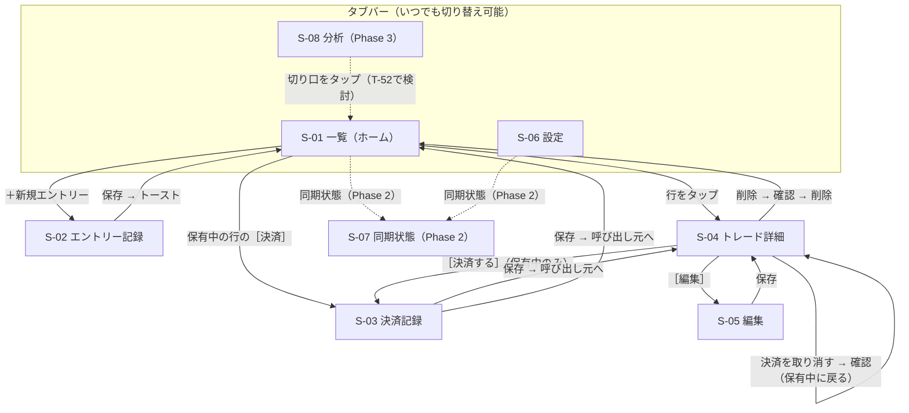

# FXトレード記録PWA 画面設計・デザインルール（design.md）

| 項目 | 内容 |
|---|---|
| 版 | v1.14（T-66：設定の「スプレッドシート同期」グループ〔14.6.8〕と「CSVを読み込む」〔14.6.9〕の画面設計を追記。想定タップ数〔14.6.10〕・判断してほしい点〔14.6.11〕・実装メモ〔14.6.12〕。3.2 S-06・9.2・14.6.1・14.7.1 に小さな追記）／v1.13（T-36 の決定〔2026-10-19・オーナー推奨どおり〕で、10.3「一覧に7件前後」と 11章「文字サイズ設定」の2点を例外として許容する注記を追記。画面の設計・値は変更なし）／v1.12（T-30〜T-33 の結果を 2026-10-18 オーナー決定〔推奨どおり〕で反映する pm のまとめ反映：8.1・9.7・9.8・9.10・9.12・9.16、14.1.5・14.1.6・14.1.8・14.1.9、14.2.5・14.2.7・14.2.9、14.3.1・14.3.3・14.3.4・14.3.6・14.3.7・14.3.8、14.7.1・14.7.5・14.7.10）。v1.11（T-25・T-27・T-29 の申し送りを 2026-10-17 オーナー決定で反映〔pm のまとめ反映〕：8.3・14.6.1・14.6.2・14.6.5・14.6.6・14.7.3・15.4） |
| 作成日 | 2026-10-15 |
| 作成 | designer |
| 前提 | `docs/requirements.md` v1.6、`docs/roadmap.md` v1.19、`docs/fx-rules.md` v1.10、`docs/analytics.md` v1.2、`docs/architecture.md` v1.8、オーナー追加要望（2026-10-15：「AIが作ったと分からないデザイン」、主な端末はiPhone） |
| 関連タスク | T-05（本書）、T-06/T-07（画面別ワイヤーフレーム）、T-11（共通CSS・共通部品の実装）、T-26（アイコン）、T-32（UXテスト）、T-52（分析画面ワイヤーフレーム） |

> **このドキュメントの位置づけ**
> 「どう見せるか・どう操作させるか」を決める文書です。何を作るか（機能・項目）は `docs/requirements.md`、計算式や価格の表示桁数は `docs/fx-rules.md`、絞り込み条件の中身は `docs/analytics.md` に従います。
> **12章のCSS変数** は、engineer が T-11 でそのまま貼り付けて使える形にしています。色やサイズは画面ごとに直接書かず、必ずこの変数を使ってください（見た目のブレを防ぐため）。
> **10章「AIっぽさを避けるためのルール」** はオーナーの必須要望です。ux-tester は 10.3 のチェックリストで確認してください。

---

## 1. この文書で使う言葉

| 用語 | 一言説明 |
|---|---|
| モバイルファースト | まずスマホ幅で最適な画面を作り、PCなど広い画面はその延長で対応する考え方 |
| iOS標準アプリ | iPhoneに最初から入っているアプリ（設定・ヘルスケア・株価・リマインダーなど）。本アプリの見た目の手本 |
| グループ化されたリスト | iPhoneの「設定」アプリのように、白い行を数行ずつ角丸のまとまりにして灰色の背景に並べる表示。本アプリの画面の基本形 |
| ヘアライン | 0.5pxほどの極細の区切り線。影の代わりに使い、画面をすっきり見せる |
| ナビゲーションバー | 画面上部のバー。画面名と「戻る」「キャンセル」「保存」などを置く |
| 大タイトル | iOSのタブ画面の左上に出る大きな太字の画面名（34px）。例：「設定」アプリの「設定」 |
| タブバー（下部ナビ） | 画面の一番下に固定された切り替えメニュー（一覧／分析／設定） |
| セグメント切替 | 2〜3個の選択肢が横につながったボタン。1つだけ選べる（例：買い｜売り） |
| チップ | 小さな角丸のボタン。タップで選択/解除できる（例：根拠・感情・タグ） |
| バッジ | 状態を示す小さなラベル（例：「本番」「保有中」） |
| トースト | 画面の下に数秒だけ出て自動で消える短い通知（例：「保存しました」） |
| アクションシート | iOSで削除などの確認時に画面の下から出る選択肢の一覧。親指が届く位置に「削除」「キャンセル」が並ぶ |
| ボトムシート | 画面の下からせり上がってくるパネル。絞り込み条件などを出す |
| セーフエリア | iPhoneの画面下のホームバー（横線）や上部のノッチ・ダイナミックアイランドを避けた、安全に表示・操作できる領域 |
| コントラスト比 | 文字色と背景色の明るさの差を数値にした「読みやすさの指標」。1:1〜21:1。WCAG AA基準では通常の文字は **4.5:1以上**、ボタンの枠線など文字以外は **3:1以上** が必要 |
| WCAG | Web Content Accessibility Guidelines。Webを誰でも使いやすくするための国際的なガイドライン |
| CSS変数 | `--color-buy` のように名前を付けて色やサイズを1か所で定義し、使い回せるCSSの仕組み。ダークモード切替も変数の値を差し替えるだけで済む |
| tabular-nums | 数字の幅を全部同じにするフォント設定。桁がそろって、一覧の金額が縦に並ぶ |
| inputmode | 入力欄をタップしたときに出すキーボードの種類を指定する属性。`decimal` で小数点付きの数字キーボードになる |
| visualViewport | ブラウザの「今実際に見えている範囲」の大きさを教えてくれる仕組み。iPhoneでキーボードが出ているかを判定するのに使う |
| ハッシュ（#） | URLの `#` 以降の部分。ページを再読み込みせずに画面を切り替えるのに使う（例：`index.html#/settings`） |

---

## 2. デザイン方針

### 2.1 最優先する体験

**「トレード直後の高ぶった気持ちでも、iPhoneを片手で持ったまま30秒で迷わず記録できる」** を最優先にします。振り返り（一覧・詳細・分析）はその次です。見た目は **「iPhoneに最初から入っている実用アプリ」** のように、飾らず、数字が読みやすい道具にします。

| # | 方針 | 具体的なルール |
|---|---|---|
| 1 | **iPhone最優先** | iOS Safari の「ホーム画面に追加」した状態（全画面表示）を基準に設計・確認する。Android Chrome・PCは「崩れない」水準で対応 |
| 2 | **モバイルファースト（幅375px基準）** | iPhone SE〜標準サイズ（幅375〜393px）で最適化。幅325pxでも崩れず横スクロールが出ないこと（**幅325px未満の画面は対応しない**：iOS 16.4 以上の iPhone はすべて幅375px以上のため。2026-10-16 オーナー決定）。PCでは中央に最大幅 **560px** の列として表示 |
| 3 | **iOS標準アプリに馴染む見た目** | システムフォント、グループ化されたリスト、ヘアラインの区切り線、iOSと同じ部品の形（ナビゲーションバー・タブバー・セグメント・アクションシート）。迷ったら「iPhoneの標準アプリならどうするか」で決める（10章） |
| 4 | **帳簿のような情報密度・数字が主役** | 1画面にできるだけ多くの記録が見える行の高さ。数値は等幅数字・右揃えで桁をそろえる。装飾で目立たせず、文字の大きさと太さで強弱を付ける |
| 5 | **片手操作（親指ゾーン）** | よく押すボタン（＋新規エントリー、保存、決済、タブバー）は **画面の下1/3** に置く。画面上部には「見るだけ」の情報と頻度の低い操作だけ |
| 6 | **30秒記録** | 必須6項目だけを最初に表示し、任意項目は折りたたむ。日時は自動入力、デモ/本番・通貨ペア・ロットは前回値。保存はいつでも押せる位置に置く（キーボード表示中も：8.4） |
| 7 | **ひと目で区別** | 買い/売り、利益/損失、デモ/本番、保有中/決済済みは **色＋文字（記号）** の2重で区別する。色だけに頼らない |
| 8 | **色数を絞る** | ニュートラル（白・灰・黒）＋意味のある色（買い・売り・利益・損失・デモ・本番）＋アクセント1色のみ（5章） |
| 9 | **ダークモード** | 夜間のトレードを想定し、ライト/ダーク両方を最初から設計。iOSと同じく、ダークは真っ黒の背景（有機ELのiPhoneで眩しくなく省電力）。設定で「端末に合わせる／ライト／ダーク」（初期値：端末に合わせる） |
| 10 | **誤操作を防ぐ** | 削除・決済の取り消し・入力の破棄は確認を出す。危険な操作はよく押すボタンから離す。保存中はボタンを無効にして二重保存を防ぐ |
| 11 | **データの安心感** | 「保存した」「保存できなかった」を必ず画面に出す。保存失敗は自動で消えない表示にする |
| 12 | **助言をしない・煽らない** | 「おすすめ」「買い時」など売買を促す文言、感嘆符だらけの励まし文は使わない。分析画面も事実の集計表示に限る |

### 2.2 画面の基本レイアウト（3種類）

全画面を次の3つの型のどれかで作ります。型ごとに「上・中・下」の役割を固定し、どの画面でも迷わないようにします。

```
【A. タブ画面】S-01 一覧 / S-08 分析 / S-06 設定
┌─────────────────────────┐ ← ステータスバー（時刻・電池）の下まで背景色で塗る
│ 一覧                   [絞込] │ ← 大タイトル（34px太字・左揃え）。スクロールで流れる
│                                 │
│ 12件            合計 ＋8,450円  │ ← サマリー（数字は右揃え）
│ 保有中                          │ ← セクション見出し（13px・灰色）
│ ┌───────────────────────┐ │
│ │ USD/JPY …行…           │ │ ← グループ化されたリスト（白い行・ヘアライン区切り）
│ └───────────────────────┘ │
│                  ┌─────────┐ │
│                  │＋新規エントリー│ │ ← 新規エントリーボタン（S-01のみ。9.10）
├─────────────────────────┤
│  一覧  │  分析  │  設定       │ ← タブバー 49px
└─────────────────────────┘ ← ホームバー分の余白（セーフエリア）

【B. 入力画面】S-02 エントリー / S-03 決済 / S-05 編集
┌─────────────────────────┐
│ キャンセル  新規エントリー  保存 │ ← ナビゲーションバー（iOSの入力画面と同じ配置）
├━━━━━━━━━━━━━━━━━━━━━━━━━┤ ← 口座色の線（3px。デモ＝琥珀／本番＝墨色）
│  グループ化されたフォーム       │
│  （ラベル左・入力値右揃え）     │
├─────────────────────────┤
│ [       本番で保存          ]   │ ← 下部固定の保存ボタン（キーボード表示中は隠す）
└─────────────────────────┘

【C. 詳細画面】S-04 トレード詳細 / S-07 同期状態
┌─────────────────────────┐
│ ‹ 一覧          詳細       編集 │ ← ナビゲーションバー
├─────────────────────────┤
│  グループ化されたリスト（表示） │
│  ┌────────────┐          │
│  │ この記録を削除（赤字）│        │ ← 危険な操作は最下部の独立したグループに
│  └────────────┘          │
├─────────────────────────┤
│ [          決済する          ]  │ ← 下部固定の操作バー（保有中のみ）
└─────────────────────────┘
```

- 入力画面（B）でタブバーを出さない理由：入力中にうっかりタブを押して入力内容を失う事故を防ぎ、画面を広く使うため（iOSでも入力画面はタブバーを隠すのが標準）。
- 詳細画面（C）でもタブバーは出さない（下部操作バーと重ならないようにするため）。
- **ホーム画面に追加した iPhone のアプリにはブラウザの「戻る」ボタンがない**ため、アプリ内の「‹ 戻る」「キャンセル」が唯一の戻る手段になる前提で、すべての画面に必ず置く。

---

## 3. 画面一覧

### 3.1 一覧表

| ID | 画面名 | 型 | 目的 | フェーズ |
|---|---|---|---|---|
| S-01 | 一覧（ホーム） | A | 起動直後の画面。記録を見る・新規記録へ進む・保有中を決済する | 1（同期表示は2、拡張絞り込みは3） |
| S-02 | エントリー記録 | B | 30秒以内で新規記録 | 1 |
| S-03 | 決済記録 | B | 保有中トレードを20秒以内で決済済みにする | 1 |
| S-04 | トレード詳細 | C | 1件の全情報を見返す。決済・編集・削除の入口 | 1 |
| S-05 | 編集 | B | 記録の修正（S-02/S-03 の入力部品を流用） | 1 |
| S-06 | 設定 | A | アプリの設定・データ管理 | 1（同期設定・CSVインポートは2） |
| S-07 | 同期状態 | C | スプレッドシート連携の状況確認と手動同期 | 2 |
| S-08 | 分析 | A | 勝率・損益推移・切り口別の振り返り | 3（Phase 1〜2 は「準備中」表示。13章 判断事項①） |

### 3.2 画面ごとの仕様

> 詳細なレイアウト（どの位置に何を置くか）は 14章（S-02/S-03：T-06、S-01/S-04/S-05/S-06：T-07、S-08：T-52）にあります。ここでは「何を表示し、何ができ、どこへ行けるか」を決めます。

#### S-01 一覧（ホーム）

| 観点 | 内容 |
|---|---|
| 目的 | 起動直後に「今の保有中」と「最近の記録」が分かり、ワンタップで新規記録・決済に進める |
| 表示項目 | ・大タイトル「一覧」、右に絞り込みボタン（条件が付いていれば件数を表示）<br>・サマリー行：絞り込み結果の**件数**と**合計損益（円／pips）**（+/− 記号と色、右揃え）。**デモと本番が混在するときは口座ごとに2行**にし、混ぜた合計は出さない。pips の合計には「通貨ペア・ロットの違いを考えない単純な合計」の注記を添える（`analytics.md` 4.7.2・4.7.3。見せ方は 14.3.6）<br>・適用中の絞り込み条件チップ（タップで個別解除、「すべて解除」。14.3.7）<br>・**「保有中」グループ**（上部にまとめる）：各行に デモ/本番バッジ・通貨ペア・売買方向・エントリー日時・ロット・エントリー価格・「決済」ボタン<br>・**決済済み**（新しい順）：各行に デモ/本番バッジ・通貨ペア・売買方向・決済日時・損益（円）・pips。決済日ごとに見出し（例「10月15日（木）」）を付け、帳簿のように見せる。日計はサマリーが1口座のときだけ（14.3.5）<br>・新規エントリーボタン（右下）<br>・（Phase 2）同期状態の表示（未送信件数）、未同期の行に小さな印<br>・お知らせ行：入力途中の記録、（T-29）ホーム画面未追加時の案内、新バージョンのお知らせ（14.3.8） |
| 主な操作 | 行をタップ → 詳細／保有中の行の「決済」→ 決済記録（**一覧から直接決済でき、決済は最短タップ数で済む**）／新規エントリーボタン → エントリー記録／絞り込み → 絞り込みシート（条件は T-04 の `analytics.md` に従う。キーワード検索もシート内）／下にスクロールで過去の記録 |
| 遷移先 | S-02、S-03、S-04、絞り込みシート（同じ画面に重なる）、S-07（Phase 2）、タブバーで S-08・S-06 |
| 空状態 | 記録0件：「記録はまだありません」＋説明1行（ボタンは右下の新規エントリーボタンを使う）／絞り込み結果0件：「条件に合う記録はありません」＋「条件を解除」（9.14、14.3.9） |
| フェーズ | 1（同期表示：2、拡張絞り込み・並び替え：3） |

#### S-02 エントリー記録

| 観点 | 内容 |
|---|---|
| 目的 | 必須項目だけなら **30秒以内** に保存できる |
| 表示項目 | ・**必須（最初から表示）**：デモ/本番（セグメント・前回値）、通貨ペア（よく使うペアのチップ＋「その他」・前回値）、売買方向（セグメント）、エントリー価格、ロット（前回値）、エントリー日時（「今」を自動入力・変更可）<br>・**任意（「詳細（任意）」の行をタップで展開）**：SL・TP（両方入力でRRを自動表示、方向と矛盾すれば警告）、エントリー根拠（チップ・複数）、時間足（チップ・1つ）、セッション（自動判定・変更可）、感情（チップ・1つ）、タグ（チップ・複数）、メモ、画像（最大4枚） |
| 主な操作 | 入力 → 下部固定の「デモで保存／本番で保存」またはナビゲーションバー右上の「保存」／「キャンセル」（入力があれば破棄確認） |
| 遷移先 | 保存成功 → S-01（トースト「保存しました」、新しい行を一瞬だけ薄く強調）／キャンセル → S-01 |
| フェーズ | 1 |

#### S-03 決済記録

| 観点 | 内容 |
|---|---|
| 目的 | 保有中のトレードを **20秒以内** で決済済みにする |
| 表示項目 | ・上部に対象トレードの要約（デモ/本番バッジ・通貨ペア・売買方向・エントリー価格・ロット・エントリー日時）<br>・**必須**：決済価格、決済日時（「今」を自動入力・変更可）<br>・**自動計算の結果**：pips・損益（円）を大きく表示（入力に合わせて即時更新、+/− と色）。損益（円）は「業者の確定値で上書き」可能（上書き時は「手入力」バッジ）。円以外が決済通貨のペアは円換算レート欄<br>・**任意（展開）**：決済理由（チップ・1つ）、決済時の感情（チップ・1つ）、タグ、メモ、画像 |
| 主な操作 | 入力 → 下部固定の「本番の決済を保存／デモの決済を保存」または右上「保存」／「キャンセル」（入力があれば破棄確認）（14.2） |
| 遷移先 | 保存成功 → **呼び出し元**（S-01から来たら S-01、S-04から来たら S-04）。トースト「決済を保存しました ＋1,234円」 |
| フェーズ | 1 |

#### S-04 トレード詳細

| 観点 | 内容 |
|---|---|
| 目的 | 1件の全情報（メモ・画像・感情含む）を見返す |
| 表示項目 | ・先頭：デモ/本番バッジ、通貨ペア（大きく）、売買方向、状態（保有中/決済済み）<br>・決済済みなら損益（円）・pips を大きく表示（手入力の場合は「手入力」バッジ）<br>・グループ「エントリー」：日時・価格・ロット（1lotの通貨数）・SL・TP・RR・セッション・時間足・根拠・感情（ラベル左・値右揃え）<br>・グループ「決済」：日時・価格・決済理由・決済時の感情・保有時間<br>・グループ「メモ・タグ・画像」：画像はサムネイル（タップで拡大）<br>・（Phase 2）同期状態<br>・作成日時・更新日時（最下部に小さく） |
| 主な操作 | ナビゲーションバー右上「編集」／下部固定の「決済する」（保有中）・「編集」（決済済み。14.4.5）<br>最下部の独立したグループ（よく押すボタンから離す）：「決済を取り消す」（決済済みのみ）、「この記録を削除」（赤字）。どちらもアクションシートで確認<br>画像タップ → 拡大表示（閉じる・左右スワイプ） |
| 遷移先 | S-03（決済）、S-05（編集）、削除確定 → S-01（トースト「削除しました」）、‹ 一覧 → S-01 |
| フェーズ | 1 |

#### S-05 編集

| 観点 | 内容 |
|---|---|
| 目的 | 記録の全項目を修正する |
| 表示項目 | S-02 と同じ入力部品＋（決済済みなら）S-03 の決済部品。任意項目も**最初から展開**（編集時は全体を見たいことが多いため）。価格・ロットを変えると pips・損益・RR をその場で再計算 |
| 主な操作 | 下部固定の「変更を保存」または右上「保存」／「キャンセル」（変更があれば破棄確認） |
| 遷移先 | 保存成功 → S-04（トースト「変更を保存しました」）／キャンセル → S-04 |
| フェーズ | 1 |

#### S-06 設定

iPhoneの「設定」アプリと同じ、グループ化されたリストで構成します。

| 観点 | 内容 |
|---|---|
| 目的 | 計算に必要な設定・選択肢の編集・バックアップ |
| 表示項目 | ①**取引**：1lotの通貨数（デモ）、1lotの通貨数（本番）<br>②**選択肢**：よく使う通貨ペア ›、エントリー根拠 ›、感情 ›、タグ ›（› は次の画面へ進む印）<br>③**テーマ**：端末に合わせる／ライト／ダーク（チェックの行）<br>④**データ**：CSVを書き出す、削除済みの記録も含める（オン/オフ）、記録の件数、最終書き出し日時、（Phase 2）CSVを読み込む<br>⑤（Phase 2）**スプレッドシート同期**：Apps Script URL、合言葉（伏せ字・表示切替）、接続テスト、同期状態 › → S-07<br>⑥**このアプリについて**：バージョン、データの保護、使用量、ホーム画面への追加方法 ›（14.6.1）<br>※ 画面での並びは ⑤ を ④ の上に置く（取引 → 選択肢 → テーマ → スプレッドシート同期 → データ → このアプリについて。14.6.8） |
| 主な操作 | 各項目の変更（その場で保存。トースト「設定を保存しました」は1lotの通貨数と、Phase 2 の Apps Script URL・合言葉のときだけ：14.6.8）、CSV書き出し（iPhoneでは共有シートを使う2段階）、選択肢の編集（追加・削除・並び替え）（14.6） |
| 遷移先 | 選択肢の編集画面 `#/settings/choices/{kind}`、ホーム画面への追加方法 `#/settings/install`（どちらも S-06 内の下位画面）、S-07（Phase 2）、タブバーで S-01・S-08 |
| フェーズ | 1（⑤とCSV読み込みは2） |

#### S-07 同期状態（Phase 2）

| 観点 | 内容 |
|---|---|
| 目的 | シートに控えが届いているか安心して確認する |
| 表示項目 | 状態（「すべて同期済み」／「未送信 3件」／「エラーあり」）、未送信件数、最終同期日時、直近のエラー内容（原因と対処を日本語で）、オンライン/オフライン |
| 主な操作 | 下部固定の「今すぐ同期」（実行中は読み込み表示）、エラー時「設定を確認」→ S-06 の同期項目 |
| 遷移先 | ‹ 戻る → 呼び出し元（S-06 または S-01） |
| フェーズ | 2。独立画面とし、S-06 と S-01 の両方から開ける形を推奨 |

#### S-08 分析（Phase 3）

| 観点 | 内容 |
|---|---|
| 目的 | 勝ちパターン・負けパターンに気づくための事実の集計を見る |
| 表示項目 | デモ/本番の切替（**混ぜた表示はしない**）、期間切替、サマリー指標（トレード数・勝率・合計損益など。iOSの「株価」「ヘルスケア」のように数字を大きく・ラベルを小さく）、累積損益グラフ、切り口別成績（表形式・右揃え）、件数不足は「データ不足」（指標の中身は T-49 の `analytics.md`） |
| 主な操作 | デモ/本番・期間の切替、切り口の切替、行タップでその条件の一覧へ（T-52で検討） |
| 遷移先 | S-01（条件付き）、タブバーで S-01・S-06 |
| Phase 1〜2 の表示 | 「分析は今後のアップデートで追加します。合計損益は一覧で確認できます。」＋「一覧を見る」ボタン |
| フェーズ | 3（詳細は T-52） |

---

## 4. 画面遷移

### 4.1 画面遷移図



Mermaid（文字で書く図の記法。GitHub上では図として表示される）が表示されない環境向けのテキスト版：

```
[タブバー] 一覧(S-01) ─ 分析(S-08) ─ 設定(S-06)

一覧(S-01)
 ├─ ＋新規エントリー ──→ エントリー記録(S-02) ──保存──→ 一覧(S-01)
 ├─ 保有中の行［決済］ ─→ 決済記録(S-03) ──保存──→ 一覧(S-01)
 ├─ 行をタップ ────────→ トレード詳細(S-04)
 │                          ├─［決済する］→ 決済記録(S-03) ──保存──→ 詳細(S-04)
 │                          ├─［編集］───→ 編集(S-05) ──保存──→ 詳細(S-04)
 │                          ├─［決済を取り消す］→ 確認 → 詳細(S-04)（保有中に戻る）
 │                          └─［この記録を削除］→ 確認 → 一覧(S-01)
 └─ 同期状態（Phase 2）──→ 同期状態(S-07)

設定(S-06)
 ├─ 選択肢の項目 › ──→ 選択肢の編集（S-06の下位画面）
 └─ 同期状態 ›（Phase 2）→ 同期状態(S-07)
```

### 4.2 画面のURL（ハッシュ）案

T-10 の「URLの `#` で画面を切り替える仕組み」で使う名前の案です。**`docs/architecture.md` 5.1 でこの案のまま確定**しました（S-01 は `#/`。設定の下位画面 `#/settings/choices/{kind}`・`#/settings/install` が追加されています）。

| 画面 | ハッシュ（案） | タブバー | 画面の出方 |
|---|---|---|---|
| S-01 一覧 | `#/`（`#/list` は使わない。一覧にない URL として `#/` に置き換わる：architecture 5.1） | 表示（「一覧」選択中） | — |
| S-02 エントリー記録 | `#/new` | 非表示 | 下からせり上がる（iOSの入力画面と同じ） |
| S-03 決済記録 | `#/trades/{id}/close` | 非表示 | 下からせり上がる |
| S-04 トレード詳細 | `#/trades/{id}` | 非表示 | 右から入る（iOSの「進む」と同じ） |
| S-05 編集 | `#/trades/{id}/edit` | 非表示 | 下からせり上がる |
| S-06 設定 | `#/settings` | 表示（「設定」選択中） | — |
| S-07 同期状態 | `#/settings/sync`（Phase 2 で追加。それまでは一覧へ戻る） | 非表示 | 右から入る |
| S-08 分析 | `#/analytics` | 表示（「分析」選択中） | — |

- 画面の出方の動き（アニメーション）は 0.25秒程度の控えめなものにし、なくても成立するようにする（「視差効果を減らす」設定の人には動きなし）。実装が重ければ Phase 1 では省略可。

### 4.3 戻る操作のルール

- 「‹ 戻る」「キャンセル」と、Androidの戻る操作は**同じ動き**にする（ブラウザの履歴を使う）。iPhoneのホーム画面版にはブラウザの戻るボタンがないため、アプリ内のボタンを必ず表示する。
- 入力画面（S-02/S-03/S-05）で**入力・変更がある状態**でキャンセルしたら、アクションシート「入力内容を破棄」（赤字）／「編集を続ける」を出す。入力がなければ確認なしで閉じる。
- 保存後は履歴に入力画面を残さない（保存後に戻る操作で入力画面に戻り、二重保存する事故を防ぐ。`history.replaceState` 等を使う）。
- タブを切り替えて戻ってきたとき、S-01 のスクロール位置と絞り込み条件は保持する。絞り込み条件は、アプリを閉じても **30分以内**に開き直せば復元し、それを過ぎたら初期値に戻す（`analytics.md` 4.8。スクロール位置は復元しない）。

---

## 5. 色ルール

### 5.1 配色の考え方

- **使う色は「ニュートラル（白・灰・黒）＋意味のある色＋アクセント1色」だけ**。意味のない色・グラデーション・飾りの色は使わない。
- 色の値は **iOSのシステムカラーをもとに、文字として読めるよう濃さを調整**したもの（iOSの標準の青や赤は白背景の文字だとコントラスト不足のため）。一般的なWeb用カラーパレットの既定値をそのまま使うことはしない（どこかで見た「量産型」の見た目になるため）。
- 赤は「売り・損失・危険（削除）」で共通、琥珀は「デモ・警告」で共通にして、色数を増やさない。区別は形と文字で行う（下表）。

| 区別したいもの | 色 | 色以外の区別（必須） | 理由 |
|---|---|---|---|
| **買い / 売り** | 買い＝**青**、売り＝**赤** | 文字「買い」「売り」＋記号 **▲**（買い）／**▼**（売り） | 多くの取引アプリと同じ慣習 |
| **利益 / 損失** | 利益＝**緑**、損失＝**赤**、±0＝灰 | 数字の頭に必ず **＋ / −**（ゼロは **±0**） | iOS「株価」アプリと同じ配色。「赤字＝損失」の慣習にも合う。緑と赤は色覚によって見分けにくいため記号を必須にする |
| **デモ / 本番** | デモ＝**琥珀**（淡い背景＋濃い文字）、本番＝**墨色の塗りつぶし**（ライトでは黒地に白文字、ダークでは白地に黒文字） | 文字「デモ」「本番」のバッジ。入力画面はナビゲーションバー下に**口座色の線（3px）**、保存ボタンに「デモで保存」「本番で保存」 | 売買・損益の青・赤・緑と被らない。本番は最も強い白黒反転で「本物のお金」であることを示す。新しい色相を増やさずに済む |
| **保有中 / 決済済み** | 保有中＝**アクセント色**の文字、決済済み＝**灰** | 文字「保有中」「決済済み」。保有中は一覧の上部に別グループでまとめる | 保有中は「まだ終わっていない・要対応」なのでアクセント色、決済済みは落ち着いた灰 |
| **アクセント**（主要ボタン・リンク・選択中・保有中） | **深い青緑**（1色のみ） | — | 買いの青・利益の緑のどちらとも見分けがつく色相。iOSの「ティール」を濃くしたもの |
| **警告**（SL/TPの向きが不自然など） | 琥珀（デモと同じ値） | ⚠ の線画アイコン＋説明文（バッジではなく文章で出すので、デモ表示とは形が違う） | 保存は止めないが気づいてほしい |
| **エラー・危険操作** | 赤（売り・損失と同じ値） | ⚠ アイコン＋説明文、ボタンの文言（「この記録を削除」） | iOSでも削除は赤字で表すのが標準 |

**売り・損失・削除が同じ赤になる点について**：売りは「バッジ（四角い札）＋▼」、損失は「数字＋ −」、削除は「独立したグループの赤い文字ボタン」と**形と置き場所**で区別します。例えば「売りで勝った」行は「赤い ▼売り」と「緑の ＋1,200円」が並びます。代案は 13章 判断事項② を参照。

### 5.2 色の値（ライト／ダーク）とコントラスト比

コントラスト比は WCAG の計算式で算出した実測値です。文字は **4.5:1以上**、文字以外の部品は **3:1以上** を満たしています。

#### 基本色

| 役割 | 変数名 | ライト | ダーク | 比（ライト / ダーク） |
|---|---|---|---|---|
| ページ背景（グループの外側） | `--color-bg` | `#F2F2F7` | `#000000` | — |
| 行・グループの背景 | `--color-surface` | `#FFFFFF` | `#1C1C1E` | — |
| 塗り（セグメントの溝・副ボタン） | `--color-fill` | `#E5E5EA` | `#2C2C2E` | — |
| 本文・数値 | `--color-text` | `#000000` | `#FFFFFF` | 行で 21.00 / 17.01、ページ背景で 18.82 / 21.00 |
| 補足文字（日時・ラベル・見出し） | `--color-text-sub` | `#636366` | `#98989F` | 行で 5.99 / 5.94、ページ背景で 5.37 / 7.33、塗りの上で 4.77 / 4.86 |
| 区切り線（ヘアライン） | `--color-separator` | `#C6C6C8` | `#38383A` | 装飾のため基準対象外 |
| チップ・入力欄の枠線 | `--color-border-strong` | `#8E8E93` | `#7C7C80` | 行の上で 3.26 / 4.09（3:1基準。行の背景の上でだけ使う） |
| アクセント | `--color-accent` | `#00667C` | `#40C8E0` | 行で 6.58 / 8.55、ページ背景で 5.90 / 10.56、塗りの上で 5.24 / 7.01 |
| アクセント上の文字 | `--color-on-accent` | `#FFFFFF` | `#000000` | 6.58 / 10.56 |
| アクセントの淡い背景 | `--color-accent-tint` | `#E3F3F6` | `#0C2F36` | アクセント文字で 5.77 / 7.15 |
| フォーカス枠 | `--color-focus` | `#00667C` | `#40C8E0` | アクセントと同じ値（色数を増やさない） |
| スイッチのつまみ | `--color-switch-knob` | `#FFFFFF` | `#FFFFFF` | オフの溝の上で 1.26 / 13.94、オンの溝（アクセント）の上で 6.58 / 1.99。ライト・ダークとも白（iOS標準と同じ）。オン/オフはつまみの**位置**と溝の色で区別し、溝とまわりの行の比はオン 6.58 / 8.55（3:1基準を満たす）。ダークのオンでつまみと溝の比が低いのは iOS標準（緑の溝に白のつまみ）と同じで、位置で読み取れるため可 |

#### 意味を持つ色

| 役割 | 変数名 | ライト | ダーク | 比（ライト / ダーク） |
|---|---|---|---|---|
| 買い（文字） | `--color-buy` | `#0057D9` | `#4DA2FF` | 行で 6.24 / 6.42、ページ背景で 5.59 / 7.93 |
| 買い（淡い背景） | `--color-buy-bg` | `#E8F0FC` | `#0F2440` | 買い文字で 5.44 / 5.89 |
| 買い（塗り）上の文字 | `--color-on-buy` | `#FFFFFF` | `#000000` | 6.24 / 7.93（塗りは `--color-buy`） |
| 売り（文字） | `--color-sell` | `#C00013` | `#FF6961` | 行で 6.46 / 6.03、ページ背景で 5.79 / 7.45 |
| 売り（淡い背景） | `--color-sell-bg` | `#FCE8EA` | `#3A1614` | 売り文字で 5.50 / 5.71 |
| 売り（塗り）上の文字 | `--color-on-sell` | `#FFFFFF` | `#000000` | 6.46 / 7.45 |
| 利益 | `--color-profit` | `#1A7230` | `#30D158` | 行で 6.01 / 8.42、ページ背景で 5.39 / 10.39 |
| 利益（淡い背景） | `--color-profit-bg` | `#E6F4EA` | `#0E2E17` | 利益文字で 5.29 / 7.31 |
| 損失 | `--color-loss` | `#C00013` | `#FF6961` | 売りと同じ値 |
| 損益ゼロ | `--color-even` | `#636366` | `#98989F` | 補足文字と同じ値 |
| デモ（文字） | `--color-demo` | `#8F5A00` | `#FFD60A` | デモ背景で 5.25 / 9.28、行で 5.78 / 12.05 |
| デモ（淡い背景） | `--color-demo-bg` | `#FFF3D6` | `#3A3000` | — |
| デモ（枠線・口座色の線） | `--color-demo-accent` | `#B07800` | `#B89600` | 行の上で 3.80 / 6.00（3:1基準） |
| 本番（塗り＝口座色の線） | `--color-real` | `#1C1C1E` | `#F2F2F7` | 行の上で 17.01 / 15.25 |
| 本番の塗りの上の文字 | `--color-on-real` | `#FFFFFF` | `#000000` | 17.01 / 18.82 |
| 保有中 | `--color-open` | `#00667C` | `#40C8E0` | アクセントと同じ値 |
| 決済済み（文字 / 背景） | `--color-closed` / `--color-closed-bg` | `#636366` / `#E5E5EA` | `#98989F` / `#2C2C2E` | 4.77 / 4.86 |
| 危険（削除・エラー） | `--color-danger` | `#C00013` | `#FF6961` | 売りと同じ値。行で 6.46 / 6.03 |
| 危険（淡い背景） | `--color-danger-bg` | `#FCE8EA` | `#3A1614` | 5.50 / 5.71 |
| 警告（文字 / 背景） | `--color-warning` / `--color-warning-bg` | `#8F5A00` / `#FFF3D6` | `#FFD60A` / `#3A3000` | デモと同じ値。5.25 / 9.28 |
| トースト（背景 / 文字） | `--color-toast-bg` / `--color-toast-text` | `#1C1C1E` / `#FFFFFF` | `#E5E5EA` / `#000000` | 17.01 / 16.73 |
| トースト内の操作ボタンの文字（「取り消す」） | `--color-toast-action` | `#40C8E0` | `#00667C` | トースト背景の上で 8.55 / 5.24（アクセントのライト/ダークの値を入れ替えて使う。新しい色相は増やさない） |

> **ルール**：色付きの文字（買い・売り・利益・損失）は、**行の背景（`--color-surface`）かページ背景の上**で使う。塗り（`--color-fill`）の上には置かない（一部の組み合わせで4.5:1を下回るため）。

> **ダークモードの考え方**：iOSと同じく背景は真っ黒、行は一段明るい灰。同じ色相のまま明るい色に置き換え、塗りつぶしボタンの上の文字は白ではなく黒にしてコントラストを確保しています。

### 5.3 色の組み合わせの例（一覧）

```
 保有中                                          ← セクション見出し（13px・灰）
┌────────────────────────────────┐
│ [デモ] EUR/USD ▲買い                    [決済] │ ← デモ＝琥珀、買い＝青の文字
│ 10/15(木) 22:05   0.5lot   1.07250           │ ← 補足文字色、数値は等幅
└────────────────────────────────┘
 10月15日（木）                       ＋3,200円   ← 日付見出し＋日計（サマリーが1口座のときだけ：14.3.5）
┌────────────────────────────────┐
│ [本番] USD/JPY ▼売り              ＋12,345円 │ ← 本番＝黒地に白、売り＝赤、利益＝緑・右揃え
│ 21:30   1.0lot                     ＋25.3 pips │
├─────────────────────────── ヘアライン ─┤
│ [本番] GBP/JPY ▲買い               −9,145円 │ ← 損失＝赤・「−」
│ 14:02   0.3lot                     −30.5 pips │
└────────────────────────────────┘
```

### 5.4 色の使用ルール

- 意味のある色を**飾りとして使わない**。見出し・アイコン・区切り線に色を付けない（見出しは灰、アイコンはアクセントか灰）。
- 行全体の背景を損益で塗りつぶさない。損益は**文字色のみ**。
- 1画面で同時に使う色は、ニュートラル＋その画面に必要な意味色＋アクセントまで。
- グラフ（Phase 3）も利益＝`--color-profit`、損失＝`--color-loss`、それ以外は灰とアクセント。グラデーションの塗りは使わない（T-52）。

---

## 6. タイポグラフィ（文字）

### 6.1 フォント

```
font-family: -apple-system, BlinkMacSystemFont, system-ui, "Hiragino Sans", "Hiragino Kaku Gothic ProN", "Noto Sans JP", "Yu Gothic UI", Meiryo, sans-serif;
```

- **iPhoneの標準書体（英数字＝SF Pro、日本語＝ヒラギノ角ゴ）をそのまま使う**。`-apple-system` を先頭にするとiPhoneでこの組み合わせになる。Androidでは Roboto＋Noto Sans JP。
- Webフォント（ネットから読み込む書体）は使わない。オフラインでも表示が変わらず、iOS標準アプリと同じ文字になるため。
- `<html lang="ja">` を必ず指定する（日本語用の字形で表示させるため）。
- **数値（価格・ロット・pips・損益・件数・日時）には必ず `font-variant-numeric: tabular-nums;`** を指定し、桁をそろえる（共通クラス `.num`）。一覧・詳細の数値は**右揃え**。

### 6.2 文字サイズの段階（iOSの標準の文字サイズに合わせる）

| 変数名 | サイズ | 太さ | 行の高さ | 主な用途（iOSでの名前） |
|---|---|---|---|---|
| `--fs-large-title` | 34px | 700 | 1.2 | タブ画面の大タイトル（Large Title） |
| `--fs-title` | 28px | 700 | 1.2 | 決済・詳細画面の損益（主役の数字）（Title 1） |
| `--fs-title2` | 22px | 700 | 1.25 | 一覧サマリーの合計損益、詳細の通貨ペア（Title 2） |
| `--fs-headline` | 17px | 600 | 1.3 | 行の主な文字（通貨ペア・損益）、ナビゲーションバーの画面名、ボタン（Headline） |
| `--fs-body` | 17px | 400 | 1.35 | 本文、**入力欄の文字**（Body） |
| `--fs-subhead` | 15px | 400 | 1.35 | 行の2行目（日時・ロット・pips）、チップ（Subheadline） |
| `--fs-footnote` | 13px | 400 | 1.35 | セクション見出し、グループ下の説明・エラー文（Footnote） |
| `--fs-caption` | 12px | 600 | 1.3 | バッジ（Caption 1）。**これより小さい文字は使わない**（タブバーのラベルのみ11px＝iOS標準と同じ） |

- **入力欄は16px未満にしない**（iPhoneのSafariは16px未満の入力欄をタップすると画面が勝手に拡大される）。本アプリは17px。
- 強弱は**サイズと太さ（400/600/700）**で付ける。色を変えて強調しない（補足は灰にするだけ）。
- セクション見出しは iOS と同じく13pxの灰色。英字の大文字や記号飾りは付けない。

### 6.3 数値の表示形式

| 種類 | 形式 | 例 |
|---|---|---|
| 損益（円） | 符号＋3桁区切り＋「円」 | `＋12,345円` / `−3,210円` / `±0円` |
| pips | 符号＋小数第1位＋「pips」 | `＋25.3 pips` / `−8.0 pips` / `±0.0 pips` |
| 価格 | 通貨ペアごとの桁数（`docs/fx-rules.md` の通貨ペアマスタに従う） | `151.234` / `1.07250` |
| ロット | 余計な0を付けない＋「lot」 | `0.5lot` / `1lot` |
| RR | 小数第2位 | `2.00` |
| 日時（一覧） | 月/日(曜) 時:分。日付見出しを使う場合は時:分のみ。今年以外は年も表示 | `10/15(木) 21:30` / `2025/12/30(火) 09:00` |
| 保有時間 | 単位付き | `2時間15分` / `3日4時間` |

- 画面表示のマイナス記号は、ハイフン（-）より見やすい **「−」（U+2212）** を使う。**入力値・CSV・保存データには使わない**（数値として扱えなくなるため）。
- 符号は数値と同じ色・同じ太さで表示する。

---

## 7. 余白・角丸・区切り線・サイズ

### 7.1 余白の段階（4pxの倍数）

| 変数名 | 値 | 主な用途 |
|---|---|---|
| `--sp-1` | 4px | アイコンと文字の間、バッジと文字の間 |
| `--sp-2` | 8px | チップ同士の間、行の中の2行の間 |
| `--sp-3` | 12px | 行の上下の内側余白 |
| `--sp-4` | 16px | **画面左右の余白・行の左右の内側余白**（iOS標準と同じ） |
| `--sp-5` | 24px | グループ同士の間（セクション見出し込み） |
| `--sp-6` | 32px | 大きな区切り |
| `--sp-7` | 48px | 空状態の上の余白 |

- 余白は「間延び」させない。行の高さは2行の行で **60px前後**（帳簿のように1画面で7〜8件見える密度）。

### 7.2 角丸

| 変数名 | 値 | 用途 |
|---|---|---|
| `--radius-sm` | 5px | バッジ |
| `--radius-md` | 10px | グループ化されたリストのまとまり、入力欄、セグメント（iOS標準と同じ） |
| `--radius-lg` | 12px | ボタン、アクションシートのまとまり |
| `--radius-sheet` | 14px | ボトムシートの上側の角 |
| `--radius-full` | 9999px | チップ、新規エントリーボタン |

- **1件ごとにカードを分けて角丸＋影を付けることはしない**。記録は「グループ化されたリストの行」として並べ、まとまり単位でだけ角丸にする。

### 7.3 区切り線と影

| 変数名 | 値 | 用途 |
|---|---|---|
| `--hairline` | 0.5px（非対応端末では1px） | 行と行の間、ナビゲーションバー・タブバーの境目。行の区切り線は左に16px空けて始める（iOS標準） |
| `--shadow-float` | 細く小さい影（12章） | 新規エントリーボタン、トーストのみ |
| `--shadow-sheet` | 上向きの細い影 | ボトムシート・アクションシートのみ |
| `--shadow-segment` | ごく細い影（ダークではなし） | セグメントの選択中、スイッチのつまみ（どちらも iOS 標準の部品と同じ表現のため例外として可） |

- **影は基本使わない**。ナビゲーションバー・タブバー・下部操作バーも影ではなくヘアラインで区切る。
- 半透明のすりガラス風（背景をぼかして透かす表現）は使わない。バーは不透明の背景色で塗る。

### 7.4 固定サイズ

| 変数名 | 値 | 内容 |
|---|---|---|
| `--tap-min` | 44px | タップ領域の最小値（縦横とも） |
| `--control-h` | 44px | 入力行・チップの最小の高さ。セグメントは**選択肢1つ**の高さ |
| `--segment-h` | 48px | セグメントの外側の高さ（溝2px＋選択肢44px＋溝2px。9.3） |
| `--button-h` | 50px | 主要ボタンの高さ（iOS標準の大きいボタン） |
| `--navbar-h` | 44px | ナビゲーションバーの高さ（＋上のセーフエリア） |
| `--tabbar-h` | 49px | タブバーの高さ（＋下のセーフエリア。iOS標準と同じ） |
| `--fab-h` | 50px | 新規エントリーボタンの高さ |
| `--action-bar-h` | 66px | 下部操作バー（ボタン50px＋上下8px）（＋下のセーフエリア） |
| `--account-line-h` | 3px | 入力画面の口座色の線 |
| `--content-max` | 560px | PCなど広い画面での最大幅 |

- S-01 のリストの最下部には、新規エントリーボタンとタブバーに最後の行が隠れないよう `--fab-h + --sp-4 * 2` 以上の余白を入れる。
- 入力画面の最下部にも、下部操作バーに最後の項目が隠れないよう `--action-bar-h + セーフエリア` の余白を入れる。

### 7.5 部品だけで使う寸法（2026-10-16 追加）

9章の本文で決まっていたが変数がなかった値です。T-11 で engineer が `css/components.css` の冒頭で仮の名前を付けていたものを、12章の正式な変数にしました（名前は engineer の案をそのまま採用）。**4pxの段階（7.1）に当てはまらない値は、この表の部品にだけ使い、他の場所に流用しない**。

| 変数名 | 値 | 内容 | iOS標準との比較 |
|---|---|---|---|
| `--segment-pad` | 2px | セグメントの溝の内側余白・スイッチのつまみの周り | iOSのセグメント・スイッチも2pt。同じ |
| `--badge-pad-x` | 6px | バッジの左右の内側余白 | 12px文字の小さなラベルとして標準的。妥当 |
| `--chip-pad-x` | 14px | チップの左右の内側余白 | iOSのカプセル型のボタンと同程度。15px文字に対して妥当（3列の格子の通貨ペアは 9.4 の注記） |
| `--fab-pad-x` | 18px | 新規エントリーボタンの左右の内側余白 | 50px高のカプセルに対し、高さの約1/3。妥当 |
| `--trade-row-pad-y` | 9px | 一覧のトレード行の上下の余白（2行で60px：9.12。T-33 で追加） | 12px（`--sp-3`）だと行が66〜67pxになり、375×812で約5.8件しか見えなかった（T-32 の U-06） |
| `--tabbar-gap` | 2px | タブバーのアイコンと文字の間 | iOSのタブバーとほぼ同じ |
| `--border-w` | 1px | チップ・デモのバッジとセグメントの枠線、エラーの外枠 | — |
| `--focus-w` | 2px | フォーカス枠の太さと外側の隙間（9.1） | — |
| `--alert-w` | 270px | アラートの幅（14.7.3） | iOSのアラートと同じ270pt |
| `--switch-w` / `--switch-h` / `--switch-knob` | 51px / 31px / 27px | スイッチの幅・高さ・つまみの直径（9.2） | iOSの標準スイッチと同じ |
| `--sheet-grip-w` / `--sheet-grip-h` | 36px / 5px | ボトムシートの上端のつまみ（9.8） | iOSのシートのつまみと同じ |
| `--sheet-max-h` | 90dvh | ボトムシート・アクションシートの高さの上限（9.8） | — |
| `--row-button-h` / `--row-button-min-w` | 32px / 64px | 一覧の保有中の行の「決済」ボタンの見た目の高さ・最小の幅（押せる範囲は44px。9.12） | iOSの小さいボタン（28〜34pt）の範囲内 |
| `--icon-xs` | 16px | エラー文・注意文の⚠、チップの✓ | 13〜15px文字の横に置く記号の大きさ |
| `--icon-sm` | 20px | 新規エントリーボタンの＋ | 17px文字の横のアイコン |
| `--icon-md` | 24px | 標準（ナビゲーションバー・お知らせ行など。9.17の24pxの枠） | iOSのナビゲーションバーのアイコン（22〜24pt）と同じ |
| `--icon-tab` | 25px | タブバーのアイコン | iOSのタブバーのアイコン（25pt）と同じ |
| `--icon-lg` | 40px | 空状態のアイコン | iOSの空状態より小さめ（「画面中央まで下げない・飾らない」9.14 の方針） |
| `--icon-stroke` / `--icon-stroke-bold` | 1.75 / 2 | 線の太さ（24pxの枠での値。SVG の単位なしの数）。太い方は新規エントリーボタンの＋だけ | — |
| `--opacity-pressed` | 0.7 | 押下中の不透明度（9.1） | 9.1 で決定済み（iOSのボタンと同じく「薄くなる」反応） |
| `--opacity-disabled` | 0.4 | 無効時の不透明度（9.1） | 9.1 で決定済み |
| `--dur-spin` | 900ms | 読み込み中の回転アイコンの1回転の時間（9.15） | iOSの読み込み表示（約1秒）とほぼ同じ |

- **変数にしない寸法（2026-10-16 判断）**：選択肢の編集画面（14.6.3）の赤い「削除」ボタンの幅 72px は、この1か所でしか使わない値なので12章の変数にせず、`css/screens.css` の `.choice-row` の中で `--choice-delete-w` と名前を付けて使う。12章に足すと `css/variables.css`（コード）との一致を保つために同時に直す必要があり、1か所だけの値のために全体の変数を増やすことになるため。別の画面でも使うことになったら12章へ移す。

---

## 8. 操作性のルール（iPhone優先）

### 8.1 タップ領域

- 押せるもの（ボタン・チップ・セグメント・行・アイコンボタン）は**すべて縦横44px以上**。見た目が小さいアイコン（22〜24px）でも押せる範囲は44×44px。
- 押せるもの同士の間は **8px以上** 空ける。
- 一覧の保有中の行の「決済」ボタンと、行全体（タップで詳細）は、押せる範囲を重ねない。
- 押したときは iOS と同じく**背景が灰色に変わる**反応（`:active` で `--color-fill`）を付ける。ブラウザ標準の青いハイライトは消す（`-webkit-tap-highlight-color: transparent`）。
- 押せるものに `touch-action: manipulation`（ダブルタップ拡大による反応の遅れを防ぐ）を指定。ボタンの長押しで出るiOSのメニューは `-webkit-touch-callout: none` で抑える。
- iOS Safari は振動（`navigator.vibrate`）に対応していないため、操作の手応えは**見た目の変化**で伝える。
- **モーダル（ボトムシート・アクションシート・アラート）を指で開いたときは、最初にフォーカスした要素（「キャンセル」など）や、閉じたあとにフォーカスを戻した要素（絞り込みボタンなど）に四角いフォーカス枠を出さない。Tab キーで操作しているときだけ出す**（押し間違えたように見えたため。2026-10-18・T-33 の U-09。`ui/dialog.js` の `focusQuietly`。Tab 操作中かは `<html class="kbd-nav">` で判定：`ui/keyboard.js`）。

### 8.2 親指が届く配置

```
  ┌───────────────┐
  │  届きにくい   │ ← 画面名、戻る、絞り込み、右上の「保存」（キーボード表示中の保存手段）
  │               │
  │  届く         │ ← 入力欄（スクロールで下に持ってこられる）
  │               │
  │  最も押しやすい│ ← 下部の保存ボタン、＋新規エントリー、決済、タブバー
  └───────────────┘
```

- **新規エントリーボタンは右下**（右手の親指の自然な位置）。タブバーの上 `--sp-4` の位置（13章 判断事項⑥）。
- **下部の保存ボタンは画面幅いっぱい**（左右16pxの余白のみ）で、左右どちらの手でも押せる。
- 危険な操作（削除・決済の取り消し）は下部操作バーに置かず、**詳細画面の最下部の独立したグループ**に置く。

### 8.3 セーフエリア（iPhoneの画面上下の余白）

- `<meta name="viewport" content="width=device-width, initial-scale=1, viewport-fit=cover">` を指定する（画面の端まで使い、余白を自分で制御するため）。**ユーザーの拡大操作は禁止しない**（`maximum-scale` や `user-scalable=no` は付けない）。
- ホーム画面版のステータスバー（時刻・電池の表示）は `<meta name="apple-mobile-web-app-status-bar-style" content="black-translucent">` で**アプリの背景色の上に重ねる**方式を推奨（ライト/ダークどちらでも背景と一体に見えるため）。その分、画面上端に `env(safe-area-inset-top)`（ノッチ・ダイナミックアイランドの高さ。端末が教えてくれる値）の余白を背景色で確保する。**`black-translucent` で決定**（2026-10-17 オーナー決定。T-27 で実装済み）。
- タブバー・下部操作バー・新規エントリーボタン・トーストの位置には `env(safe-area-inset-bottom)`（ホームバーの高さ。ホームボタンのあるiPhone SEでは0）を足す。
- 横向き時は左右にも `env(safe-area-inset-left/right)` を足す（Phase 1 は縦向き中心の確認でよい）。
- 画面の高さは `100vh` ではなく `100dvh` を使う（iOS Safari のアドレスバーの出し入れで高さがずれる問題を避けるため）。

### 8.4 iPhoneのキーボード表示時のレイアウト

iOS Safari ではキーボードが出ても画面の高さが縮まず、**画面下に固定した要素がキーボードの裏に隠れたり、位置がずれたりします**。そのため次のように設計します。

| ルール | 内容 |
|---|---|
| 保存手段を2つ用意 | 入力画面は、下部固定の大きな保存ボタンに加えて、**ナビゲーションバー右上にも「保存」**を置く（iOSの標準の入力画面と同じ配置）。キーボード表示中でも必ず保存できる |
| キーボード表示中は下部の保存ボタンを隠す | `visualViewport` の高さが画面の高さより大きく減ったとき（目安150px以上）をキーボード表示中と判断し、下部操作バーを非表示にする。キーボードを閉じたら再表示 |
| キーボードの上のバー | iOS Safari は入力欄の上に「∧ ∨ 完了」のバーを自動で出す。これと重なる独自のバーは作らない。「∧ ∨」で前後の入力欄に移動できるよう、入力欄の並び順＝画面の上からの順にする |
| 入力欄が隠れない | フォーカスした入力欄がキーボードやナビゲーションバーに隠れないよう、`scroll-margin-top` / `scroll-margin-bottom` を設定する |
| 次へ進むキー | `enterkeyhint="next"`（最後の欄は `"done"`）を指定 |
| 数字キーボード | `inputmode="decimal"` の数字キーボードには「完了」キーがないため、上記の「完了」バーかナビゲーションバーの「保存」で閉じる/保存する前提 |
| 背景のスクロール | ボトムシート・アクションシート表示中は、背後の画面がスクロールしないようにする |

### 8.5 入力のルール

| ルール | 内容 |
|---|---|
| 入力の見た目 | iOSの「設定」アプリと同じ**フォーム行**（ラベル左・入力値右揃え）を基本にする（9.2） |
| 数値欄 | `type="text" inputmode="decimal"`（小数点付きの数字キーボード）。`type="number"` は端末による挙動の違いがあるため使わない。全角数字・カンマは半角に直して受け付ける |
| ラベル | 入力欄の左に**常に表示**する（中の薄い文字＝プレースホルダーだけに頼らない） |
| 必須/任意 | 必須項目が最初のグループ、任意項目は「詳細（任意）」として下のグループにまとめる。必須の印は付けすぎない（最初のグループの見出しを「必須」とする） |
| 日時 | 「今」が入った状態で表示し、タップで iOS 標準の日時選択（`type="datetime-local"`）を開く。右に「今にする」文字ボタン |
| チェックのタイミング | 入力中は責めない。**欄から離れたとき**と**保存を押したとき**にチェックし、問題のある最初の欄までスクロールしてフォーカスする |
| エラー文 | 該当の行のラベルと値を `--color-danger` にし、グループの直下に13pxで具体的な直し方（例：「0より大きい数を入力してください」）。読み上げ用に `aria-describedby` で結びつける |
| 警告（保存は可能） | SL/TP の向きが不自然などは、グループの直下に ⚠＋文（琥珀）：「買いなのにSLがエントリー価格以上です。SLを建値以上に動かした場合はこのままで問題ありません。」（文言の一覧は 14.1.8・14.2.9） |
| 前回値 | 前回値で埋まった欄は通常の入力済みと同じ見た目（特別な色にしない） |

---

## 9. 共通部品の仕様

> 部品名の後ろの `.xxx` は、engineer 向けのCSSクラス名の案です。どの部品も **iOSの標準部品の形** に寄せ、独自の飾りは付けません。

**T-10 で実装済みのクラス名**（2026-10-15 の T-09 で確認。部品の中の要素は `部品名__要素名`、種類は `部品名--種類` の形で名前を付ける）

| 部品 | 実装のクラス名（`css/layout.css`・`css/components.css`） |
|---|---|
| 大タイトル（型A） | `.large-title`、`.large-title__text` |
| ナビゲーションバー | `.navbar`、`.navbar__left`、`.navbar__title`、`.navbar__right` |
| 画面の本文 | `.screen__body` |
| タブバー | `.tabbar`、`.tabbar__item`、`.tabbar__icon`、`.tabbar__label` |
| ボタン | `.btn--primary`／`.btn--secondary`／`.btn--text`、ナビゲーションバーの「保存」の太字は `.btn--text.btn--strong`、戻るの「‹」は `.btn__chevron`（T-11 で線画アイコンに置き換え） |
| グループ化されたリスト | `.list-group` の中に `.list-group__header`（見出し）・`.list-group__body`（角丸の白いまとまり）・`.list-group__footer`（下の説明文）。行は `.list-row`（`.list-row__label`・`.list-row__value`・`.list-row__chevron`） |
| 空状態 | `.empty`、`.empty__title`、`.empty__text` |
| その他 | `.visually-hidden`（読み上げ専用の文字）。画面の型は `<body data-layout="tab|form|detail">`（architecture 5.2） |

- 画面の骨組み（大タイトル・ナビゲーションバー・下部操作バー・文字ボタン）を作る JavaScript の部品は `js/ui/bars.js`（architecture 4.1）。

### 9.1 ボタン `.btn`

| 種類 | クラス案 | 見た目 | 用途 |
|---|---|---|---|
| 主要 | `.btn--primary` | `--color-accent` の塗り、文字 `--color-on-accent`、17px・600 | 1画面に**1つだけ**。保存、決済を保存、今すぐ同期 |
| 副 | `.btn--secondary` | `--color-fill` の塗り（枠線なし）、文字 `--color-accent`、17px・600 | 編集、条件を解除、一覧を見る |
| 危険 | `.btn--danger` | 行の形（グループ化されたリストの1行）で、文字だけ `--color-danger`。背景は `--color-surface` | 「この記録を削除」「決済を取り消す」（押すとアクションシートで確認） |
| 文字ボタン | `.btn--text` | 背景・枠なし、文字 `--color-accent`、17px（ナビゲーションバー内は「保存」のみ600） | 「キャンセル」「保存」（ナビゲーションバー）、「今にする」「すべて解除」 |
| アイコンボタン | `.btn--icon` | 22〜24pxの線画アイコン、色 `--color-accent`、押せる範囲44×44px | 絞り込み、閉じる |

共通：主要・副は高さ `--button-h`（50px）、角丸 `--radius-lg`（12px）、左右の内側余白 `--sp-4`。グラデーション・影・光る表現は付けない。

| 状態 | 見た目 |
|---|---|
| 押下中（`:active`） | 不透明度 `--opacity-pressed`（0.7。iOSの標準ボタンと同じく薄くなる） |
| フォーカス（キーボード操作時 `:focus-visible`） | `--color-focus` の `--focus-w`（2px）の枠＋同じ幅の外側の隙間 |
| 無効（`disabled`） | 不透明度 `--opacity-disabled`（0.4）、押せない（無効表示の文字はWCAGの基準対象外） |
| 処理中 | 文字を「保存中」にし、左に小さな回転アイコン。押せない状態にして二重保存を防ぐ |

### 9.2 入力欄（フォーム行） `.form-row`

iPhoneの「設定」アプリと同じく、グループ化されたリストの1行が1つの入力欄になります。

```
 必須                                      ← グループ見出し（13px・灰）
┌──────────────────────────────┐
│ エントリー価格              151.234 │  ← ラベル左（17px）、入力値右揃え（17px・等幅数字）
├─────────────────────── ヘアライン ─┤
│ ロット                      0.5 lot │  ← 単位は入力値の右に灰色で
├──────────────────────────────┤
│ 日時            10/15(木) 21:30  今にする │
└──────────────────────────────┘
 0より大きい数を入力してください           ← エラー時のみ（13px・赤）
```

| 項目 | 仕様 |
|---|---|
| 行 | 最小の高さ `--control-h`（44px）、背景 `--color-surface`、左右の内側余白 `--sp-4`。**行全体をタップすると入力欄にフォーカス**（`<label>` で囲む） |
| 入力欄 | 枠線なし・背景なし、右揃え、17px、`tabular-nums`、文字色 `--color-text`。未入力時の薄い文字（例「0.000」）は `--color-text-sub` |
| フォーカス時 | iOSと同じくカーソルのみ。加えて、キーボード操作時（`:focus-visible`）は行に `--color-focus` の2px枠 |
| エラー時 | ラベルと値を `--color-danger`、グループ直下にエラー文 |
| グループの下の文の順 | グループの直下に出る文は、**エラー文 → 注意（警告）→ 説明文**の順（エラーが一番上）。説明文（`.list-group__footer`）が2〜3行あっても、エラーが説明文の下に隠れて目に入らないことがないようにするため。`js/ui/fields.js` の `setGroupMessages()` が、エラー文・注意文を説明文より上（グループのすぐ下）に出す（2026-10-16 オーナー決定、T-15）。同じ文で複数の行に印を付けるとき（1lotの通貨数がデモ・本番とも誤りのとき）は、文を重ねず1つにまとめて両方の行に印を付ける |
| 数値欄 | `inputmode="decimal"`、`enterkeyhint="next"` |
| メモ欄 | 行の中の `<textarea>`（左揃え・最低3行、入力に合わせて伸びる）。上限2,000文字。残りが少なくなったら残り文字数を表示（**エントリー・編集は残り100文字以下〔1,900文字から〕、決済は残り200文字以下〔1,800文字から〕**。実装の部品の既定値は200。そろえるかは要判断：roadmap 7.14 ①） |
| 合言葉（Phase 2） | 伏せ字表示＋「表示」文字ボタン（押すと「隠す」に変わる。設定画面を開き直すと伏せ字に戻る。14.6.8） |
| スイッチ（オン/オフ） | 設定の「削除済みも含める」などは iOS と同じ形のスイッチ（`<input type="checkbox" role="switch">` の見た目を変える）。大きさは `--switch-w`×`--switch-h`（51×31px）、つまみは直径 `--switch-knob`（27px）で周りに `--segment-pad`（2px）。溝はオフ＝`--color-fill`、オン＝`--color-accent`。**つまみはライト・ダークとも白の `--color-switch-knob`**（iOS標準と同じ。ダークでも灰色にしない）、影は `--shadow-segment`（ライトのみごく細い影） |

### 9.3 セグメント切替 `.segment`

iOSのセグメントと同じ形（灰色の溝の中に、選ばれたものが浮き上がる）。ただし片手で押しやすいよう、**選択肢1つの高さを44px（`--control-h`）、溝を含めた外側の高さを48px（`--segment-h`）** とする（iOS標準の32ptより大きめ）。

> **2026-10-16 オーナー決定**：v1.7 までは「高さ44px」としていたが、溝の内側余白2pxを引くと選択肢が40pxになり、「押せるものは44px以上」（8.1）を満たさない。T-11 の実装で 8.1 を優先して選択肢を44px・外側を48pxにしたものを正式な仕様とした。

| 項目 | 仕様 |
|---|---|
| 溝 | 背景 `--color-fill`、角丸 `--radius-md`、内側余白 `--segment-pad`（2px）、選択肢どうしの間も `--segment-pad`。外側の高さ `--segment-h`（48px） |
| 選択肢 | 幅は均等割り、高さ `--control-h`（44px）＝押せる範囲、角丸は `--radius-md` − `--segment-pad`（8px）、17px。HTMLは `<input type="radio">` を見た目だけ変える方式か `role="radiogroup"`＋`role="radio"` |
| 汎用（テーマなど）の選択中 | 背景 `--color-segment-selected`（ライト白／ダーク灰）、文字 `--color-text`・600、`--shadow-segment`（ごく細い影。iOSと同じ） |
| **買い / 売り** | 未選択は「▲ 買い」「▼ 売り」を `--color-text-sub` で。選択中は 買い＝`--color-buy` の塗り＋`--color-on-buy`、売り＝`--color-sell` の塗り＋`--color-on-sell`、600 |
| **デモ / 本番** | 選択中は デモ＝`--color-demo-bg` の塗り＋`--color-demo` の文字＋`--border-w`（1px）の枠 `--color-demo-accent`、本番＝`--color-real` の塗り＋`--color-on-real` の文字、600 |

- 選択中は色だけでなく**太さ（600）と浮き上がり**でも区別する。
- 売買方向は前回値を引き継がず、毎回未選択から選ぶ（14.1.5。14.2.12 確定事項①）。

### 9.4 チップ選択 `.chip`

根拠・感情・タグ・時間足・決済理由・よく使う通貨ペアの選択に使う。

| 項目 | 仕様 |
|---|---|
| サイズ | 高さ **44px**（`--control-h`）、左右の内側余白 `--chip-pad-x`（14px）、枠 `--border-w`（1px）、角丸 `--radius-full`、15px。✓は `--icon-xs`（16px） |
| 並べ方 | 行の中で横に並べて折り返し、間隔 `--sp-2`。通貨ペアはエントリー画面では3列×2段の格子で位置を固定し、横スクロールは使わない（14.1.2） |
| 未選択 | 背景 `--color-surface`、枠 1px `--color-border-strong`、文字 `--color-text` |
| 選択中 | 背景 `--color-accent`、文字 `--color-on-accent`、先頭に線画の **✓**（色以外の区別） |
| 1つだけ選ぶ（感情・時間足・決済理由・通貨ペア） | 選択中をもう一度タップすると解除（任意項目を未選択に戻せる）。通貨ペアは必須なので解除不可 |
| 複数選ぶ（根拠・タグ） | `aria-pressed` 付きのボタン。上限なし |
| 追加 | 末尾に「＋追加」チップ（枠線のみ）。タップで入力欄が開く。入力画面で「＋追加」を置くのはタグだけで、追加したタグは設定の選択肢にも加える（14.1.5） |

- **通貨ペアの3列の格子（14.1.2）の注意**：格子のチップは幅が固定（375px幅で約98px、320px幅で約80px）で、選択中は先頭に✓（16px＋間4px）が付く。左右に `--chip-pad-x`（14px）を取ると、選択中の「USD/JPY」が幅に収まらないおそれがある。格子のチップに限り、文字と✓を中央に置き、左右の内側余白は `--sp-1`（4px）まで縮めてよい（v1.8 の designer 案。T-15 で iPhone 実機または 375px・320px 幅で確認する）。

### 9.5 バッジ `.badge`

小さなラベル。高さ `--badge-h`（20px）、左右の内側余白 `--badge-pad-x`（6px）、角丸 `--radius-sm`、12px・600。**押せない**（押せるものと見間違えないよう、影や立体感は付けない）。

| 種類 | 文字 | 見た目 |
|---|---|---|
| デモ | 「デモ」 | 背景 `--color-demo-bg`、文字 `--color-demo`、枠 1px `--color-demo-accent` |
| 本番 | 「本番」 | 背景 `--color-real`、文字 `--color-on-real` |
| 買い | 「▲買い」 | 背景なし、文字 `--color-buy`（一覧では文字だけで十分なため塗らない） |
| 売り | 「▼売り」 | 背景なし、文字 `--color-sell` |
| 保有中 | 「保有中」 | 背景 `--color-accent-tint`、文字 `--color-open` |
| 決済済み | 「決済済み」 | 背景 `--color-closed-bg`、文字 `--color-closed`（一覧では省略し、詳細でのみ表示） |
| 手入力（損益を業者の確定値で上書き） | 「手入力」 | 背景 `--color-fill`、文字 `--color-text-sub` |
| 未同期（Phase 2） | 「未同期」 | 背景 `--color-warning-bg`、文字 `--color-warning` |

一覧の行での並び順は **［デモ/本番］ 通貨ペア ▲買い/▼売り** で統一する。

### 9.6 トースト通知 `.toast`

| 項目 | 仕様 |
|---|---|
| 位置 | 画面下部。タブバー／下部操作バーの**すぐ上**（`bottom: バーの高さ + --sp-3 + セーフエリア`）、左右 `--sp-4`。**S-01 では新規エントリーボタンと重ならないよう、その上**に出す（14.7.5） |
| 見た目 | 背景 `--color-toast-bg`、文字 `--color-toast-text`、15px、角丸 `--radius-md`、`--shadow-float`、高さ最低44px。先頭に線画アイコン（✓ 成功）。左揃え |
| 文言 | **短く具体的に・感嘆符なし**。「保存しました」「決済を保存しました ＋1,234円」「変更を保存しました」「削除しました［取り消す］」（取り消しは 13章 判断事項⑤・14.7.5）「削除を取り消しました」「決済を取り消しました」「画像を削除しました」「設定を保存しました」「CSVを書き出しました」 |
| 操作ボタン | 右端に文字ボタン（15px・600・`--color-toast-action`、押せる範囲44px）。現在は「取り消す」のみ |
| 表示時間 | 成功：**3秒**で自動で消える。操作ボタン付き：**6秒**。タップで即閉じる |
| 同時表示 | 1つだけ。新しいものが来たら入れ替える |
| 読み上げ | `role="status"`（`aria-live="polite"`） |
| 使わない場面 | **保存失敗などのエラーには使わない**（自動で消えて見逃すため）。9.15 のエラー表示を使う |

### 9.7 確認（アクションシート） `.action-sheet`

削除などの確認は、iOS標準のアクションシート（画面の下から出る選択肢）にします。親指が届く位置に選択肢が出るため、片手でも確実に操作できます。

```
 （背後の画面は半透明の黒で覆う）
┌──────────────────────────────┐
│        この記録を削除しますか？       │ ← 説明（13px・灰・中央）
│   USD/JPY 売り 10/15 21:30 の記録     │
├──────────────────────────────┤
│              削除                    │ ← 危険な操作は赤字（17px）
└──────────────────────────────┘
┌──────────────────────────────┐
│            キャンセル                 │ ← 独立したまとまり（17px・600）
└──────────────────────────────┘
       （ホームバー分の余白）
```

| 項目 | 仕様 |
|---|---|
| 構成 | 上のまとまり（説明＋操作の選択肢）と、下の独立した「キャンセル」。まとまりの角丸 `--radius-lg`、左右・下の余白 8px＋セーフエリア |
| 文言 | 操作は具体的な動詞（「削除」「決済を取り消す」「入力内容を破棄」）。「OK」「はい」は使わない |
| 閉じ方 | キャンセル、背景タップ、Escキー、Androidの戻る。いずれも「何もしない」 |
| 読み上げ・フォーカス | `role="alertdialog"`、開いたら説明を読み上げ、初期フォーカスは「キャンセル」。**指で開いたときはフォーカス枠を出さない**（Tab キーで操作しているときだけ出す：8.1） |
| 実装 | HTML標準の `<dialog>` 要素と `showModal()` を推奨（背後の操作を自動で止めてくれる） |
| 文言例 | 削除：「この記録を削除しますか？」＋対象の要約／［削除］［キャンセル］<br>決済の取り消し：「決済を取り消すと、決済価格と損益が消えて保有中に戻ります。」／［決済を取り消す］［キャンセル］<br>入力の破棄：［入力内容を破棄］［編集を続ける］ |

### 9.8 ボトムシート `.sheet`

絞り込み条件、通貨ペアの「その他」選択などに使う。背景 `--color-bg`、上側の角丸 `--radius-sheet`、上端に「つまみ」（幅 `--sheet-grip-w`（36px）・高さ `--sheet-grip-h`（5px）の灰色の棒。色は `--color-separator`、角丸 `--radius-full`）、中身はグループ化されたリスト。高さは内容に合わせて最大 `--sheet-max-h`（画面の90%）。絞り込みシートは、上部に「キャンセル」「すべて解除」の文字ボタン、**下部に主要ボタン「12件を表示」を固定**する（件数は条件を変えるたびに更新。14.3.10 で決定）。選ぶだけで閉じるシート（通貨ペアの「その他」）は上部の「キャンセル」のみ。**最初のフォーカス**は、通貨ペアの「その他」だけ検索欄（開く目的がほぼ検索で、タップが1つ減る。タップの流れの中で開くので iPhone でもキーボードが出る：14.1.6）、それ以外のシートは「キャンセル」（検索欄だとキーボードで一覧が隠れるため）。指で開いたときはどちらもフォーカス枠を出さない（8.1）。2026-10-18・T-33 の U-09。

### 9.9 タブバー（下部ナビ） `.tabbar`

| 項目 | 仕様 |
|---|---|
| 位置・高さ | 画面下に固定。高さ `--tabbar-h`（49px）＋`env(safe-area-inset-bottom)` |
| 項目 | 3つを均等割り：**一覧**（線画のリストアイコン）／**分析**（線画のグラフアイコン）／**設定**（線画の歯車アイコン） |
| 1項目の中身 | アイコン `--icon-tab`（25px）＋文字ラベル（11px・500）を縦に並べ、間は `--tabbar-gap`（2px）。**ラベルは省略しない** |
| 選択中 | アイコンと文字が `--color-accent`。`aria-current="page"`。下線や丸い背景などの飾りは付けない（iOSと同じく色だけ＋ラベル） |
| 未選択 | `--color-text-sub` |
| 背景 | 不透明の `--color-surface`（ライト）／`#121214` 相当の `--color-bar`（ダーク）。上端にヘアライン `--color-separator`。**すりガラス風の透過はしない** |
| 表示する画面 | S-01・S-06・S-08 のみ |
| 実装 | `<nav aria-label="メインメニュー">` |

### 9.10 ＋新規エントリーボタン `.fab`

画面の上に浮いて常に見えているボタン（FAB）です。iOSらしさを損なわないよう、**大きなぼかし影や光る表現は使わず**、平らな塗りに最小限の影だけを付けます。

| 項目 | 仕様 |
|---|---|
| 位置 | S-01 のみ。右下、タブバーの上 `--sp-4`、右端から `--sp-4`（＋セーフエリア） |
| 形・大きさ | 横長のカプセル：高さ `--fab-h`（50px）、左右の内側余白 `--fab-pad-x`（18px）、角丸 `--radius-full` |
| 中身 | 線画の「＋」アイコン（`--icon-sm`＝20px・線 `--icon-stroke-bold`＝2）＋「新規エントリー」（17px・600） |
| 色 | `--color-accent` の塗り、文字 `--color-on-accent`、影は `--shadow-float`（細く小さい影のみ） |
| スクロール時 | 常に表示（いつでも1タップで記録を始められることを優先） |
| 行との重なり（T-32 の U-13・2026-10-18 の扱い） | **一番下までスクロールしきれば、保有中の行の［決済］とは重ならない。スクロールの途中では、［決済］や損益が浮いたボタンの裏に入る重なりが残る**（コードは変更しない）。直すなら、スクロール中は「＋」だけの丸に小さくする、重なる行の右端を空ける、などボタンの形の見直し（＝デザインの判断）になるため、Phase 2 以降に回した（roadmap 7.18）。行を60pxに詰めた（9.12）ので、64件のデータでは保有中5件の［決済］はボタンにかからなくなった（ただし6行目の決済済みの損益額がボタンの裏に入る。T-33 の再確認） |
| 読み上げ | ボタン内の文字で足りるため `aria-label` は不要 |

### 9.11 ナビゲーションバー `.navbar` と下部操作バー `.action-bar`

**ナビゲーションバー**：高さ `--navbar-h`（44px）＋上のセーフエリア、不透明の背景（タブ画面と同じ `--color-bg`）、下端にヘアライン。左に「‹ 戻る先の画面名」または「キャンセル」、中央に画面名（17px・600）、右に「保存」「編集」（文字ボタン）。入力画面はナビゲーションバーの直下に**口座色の線**（3px。デモ＝`--color-demo-accent`、本番＝`--color-real`）。

**下部操作バー**：入力画面・詳細画面の下に固定。高さ `--action-bar-h`＋セーフエリア、背景 `--color-bg`、上端にヘアライン。中身は幅いっぱいの主要ボタン1つ（「本番で保存」「本番の決済を保存」「決済する」など）。**キーボード表示中は非表示**（8.4）。

### 9.12 トレード行 `.trade-row`（一覧の1件）

> 行の中の並び・2行目の内容・折り返しの確定版は 14.3.4。

| 項目 | 仕様 |
|---|---|
| 構成 | 1行目：［デモ/本番］通貨ペア（17px・600）▲買い/▼売り（15px）…右端に損益（円）（17px・600・利益/損失の色）<br>2行目：日時・ロット（15px・`--color-text-sub`）…右端に pips（15px・損益と同じ色） |
| 保有中の行 | 「保有中」グループにまとめる。2行目にエントリー価格。右端に「決済」ボタン（副ボタン型・見た目の高さ `--row-button-h`（32px）／押せる範囲44px・幅 `--row-button-min-w`（64px）以上）。損益は未確定なので表示しない |
| 高さ | **2行で60px**（上下余白 `--trade-row-pad-y`＝9px、2行目は行の高さを詰める。決済日の見出しがつく先頭の行は61px。T-33 で 66〜67px から詰めた：T-32 の U-06。押せる範囲は44px以上のまま）。行全体がタップ可能（→詳細）。右端に › は付けない（数値を右端に揃えるため） |
| 区切り | 行の間はヘアライン（左16px空ける）。行ごとのカード・影は使わない |
| 数値 | すべて `tabular-nums`・右揃え |

### 9.13 グループ化されたリスト `.list-group`

全画面の基本の入れ物。セクション見出し（13px・`--color-text-sub`・左16px）→ 角丸 `--radius-md` のまとまり（背景 `--color-surface`、左右の外側余白 `--sp-4`）→ 必要ならまとまりの下に説明文（13px・灰）。行と行の間はヘアライン（左16px空ける）。次へ進む行は右端に灰色の「›」。実装のクラス名は 9章冒頭の表（`.list-group__header`／`__body`／`__footer`、行は `.list-row`）。

**値と「›」が両方ある行の配置**（2026-10-16 T-16 の修正）：右端に値（登録数・選んでいるペアなど）と「›」が並ぶ行では、値を「›」のすぐ左に寄せる（`css/components.css` の `.list-row--link .list-row__value + .list-row__chevron { margin-left: 0 }`）。値と「›」の両方に左の余白を自動（`margin-left: auto`）にすると、空きを半分ずつ分け合って値が行の真ん中に浮くため。設定画面の「よく使う通貨ペア ＋登録数 ›」、エントリー・編集画面の「その他の通貨ペア ＋選んだペア ›」で使う。

**チェックの行（1つだけ選ぶ行）**：iOSの「設定」アプリと同じ形で、設定のテーマ（端末に合わせる／ライト／ダーク）などに使う（14.6.1）。部品は `js/ui/fields.js` の `checkRows()`（2026-10-16 オーナー決定、T-15）。選ばれた行の右端に✓（色だけに頼らず「選択中」を示す印）、行のどこを押しても選べる（行全体が `<label>`、中身はラジオボタン）。`.list-group` の行として並べ、グループの見出しがまとまりの名前として読み上げられる。タップした瞬間に切り替わり、トーストは出さない。

### 9.14 空状態（記録がないとき） `.empty`

| 項目 | 仕様 |
|---|---|
| 方針 | iOS標準と同じく、**小さな線画アイコン＋短い見出し＋説明1行＋ボタン1つ**だけ。装飾のイラスト、絵文字、「さあ始めましょう！」のような呼びかけは使わない |
| 構成 | 線画アイコン（`--icon-lg`＝40px・`--color-text-sub`）→ 見出し（22px・700）→ 説明（15px・灰）→ ボタン（副ボタン、または文字ボタン）。上の余白は `--sp-7` 程度にとどめ、画面中央まで下げすぎない |
| 一覧・記録0件 | 「記録はまだありません」／「エントリーしたら「新規エントリー」から記録します。」（右下の新規エントリーボタンがあるため、ここのボタンは省略してもよい） |
| 一覧・絞り込み0件 | 「条件に合う記録はありません」／［条件を解除］ |
| 保有中0件 | 「保有中」グループ自体を出さない |
| 分析（Phase 1〜2） | 3.2 S-08 の文言 |
| 分析・件数不足（Phase 3） | 該当の数値の代わりに「データ不足（5件未満）」を灰色で（T-52） |

### 9.15 読み込み中・エラー表示

**読み込み中** `.loading`

| 場面 | 表示 |
|---|---|
| 一覧の読み込み（0.3秒以上かかる場合のみ） | iOS標準のくるくる回る表示（線画の小さな回転アイコン）をリストの上部に。0.3秒未満なら何も出さない（ちらつき防止）。光が流れるような装飾的な読み込み表示は使わない |
| 保存・同期などのボタン操作 | ボタン内に回転アイコン＋「保存中」。押せない |
| 画像の縮小処理 | サムネイル枠の中に回転アイコン |
| 動き | 1回転 `--dur-spin`（900ms）で一定の速さで回す。「視差効果を減らす」設定（`prefers-reduced-motion`）がオンなら回転を止め、「読み込み中」の文字にする |

**エラー表示**（3段階）

| 段階 | 部品 | 例 | 自動で消えるか |
|---|---|---|---|
| ① 入力の問題 | 行の赤字＋グループ直下のエラー文（9.2） | 「価格を入力してください」 | 直したら消える |
| ② 注意（保存は可能） | グループ直下の ⚠＋文（琥珀） | 「買いなのにSLがエントリー価格以上です。SLを建値以上に動かした場合はこのままで問題ありません。」 | 条件が解消したら消える |
| ③ 失敗（保存できなかった等） | **アラート**（iOS標準の画面中央の小さな確認窓。`<dialog>`・`role="alertdialog"`） | タイトル「保存できませんでした」／本文「端末の空き容量が不足している可能性があります。入力内容はこの画面に残っています。」／［閉じる］［もう一度保存］ | **消えない**（閉じるまで） |
| 画面全体の問題 | 画面上部のお知らせ行（9.16） | 「データを読み込めませんでした」［再読み込み］ | 消えない |

- 保存に失敗したときは**入力内容を消さずに画面に残す**。
- エラー文は「何が起きたか」＋「どうすればよいか」を短い日本語で。英語のエラーコードだけを出さない。

### 9.16 お知らせ行 `.notice`

画面上部（大タイトルの下）に出す、グループ化されたリストの1行の形をしたお知らせ。左に線画アイコン、本文15px、右に文字ボタンと閉じるボタン（44px）。色は付けず（エラーのみアイコンを赤）、目立たせすぎない。用途：

- 「入力途中のエントリーがあります」［続ける］（下書きが残っているとき。14.3.8）
- 「新しいバージョンがあります」［更新］（F-10）
- 「ホーム画面に追加すると、記録が消えにくくなります」［方法］（ホーム画面に追加せずSafariで開いたとき。T-29。文は T-33 で「データが…」から短くした：2行に収まり、「す」だけが3行目に落ちない）
- （Phase 2）「オフラインです。接続後に自動で送信します」
- （Phase 4）「最後のバックアップから30日経ちました」［書き出す］
- 入力画面：「入力途中の内容を復元しました」［破棄］（14.1.10）、「下書きを保存できません」（14.7.6）

同時に出すのは最大2行。優先順位は 14.3.8。

**置き場所の決まり（2026-10-15 T-09 で確定）**

| お知らせ | 置き場所 | 理由 |
|---|---|---|
| 画面ごとのお知らせ（S-01 の下書き・新しいバージョン・ホーム画面への追加・読み込みエラー、入力画面の復元・下書きを保存できない） | **各画面の中**（S-01 は大タイトルの下、入力画面は口座色の線の下） | 大タイトル・ナビゲーションバーの位置を画面ごとに変えないため（14.3.2・14.1.10） |
| どの画面でも起こりうるアプリ全体の問題（予期しない問題・DB が開けない `DB_OPEN`・古いアプリ `VERSION`） | **画面の一番上の共通の置き場**（`index.html` の `#notice-area`。architecture 4.5） | 画面の中身を描けない状態でも必ず見えるようにするため |

- 部品（見た目・ボタン・×）は同じ `ui/notice.js` を使う（T-11）。

### 9.17 アイコン

- 外部のアイコン集は使わない（外部ライブラリは Chart.js のみの方針のため）。**SVGを直接HTMLに書く**。
- 描き方を統一：24×24pxの枠、**線の太さ1.75px**（`--icon-stroke`）、線の端と角は丸め（`stroke-linecap: round; stroke-linejoin: round`）、塗りなし、色は `currentColor`（文字色に追従）。iOS標準アイコン（SF Symbols）の雰囲気に合わせ、細部を描き込みすぎない。
- 必要なアイコン：一覧、グラフ、歯車、＋、‹（戻る）、×（閉じる）、›（次へ）、写真、⚠、✓、絞り込み、検索、回転（読み込み）、同期（Phase 2）。T-07 で追加：鉛筆（入力途中の下書き）、帳面（空状態）、⊖（選択肢の削除）、≡（並べ替えのつまみ）、共有（iOSの共有ボタンと同じ形。ホーム画面への追加方法の説明用）、縦の三点（Androidのメニューの説明用）。
- **絵文字・キラキラ・立体的なアイコン・色付きの丸背景アイコンは使わない**（▲▼✓±−の記号は文字として可）。

---

## 10. AIっぽさを避けるためのルール（オーナーの必須要望）

**目標**：「AIが自動で作った画面」に見える定番の見た目を避け、**人が意図を持って作り込んだ、iPhoneに馴染む実用の道具**に見せる。迷ったら「iPhoneに最初から入っているアプリならどうするか」で決める。

### 10.1 やらないこと

| # | やらないこと | 理由・代わりにやること |
|---|---|---|
| 1 | 紫〜青・ピンクなどの**グラデーション**（背景・ボタン・ヘッダー・グラフの塗り） | 単色の塗りだけを使う |
| 2 | **グラデーション文字**、光る文字、文字の影 | 文字は単色。強調はサイズと太さで |
| 3 | **すりガラス風の半透明**（背景をぼかして透かす） | バーやシートは不透明の背景色で塗る |
| 4 | **絵文字**、✨🚀などのキラキラ、立体的・色付き丸背景のアイコン | 線の太さを揃えた線画SVG（9.17） |
| 5 | **何でも角丸カード＋大きなぼかし影**（1件ごとのカード、浮いたパネル） | グループ化されたリストの行＋ヘアライン。影は新規エントリーボタンとシートだけ |
| 6 | 意味のない**装飾イラスト**、背景の模様・図形 | 空状態も小さな線画アイコン1つまで |
| 7 | **中央寄せばかり**の間延びしたレイアウト、大きすぎる余白 | 左揃えが基本、数値は右揃え。中央寄せはナビゲーションバーの画面名・アクションシート・アラート・空状態だけ |
| 8 | 「🚀 さあ始めましょう！」「素晴らしい！」のような**定型の励まし文**、感嘆符の多用 | 短く具体的な文言（10.2） |
| 9 | 意味のない**色の追加**（セクションごとに色を変える、見出しを色付きにする） | 色はニュートラル＋意味色＋アクセント1色（5章） |
| 10 | 何でも**大きな数字のダッシュボード風カード**（中身の薄い指標カードの並び） | 必要な数値を表や行で密度高く並べる（分析画面も同じ） |
| 11 | 一般的なWeb用カラーパレットの**既定値そのまま**の色 | 5.2の調整済みの値を使う |
| 12 | 押せないのに押せそうな見た目（影付きのバッジなど）、飾りのアニメーション（跳ねる・光る・揺れる） | 動きは画面の出入りと押した反応だけ |

### 10.2 やること

| # | やること | 具体例 |
|---|---|---|
| 1 | **iOS標準アプリの構成**を使う | 大タイトル、グループ化されたリスト、ナビゲーションバーの「キャンセル／保存」、タブバー、アクションシート、セグメント、スイッチ |
| 2 | **システムフォント**のみ | `-apple-system` を先頭にしたフォント指定（6.1） |
| 3 | **帳簿のような情報密度** | 2行で60px前後の行、1画面に7〜8件。ラベル左・値右の表のような並び |
| 4 | **数値が主役** | 等幅数字・桁揃え・右揃え。損益は太字、ラベルは灰色の小さい文字 |
| 5 | **色数を絞る** | 意味のある色（買い・売り・利益・損失・デモ・本番）＋アクセント1色 |
| 6 | **影より細い区切り線** | ヘアライン（0.5px）で区切る |
| 7 | **装飾より文字の強弱と余白**で階層を作る | 見出し13px灰／行17px／数値17px太字 など、決まった段階だけを使う（6.2） |
| 8 | **線の太さが揃ったシンプルなSVGアイコン** | 24px枠・線1.75px・丸い線端（9.17） |
| 9 | **文言は短く具体的に** | 「保存しました」「決済価格を入力」「この記録を削除」「記録はまだありません」 |
| 10 | 「なぜこの見た目か」を説明できる要素だけを置く | 理由のない飾りは消す |

### 10.3 ux-tester 向けチェックリスト（AIっぽさ）

iPhone実機（またはSafariの375×812表示）で、ライト・ダーク両方で確認します。1つでも「いいえ」なら指摘してください。

- [ ] グラデーション（背景・ボタン・文字・グラフ）が1つもない
- [ ] すりガラス風の半透明（背後がぼけて透ける表現）がない
- [ ] 絵文字・キラキラ・立体的なアイコン・色付き丸背景のアイコンがない。アイコンの線の太さが全画面で揃っている
- [ ] 記録が1件ずつ影付きのカードになっておらず、グループ化されたリストの行として並んでいる
- [ ] 影が付いているのは新規エントリーボタン・トースト・シートだけで、どれも控えめ（例外：セグメントの選択中とスイッチのつまみのごく細い影。iOS標準と同じ。7.3）
- [ ] 装飾だけのイラスト・模様・図形がない
- [ ] 中央寄せは画面名・アクションシート・アラート・空状態だけで、それ以外は左揃え（数値は右揃え）
- [ ] 一覧・詳細の数値が等幅数字で、桁が縦にそろっている
- [ ] 使われている色が、ニュートラル＋意味のある色（買い/売り・利益/損失・デモ/本番）＋アクセント1色だけ
- [ ] 文言に定型の励まし文（「さあ始めましょう！」等）や感嘆符の多用がなく、短く具体的
- [ ] 文字の大きさが決められた段階（34/28/22/17/15/13/12px、タブバーのみ11px）だけで作られている
- [ ] iPhoneの「設定」アプリと並べて見ても違和感がない（同じ系統の道具に見える）
- [ ] 1画面に表示される記録の件数が少なすぎない（375×812で一覧に7件前後見える）　**〔例外として許容：約6件でよい。11章末の注記〕**

---

## 11. アクセシビリティ・品質チェックリスト

engineer の実装時・ux-tester の検証時に確認する項目です（iPhone実機を優先）。

- [ ] 文字のコントラスト比が4.5:1以上（5.2の変数を使っていれば満たす）
- [ ] 押せるものはすべて44×44px以上、隣との間隔8px以上
- [ ] 買い/売り・利益/損失・デモ/本番・保有中/決済済みが、白黒表示でも文字・記号で区別できる
- [ ] 数値に `tabular-nums` が効いていて、一覧の金額の桁がそろう
- [ ] 入力欄の文字が16px以上（iPhoneで勝手に拡大されない）
- [ ] 数値欄で小数点付きの数字キーボードが出る
- [ ] iPhoneのホームバー・ノッチ・ダイナミックアイランドに、ボタンや文字が隠れない（ホーム画面に追加した状態で確認）
- [ ] キーボード表示中もナビゲーションバーの「保存」が押せ、下部の保存ボタンがキーボードの上に浮いて崩れていない
- [ ] フォーカスした入力欄がキーボードに隠れない。「∧ ∨」で上から順に入力欄を移動できる
- [ ] ダークモードで読めない文字・見えない区切り線がない
- [ ] 端末の文字サイズ設定を大きくしても、文字が重なったり切れたりしない　**〔例外として許容：11章末の注記〕**
- [ ] キーボード操作（PC）でフォーカス枠が見える
- [ ] 保存中は保存ボタンを連打しても1件しか保存されない
- [ ] 保存失敗の表示が自動で消えない
- [ ] 「おすすめ」「買い時」など売買を促す文言がない

**例外として許容した2点（T-36・2026-10-19 オーナー決定。roadmap 5章・7.19）**

MVP の完了判定（T-36）で、10.3 と 11章のうち次の2点は満たしていないが、既知の差として許容した。チェックリストの項目は残し、確認のときは下の扱いで判定する。

| 項目 | 現状 | 許容した扱い |
|---|---|---|
| 10.3「375×812で一覧に7件前後見える」 | 起動直後 約6件（ホーム画面追加のお知らせ行があるとき約5件）、「本番・今月・負け」で絞り込んだ後 約4.5件（T-33 の実測：14.3 の実測欄） | **約6件で OK とする**。14.3.1 の目安「6件前後」を基準にする。行をさらに詰めることはしない |
| 11章「端末の文字サイズ設定を大きくしても、文字が重なったり切れたりしない」 | 文字の大きさはすべて px 固定。ホーム画面版では端末の文字サイズ設定が効かないので重ならないが、Safari の拡大（150% 相当）では通貨ペアの格子とナビゲーションバーが重なる（T-32 の U-12） | **ホーム画面版を前提とし、Safari の拡大時の重なりは対象外**。文字を大きくしたい要望が出たら、中間ヒアリング（roadmap T-67）の後で扱いを決める（Phase 4 のバックログ） |

---

## 12. CSS変数の定義案（engineer 向け）

`css/variables.css`（architecture 4.1 で確定。T-10 で貼り付け済み）にそのまま貼り付けて使える形です。**変数の値を変えるときは、先にこの章を直してから `css/variables.css` に写します**（デザインの正は本書）。2026-10-15 の T-09 で、`css/variables.css` の変数（ライト・ダーク2か所とも、`--color-toast-action` を含む全177個）がこの章と完全に一致していることを確認済みです（2026-10-16 の T-11 でも v1.7 との一致を再確認）。**v1.8（2026-10-16）で次を追加**したため、`css/variables.css` への写し直しが必要です：部品だけで使う寸法（7.5。T-11 で `css/components.css` の冒頭に仮置きされていたもの）、`--segment-h`（9.3）、`--color-switch-knob`（ライト・ダーク2か所とも。9.2）。写し終えたら `css/components.css` の冒頭の仮置きのブロックは削除してください（同じ名前・同じ値なので、部品側の書き換えは不要）。末尾の「変数を使った基本設定の例（参考）」は、実装では `css/base.css`・`css/layout.css` に分けて書かれています。

**テーマ切替の仕組み**：
- 設定が「端末に合わせる」のとき：`<html>` に `data-theme` を付けない → 端末の設定（`prefers-color-scheme`）に従う
- 「ライト」のとき：`<html data-theme="light">`、「ダーク」のとき：`<html data-theme="dark">`
- ビルド不要の素のCSSでは、ダーク用の値を「端末設定がダークのとき」と「手動でダークを選んだとき」の2か所に書く必要があります。値を変えるときは**両方**を直してください。
- `<meta name="theme-color">` も、テーマに合わせて JavaScript で `--color-bg` と同じ値に切り替えてください。
- 設定で変えたときの `data-theme` と `theme-color` の切り替えは、`js/ui/theme.js` の `applyTheme()` が受け持つ（起動時の `app.js` と設定画面の両方から使うため共通部品の層に置いた：architecture 4.1・4.2）。最初の描画前の適用は従来どおり `js/boot-theme.js`（2026-10-16 オーナー決定、T-15）。

```css
/* =========================================================
   FXトレードノート デザイン変数（design.md 12章）
   色やサイズは画面ごとに直接書かず、必ずこの変数を使う
   値は iOS のシステムカラーをもとにコントラストを調整したもの
   ========================================================= */

/* ---------- ライトモード（初期値）＋ 色以外の共通値 ---------- */
:root {
  color-scheme: light; /* 端末標準の部品（日時選択など）もライト表示にする */

  /* ニュートラル */
  --color-bg: #F2F2F7;            /* ページ背景（グループの外側） */
  --color-surface: #FFFFFF;       /* 行・グループの背景 */
  --color-fill: #E5E5EA;          /* セグメントの溝・副ボタン・押下中 */
  --color-bar: #FFFFFF;           /* タブバーの背景（不透明） */
  --color-segment-selected: #FFFFFF; /* 汎用セグメントの選択中 */
  --color-text: #000000;          /* 本文・数値 */
  --color-text-sub: #636366;      /* 補足・ラベル・セクション見出し */
  --color-separator: #C6C6C8;     /* ヘアライン */
  --color-border-strong: #8E8E93; /* チップの枠線（行の背景の上でのみ使う） */
  --color-scrim: rgba(0, 0, 0, 0.4); /* シート・アラート背後の半透明の黒（ぼかしはしない） */
  --color-switch-knob: #FFFFFF;   /* スイッチのつまみ（ライト・ダークとも白。iOS標準と同じ） */

  /* アクセント（1色のみ） */
  --color-accent: #00667C;
  --color-on-accent: #FFFFFF;
  --color-accent-tint: #E3F3F6;
  --color-focus: #00667C;

  /* 買い / 売り */
  --color-buy: #0057D9;
  --color-buy-bg: #E8F0FC;
  --color-on-buy: #FFFFFF;
  --color-sell: #C00013;
  --color-sell-bg: #FCE8EA;
  --color-on-sell: #FFFFFF;

  /* 利益 / 損失 / ゼロ（必ず ＋/− 記号と併用） */
  --color-profit: #1A7230;
  --color-profit-bg: #E6F4EA;
  --color-loss: #C00013;
  --color-even: #636366;

  /* デモ / 本番 */
  --color-demo: #8F5A00;
  --color-demo-bg: #FFF3D6;
  --color-demo-accent: #B07800;   /* デモの枠線・入力画面の口座色の線 */
  --color-real: #1C1C1E;          /* 本番の塗り・入力画面の口座色の線 */
  --color-on-real: #FFFFFF;

  /* 保有中 / 決済済み */
  --color-open: #00667C;
  --color-closed: #636366;
  --color-closed-bg: #E5E5EA;

  /* 危険・警告・通知（赤は売り・損失と、琥珀はデモと共通の値） */
  --color-danger: #C00013;
  --color-danger-bg: #FCE8EA;
  --color-warning: #8F5A00;
  --color-warning-bg: #FFF3D6;
  --color-toast-bg: #1C1C1E;
  --color-toast-text: #FFFFFF;
  --color-toast-action: #40C8E0; /* トースト内の「取り消す」（ダークのアクセントと同じ値） */

  /* 影（使う場所は限定：新規エントリーボタン・トースト・シート） */
  --shadow-float: 0 1px 2px rgba(0, 0, 0, 0.12), 0 2px 6px rgba(0, 0, 0, 0.10);
  --shadow-sheet: 0 -1px 4px rgba(0, 0, 0, 0.08);
  --shadow-segment: 0 1px 2px rgba(0, 0, 0, 0.12); /* セグメントの選択中 */

  /* ---------- 以下は色以外（ライト/ダーク共通） ---------- */

  /* フォント（iPhone：SF Pro＋ヒラギノ角ゴ） */
  --font-family: -apple-system, BlinkMacSystemFont, system-ui, "Hiragino Sans",
    "Hiragino Kaku Gothic ProN", "Noto Sans JP", "Yu Gothic UI", Meiryo, sans-serif;

  /* 文字サイズ（iOS標準の段階） */
  --fs-large-title: 34px; /* タブ画面の大タイトル */
  --fs-title: 28px;       /* 決済・詳細の損益 */
  --fs-title2: 22px;      /* 合計損益・詳細の通貨ペア・空状態の見出し */
  --fs-headline: 17px;    /* 行の主な文字・ボタン（太さ600） */
  --fs-body: 17px;        /* 本文・入力欄 */
  --fs-subhead: 15px;     /* 行の2行目・チップ・トースト */
  --fs-footnote: 13px;    /* セクション見出し・説明・エラー文 */
  --fs-caption: 12px;     /* バッジ（これより小さくしない） */
  --fs-tab: 11px;         /* タブバーのラベルのみ */

  --lh-tight: 1.2;
  --lh-normal: 1.35;

  --fw-regular: 400;
  --fw-medium: 500;
  --fw-semibold: 600;
  --fw-bold: 700;

  /* 余白（4pxの倍数） */
  --sp-1: 4px;
  --sp-2: 8px;
  --sp-3: 12px;
  --sp-4: 16px;   /* 画面左右・行の左右の基本余白 */
  --sp-5: 24px;
  --sp-6: 32px;
  --sp-7: 48px;

  /* 角丸 */
  --radius-sm: 5px;      /* バッジ */
  --radius-md: 10px;     /* リストのまとまり・入力欄・セグメント */
  --radius-lg: 12px;     /* ボタン・アクションシート */
  --radius-sheet: 14px;  /* ボトムシートの上側 */
  --radius-full: 9999px; /* チップ・新規エントリーボタン */

  /* 区切り線・枠線 */
  --hairline: 0.5px;     /* 非対応の端末では 1px に置き換える */
  --border-w: 1px;       /* チップ・デモのバッジとセグメントの枠線、エラーの外枠 */
  --focus-w: 2px;        /* フォーカス枠の太さと外側の隙間 */

  /* サイズ */
  --tap-min: 44px;       /* タップ領域の最小値 */
  --control-h: 44px;     /* 入力行・チップの最小の高さ／セグメントの選択肢1つの高さ */
  --segment-h: calc(var(--control-h) + var(--segment-pad) * 2); /* セグメントの外側の高さ＝48px */
  --button-h: 50px;      /* 主要ボタン */
  --badge-h: 20px;
  --navbar-h: 44px;
  --tabbar-h: 49px;
  --fab-h: 50px;
  --action-bar-h: 66px;
  --account-line-h: 3px; /* 入力画面の口座色の線 */
  --row-h-2line: 60px;   /* 2行の行の目安 */
  --content-max: 560px;

  /* 部品だけで使う寸法（design 7.5。4pxの段階にない値は、その部品にだけ使う） */
  --segment-pad: 2px;    /* セグメントの溝の内側余白・スイッチのつまみの周り */
  --badge-pad-x: 6px;    /* バッジの左右の内側余白 */
  --chip-pad-x: 14px;    /* チップの左右の内側余白 */
  --fab-pad-x: 18px;     /* 新規エントリーボタンの左右の内側余白 */
  --trade-row-pad-y: 9px; /* 一覧のトレード行の上下の余白（2行で約60px：T-33 U-06） */
  --tabbar-gap: 2px;     /* タブバーのアイコンと文字の間 */
  --alert-w: 270px;      /* アラートの幅（iOS と同じ） */
  --switch-w: 51px;      /* スイッチ（iOS と同じ大きさ） */
  --switch-h: 31px;
  --switch-knob: 27px;   /* スイッチのつまみの直径 */
  --sheet-grip-w: 36px;  /* ボトムシートの上端のつまみ */
  --sheet-grip-h: 5px;
  --sheet-max-h: 90dvh;  /* シートの高さの上限（画面の90%） */
  --row-button-h: 32px;  /* 一覧の保有中の行の「決済」ボタンの見た目の高さ（押せる範囲は44px） */
  --row-button-min-w: 64px;

  /* アイコン（design 9.17） */
  --icon-xs: 16px;       /* エラー文の⚠・チップの✓ */
  --icon-sm: 20px;       /* 新規エントリーボタンの＋ */
  --icon-md: 24px;       /* 標準（24px の枠） */
  --icon-tab: 25px;      /* タブバー */
  --icon-lg: 40px;       /* 空状態 */
  --icon-stroke: 1.75;   /* 線の太さ（SVG の単位なしの数） */
  --icon-stroke-bold: 2; /* 新規エントリーボタンの＋だけ */

  /* 押したとき・押せないとき（design 9.1） */
  --opacity-pressed: 0.7;
  --opacity-disabled: 0.4;

  /* セーフエリア（iPhoneのノッチ・ホームバー分の余白。対応しない端末では0） */
  --safe-top: env(safe-area-inset-top, 0px);
  --safe-bottom: env(safe-area-inset-bottom, 0px);
  --safe-left: env(safe-area-inset-left, 0px);
  --safe-right: env(safe-area-inset-right, 0px);

  /* 重なり順（数字が大きいほど手前） */
  --z-navbar: 10;
  --z-tabbar: 20;
  --z-fab: 30;
  --z-toast: 40;
  --z-dialog: 50;

  /* 動き（控えめに） */
  --dur-fast: 100ms;
  --dur-normal: 250ms;
  --dur-spin: 900ms;     /* 読み込み中の回転アイコンの1回転 */
  --ease-ios: cubic-bezier(0.25, 0.1, 0.25, 1);
}

/* ---------- ダークモード（端末設定がダーク かつ 手動でライトを選んでいないとき） ---------- */
@media (prefers-color-scheme: dark) {
  :root:not([data-theme="light"]) {
    color-scheme: dark;

    --color-bg: #000000;
    --color-surface: #1C1C1E;
    --color-fill: #2C2C2E;
    --color-bar: #121214;
    --color-segment-selected: #636366;
    --color-text: #FFFFFF;
    --color-text-sub: #98989F;
    --color-separator: #38383A;
    --color-border-strong: #7C7C80;
    --color-scrim: rgba(0, 0, 0, 0.6);
    --color-switch-knob: #FFFFFF;

    --color-accent: #40C8E0;
    --color-on-accent: #000000;
    --color-accent-tint: #0C2F36;
    --color-focus: #40C8E0;

    --color-buy: #4DA2FF;
    --color-buy-bg: #0F2440;
    --color-on-buy: #000000;
    --color-sell: #FF6961;
    --color-sell-bg: #3A1614;
    --color-on-sell: #000000;

    --color-profit: #30D158;
    --color-profit-bg: #0E2E17;
    --color-loss: #FF6961;
    --color-even: #98989F;

    --color-demo: #FFD60A;
    --color-demo-bg: #3A3000;
    --color-demo-accent: #B89600;
    --color-real: #F2F2F7;
    --color-on-real: #000000;

    --color-open: #40C8E0;
    --color-closed: #98989F;
    --color-closed-bg: #2C2C2E;

    --color-danger: #FF6961;
    --color-danger-bg: #3A1614;
    --color-warning: #FFD60A;
    --color-warning-bg: #3A3000;
    --color-toast-bg: #E5E5EA;
    --color-toast-text: #000000;
    --color-toast-action: #00667C;

    /* ダークでは影がほぼ見えないため、浮きは背景色の差で表現する */
    --shadow-float: 0 2px 8px rgba(0, 0, 0, 0.6);
    --shadow-sheet: none;
    --shadow-segment: none;
  }
}

/* ---------- ダークモード（設定で手動で「ダーク」を選んだとき） ---------- */
/* ※ 上の @media 内と同じ値。変更するときは両方を直すこと */
:root[data-theme="dark"] {
  color-scheme: dark;

  --color-bg: #000000;
  --color-surface: #1C1C1E;
  --color-fill: #2C2C2E;
  --color-bar: #121214;
  --color-segment-selected: #636366;
  --color-text: #FFFFFF;
  --color-text-sub: #98989F;
  --color-separator: #38383A;
  --color-border-strong: #7C7C80;
  --color-scrim: rgba(0, 0, 0, 0.6);
  --color-switch-knob: #FFFFFF;

  --color-accent: #40C8E0;
  --color-on-accent: #000000;
  --color-accent-tint: #0C2F36;
  --color-focus: #40C8E0;

  --color-buy: #4DA2FF;
  --color-buy-bg: #0F2440;
  --color-on-buy: #000000;
  --color-sell: #FF6961;
  --color-sell-bg: #3A1614;
  --color-on-sell: #000000;

  --color-profit: #30D158;
  --color-profit-bg: #0E2E17;
  --color-loss: #FF6961;
  --color-even: #98989F;

  --color-demo: #FFD60A;
  --color-demo-bg: #3A3000;
  --color-demo-accent: #B89600;
  --color-real: #F2F2F7;
  --color-on-real: #000000;

  --color-open: #40C8E0;
  --color-closed: #98989F;
  --color-closed-bg: #2C2C2E;

  --color-danger: #FF6961;
  --color-danger-bg: #3A1614;
  --color-warning: #FFD60A;
  --color-warning-bg: #3A3000;
  --color-toast-bg: #E5E5EA;
  --color-toast-text: #000000;
  --color-toast-action: #00667C;

  --shadow-float: 0 2px 8px rgba(0, 0, 0, 0.6);
  --shadow-sheet: none;
  --shadow-segment: none;
}

/* ---------- 変数を使った基本設定の例（参考） ---------- */
html {
  -webkit-text-size-adjust: 100%; /* 横向き時に文字が勝手に拡大されるのを防ぐ */
}
body {
  margin: 0;
  min-height: 100dvh;
  background: var(--color-bg);
  color: var(--color-text);
  font-family: var(--font-family);
  font-size: var(--fs-body);
  line-height: var(--lh-normal);
  -webkit-tap-highlight-color: transparent;
  -webkit-font-smoothing: antialiased;
}
/* 数値は等幅数字にして桁をそろえる */
.num {
  font-variant-numeric: tabular-nums;
}
/* 押せるものの共通設定 */
button, a, [role="button"], .chip, .segment label {
  min-height: var(--tap-min);
  min-width: var(--tap-min);
  touch-action: manipulation;
  -webkit-touch-callout: none;
}
:focus-visible {
  outline: var(--focus-w) solid var(--color-focus);
  outline-offset: var(--focus-w);
}
/* ヘアライン：行と行の間に、左を16px空けて引く（0.5px 非対応の端末では --hairline を 1px にする）
   実装（T-10）は .list-group__body の中の .list-row どうしの間に引く */
.list-row + .list-row::before {
  content: "";
  position: absolute;
  top: 0;
  left: var(--sp-4);
  right: 0;
  border-top: var(--hairline) solid var(--color-separator);
}
/* タブバー：ホームバーの分だけ高くする。すりガラスにしない */
.tabbar {
  height: calc(var(--tabbar-h) + var(--safe-bottom));
  padding-bottom: var(--safe-bottom);
  background: var(--color-bar);
  border-top: var(--hairline) solid var(--color-separator);
}
/* 新規エントリーボタン：タブバーの上に浮かせる */
.fab {
  bottom: calc(var(--tabbar-h) + var(--sp-4) + var(--safe-bottom));
  right: calc(var(--sp-4) + var(--safe-right));
  box-shadow: var(--shadow-float);
}
/* キーボード表示中は下部操作バーを隠す（JSで body に .keyboard-open を付ける） */
.keyboard-open .action-bar {
  display: none;
}
/* 「視差効果を減らす」設定の人には動きを止める */
@media (prefers-reduced-motion: reduce) {
  *, *::before, *::after {
    animation-duration: 0.01ms !important;
    transition-duration: 0.01ms !important;
  }
}
```

---

## 13. 判断事項（2026-10-15 確定）

> **決定**：オーナーの承認により、①〜⑧はすべて「designer の推奨」で確定。⑥の利き手は**右**のため、新規エントリーボタンは**右下に浮かぶカプセル型**とする。④下書き自動保存・⑤削除の取り消しは `requirements.md` v1.1 に機能として追加済み。

| No. | 内容 | designer の推奨 | 代案 |
|---|---|---|---|
| ① | **分析タブ（S-08）を Phase 1 からタブバーに出すか** | 出す（中身は「今後追加します」の案内）。T-10 の「下部ナビ（一覧/分析/設定）」の記載どおりで、Phase 3 で配置が変わらない | Phase 3 まで隠して「一覧／設定」の2つにする（使えないタブを見せない） |
| ② | **売り・損失・削除が同じ赤になる** | このまま（iOS「株価」アプリ・取引アプリの慣習を優先し、形と記号で区別。色数も増えない） | 損益を「利益＝青／損失＝赤」（日本の業者アプリに多い）→ 買いの青とも重なるため非推奨 |
| ③ | **保存ボタンに口座区分を表示**（「本番で保存」） | 採用（デモと本番の入れ間違いを保存直前に防げる） | 「保存」だけにして、口座色の線とバッジのみで示す |
| ④ | **入力途中の下書きの自動保存**（要件外の追加提案） | **Phase 1 で採用を強く推奨**。iPhoneでは記録の途中に業者アプリへ切り替えると、ホーム画面版のアプリが閉じられて入力が消えることがあるため、入力中の内容を端末に一時保存し、再度開いたら続きから入力できるようにする | 採用しない（現仕様どおり） |
| ⑤ | **削除後のトーストに「取り消す」ボタン**（要件外の追加提案） | 採用を推奨。論理削除なので実装は軽く、誤削除の安心感が大きい | 採用しない（アクションシートの確認のみ） |
| ⑥ | **新規エントリーボタンの形と位置** | 右下に浮かぶカプセル型（右手前提・控えめな影）。オーナーの利き手・普段スマホを持つ手を教えてほしい（左手なら左下） | iOS「リマインダー」のように、タブバーのすぐ上に「＋ 新規エントリー」の文字ボタンを置いた細いバーを固定する（浮かせない分さらにiOSらしいが、一覧の表示領域が少し減る） |
| ⑦ | **アクセント色を深い青緑（ライト `#00667C`／ダーク `#40C8E0`）にする** | 採用（買い＝青・売り＝赤・利益＝緑・デモ＝琥珀と被らない） | 好みの色があれば教えてほしい（意味色と被らない範囲で調整） |
| ⑧ | **本番の色を「墨色（白黒反転）」にする** | 採用。紫などの新しい色を増やさず、最も強い白黒反転で「本物のお金」を示せる | 本番に専用の色（例：紫）を使う → 色数が増え、AIっぽい配色にも近づくため非推奨 |

---

## 14. 画面別ワイヤーフレーム

> 各画面の詳細なレイアウト（テキスト図）、入力順、想定タップ数を画面ごとに記載します（14.1・14.2：T-06、14.3〜14.7：T-07、14.8：Phase 2、14.9：T-52）。

> **14章の図の読み方**：iPhone（375×812、ホーム画面に追加した全画面表示）を想定したテキスト図です。全角文字の幅の都合で枠線は多少ずれます。`[ ]` はチップ、`┌─┬─┐` の横並びはセグメント、`■` は塗りつぶされた選択中、右端の `›` は次へ進む行を表します。色・部品の細部は 5章・9章に従います。

### 14.1 S-02 エントリー記録

**目的**：エントリー直後に、必須6項目だけなら**30秒以内・8タップ程度**で保存できること。前回値のままなら、売買方向を選んで価格を打つだけで保存できる形にする。

#### 14.1.1 画面の構成（上から順に）

| 位置 | 内容 | 補足 |
|---|---|---|
| ナビゲーションバー | 左「キャンセル」／中央「新規エントリー」／右「保存」（600） | 右上の「保存」はキーボード表示中の保存手段（8.4） |
| 口座色の線（3px） | デモ＝`--color-demo-accent`、本番＝`--color-real` | 口座を切り替えた瞬間に色が変わる |
| 復元のお知らせ行 | 下書きを復元したときだけ表示（14.1.10） | 9.16 の形 |
| 「必須」グループ | ①口座 ②通貨ペア ③売買方向 ④エントリー価格 ⑤ロット ⑥日時 | 1つのまとまりにして、上から順に入力すれば終わる並び |
| 「詳細（任意）」の行 | タップで開閉。閉じているときは中身の一覧を灰色で表示 | 初期は閉じる |
| 詳細の中身（開いたとき） | 損切り・利確 → 根拠 → 時間足 → セッション → 感情 → タグ → メモ → 画像 | 使う頻度の高い順 |
| 下部操作バー | 幅いっぱいの主要ボタン「本番で保存」／「デモで保存」 | キーボード表示中は隠す |

#### 14.1.2 ワイヤーフレーム①：開いた直後（前回値あり・キーボードなし）

```
┌─────────────────────────────────────┐
│ 21:30                        ▮▮▮ ▭ │ ← ステータスバー（背景色の上に重ねる）
│ キャンセル    新規エントリー     保存 │ ← ナビゲーションバー 44px
├━━━━━━━━━━━━━━━━━━━━━━━━━━━━━━━━━━━━━┤ ← 口座色の線 3px（本番＝墨色）
│                                     │
│  必須                                │ ← グループ見出し 13px・灰
│ ┌─────────────────────────────────┐ │
│ │ ┌──────────────┬──────────────┐ │ │
│ │ │     デモ     │■■■ 本番 ■■■│ │ │ ← ① 口座（前回値。本番＝黒地に白文字）
│ │ └──────────────┴──────────────┘ │ │
│ ├─────────────────────────────────┤ │
│ │ [✓USD/JPY ] [ EUR/USD ] [ GBP/JPY ]│ │ ← ② よく使う通貨ペア（3列×2段・位置固定）
│ │ [ EUR/JPY ] [ AUD/JPY ] [ GBP/USD ]│ │    前回値に ✓（アクセントの塗り）
│ ├─────────────────────────────────┤ │
│ │ その他の通貨ペア               › │ │ ← 7番目以降・マスタ全体から選ぶ
│ ├─────────────────────────────────┤ │
│ │ ┌──────────────┬──────────────┐ │ │
│ │ │    ▲ 買い    │    ▼ 売り    │ │ │ ← ③ 売買方向（初期は未選択・毎回選ぶ）
│ │ └──────────────┴──────────────┘ │ │
│ ├─────────────────────────────────┤ │
│ │ エントリー価格           0.000 │ │ ← ④ 未入力は灰色の「0.000」（JPYペア）
│ ├─────────────────────────────────┤ │
│ │ ロット                  0.5 lot │ │ ← ⑤ 前回値。単位は灰色
│ ├─────────────────────────────────┤ │
│ │ 日時     10/15(木) 21:30 今にする│ │ ← ⑥ 開いた時刻を自動入力
│ └─────────────────────────────────┘ │
│                                     │
│ ┌─────────────────────────────────┐ │
│ │ 詳細（任意）                   ⌄ │ │ ← 折りたたみ行（44px）
│ │ SL・TP、根拠、感情、タグ、メモ、画像│ │ ← 中身の一覧（15px・灰）
│ └─────────────────────────────────┘ │
│                                     │
├─────────────────────────────────────┤ ← ヘアライン
│ ┌─────────────────────────────────┐ │
│ │           本番で保存            │ │ ← 下部操作バー：主要ボタン 50px
│ └─────────────────────────────────┘ │
│             ━━━━━━━                 │ ← ホームバー（セーフエリア 34px）
└─────────────────────────────────────┘
```

- 高さの見積もり：ステータスバー44＋ナビ44＋線3＋下部操作バー66＋ホームバー34 を除いた表示領域は約621px。「必須」グループ（約418px。セグメント2つを外側48pxで計算：9.3）と「詳細（任意）」の行まで**スクロールなしで全部見える**。
- 通貨ペアのチップは**3列の格子で位置を固定**し、横スクロールにはしない（9.4）。並び順は設定の「よく使う通貨ペア」の先頭6つ。前回値に合わせて並びを入れ替えることはしない（いつも同じ場所にある方が指が覚えるため）。チップ幅は (311px − 8px×2) ÷ 3 ≒ 98px。
- セグメントとチップの行には左のラベルを置かない（選択肢の文字自体が内容を表すため。8.5 の例外）。読み上げ用に `role="radiogroup"` と `aria-label`（「口座」「通貨ペア」「売買方向」）を付ける。

#### 14.1.3 ワイヤーフレーム②：エントリー価格を入力中（キーボード表示）

```
┌─────────────────────────────────────┐
│ キャンセル    新規エントリー     保存 │ ← 常に表示。キーボード中はここで保存
├━━━━━━━━━━━━━━━━━━━━━━━━━━━━━━━━━━━━━┤
│ │ [ EUR/JPY ] [ AUD/JPY ] [ GBP/USD ]│ │ ← 上の行はスクロールで隠れてよい
│ ├─────────────────────────────────┤ │
│ │ その他の通貨ペア               › │ │
│ ├─────────────────────────────────┤ │
│ │ ┌──────────────┬──────────────┐ │ │
│ │ │■■■▲ 買い■■■│    ▼ 売り    │ │ │ ← 選んだ方向が見える位置まで自動スクロール
│ │ └──────────────┴──────────────┘ │ │
│ ├─────────────────────────────────┤ │
│ │ エントリー価格         151.23| │ │ ← フォーカス中（カーソルのみ）
│ ├─────────────────────────────────┤ │
│ │ ロット                  0.5 lot │ │ ← 次の欄も見えるよう scroll-margin を確保
├─────────────────────────────────────┤
│ ∧   ∨                          完了 │ ← iOS標準のバー（独自のバーは作らない）
├─────────────────────────────────────┤
│     1     │     2     │     3       │
│     4     │     5     │     6       │ ← 小数点付き数字キーボード
│     7     │     8     │     9       │    （inputmode="decimal"）
│     .     │     0     │     ⌫      │
└─────────────────────────────────────┘
   下部の「本番で保存」はキーボード表示中は非表示（閉じると再表示）
```

- 「∨」で エントリー価格 → ロット →（詳細を開いていれば）SL → TP → メモ の順に移動する（画面の上からの順＝フォーカス順）。
- 保存の仕方は2通り：**「完了」→ 下部の「本番で保存」**（どちらも親指が届く位置。口座の文字も目に入るため標準の手順とする）、または**右上の「保存」**（1タップ少ないが手を持ち替えることが多い）。
- 画面を開いたときに自動でキーボードは出さない（先に方向や通貨ペアをタップするため。キーボードが出ていると上の選択肢が隠れる）。

#### 14.1.4 ワイヤーフレーム③：詳細（任意）を開いたところ（スクロール後）

```
├━━━━━━━━━━━━━━━━━━━━━━━━━━━━━━━━━━━━━┤
│ ┌─────────────────────────────────┐ │
│ │ 詳細（任意）                   ⌃ │ │ ← もう一度タップで閉じる（入力値は残る）
│ └─────────────────────────────────┘ │
│  損切り・利確                        │
│ ┌─────────────────────────────────┐ │
│ │ SL（損切り）           151.034 │ │
│ ├─────────────────────────────────┤ │
│ │ TP（利確）             151.634 │ │
│ ├─────────────────────────────────┤ │
│ │ リスクリワード            2.00 │ │ ← 自動計算（17px・600・等幅）
│ │        損切り 20.0 pips・利確 40.0 pips│ │ ← 15px・灰
│ └─────────────────────────────────┘ │
│  根拠（複数選択）                    │
│ ┌─────────────────────────────────┐ │
│ │ [✓トレンドフォロー] [押し目買い・戻り売り]│ │
│ │ [ブレイクアウト] [レンジ逆張り]  │ │
│ │ [経済指標・ニュース] [その他]    │ │
│ └─────────────────────────────────┘ │
│  時間足                              │
│ ┌─────────────────────────────────┐ │
│ │ [1分] [5分] [15分] [30分] [1時間]│ │
│ │ [4時間] [日足] [週足]            │ │
│ └─────────────────────────────────┘ │
│  セッション                          │
│ ┌─────────────────────────────────┐ │
│ │ ┌──────┬────────┬──────┬──────┐ │ │
│ │ │ 東京 │■ロンドン■│  NY  │その他│ │ │ ← 日時から自動で選択済み
│ │ └──────┴────────┴──────┴──────┘ │ │
│ └─────────────────────────────────┘ │
│  エントリー日時から自動で判定しました。 │ ← 手で変えたら「手動で選択しました。」
│  感情                                │
│ ┌─────────────────────────────────┐ │
│ │ [冷静] [自信] [不安] [焦り]      │ │
│ │ [興奮] [取り返したい] [退屈]     │ │
│ └─────────────────────────────────┘ │
│  タグ（複数選択）                    │
│ ┌─────────────────────────────────┐ │
│ │ [指標前] [ルール違反] [様子見すべきだった]│ │
│ │ [＋追加]                         │ │ ← 枠線のみのチップ
│ └─────────────────────────────────┘ │
│  メモ                                │
│ ┌─────────────────────────────────┐ │
│ │ （3行。入力に合わせて伸びる）    │ │
│ └─────────────────────────────────┘ │
│  画像（最大4枚）                     │
│ ┌─────────────────────────────────┐ │
│ │ ┌────┐ ┌────┐                   │ │
│ │ │ ×  │ │ ◌  │                   │ │ ← サムネイル（◌＝縮小処理中）
│ │ └────┘ └────┘                   │ │
│ ├─────────────────────────────────┤ │
│ │ ▣ 画像を追加（残り2枚）          │ │ ← アクセント色の文字。▣＝写真アイコン
│ └─────────────────────────────────┘ │
│                                     │ ← 下部操作バーに隠れない余白
├─────────────────────────────────────┤
│ [            本番で保存            ] │
└─────────────────────────────────────┘
```

- 詳細の行を開いたら、その行が画面の上端に来るまでスクロールする。
- 詳細の中に値が入っている状態で閉じた場合、2行目を「SL・TP、メモ 入力済み」のように入力済みの項目名に変える（閉じても消えていないことが分かるように）。数える項目は SL・TP・根拠・時間足・セッション・感情・タグ・メモ。**セッションは日時から自動で入っているので数えず、手で選び直したときだけ数える**（T-18 の実装）。何も入っていなければ中身の一覧「SL・TP、根拠、感情、タグ、メモ」を出す。
- 時間足は保存値が `M1`〜`W1`、画面表示は「1分」「5分」「15分」「30分」「1時間」「4時間」「日足」「週足」。セッションの「NY」はニューヨーク（セグメント幅の都合で略す。詳細画面では「ニューヨーク」）。

#### 14.1.5 表示項目・入力順・初期値

| 順 | 項目（キー名） | 部品 | 必須 | 初期値 | 補足 |
|---|---|---|---|---|---|
| ① | デモ/本番（`accountType`） | セグメント（9.3） | 必須 | 前回値。**初回は未選択** | 切り替えると口座色の線と保存ボタンの文字が即座に変わる |
| ② | 通貨ペア（`pair`） | チップ 3列×2段＋「その他の通貨ペア ›」 | 必須 | 前回値。**初回は未選択** | 前回値がよく使う6ペアに無いときは、「その他の通貨ペア」の行の右に「EUR/AUD ✓」のように表示 |
| ③ | 売買方向（`side`） | セグメント（▲買い／▼売り） | 必須 | **未選択（前回値を引き継がない）** | 方向を間違えると損益の符号が逆になるため、毎回選ばせる（14.2.12 確定事項①） |
| ④ | エントリー価格（`entryPrice`） | 数値欄 `inputmode="decimal"` | 必須 | 空。灰色の見本「0.000」（JPYペア）／「0.00000」（非JPYペア） | 見本の桁は通貨ペアに合わせて切り替わる（T-03 の通貨ペアマスタに従う） |
| ⑤ | ロット（`lots`） | 数値欄 `inputmode="decimal"`、単位「lot」 | 必須 | **選んでいる口座（デモ/本番）の前回値**。その口座で初めてなら空（見本は**「必須」**。「0.1」のような数字にすると入力済みの値に見え、そのまま保存して「ロットを入力してください」になる：T-32 の U-01。編集画面も同じ見本） | 口座を切り替えると、その口座で前回使ったロットに入れ替わる（14.2.12 確定事項②） |
| ⑥ | エントリー日時（`entryAt`） | 日時行（`type="datetime-local"`）＋「今にする」 | 必須 | 画面を開いた時刻 | 行をタップで iOS 標準の日時選択。下書きから復元したときは下書きの値のまま |
| — | 詳細（任意） | 折りたたみ行 | — | 閉じる | 毎回閉じた状態で開く（14.2.12 確定事項⑦）。下書きから復元したときだけ、下書きの開閉状態に戻す（14.1.10） |
| ⑦ | SL（`slPrice`）・TP（`tpPrice`） | 数値欄 ×2 | 任意 | 空 | 下に RR を自動表示（14.1.7） |
| ⑧ | エントリー根拠（`entryReasons`） | チップ（複数） | 任意 | なし | 選択肢は設定で編集。この画面での追加はしない（分析の切り口を安定させるため） |
| ⑨ | 時間足（`timeframe`） | チップ（1つ・再タップで解除） | 任意 | なし | |
| ⑩ | セッション（`session`） | セグメント4択 | 任意 | 日時から自動判定（`docs/fx-rules.md` 11章） | 日時を変えると再判定。手で選んだ後は日時を変えても再判定しない |
| ⑪ | 感情（`emotion`） | チップ（1つ・再タップで解除） | 任意 | なし | 選択肢は設定で編集 |
| ⑫ | タグ（`tags`） | チップ（複数）＋「＋追加」 | 任意 | なし | 「＋追加」で入力欄が開き、追加したタグは**設定のタグの選択肢にも加える**（次回からチップで選べる） |
| ⑬ | メモ（`memo`） | 複数行の入力欄 | 任意 | 空 | 1,900文字に達したら「残り100文字」のように残り文字数を表示（上限2,000）。編集画面も同じ。決済画面は残り200文字以下で表示していて食い違っている（14.2.6 ⑦・要判断：roadmap 7.14 ①） |
| ⑭ | 画像（`imageIds`） | サムネイル＋「画像を追加」 | 任意 | なし | 14.1.9 |

- **前回値の更新**：保存に成功したときだけ `lastInput`（口座・通貨ペア、**保存した口座のロット**）を更新する。下書きやキャンセルでは更新しない。ロットは口座ごとに別々に覚える（`requirements.md` 6.3、`architecture.md` 7.2）。
- 前回値で埋まった欄は通常の入力済みと同じ見た目（8.5）。
- **記録が0件のときだけ、ロットの行の下に1行（13px・灰）「1lot＝1万通貨で計算します（設定で変更）」を出す**（T-32 の U-02：1lot の通貨数を一度も目にしないまま記録が進むと、損益が業者の表示と1桁ずれうるため）。数値は設定の**現在値**を `formatLotUnitWords` で言う（fx-rules 4.1）。口座を選んでいればその口座の値、まだ選んでいないときは両方の口座が同じ値ならその値、違えば「1lot＝本番10万・デモ1万通貨で計算します（設定で変更）」。値が読めなければ出さない。記録が1件でもあれば出さない。ロットの行にぴったり寄せ、上にヘアラインを引かない。

#### 14.1.6 操作と遷移

| 操作 | 結果 |
|---|---|
| 口座・通貨ペア・売買方向をタップ | 選択が切り替わる。口座は線の色と保存ボタンの文字（「デモで保存」⇔「本番で保存」）も切り替わる。未選択のときの保存ボタンは「保存」 |
| 「その他の通貨ペア」 | ボトムシート（9.8）「通貨ペア」：上に検索欄（見本「EUR/AUD など」）、下に全ペアのリスト（よく使うペアが先頭）。タップで選んでシートを閉じる。左上「キャンセル」。**シートを開いたら検索欄にフォーカスする**（そのまま「aud」と打てる。タップが1つ減り、ケースDは9タップになる：T-32 の U-09。指で開いたときは枠を出さない：8.1） |
| 「今にする」 | 日時を現在時刻に置き換える |
| 「詳細（任意）」 | 開閉する（14.1.4） |
| 下部「本番で保存」／右上「保存」 | 入力チェック（14.1.8）→ 問題なければ保存。ボタンは「保存中」＋回転アイコンで押せない状態に（二重保存防止）。成功 → S-01 へ戻り、トースト「保存しました」、新しい行を保有中グループの先頭に表示して一瞬だけ `--color-accent-tint` で強調。履歴に入力画面を残さない（4.3） |
| 保存に失敗 | アラート（9.15 ③）「保存できませんでした」／「端末の空き容量が不足している可能性があります。入力内容はこの画面に残っています。」／［閉じる］［もう一度保存］。下書きも残す |
| 「キャンセル」（初期値から変更なし） | 確認なしで S-01 に戻る |
| 「キャンセル」（変更あり） | アクションシート「入力内容を破棄しますか？」／［入力内容を破棄］（赤）［編集を続ける］。破棄 → 下書きを消して S-01 へ |

**保存ボタンの口座表示**：下部の主要ボタンは常に「デモで保存」「本番で保存」（13章 ③）。右上の「保存」は幅の都合で口座名を付けないが、口座色の線とセグメントが同じ画面に見えているため、確認の手がかりは残る。

#### 14.1.7 リアルタイム表示（リスクリワード）

| 状態 | RR の行 | 2行目（15px・灰） |
|---|---|---|
| SL・TP のどちらかが空 | 「—」（灰） | 「SLとTPの両方を入れると計算します」 |
| 正しい並び | 「2.00」（小数第2位） | 「損切り 20.0 pips・利確 40.0 pips」 |
| 方向と矛盾（W-01） | 「—」（灰） | なし（グループの下に警告文） |
| エントリー価格・売買方向が未入力 | 「—」（灰） | 「エントリー価格と売買方向を入れると計算します」 |
| SL・TP は入っているが通貨ペアが未選択（T-18 で追加） | 「—」（灰） | 「通貨ペアを選ぶと計算します」 |

- 2行目の案内が複数に当てはまるときの優先順は、上から「SLとTPの両方」→「通貨ペア」→「エントリー価格と売買方向」（`js/entry-form.js` の `RR_HINT`）。
- **根拠・感情が0件のときの案内**（T-18 で追加）：設定で選択肢をすべて削除して0件になったとき、エントリー・編集画面の根拠・感情のグループ（チップが並ぶ行）に「選択肢がありません。設定の「エントリー根拠」で追加できます。」（感情は「設定の「感情」で…」。13px・灰）を出す。選択済みの値が残っているときは出さない。タグは0件でも「＋追加」が出るので案内は不要。決済画面の「決済時の感情」には、この案内を出していない（0件のときは空の行になる。要判断：roadmap 7.14 ⑦）。
- 計算は `docs/fx-rules.md` 5章の式（整数化）。**1文字入力するたびに更新**する（数値として読めない途中の文字のときは「—」）。売買方向・通貨ペア・エントリー価格を変えたときも再計算。
- RR は事実の表示のみ。値の良し悪しを色やコメントで評価しない（助言をしない方針。2.1 ⑫）。
- 読み上げは1文字ごとに行わない（欄から離れたときに `aria-live="polite"` で1回）。

#### 14.1.8 入力チェック（エラー・警告の出し方）

`docs/fx-rules.md` 8章に対応。**入力中は責めない**：エラー・警告の文は「欄から離れたとき」と「保存を押したとき」に出す（計算結果だけは1文字ごとに更新）。入力前に全角数字・全角ピリオドは半角に直す（8.1）。

**出し方**

| 種類 | 見た目 | 保存 |
|---|---|---|
| エラー | 該当行のラベルと値を `--color-danger`。セグメント・チップは外周に1pxの `--color-danger` の枠。そのグループの直下に ⚠（赤）＋文（13px）。同じグループに複数あれば上から順に1行ずつ | できない。保存を押すと最初のエラーの欄までスクロールしてフォーカス（詳細の中なら詳細を自動で開く） |
| 警告 | そのグループの直下に ⚠（琥珀）＋文（13px・`--color-warning`）。行の色は変えない | できる（確認ダイアログも出さない） |

**文言**（グループ内に入力欄が複数あるときは「項目名：」を先頭に付ける）

| ID | 条件 | 表示場所 | 文言 |
|---|---|---|---|
| 必須 | 口座が未選択（初回のみ） | 必須グループの下 | デモか本番を選んでください |
| 必須 | 通貨ペアが未選択（初回のみ） | 同上 | 通貨ペアを選んでください |
| 必須 | 売買方向が未選択 | 同上 | 買いか売りを選んでください |
| 必須 | エントリー価格が空 | 同上 | エントリー価格を入力してください |
| 必須 | ロットが空 | 同上 | ロットを入力してください |
| 必須 | 日時が空（日時選択で消した場合）・日時として読めない | 同上 | 日時を入力してください |
| 日時 | 年が 2000〜2099 の外（PC で年を打ち間違えたとき。入力済みなのに「入力してください」と出ると、何を直すか分からないため出し分ける：T-33 の RC-05） | 同上 | 日時は2000〜2099年で入力してください |
| E-01 | 価格が数値として読めない | 必須／損切り・利確グループの下 | エントリー価格：数値で入力してください |
| E-02 | 価格が0以下 | 同上 | SL（損切り）：0より大きい値を入力してください |
| E-03 | JPYペアで小数第4位以下 | 同上 | エントリー価格：価格は小数第3位までで入力してください |
| E-04 | 非JPYペアで小数第6位以下 | 同上 | TP（利確）：価格は小数第5位までで入力してください |
| E-05 | ロットが数値でない／0以下 | 必須グループの下 | ロット：0より大きい値を入力してください |
| E-06 | ロットが小数第3位以下 | 同上 | ロット：ロットは小数第2位までで入力してください |
| E-17 | 価格が 1,000,000 以上（T-33 で追加。通貨ペアを選ぶ前でも出す） | 必須／損切り・利確グループの下 | エントリー価格：1,000,000未満の値で入力してください（「エントリー価格：」は該当の欄名） |
| E-18 | ロットが 10,000,000 を超える（ちょうど 10,000,000 は可。T-33 で追加） | 必須グループの下 | ロット：10,000,000以下で入力してください |
| W-01 | 買いで SL ≧ エントリー価格 | 損切り・利確グループの下 | 買いなのにSLがエントリー価格以上です。SLを建値以上に動かした場合はこのままで問題ありません。 |
| W-01 | 買いで TP ≦ エントリー価格 | 同上 | 買いなのにTPがエントリー価格以下です。入力内容を確認してください。 |
| W-01 | 売りで SL ≦ エントリー価格 | 同上 | 売りなのにSLがエントリー価格以下です。SLを建値以下に動かした場合はこのままで問題ありません。 |
| W-01 | 売りで TP ≧ エントリー価格 | 同上 | 売りなのにTPがエントリー価格以上です。入力内容を確認してください。 |
| W-03 | エントリー価格と SL または TP の差が10%以上 | 同上 | 損切り/利確ラインがエントリー価格から大きく離れています。入力内容を確認してください。 |
| W-04 | ロット×1lotの通貨数が1,000万通貨超 | 必須グループの下 | 数量が非常に大きくなっています。ロットと1lotの通貨数を確認してください。 |
| W-06 | エントリー価格・SL・TP が通貨ペアの価格帯の目安から外れている（`docs/fx-rules.md` 10.5。2026-10-15 採用） | 必須／損切り・利確グループの下 | エントリー価格：USD/JPY の価格としては大きく外れています。通貨ペアと桁を確認してください。（「USD/JPY」は選んでいる通貨ペア、「エントリー価格：」は該当の欄名が入る） |

- 表の E-01〜E-04 の「項目名：」は例。実際にはエラーになった欄の名前（エントリー価格／SL（損切り）／TP（利確））が入る。
- 価格のエラーの出る順は E-01 → E-02 → E-17 → E-03／E-04、ロットは E-05 → E-18 → E-06（`docs/fx-rules.md` 8.2）。E-17・E-18 は桁を貼り間違えた巨大な値を止めるための広めの上限で、ふつうの取引では出ない。
- 通貨ペアを後から切り替えたときは、入力済みの価格の桁数を新しいペアの上限で**その場で再チェック**する（JPY→非JPY でエラーが消える／逆で出る）。
- エラーの文は直した時点（欄から離れたとき）で消える。警告は条件が解消したら消える。

**エラー時の表示例**

```
│  必須                                │
│ ┌─────────────────────────────────┐ │
│ │ ┌──────────────┬──────────────┐ │ │ ← 外周に赤い1pxの枠
│ │ │    ▲ 買い    │    ▼ 売り    │ │ │
│ │ └──────────────┴──────────────┘ │ │
│ ├─────────────────────────────────┤ │
│ │ エントリー価格        151.2345 │ │ ← ラベルと値が赤
│ ├─────────────────────────────────┤ │
│ │ ロット                  0.5 lot │ │
│ └─────────────────────────────────┘ │
│  ⚠ 買いか売りを選んでください         │ ← 13px・赤
│  ⚠ エントリー価格：価格は小数第3位までで│
│    入力してください                  │
│                                     │
│  損切り・利確                        │
│ ┌─────────────────────────────────┐ │
│ │ SL（損切り）           151.500 │ │ ← 警告では行の色は変えない
│ │ ...                             │ │
│ │ リスクリワード              — │ │
│ └─────────────────────────────────┘ │
│  ⚠ 買いなのにSLがエントリー価格以上です。│ ← 13px・琥珀
│    SLを建値以上に動かした場合はこのままで│
│    問題ありません。                  │
```

#### 14.1.9 画像の添付

| 項目 | 仕様 |
|---|---|
| 入口 | 詳細（任意）の最後のグループ「画像（最大4枚）」の行「画像を追加（残り4枚）」 |
| 選び方 | `<input type="file" accept="image/*" multiple>`。iPhoneでは標準のメニュー（フォトライブラリ／写真を撮る／ファイルを選択）が出る。`capture` 属性は付けない（カメラ起動に固定されてスクショを選べなくなるため） |
| 選んだ後 | サムネイル（4列・正方形・角丸 `--radius-sm`）を並べ、縮小処理中は中に回転アイコン。縮小は長辺1280px・JPEG（F-05）。iPhoneのHEIC形式はSafariがJPEGに変換して渡す |
| 削除 | サムネイル右上の × （見た目20px の濃い丸）で即削除（未保存の画像なので確認は出さない）。**押せる範囲は 44×44px で、サムネイルの右上の角から上へ 28px はみ出し、サムネイルの内側に入るのは上端の 16px だけ。横には外へはみ出さず、隣のサムネイルとの間は 8px 空ける。丸は右上の角に重ねる**（拡大のためにサムネイルの真ん中を押す指が、確認なしで画像を外してしまう事故を減らすため。T-32 の U-14 で隣のサムネイルへの重なりを直し、T-33 再確認の RC-03 で内側に入る範囲を 44×28px から 44×16px に減らした）。サムネイル列の**上の余白は 28px**（はみ出した押せる範囲が切れないように）。実機での押し間違いは T-35 で確かめる |
| 拡大 | サムネイルをタップで拡大表示（S-04 と同じ表示。入力画面から開いたときは「削除」を出さない：14.4.6） |
| 上限 | 4枚になったら追加の行を無効表示にし、文字を「画像は4枚までです」に。残り枚数より多く選んだ場合は先頭から残り枚数分だけ追加し、**サムネイルの上**（グループの中）に「4枚を超えた分は追加しませんでした」（13px・灰）。グループの下だと下部の保存ボタンの裏に隠れて気づけなかった（T-32 の U-14） |
| 失敗 | グループの下に ⚠（赤）「画像を読み込めませんでした。別の画像を選んでください。」 |
| 保存との関係 | 縮小処理中に保存を押したら、処理が終わるのを待ってから保存する（ボタンは「保存中」のまま）。**保存の途中は「画像を追加」と × を押せない**（× は消さずに押せないだけにする。サムネイルの見た目が変わって、何かが起きたように見えないようにするため）。保存を押したあとに足した画像が、記録に入らないまま黙って消えるのを防ぐ（T-30 の R-04）。保存に失敗して入力に戻るときは、押せる状態に戻す |

#### 14.1.10 下書きの自動保存（S-02・S-03 共通。S-05 も同じ仕組み）

iPhoneでは記録の途中に業者アプリへ切り替えると、ホーム画面版のアプリが終了して入力が消えることがあるため、入力途中の内容を端末に一時保存します（`requirements.md` F-01）。

| 項目 | 仕様 |
|---|---|
| 下書きの単位 | 新規エントリー（1件分）、決済（トレードごと）、編集（トレードごと） |
| いつ作るか | 初期値（前回値・開いた時刻）から**1つでも変更した時点**。開いただけでは作らない |
| いつ保存するか | 入力のたびに0.5秒後（連続入力中はまとめて1回）＋アプリが裏に回った瞬間（`visibilitychange` が `hidden`、`pagehide`）に即時 |
| 保存する内容 | 入力欄・選択の値、詳細の開閉状態、添付画像（縮小後）、最終更新時刻、どの画面か。自動計算値（RR・pips・損益）は保存せず復元時に計算し直す |
| 保存先 | **IndexedDB の `drafts` ストア**（2026-10-15 確定。`requirements.md` 6.4、`architecture.md` 6.5・9章）。添付画像は縮小した時点で `images` ストアに保存し、下書きにはその画像IDを記録する（`architecture.md` 11.5） |
| 保存中の表示 | **何も出さない**（iOSの「メモ」と同じく黙って保存する。記録の「保存しました」と紛らわしくなるため） |
| 復元：起動時 | 最後に開いていた画面が入力画面で、その下書きの最終更新から**30分以内**なら、起動後にその入力画面を直接開く（戻る先の S-01 は履歴に入れておく）。30分を過ぎていれば S-01 を開き、上部のお知らせ行（9.16）に1行目「入力途中のエントリーがあります」／2行目「10/15 21:32」／右に［続ける］を出す。決済なら1行目「入力途中の決済があります」／2行目「本番 USD/JPY ▲買い・23:05」（S-01 側の詳細・2件以上あるときは 14.3.8） |
| 復元：画面を開いたとき | 新規エントリーを開いたときに下書きがあれば、前回値ではなく下書きの内容で開く。決済は同じトレードの下書きがあれば復元 |
| 復元時の表示 | 口座色の線の下にお知らせ行。1行目「入力途中の内容を復元しました」（15px）、2行目「21:32 の下書き」（13px・灰。日付が今日でなければ「10/14 21:32 の下書き」）、右に文字ボタン［破棄］。画面を閉じるまで表示。日時は下書きの値のまま（「今」に置き換えない。必要なら「今にする」） |
| 破棄 | お知らせ行の［破棄］→ アクションシート「入力途中の内容を破棄しますか？」／［入力内容を破棄］（赤）［キャンセル］→ 破棄すると下書きを消し、初期値（前回値・今の時刻）の状態に戻して画面に留まる。「キャンセル」ボタンからの破棄は 14.1.6 |
| 消すタイミング | 記録の保存に成功したとき、破棄したとき、対象のトレードが削除・決済済み（別の経路で）になったとき（黙って消す）。編集・決済の下書きで、元の記録がその後に別の操作で変更されていた場合は、下書きを破棄して「元の記録が変更されたため、入力途中の編集を破棄しました」（決済の下書きは「…入力途中の決済を破棄しました」）と知らせる（`architecture.md` 9.3。文言は 14.3.8 とそろえる。決済の下書きにも照合を入れた経緯は 14.2.10）。期限による自動削除はしない（古い下書きは復元時の時刻で気づける。30分は「自動で入力画面を開くか」の境目で、下書きの有効期限ではない） |

```
├━━━━━━━━━━━━━━━━━━━━━━━━━━━━━━━━━━━━━┤
│ ┌─────────────────────────────────┐ │
│ │ 入力途中の内容を復元しました  破棄 │ │ ← お知らせ行（15px。破棄はアクセント色の文字）
│ │ 21:32 の下書き                  │ │ ← 13px・灰
│ └─────────────────────────────────┘ │
│  必須                                │
│ ┌─────────────────────────────────┐ │
│ │  …下書きの内容が入った状態…      │ │
```

#### 14.1.11 想定タップ数と所要時間

ホーム画面のアイコンから数えます。文字のキー入力（価格の数字）はタップ数とは別に数えます。

| ケース | 手順 | タップ数 | キー入力 | 所要時間の目安 |
|---|---|---|---|---|
| **A. 前回値どおり（最頻）** | ①アイコン ②＋新規エントリー ③▲買い ④エントリー価格の欄 ⇒ 151.234 ⑤完了 ⑥本番で保存 | **6** | 7 | 約12〜15秒 |
| A'. 右上の保存を使う | ①〜④ ⇒ 151.234 ⑤右上「保存」 | 5 | 7 | 約11〜14秒 |
| B. 口座と通貨ペアも変える | ①アイコン ②＋新規エントリー ③デモ ④EUR/JPY ⑤▼売り ⑥価格の欄 ⇒ 163.450 ⑦完了 ⑧デモで保存 | **8** | 7 | 約16〜20秒 |
| C. Bに加えてロットも変える | B の⑥の後、「∨」でロットへ ⇒ 0.3（前の値の消去を含む） | 9 | 7＋6 | 約20〜24秒 |
| D. 通貨ペアが「その他」 | B の④が「その他の通貨ペア」＋検索1文字＋選択（T-33 から検索欄に自動でフォーカスするため、検索欄のタップは不要。旧：10タップ） | 9 | 7＋1 | 約23〜27秒 |
| 参考：SL・TP も入れる | A の⑤の後に「詳細（任意）」→ SL欄 ⇒ ∨ ⇒ TP欄 ⇒ 完了 を追加 | 10 | 7＋14 | 約25〜30秒 |

- 内訳の目安：起動〜一覧表示 約2秒、1タップ 約1秒、価格7桁 約4秒、保存前の見直し 約2〜3秒。
- 必須項目だけなら、最も手間のかかる通常ケース（C）でも **30秒以内・9タップ**。前回値どおりなら6タップ。
- 実測は ux-tester が T-32 で行う。目標を超えた場合は、まずケースAのタップ数が増えていないかを確認する。

---

### 14.2 S-03 決済記録

**目的**：保有中のトレードを **20秒以内** で決済済みにする。決済価格を打つだけで pips と損益（円）が見え、そのまま保存できる形にする。

#### 14.2.1 入口（一覧から直接決済）

| 入口 | 操作 | 戻り先（保存・キャンセル後） |
|---|---|---|
| **S-01 一覧の保有中の行** | 行の右端の「決済」ボタン（副ボタン型。9.12）を1タップ。行の他の部分のタップは詳細（S-04）なので、押せる範囲は重ねない | S-01 |
| S-04 トレード詳細 | 下部固定の「決済する」 | S-04 |
| 下書きからの再開 | 起動時の自動復元、または S-01 のお知らせ行［続ける］（14.1.10） | 元の呼び出し元（不明なら S-01） |

```
 S-01 一覧（保有中グループ。行の仕様は 14.3.4）
│  保有中 2件                          │
│ ┌─────────────────────────────────┐ │
│ │ [本番] USD/JPY ▲買い             │ │
│ │ 10/15(木) 21:30 0.5lot 151.234 [決済]│ ← 1タップで S-03 へ（押せる範囲 44px以上）
│ ├─────────────────────────────────┤ │
│ │ [デモ] EUR/USD ▼売り             │ │
│ │ 10/15(木) 22:05 1lot 1.07250  [決済]│ │
│ └─────────────────────────────────┘ │
```

- 一覧の行の左スワイプで決済する操作は採用しない（気づきにくく、誤操作もしやすいため。決済ボタンが常に見えていれば足りる）。

#### 14.2.2 ワイヤーフレーム①：開いた直後（キーボードを自動表示）

```
┌─────────────────────────────────────┐
│ キャンセル        決済           保存 │ ← ナビゲーションバー
├━━━━━━━━━━━━━━━━━━━━━━━━━━━━━━━━━━━━━┤ ← 口座色の線（対象トレードの口座）
│ ┌─────────────────────────────────┐ │
│ │ [本番] USD/JPY ▲買い             │ │ ← 対象トレードの要約（表示のみ・押せない）
│ │ 10/15(木) 21:30   0.5lot  151.234│ │ ← 15px・灰、数値は等幅
│ │ SL 151.034   TP 151.634          │ │ ← SL/TP がある場合のみ
│ └─────────────────────────────────┘ │
│  決済                                │
│ ┌─────────────────────────────────┐ │
│ │ 決済価格               151.487| │ │ ← 開いた直後にフォーカス済み
│ ├─────────────────────────────────┤ │
│ │ 日時     10/15(木) 23:05 今にする│ │ ← 開いた時刻を自動入力
│ └─────────────────────────────────┘ │
│  損益                                │
│ ┌─────────────────────────────────┐ │
│ │ 損益                 ＋1,265円 │ │ ← 28px・700・利益色。1文字ごとに更新
│ │                    ＋25.3 pips │ │ ← 15px・同じ色
│ └─────────────────────────────────┘ │
├─────────────────────────────────────┤
│ ∧   ∨                          完了 │
├─────────────────────────────────────┤
│     1     │     2     │     3       │
│     4     │     5     │     6       │
│     7     │     8     │     9       │
│     .     │     0     │     ⌫      │
└─────────────────────────────────────┘
```

- **開いたら決済価格の欄に自動でフォーカスしてキーボードを出す**（決済で毎回必ず打つのはこの欄だけのため。14.2.12 確定事項④）。iOSは利用者のタップの流れの中でないとキーボードを出さないため、「決済」ボタンのタップ処理の中で画面を描いてすぐにフォーカスする。出なかった場合も欄をタップすれば入力できる（タップ数が1増えるだけ）。下書きを復元したときは自動フォーカスしない（先に復元内容を見せるため）。
- キーボード表示中の見える範囲（約385px）に、要約・決済価格・日時・**損益**まで収まる。打ちながら pips と損益の変化が見える。

#### 14.2.3 ワイヤーフレーム②：キーボードを閉じた全体

```
┌─────────────────────────────────────┐
│ キャンセル        決済           保存 │
├━━━━━━━━━━━━━━━━━━━━━━━━━━━━━━━━━━━━━┤
│ ┌─────────────────────────────────┐ │
│ │ [本番] USD/JPY ▲買い             │ │
│ │ 10/15(木) 21:30   0.5lot  151.234│ │
│ │ SL 151.034   TP 151.634          │ │
│ └─────────────────────────────────┘ │
│  決済                                │
│ ┌─────────────────────────────────┐ │
│ │ 決済価格               151.487 │ │
│ ├─────────────────────────────────┤ │
│ │ 日時     10/15(木) 23:05 今にする│ │
│ └─────────────────────────────────┘ │
│  損益                                │
│ ┌─────────────────────────────────┐ │
│ │ 損益                 ＋1,265円 │ │
│ │                    ＋25.3 pips │ │
│ ├─────────────────────────────────┤ │
│ │ 確定損益を入力                 › │ │ ← アクセント色の文字（業者の確定値で上書き）
│ └─────────────────────────────────┘ │
│  自動計算はスワップ・手数料を含みません。│ ← 13px・灰
│                                     │
│ ┌─────────────────────────────────┐ │
│ │ 詳細（任意）                   ⌄ │ │
│ │ 決済理由、感情、タグ、メモ、画像 │ │
│ └─────────────────────────────────┘ │
│                                     │
├─────────────────────────────────────┤
│ ┌─────────────────────────────────┐ │
│ │         本番の決済を保存         │ │ ← 主要ボタン（口座区分付き）
│ └─────────────────────────────────┘ │
│             ━━━━━━━                 │
└─────────────────────────────────────┘
```

- 詳細（任意）を開くと、**決済理由**（チップ1つ：[TP到達] [SL到達] [裁量決済] [建値決済] [その他]）→ **決済時の感情**（チップ1つ。選択肢はエントリー時と共通）→ **タグ**（エントリー時に付けたものは選択済みで表示。追加も可）→ **メモ**（エントリー時のメモが入った状態。続けて書ける。グループ下に「エントリー時のメモに続けて書けます。」）→ **画像**（14.2.10）の順に並ぶ。部品の見た目は 14.1.4 と同じ。
- 決済理由のチップの表示名と保存値：TP到達＝`tp`（利確ライン到達）、SL到達＝`sl`（損切りライン到達）、裁量決済＝`manual`、建値決済＝`breakeven`、その他＝`other`。

#### 14.2.4 ワイヤーフレーム③：非JPYペア（円換算レート欄あり）

```
│ ┌─────────────────────────────────┐ │
│ │ [デモ] EUR/USD ▲買い             │ │
│ │ 10/15(木) 22:05   1lot    1.08500│ │
│ └─────────────────────────────────┘ │
│  決済                                │
│ ┌─────────────────────────────────┐ │
│ │ 決済価格               1.08750 │ │
│ ├─────────────────────────────────┤ │
│ │ 円換算レート USD/JPY   149.850 │ │ ← 非JPYペアのときだけ表示。初期値は空
│ ├─────────────────────────────────┤ │
│ │ 日時     10/15(木) 23:40 今にする│ │
│ └─────────────────────────────────┘ │
│  決済時点のUSD/JPYを入れると損益（円）を │ ← 13px・灰
│  自動計算します。空欄なら確定損益を入力 │
│  してください。                      │
│  損益                                │
│ ┌─────────────────────────────────┐ │
│ │ 損益                 ＋3,746円 │ │ ← レート入力済み：自動計算（auto）
│ │                    ＋25.0 pips │ │
│ ├─────────────────────────────────┤ │
│ │ 確定損益を入力                 › │ │
│ └─────────────────────────────────┘ │

 レートが空欄のとき：
│ ┌─────────────────────────────────┐ │
│ │ 損益                         — │ │ ← 灰
│ │   円換算レートか確定損益を入力   │ │ ← 15px・灰（右揃え）
│ │                    ＋25.0 pips │ │ ← pips は常に自動計算
│ ├─────────────────────────────────┤ │
│ │ 確定損益を入力                 › │ │
│ └─────────────────────────────────┘ │
```

- 円換算レートの欄名は「円換算レート」＋決済通貨/JPY（EUR/USD・GBP/USD → USD/JPY、EUR/GBP → GBP/JPY）。`docs/fx-rules.md` 4.3。
- 円換算レートには前回値を入れない（古いレートのまま気づかずに損益が計算されるのを防ぐため）。
- レートと確定損益は**どちらか一方でよい**。両方入れた場合は確定損益（手入力）を保存し、レートも記録として残す。

#### 14.2.5 ワイヤーフレーム④：確定損益を手入力して上書き

```
│  損益                                │
│ ┌─────────────────────────────────┐ │
│ │ 確定損益   ┌───┬───┐   1,240 円 │ │ ← ＋/−切替（44px）＋数字欄（inputmode="numeric"）
│ │            │■＋■│ − │            │ │    符号の初期値は pips の符号に合わせる
│ │            └───┴───┘            │ │
│ ├─────────────────────────────────┤ │
│ │ pips                 ＋25.3 pips │ │
│ ├─────────────────────────────────┤ │
│ │ 自動計算（参考）      ＋1,265円 │ │ ← 15px・灰（色を付けない）
│ ├─────────────────────────────────┤ │
│ │ 自動計算に戻す                   │ │ ← アクセント色の文字ボタン
│ └─────────────────────────────────┘ │
│  業者アプリに表示された確定損益を入力し │ ← 13px・灰
│  ます。スワップ・手数料を含めた値にでき │
│  ます。                              │
```

| 操作 | 結果 |
|---|---|
| 「確定損益を入力 ›」をタップ | 損益の行が上の形に変わり、金額の欄にフォーカスして数字キーボードを出す。金額欄は空で、灰色の見本に自動計算値（例「1,265」）を表示。符号は pips がマイナスなら「−」、それ以外は「＋」を選択済み |
| 金額を入力 | 整数のみ。欄から離れたら3桁区切り（1,240）で表示。0なら符号に関係なく ±0円として保存 |
| ＋/− をタップ | 符号を切り替える。iPhoneの数字キーボードにはマイナスキーが無いため、符号はこの切替で入れる |
| 「自動計算に戻す」 | 手入力の値を消して自動計算の表示（14.2.3）に戻る（確認なし。保存前なのでキャンセルで元に戻せる） |
| 金額を空にして欄から離れる | 自動計算の表示に戻る（空欄＝上書きしない） |
| 保存 | `profitSource = manual`、`profitJpy` に「符号×金額」を保存。詳細・一覧では「手入力」バッジ（9.5）を付けて表示 |

- 非JPYペアで円換算レートが空欄のときは自動計算値がないため、「自動計算（参考）」の行は「—」、「自動計算に戻す」の代わりに灰色の文「円換算レートを入れると自動計算に戻せます」を出す。
- pips は手入力の対象にしない（常に自動計算。`docs/fx-rules.md` 4.4）。
- 手入力に切り替えている間は、損益の下の注記（「自動計算はスワップ・手数料を含みません。」と、その次の行「1lot＝1万通貨で計算しています（記録時の設定）。」：14.2.7）は隠す（自動計算の説明なので）。

#### 14.2.6 表示項目・入力順・初期値

| 順 | 項目（キー名） | 部品 | 必須 | 初期値 | 補足 |
|---|---|---|---|---|---|
| — | 対象トレードの要約 | 表示のみ（グループ1つ） | — | — | ［デモ/本番］通貨ペア ▲買い/▼売り、エントリー日時・ロット・エントリー価格、SL・TP（あれば） |
| ① | 決済価格（`exitPrice`） | 数値欄 `inputmode="decimal"` | 必須 | 空（見本「0.000」／「0.00000」）。**開いたらフォーカス** | |
| ② | 円換算レート（`quoteToJpyRate`） | 数値欄 `inputmode="decimal"` | 条件付き（非JPYでは、これか確定損益のどちらか） | 空 | 非JPYペアのときだけ表示 |
| ③ | 決済日時（`exitAt`） | 日時行＋「今にする」 | 必須 | 画面を開いた時刻 | |
| — | 損益（`profitJpy`・`pips`） | 表示（自動計算）／確定損益の入力 | 保存時に値が必要 | 自動計算 | 14.2.7 |
| ④ | 決済理由（`exitReason`） | チップ（1つ・再タップで解除） | 任意 | なし。**決済を取り消した記録をもう一度決済するときだけ、取り消しで残した値が選択済みで始まる**（14.2.8） | 詳細（任意）の中 |
| ⑤ | 決済時の感情（`exitEmotion`） | チップ（1つ） | 任意 | 同上 | 同上 |
| ⑥ | タグ（`tags`） | チップ（複数）＋「＋追加」 | 任意 | エントリー時の選択 | 同上。1つの配列をエントリーと共有 |
| ⑦ | メモ（`memo`） | 複数行の入力欄 | 任意 | エントリー時のメモ | 同上。1つの欄をエントリーと共有。残り文字数は**残り200文字以下（1,800文字から）**で表示する（実装の部品の既定値のまま。エントリー・編集の画面は 14.1.5 ⑬ のとおり残り100文字以下〔1,900文字から〕で、食い違っている。要判断：roadmap 7.14 ①） |
| ⑧ | 画像（`imageIds`） | サムネイル＋「画像を追加」 | 任意 | エントリー時の画像を表示 | 14.2.10 |

#### 14.2.7 損益の表示ルール

| 状態 | 損益の行 | pips | 下の行 | 保存される `profitSource` |
|---|---|---|---|---|
| 決済価格が未入力 | 「—」（灰）＋「決済価格を入れると計算します」 | **行を出さない**（実装は pips の「—」を出さず、損益の行だけにしている。損益・pips・確定損益の3行が並んで煩雑になるため。要判断：roadmap 7.14 ⑤） | 確定損益を入力 › | （保存不可：必須エラー） |
| JPYペア・自動 | `＋1,265円`（利益色）／`−1,885円`（損失色）／`±0円`（灰） | `＋25.3 pips` | 確定損益を入力 › | `auto` |
| 非JPY・レートあり | 同上 | 同上 | 確定損益を入力 › | `auto` |
| 非JPY・レート空欄 | 「—」（灰）＋「円換算レートか確定損益を入力」 | 自動計算 | 確定損益を入力 › | （保存不可：E-11） |
| 手入力 | 確定損益の入力欄（14.2.5） | 自動計算 | 自動計算（参考）・自動計算に戻す | `manual` |

- 文字：損益 28px・700（`--fs-title`）、pips 15px。符号は 6.3 のとおり ＋/−/±0（画面表示のマイナスは「−」U+2212）。色だけでなく符号で必ず区別する。
- 計算は `docs/fx-rules.md` 3・4章（整数化・BigInt・0から遠い方へ四捨五入）。**1文字入力するたびに更新**。数値として読めない途中の文字（「151.」など）のときは「—」。
- 値が変わるときに数字を動かす演出（カウントアップ等）はしない。
- 損益の大小で励ましや評価の文言は出さない（2.1 ⑫）。
- **自動計算のときの注記は2行**（損益グループの直下・13px・灰）：①「自動計算はスワップ・手数料を含みません。」②その次の行に「**1lot＝1万通貨で計算しています（記録時の設定）。**」（T-32 の U-02。損益が業者の表示と1桁ずれたとき、原因に気づけるようにする）。②の数値は**その記録の `lotUnitSize`**（記録したときの設定値。今の設定ではない）を `formatLotUnitWords` で言う（fx-rules 4.1）。**記録に値が無い・読めないときは②を出さない**（値が分からないのに断定しない：fx-expert の指摘）。手入力の損益に切り替えたら両方とも隠す（14.2.5）。

#### 14.2.8 操作と遷移

| 操作 | 結果 |
|---|---|
| 下部「本番の決済を保存」／右上「保存」 | 入力チェック（14.2.9）→ 保存。`status = closed`。ボタンは「保存中」。成功 → **呼び出し元**へ戻り、トースト「決済を保存しました ＋1,265円」（保存した損益（円）。トーストは単色なので符号で示す）。S-01 に戻った場合は、その行が保有中グループから決済済みの先頭へ移り、一瞬だけ強調 |
| 保存に失敗 | 14.1.6 と同じアラート。入力内容と下書きは残す |
| 「キャンセル」（開いた直後から変更なし） | 確認なしで呼び出し元へ（自動フォーカスしただけでは「変更あり」にしない） |
| 「キャンセル」（変更あり） | アクションシート「決済の入力内容を破棄しますか？」／［入力内容を破棄］（赤）［編集を続ける］ |
| 「今にする」「詳細（任意）」 | 14.1.6 と同じ |

**保存ボタンの口座表示**：「本番の決済を保存」「デモの決済を保存」とする。決済時に口座は変えられないが、**デモと本番で同じ通貨ペアを同時に保有しているときに、違う方の行の「決済」を押した**取り違えに保存直前で気づけるようにするため。トーストは「決済を保存しました」で口座名は付けない（一覧の行のバッジで分かるため）。

- 決済済みのトレードに対してこの画面を開こうとした場合（戻る操作など）は、S-04 詳細を開く。
- **決済を取り消した記録をもう一度決済するとき**（T-21 の実装）：取り消しで残した決済理由・決済時の感情（F-02）は、詳細（任意）の中で選択済みの状態で始まる。空で始めると、そのまま保存して残した値を消してしまうため。通常の決済（取り消しをしていない記録）は従来どおり未選択。当初の 14.2.6 は「なし」だったので、どちらにするかは要判断（roadmap 7.14 ②。推奨：実装のまま）。
- 保存の相手の記録が、入力している間に別の画面で変わっていたときの扱い（T-21・T-22 の実装）：削除されていた → 入力内容と下書きを消して「この記録は見つかりません」（14.4.7）に切り替える。先に決済されていた → 上書きせず、下書きを黙って消して詳細（S-04）を開く（architecture 15.1 の `ALREADY_CLOSED`）。

#### 14.2.9 入力チェック（エラー・警告の出し方）

出し方（色・位置・タイミング・最初のエラーへのスクロール）は 14.1.8 と同じ。

| ID | 条件 | 表示場所 | 文言 |
|---|---|---|---|
| 必須 | 決済価格が空 | 決済グループの下 | 決済価格を入力してください |
| 必須 | 日時が空・日時として読めない | 同上 | 日時を入力してください |
| 日時 | 年が 2000〜2099 の外 | 同上 | 日時は2000〜2099年で入力してください（14.1.8 と同じ出し分け：T-33 の RC-05） |
| E-17 | 決済価格が 1,000,000 以上（T-33 で追加。通貨ペアに関係なく出す） | 同上 | 決済価格：1,000,000未満の値で入力してください |
| E-01〜E-04 | 決済価格が数値でない／0以下／桁数超過 | 同上 | 決済価格：数値で入力してください／0より大きい値を入力してください／価格は小数第3位までで入力してください（非JPYは「第5位」） |
| E-08 | 円換算レートが数値でない／0以下／小数第4位以下 | 同上 | 円換算レートは0より大きい値（小数第3位まで）で入力してください |
| E-10 | 決済日時がエントリー日時より前 | 同上 | 決済日時がエントリー日時（10/15 21:30）より前になっています |
| W-02 | エントリー価格と決済価格の差が10%以上 | 同上（琥珀） | 価格の差が大きすぎます。桁や通貨ペアの間違いがないか確認してください。 |
| W-06 | 決済価格が通貨ペアの価格帯の目安から外れている（`docs/fx-rules.md` 10.5。2026-10-15 採用） | 同上（琥珀） | 決済価格：USD/JPY の価格としては大きく外れています。通貨ペアと桁を確認してください。 |
| E-09 | 確定損益が整数でない（貼り付け時など） | 損益グループの下 | 損益（円）は整数で入力してください |
| E-11 | 非JPYで円換算レートも確定損益も空 | 同上（保存を押したとき） | 円換算レートか確定損益のどちらかを入力してください |
| W-05 | 確定損益と pips の符号が逆 | 同上（琥珀） | pips と損益（円）のプラス・マイナスが逆です。スワップや手数料の影響であればこのままで問題ありません。 |

- E-11 のときは、円換算レートの欄にフォーカスする（打つ量が少ない方へ誘導）。
- 確定損益の金額欄は `inputmode="numeric"`（小数点なし）なので、E-09 は通常は起きない。
- 業者アプリの表示を貼り付けた `+2,480`・`－５，７００`（全角の数字・カンマ・マイナス）は受け付ける（2026-10-16 オーナー決定。fx-rules 8.1）。**符号付きの値を貼り付けた（入力した）ときの ＋/− 切替との関係**は、T-21 で次のとおり確定・実装済み（`js/close-form.js` の `splitSignedAmount`）：貼り付け・入力のたびに、金額欄の先頭の符号（`−`・`-`・`－`・`+`・`＋`）を見て切替をその符号に合わせ、金額欄には符号とカンマを除いた**数字だけ**を残す（例：切替が「＋」のとき `−5,700` を貼ると、切替が「−」に変わり金額欄は `5700`。欄から離れると `5,700` と表示）。符号がない値は切替のまま（切替が「−」のまま `5,700` と入力すれば −5,700）。**`--5`・`+-5` のように符号が重なる値**は、先頭の符号だけを切替に反映し、金額欄に符号が残るので **E-09**「損益（円）は整数で入力してください」にする（黙って直さない）。

#### 14.2.10 画像・下書き

- **画像**：グループ「画像（最大4枚・エントリーと合わせて）」の中に、エントリー時の画像を先に並べ（この画面では削除できない。× を出さない。削除は編集画面で）、続けて決済時に追加した画像（× で削除可）を並べる。追加の行は「画像を追加（残り2枚）」のように残り枚数を表示。選び方・縮小・上限・失敗の表示は 14.1.9 と同じ。決済時の画像は `kind = exit` で保存。
- **下書き**：14.1.10 と同じ仕組み。トレードごとに1件。復元時のお知らせ行は対象トレードの要約の上に出す。対象トレードが削除・決済済みになっていたら下書きは黙って消す。
- **元の記録が変更されていたとき**（T-22 で追加）：下書きには、作ったときの元の記録の `updatedAt`（`baseUpdatedAt`）を保存しておき、開くときに照合する。違っていたら（下書きのあとに編集などで記録が変わっていた）下書きを使わずに破棄し、復元のお知らせ行と同じ位置に「**元の記録が変更されたため、入力途中の決済を破棄しました**」（× のみ）を出す。決済の下書きにもエントリー時のタグ・メモが入っており、あとから編集で書き換えた内容を古い内容で戻してしまうため（編集の下書きと同じ考え方：14.1.10）。起動時の自動復元では、このような下書きは自動で開かず、一覧のお知らせ行に回す（14.3.8・architecture 9.3）。

#### 14.2.11 想定タップ数と所要時間

| ケース | 手順 | タップ数 | キー入力 | 所要時間の目安 |
|---|---|---|---|---|
| **A. 一覧から決済（最頻）** | ①アイコン ②保有中の行の「決済」（自動でキーボード表示）⇒ 151.487 ③完了 ④本番の決済を保存 | **4** | 7 | 約10〜12秒 |
| A'. 右上の保存を使う | ①② ⇒ 151.487 ③右上「保存」 | 3 | 7 | 約9〜11秒 |
| A''. キーボードが自動で出なかった場合 | A に決済価格の欄のタップを追加 | 5 | 7 | 約11〜13秒 |
| B. 決済理由も入れる | A の③の後に「詳細（任意）」→「SL到達」 | 6 | 7 | 約13〜15秒 |
| C. 非JPYペア（円換算レート） | A の価格入力後に「∨」でレートへ ⇒ 149.850 | 5 | 7＋7 | 約15〜18秒 |
| D. 業者の確定損益で上書き | A の③の後に「確定損益を入力」⇒ 1240 ⇒ 完了（符号は自動で合っている前提） | 6 | 7＋4 | 約16〜19秒 |
| E. 詳細から決済 | ①アイコン ②行をタップ ③「決済する」⇒ 価格 ④完了 ⑤保存 | 5 | 7 | 約12〜14秒 |

- 最頻のケースAは **4タップ・約10秒**で、目標の20秒に十分な余裕がある。非JPYペアや確定損益の上書きを含めても20秒以内。

#### 14.2.12 確定事項（2026-10-15 オーナー決定）

> もとは「T-06 で決めた点・確認してほしい点」です。2026-10-15 に**①〜⑧すべて designer の案どおり**に決まりました。

| No. | 決定内容 | 反映先 |
|---|---|---|
| ① | 売買方向は**前回値を引き継がず、毎回選ぶ** | 9.3、14.1.5、requirements F-01・6.3 |
| ② | ロットの前回値は**デモ/本番別**に覚える（`lastInput` に口座別のロットを持つ） | 14.1.5、requirements 6.3、architecture 7.2 |
| ③ | 下書きがあり最終更新から**30分以内**なら、起動時に入力画面を自動で開く（過ぎたら一覧にお知らせ）。architecture の60分案も30分にそろえた | 14.1.10、requirements F-01、architecture 9.3 |
| ④ | 決済画面は開いたら決済価格の欄に**キーボードを自動表示** | 14.2.2、requirements F-02 |
| ⑤ | 確定損益（手入力）は **＋/− の切替＋数字キーボード** | 14.2.5、architecture 17章 #9 |
| ⑥ | 入力画面で追加できる選択肢は**タグのみ**（追加したタグは設定の選択肢にも加える）。根拠・感情は設定画面で追加 | 9.4、14.1.5、requirements F-01 |
| ⑦ | 詳細（任意）は**毎回閉じた状態**で開く（下書きの復元時を除く） | 14.1.5、requirements F-01 |
| ⑧ | 決済画面の保存ボタンは**「本番の決済を保存」「デモの決済を保存」** | 3.2 S-03、9.11、14.2.8、requirements F-02 |

**参考：もとの確認事項と designer の案**

| No. | 内容 | designer の案 | 代案 |
|---|---|---|---|
| ① | 売買方向の初期値 | **前回値を引き継がず、毎回未選択から選ぶ**（方向の間違いは損益の符号が逆になる重大なミスのため。1タップ増える） | 前回値を初期表示する（タップ数は1減るが、思い込みで押し間違えやすい） |
| ② | ロットの前回値 | **口座（デモ/本番）ごとに覚える**。口座を切り替えるとその口座で前回使ったロットに変わる（デモと本番でロットが大きく違うことが多いため）。`lastInput` に口座別のロットを持たせる（engineer の T-08 で反映） | 要件どおり口座に関係なく直前のロット1つ |
| ③ | 下書きがある状態で起動したとき | **最終更新から30分以内なら入力画面を直接開く**（業者アプリから戻ったときにそのまま続けられる）。30分を過ぎたら一覧にお知らせを出す | 常に一覧を開き、お知らせ行から続ける（1タップ増える） |
| ④ | 決済画面のキーボード | **開いたら決済価格の欄に自動でフォーカスしてキーボードを出す** | 自動では出さない（1タップ増える） |
| ⑤ | 確定損益（手入力）の入れ方 | **＋/− の切替＋数字キーボード**（iPhoneの数字キーボードにはマイナスキーがないため。符号は pips に合わせて自動で選択） | 文字キーボードで「-5700」のように入力（キーボードの切り替えが必要） |
| ⑥ | 入力画面でのタグの追加 | **タグだけ「＋追加」を置き、追加したタグは設定の選択肢にも加える**。根拠・感情は設定画面でだけ追加（分析の切り口を安定させるため） | 根拠・感情も入力画面で追加できるようにする |
| ⑦ | 詳細（任意）の開閉 | **毎回閉じた状態で開く**（必須項目だけの画面をいつも同じ形にするため） | 前回保存したときの開閉状態を覚える（SL/TPを毎回入れる人は1タップ減る） |
| ⑧ | 決済画面の保存ボタンの文言 | **「本番の決済を保存」「デモの決済を保存」**（デモと本番で同じペアを保有しているときの取り違え防止） | 「決済を保存」（3.2 の当初案） |

---

### 14.3 S-01 一覧（ホーム）・絞り込みシート

**目的**：起動したら「今の保有中」と「最近の結果」が1画面で分かり、決済・新規エントリーへ1タップで進めること。週末の振り返りでは、「本番・今月・負け」のような目的の記録まで**一覧から5タップ**で絞り込めること。

> 図の例の数値は `docs/analytics.md` 4.11 のサンプルデータ（T01〜T12、「今」＝10/15（木）12:00）に合わせています。ロット・エントリー価格など、サンプルに無い値は説明用の仮の値です。

#### 14.3.1 画面の構成（上から順に）

| 位置 | 内容 | 出す条件 |
|---|---|---|
| 大タイトル行 | 左に「一覧」（34px・700）、右に絞り込みボタン（線画アイコン。条件があるときはアイコンの右に条件の数） | 常に |
| お知らせ行 | 入力途中の記録・新しいバージョン・ホーム画面への追加・読み込みエラー（14.3.8） | 該当するときだけ。同時に最大2行 |
| 条件チップ | 適用中の絞り込み条件。タップでその条件だけ解除。2つ以上あれば末尾に「すべて解除」（14.3.7） | 条件があるとき |
| サマリー | 件数と合計損益（口座ごと）＋直下に pips の注記（14.3.6） | 1件以上あるとき（0件は空状態：14.3.9） |
| 「保有中」グループ | エントリー日時の新しい順（14.3.4） | 保有中が1件以上 |
| 決済済み | 決済日ごとの見出し（日計：14.3.5）の下に、決済日時の新しい順 | 決済済みが1件以上 |
| 新規エントリーボタン | 右下に浮かぶカプセル（9.10） | 常に |
| タブバー | 一覧（選択中）／分析／設定 | 常に |

- スクロールすると、大タイトル・お知らせ行・チップ・サマリーも一緒に流れる。上端には高さ44pxの小さいバー（中央に「一覧」17px・600、右に絞り込みボタン）が現れる（iOSの大タイトルと同じ動き）。実装が重ければ Phase 1 は流れるだけでよい。
- 一覧を表示中に「一覧」タブをもう一度タップすると、先頭までスクロールする（iOS標準の動き）。
- 一覧には**画像を出さない**（`analytics.md` 4.9。1,000件でも軽く保つため）。
- 375×812 では、混在時のサマリー（約170px）があっても起動直後に6件前後、少しスクロールすれば1画面に8件前後の行が見える。
- **T-33 の実測（64件・375×812）**：行を60pxに詰めた（9.12）ので、起動直後（お知らせ行なし）は約6件、ホーム画面への追加のお知らせ行（60px・2行）が出ているときは約5件、「本番・今月・負け」で絞り込んだ後は約4.5件（以前は約2.5件で、最初の行が画面の半分より下から始まった）。10.3 の「7件前後」には届かないが、この節の6件前後の目安は満たす（T-32 の U-06）。

#### 14.3.2 ワイヤーフレーム①：起動直後（条件なし・デモと本番が混在）

```
┌─────────────────────────────────────┐
│ 12:00                        ▮▮▮ ▭ │ ← ステータスバー
│ 一覧                            ⧩  │ ← 大タイトル 34px。右は絞り込み（押せる範囲44×44）
│                                     │
│  11件                                │ ← 全体の件数（13px・灰）。混在時だけ出す
│ ┌─────────────────────────────────┐ │
│ │ [本番]               −46,980円 │ │ ← 17px・600・損失色。混ぜた合計は出さない
│ │ 7件（保有中1）       ＋12.8 pips │ │ ← 件数は15px・灰／pipsは15px・利益色
│ ├─────────────────────────────────┤ │
│ │ [デモ]                ＋1,543円 │ │
│ │ 4件（保有中1）       −19.7 pips │ │
│ └─────────────────────────────────┘ │
│  pips は通貨ペア・ロットを区別せず足した値です。│ ← 13px・灰（14.3.6）
│                                     │
│  保有中 2件                          │ ← セクション見出し 13px・灰
│ ┌─────────────────────────────────┐ │
│ │ [本番] USD/JPY ▲買い             │ │
│ │ 10/15(木) 11:30 0.5lot 151.234 [決済]│ ← ［決済］は行の右端・上下中央（14.3.4）
│ ├─────────────────────────────────┤ │
│ │ [デモ] AUD/JPY ▲買い             │ │
│ │ 9/28(月) 10:00  1lot   98.120 [決済]│ │
│ └─────────────────────────────────┘ │
│                                     │
│  10月15日（木）                      │ ← 決済日の見出し。混在中なので日計は出さない
│ ┌─────────────────────────────────┐ │
│ │ [デモ] USD/JPY ▲買い     −1,885円 │ │ ← 17px・600・損失色
│ │ 11:20  0.5lot          −37.7 pips │ │ ← 時刻のみ（見出しに日付があるため）
│ ├─────────────────────────────────┤ │
│ │ [本番] USD/JPY ▲買い     ＋2,500円 │ │
│ │ 10:30  1lot            ＋25.0 pips │ │
│ └─────────────────────────────────┘ │
│  10月14日（水）                      │
│ ┌─────────────────────────────────┐ │
│ │ [本番] EUR/USD ▲買い     ＋3,750円 │ │
│ │ 23:40  1lot      ┌────────────────┐│
│ │                  │ ＋ 新規エントリー ││ ← 9.10。リストの上に浮く
├──────────────────┴────────────────┴┤
│     一覧      │     分析     │     設定    │ ← タブバー（一覧＝アクセント色）
│             ━━━━━━━                 │ ← ホームバー
└─────────────────────────────────────┘
```

#### 14.3.3 ワイヤーフレーム②：「本番・今月・負け」で絞り込んだ結果（1口座）

```
┌─────────────────────────────────────┐
│ 一覧                          ⧩ 3  │ ← 条件の数（15px・600・アクセント色）
│ ┌──────────┐┌────────────────────┐ │
│ │ 本番   × ││ 今月（10/1〜10/31） × │ │ ← 条件チップ（タップでその条件を解除）
│ └──────────┘└────────────────────┘ │
│ ┌──────────┐                        │
│ │ 負け   × │  すべて解除             │ ← 2つ以上のときだけ「すべて解除」（文字ボタン）
│ └──────────┘                        │
│ ┌─────────────────────────────────┐ │
│ │ [本番]               −50,030円 │ │ ← 1口座のときは 22px・700
│ │ 2件                  −24.5 pips │ │
│ └─────────────────────────────────┘ │
│  pips は通貨ペア・ロットを区別せず足した値です。│
│                                     │
│  10月13日（火）            −50,000円 │ ← 日計（13px・600・損失色）。1口座のときだけ
│ ┌─────────────────────────────────┐ │
│ │ [本番] GBP/JPY ▼売り    −50,000円 │ │
│ │ 17:30  2lot            −25.0 pips │ │
│ └─────────────────────────────────┘ │
│  10月9日（金）                −30円 │
│ ┌─────────────────────────────────┐ │
│ │ [本番] USD/JPY ▲買い        −30円 │ │ ← 損益（円）は損失色
│ │ 22:30  1lot  [手入力]   ＋0.5 pips │ │ ← pips は利益色。手入力バッジは2行目
│ └─────────────────────────────────┘ │
```

- **実装（T-33 以降）は上の図と違う**：条件チップは2段に折り返さず**横1列**に並べ、はみ出す分は横にスクロールする（14.3.7）。絞り込み中は、サマリーの下の pips の注記（図の「pips は通貨ペア・ロットを区別せず〜」）を**出さない**（14.3.6）。そのぶん結果の行が上に寄る（T-32 の U-06）。
- 「状態＝すべて」で勝敗を選んでいるため、保有中（T09）は自動で対象外になり、「保有中」グループは出ない（`analytics.md` 4.2）。
- 円と pips の符号が逆になる行（T06：−30円・＋0.5 pips）や、合計どうしが食い違う場合（`analytics.md` L-11：−46,250円・±0.0 pips）があるため、pips の注記を合計の直下に置く（14.3.6）。

#### 14.3.4 トレード行（9.12 の確定版）

| 項目 | 保有中の行 | 決済済みの行 |
|---|---|---|
| 1行目 左 | ［デモ/本番］通貨ペア（17px・600）▲買い/▼売り（15px・買い青/売り赤） | 同じ |
| 1行目 右 | なし（右端は［決済］ボタン） | 損益（円）17px・600・利益/損失/ゼロの色・符号付き |
| 2行目 左 | エントリー日時「10/15(木) 11:30」（今年以外は「2025/12/30(火) 09:00」）・ロット・エントリー価格（通貨ペアの表示桁数：`fx-rules.md` 10.3。例 `151.234`／`1.08500`）。15px・灰・等幅 | 決済時刻「10:30」（見出しに日付があるため時刻のみ）・ロット・（手入力なら）［手入力］バッジ。15px・灰 |
| 2行目 右 | — | pips 15px・損益（円）とは**別に** pips 自身の符号で色を付ける（`＋0.5 pips` は利益色。円がマイナスでも pips の事実をそのまま示す） |
| 右端の操作 | ［決済］副ボタン型（見た目：高さ32px・幅64px以上、押せる範囲44px以上）。2行の高さの上下中央 | なし（› も付けない。数値を右端にそろえるため） |
| 行のタップ | ［決済］以外のどこでも → S-04 詳細（押せる範囲は重ねない：8.1） | 行全体 → S-04 |
| 高さ | 2行で60px（9.12。上下余白 9px。T-33 で 66〜67px から詰めた）。幅320pxや文字を大きくする設定で2行目が収まらないときは、エントリー価格を3行目に折り返す（省略記号で切らない） | 同じ |

- 保存・決済・削除の取り消しから戻った直後は、その行を約1秒だけ `--color-accent-tint` の背景にしてから元に戻す（「どこに入ったか」が分かるように。`prefers-reduced-motion` では色の切り替えのみで、ゆっくり消す動きはしない）。
- 損益が手入力（`profitSource = manual`）の行は2行目に［手入力］バッジ（9.5）。
- （Phase 2）未同期の記録は2行目の末尾に［未同期］バッジ（9.5）。
- 読み上げ：行を1つのまとまりとして「本番、USD/JPY、買い、10月15日 10時30分決済、1ロット、プラス2,500円、プラス25.0 pips」のように読ませる（記号「▲」「＋」をそのまま読ませない）。

#### 14.3.5 決済日の見出しと日計（T-07 で決定）

| 項目 | 決定 |
|---|---|
| 見出しの形 | 「10月15日（木）」、今年以外は「2025年12月30日（火）」（`analytics.md` 4.6）。13px・灰・左揃え。見出しは押せない |
| 日計を出す条件 | **サマリーが1口座のとき（＝条件に合う記録が本番だけ、またはデモだけのとき）だけ**出す。デモと本番が混在してサマリーが2行のときは出さない |
| 日計の中身 | その日（日本時間）に決済した、条件に合う記録の損益（円）の合計。**円だけ**で、pips は出さない |
| 日計の見た目 | 見出しの右端、13px・600・等幅・利益/損失の色＋符号（`＋3,200円`／`−50,000円`／`±0円` は灰） |
| 保有中グループ | 見出しは「保有中 2件」（件数付き）。日計は出さない（損益が未確定のため） |

- **理由（日計の条件）**：`analytics.md` 4.6 の案（口座が「本番」か「デモ」に絞られているときだけ）を元に、「絞り込んでいなくても記録が片方の口座だけなら出す」に広げた。デモを使っていない人・本番を始める前の人にも日計が見え、しかも混ぜた合計は出ない（`analytics.md` 3章ルール6）。判定がサマリーと同じなので「サマリーが1行なら日計あり」と覚えやすい。
- **理由（円だけ）**：pips の合計は注記が必要な値（14.3.6）で、見出しの13pxの中に入れると読み違えやすい。日計は「その日勝ったか負けたか」をひと目で見るためのものなので円だけで足りる。
- 日計の計算は `analytics.md` 4.7.1 と同じ（整数の円をそのまま足す）。表示している行（最初の約50件）だけでなく、その日の条件に合う全件で計算する。

#### 14.3.6 サマリー（件数・合計損益）と pips の注記

`analytics.md` 4.7.2 の表示パターンを次の形で出します。サマリーは**押せない**（› を付けない）。

| 状況 | 表示 |
|---|---|
| 本番とデモが混在 | グループの上に全体の件数「11件」（13px・灰）。グループの中に口座ごとの2行（本番が上）。金額は **17px・600**（2行とも主役にしないため、トレード行と同じ大きさにそろえる） |
| 1口座だけ | 全体の件数は出さない（行の中にあるため）。1行だけ、金額は **22px・700**（`--fs-title2`） |
| ある口座に決済済みが1件もない | 金額の位置に**「損益は未確定」（15px・灰）**と文字で出し、pips は出さない。件数は「1件（保有中1）」。`±0円` とは出さない（以前は「—」を2つ並べていたが、最初の記録の直後に「壊れている？」と見えた：T-32 の U-03。読み上げの文は従来から「損益は未確定」） |
| 決済済みがあり合計がちょうど0 | `±0円`・`±0.0 pips`（灰） |
| 0件 | サマリーのグループは出さず、件数「0件」（13px・灰）＋空状態（14.3.9） |

- 行の形：1行目 左に［本番］／［デモ］バッジ、右に合計損益（円）。2行目 左に件数「7件（保有中1）」（保有中が0なら「6件」）、右に合計 pips。数値はすべて等幅・右揃え。
- 読み上げ：行ごとに「本番、7件、うち保有中1件、合計損益 マイナス46,980円、pips合計 プラス12.8」。

**pips の注記（T-07 で決定）**

| 項目 | 決定 |
|---|---|
| 置き場所 | **サマリーのグループの直下**の説明文（9.13 のグループ下の説明文と同じ形。13px・灰） |
| 文言 | 「pips は通貨ペア・ロットを区別せず足した値です。」（`analytics.md` 4.7.3 の「通貨ペア・ロットの違いを考えない単純な合計」を、幅375pxで1行に収まる長さに言い換えたもの） |
| 出す条件 | サマリーに pips の合計が1つでも表示されているとき（＝条件に合う決済済みが1件以上）。保有中だけ・0件のときは出さない。**絞り込み中（条件を1つ以上適用しているとき）は出さない**（1回読めば分かる注記で、絞り込んだ結果の行が下へ押し出されるため。T-33 の U-06。`filter.js` の `showSummaryPipsNote`） |

- **理由**：注記は「合計 pips を見た瞬間」に読めないと意味がない。絞り込みシートの中に置くと、シートを開かない人（＝起動直後の初期状態で合計を見る人）には届かない。ⓘ ボタンで開く方式は、押さないと読めないうえアイコンが増える。iOS の「設定」アプリでも、数値の補足はグループ直下の灰色の文で示すのが標準。
- 1行に収まらない設定（文字サイズを大きくしている等）では2行に折り返してよい。

#### 14.3.7 条件チップ（適用中の絞り込み）

| 項目 | 仕様 |
|---|---|
| 位置 | 大タイトル（とお知らせ行）の下、サマリーの上。**チップは横1列に並べ、はみ出す分は横にスクロールする**（スクロールバーは出さない。右端でチップが切れて見えることで続きがあると分かる）。折り返して2段にすると約110pxを使い、結果の行が画面の半分より下から始まったため（T-32 の U-06）。列の左端は16px空ける |
| 見た目 | 高さ44px・角丸 `--radius-full`・背景 `--color-accent-tint`・文字 `--color-accent` 15px・右端に線画の × （16px）。選択用のチップ（9.4）と見分けがつくよう、枠線は付けず淡い塗りにする |
| 文言 | `analytics.md` 4.2 の表のとおり：「本番」「保有中」「USD/JPY・EUR/USD」（3つ以上は「USD/JPY ほか2」）「▲ 買い」「今月（10/1〜10/31）」「10/13〜10/14」「10/13以降」「10/14まで」「負け」「勝ち・引き分け」「“ルール違反”」 |
| 並び順 | 絞り込みシートの項目順（キーワード → 口座 → 期間 → 勝敗 → 状態 → 売買方向 → 通貨ペア） |
| タップ | **そのチップの条件だけを初期値に戻す**（確認なし）。リストとサマリーをすぐに更新し、`listFilter` も保存し直す。通貨ペアのチップは選んでいたペアをすべて解除 |
| すべて解除 | チップが2つ以上のとき、文字ボタン「すべて解除」（アクセント色・15px）を出す。**スクロールする列の外の右端に固定**する（列の末尾に置くと、条件が3つ以上で画面の外に隠れた：T-33 再確認の RC-02）。全条件を初期値に戻す |
| 読み上げ | 各チップは `<button>`、`aria-label`「本番の条件を解除」 |

- **理由（タップで解除）**：チップを押して絞り込みシートを開く方式も考えたが、「1つだけ外したい」場面（例：「負け」だけ外して今月の本番を全部見る）が多いため、1タップで外せる方を優先した。条件を変えたいときは右上の絞り込みボタンを使う。誤って外しても、シートで1タップで戻せる。

#### 14.3.8 お知らせ行（S-01 の上部）

9.16 の形（グループ化されたリストの1行、左に線画アイコン、本文15px＋2行目13px・灰、右に文字ボタンと × ）。複数ある場合は下の優先順に**最大2行**まで出し、上のものが解決・非表示になったら次を出す。

| 優先 | お知らせ | 1行目 | 2行目 | 右のボタン | × で閉じたとき |
|---|---|---|---|---|---|
| 1 | 読み込みエラー（⚠ 赤） | データを読み込めませんでした | — | ［再読み込み］ | × なし（消えない） |
| 2 | 入力途中の記録（鉛筆アイコン） | 下表 | 下表 | ［続ける］または［選ぶ］ | 次に起動するまで出さない（**下書きは残す**） |
| 3 | 新しいバージョン | 新しいバージョンがあります | — | ［更新］ | 次に起動するまで出さない |
| 4 | ホーム画面に未追加（iPhone／iPad のブラウザで開いている。Android・PC には出さない） | ホーム画面に追加すると、記録が消えにくくなります | — | ［方法］→ `#/settings/install` | 次に起動するまで出さない |
| — | （Phase 2）オフライン | オフラインです。接続後に自動で送信します | — | — | × なし |

- 優先4の文は T-33 で「データが消えにくくなります」から「記録が消えにくくなります」に短くした（T-32 の U-04：以前は3行目に「す」の1文字だけが落ち、一覧の上部を約95px 使っていた）。今は2行・高さ60px に収まる。ヒラギノ（iPhone の書体）で本当に2行に収まるかは T-35 の実機で確かめる。

**入力途中の記録（30分を過ぎた下書き）の細部（T-07 で決定）**

| 下書き | 1行目 | 2行目（13px・灰） | ボタン → 結果 |
|---|---|---|---|
| 新規エントリー1件 | 入力途中のエントリーがあります | 「USD/JPY ▲買い・21:32」（選んでいない項目は省く。何も選んでいなければ「21:32」のみ） | ［続ける］→ `#/new` を下書きの内容で開く |
| 決済1件 | 入力途中の決済があります | 「本番 USD/JPY ▲買い・23:05」 | ［続ける］→ `#/trades/{id}/close` |
| 編集1件 | 入力途中の編集があります | 「本番 USD/JPY ▲買い・23:10」 | ［続ける］→ `#/trades/{id}/edit` |
| 2件以上 | 入力途中の記録が3件あります | 「エントリー1件・決済2件」 | ［選ぶ］→ アクションシートに下書きを新しい順に並べる（例「決済　本番 USD/JPY ▲買い　23:05」）＋［キャンセル］。選ぶとその入力画面を開く |

- 2行目の時刻は下書きの最終更新。今日なら時刻だけ（「21:32」）、それ以外は「10/14 21:32」（14.1.10 の復元時の表示とそろえる）。
- **出す条件**：一覧を表示したときに下書きが残っていれば、経過時間に関係なく出す。下書きが残るのは「アプリが閉じられて入力が途中で止まった」ときだけなので（キャンセルで戻るときは必ず破棄確認が出る）、出しすぎにはならない。起動時に30分以内の下書きで入力画面を自動で開いた場合（14.1.10）は、その入力画面から一覧に戻った時点で、残っている他の下書きだけを出す。
- **破棄はここではしない**：× は「今は閉じる」だけで下書きは消さない。破棄したいときは［続ける］で入力画面を開き、復元のお知らせ行の［破棄］（14.1.10）か「キャンセル」→「入力内容を破棄」で行う。一覧で誤って破棄する事故を防ぐため、一覧には破棄の操作を置かない（architecture 9.3 の［破棄］案は採らない）。
- 対象トレードが削除・決済済みになった決済の下書きは、お知らせを出す前に黙って消す（14.2.10）。**ただし、記録を削除して1分以内（`DELETED_DRAFT_KEEP_MINUTES`）の決済・編集の下書きは、消さず、お知らせも出さずに残す**（削除のトースト［取り消す］で記録を戻したとき、入力途中の内容と画像も戻せるように：T-30 の R-10。取り消すと下書きの土台の日時を付け替えて、お知らせ行［続ける］が出る。取り消さずに1分を過ぎたら、次に一覧を開いたときに今までどおり黙って消す）。編集・決済の下書きで元の記録が変わっていたものは、消したうえでこの行に「元の記録が変更されたため、入力途中の編集を破棄しました」（決済は「…入力途中の決済を破棄しました」。× のみ）を1回だけ出す（architecture 9.3）。

```
│ 一覧                            ⧩  │
│ ┌─────────────────────────────────┐ │
│ │ ✎ 入力途中のエントリーがあります  続ける ×│ ← 15px。「続ける」はアクセント色の文字
│ │    USD/JPY ▲買い・21:32           │ │ ← 13px・灰
│ └─────────────────────────────────┘ │
│  11件                                │
```

#### 14.3.9 空状態（記録0件・絞り込み結果0件）

**記録が1件もない（初回起動など）**

```
┌─────────────────────────────────────┐
│ 一覧                            ⧩  │ ← 絞り込みボタンは無効表示（不透明度0.4）
│                                     │
│                                     │ ← 上の余白 48px（画面中央まで下げない）
│                 ▤                   │ ← 線画アイコン 40px・灰（帳面）
│          記録はまだありません         │ ← 22px・700
│   エントリーしたら右下の「新規エントリー」│ ← 15px・灰
│   から記録します。                    │
│                                     │
│                    ┌────────────────┐│
│                    │ ＋ 新規エントリー ││ ← 右下のボタンがあるので、空状態にボタンは置かない
├────────────────────┴────────────────┴┤
│     一覧      │     分析     │     設定    │
└─────────────────────────────────────┘
```

**絞り込みの結果が0件**

```
│ 一覧                          ⧩ 2  │
│ ┌──────────┐┌────────────┐          │
│ │ 本番   × ││ “誤登録”  × │ すべて解除 │ ← 条件チップは出したまま（何で絞ったか分かるように）
│ └──────────┘└────────────┘          │
│  0件                                 │ ← 13px・灰（analytics 4.7.2）
│                                     │
│                 ⌕                   │ ← 線画アイコン 40px・灰（検索）
│       条件に合う記録はありません       │ ← 22px・700
│   条件を変えるか、解除してください。   │ ← 15px・灰
│          ┌──────────────┐           │
│          │  条件を解除  │           │ ← 副ボタン（すべての条件を初期値に戻す）
│          └──────────────┘           │
```

- 保有中が0件のときは「保有中」グループごと出さない（9.14）。決済済みが0件で保有中だけあるときは、保有中グループだけを出す（空状態にはしない）。
- 記録0件のときもタブバー・お知らせ行（ホーム画面への追加など）は通常どおり出す。

#### 14.3.10 絞り込みシート

一覧の上に重なるボトムシート（9.8）。条件の中身・選択肢・初期値は `analytics.md` 4.2〜4.5 に従います。

**確定の仕方（9.8 の「T-07で決定」）**：上部に「キャンセル」と「すべて解除」、**下部に固定の主要ボタン「2件を表示」**を置く方式にする。

- シート内で条件を変えるたびに、ボタンの件数をその場で計算し直す（メモリ上の全件で数ミリ秒。キーワードは0.25秒のデバウンス後）。押すまで一覧そのものは変えない。
- 理由：押す前に結果の件数が分かるので、0件になる組み合わせを試行錯誤しなくて済む。決定ボタンが親指の届く下端にあり、片手で「選ぶ → 表示」まで完結する。右上の「適用」だけにする方式は、持ち替えが必要なので採らない。

```
┌─────────────────────────────────────┐
│ （背後の一覧は --color-scrim で覆う） │
├─────────────────────────────────────┤ ← シートの上端（角丸14px・背景 --color-bg）
│                ━━━━                 │ ← つまみ（36×5px・灰）
│ キャンセル        絞り込み     すべて解除│ ← 17px。「すべて解除」は条件があるときだけ押せる
│ ┌─────────────────────────────────┐ │
│ │ ⌕ メモ・根拠・タグを検索          │ │ ← 検索欄（enterkeyhint="search"・最大100文字）
│ └─────────────────────────────────┘ │
│  口座                                │
│ ┌─────────────────────────────────┐ │
│ │ ┌──────────┬──────────┬──────────┐│ │
│ │ │  すべて  │■■本番■■│   デモ   ││ │ ← 本番の選択中は墨色の塗り（9.3）
│ │ └──────────┴──────────┴──────────┘│ │
│ └─────────────────────────────────┘ │
│  期間                                │
│ ┌─────────────────────────────────┐ │
│ │ [ 全期間 ] [ 今日 ] [ 今週 ] [ 先週 ]│ │ ← 4列×2段の格子で位置を固定・1つだけ選ぶ
│ │ [✓ 今月 ] [ 先月 ] [ 今年 ] [ 指定 ]│ │
│ └─────────────────────────────────┘ │
│  10/1（木）〜10/31（土）。決済済みは決済日、│ ← 13px・灰（全期間のときは出さない）
│  保有中はエントリー日で判定します。      │
│  勝敗                                │
│ ┌─────────────────────────────────┐ │
│ │ [  勝ち  ]  [✓ 負け  ]  [ 引き分け ]│ │ ← 3列。複数選べる
│ └─────────────────────────────────┘ │
│  勝敗で絞り込むと、保有中の記録は表示されません。│ ← 勝敗を1つでも選んだときだけ
│  状態                                │
│ │ ┌──────────┬──────────┬──────────┐│ │
│ │ │■すべて■│  保有中  │ 決済済み ││ │
│  売買方向                            │
│ │ │■すべて■│  ▲ 買い  │  ▼ 売り  ││ │
│  通貨ペア                            │
│ │ [ USD/JPY ] [ EUR/USD ] [ GBP/JPY ]│ │ ← 記録のあるペアだけ。3列の格子。複数選べる
│ │ [ EUR/JPY ] [ AUD/JPY ] [ GBP/USD ]│ │
│ │ [ EUR/GBP ]                        │ │
│  記録のある通貨ペアだけを表示しています。 │
├─────────────────────────────────────┤
│ ┌─────────────────────────────────┐ │
│ │            2件を表示             │ │ ← 下部固定の主要ボタン（件数はその場で更新）
│ └─────────────────────────────────┘ │
└─────────────────────────────────────┘
```

**項目の並び順と部品**（週末の振り返りでよく使う順。上の4項目はスクロールせずに見える）

| 順 | 見出し | 部品 | 選択肢・初期値 | 補足 |
|---|---|---|---|---|
| 1 | （なし） | 検索欄（線画の虫めがね＋見本「メモ・根拠・タグを検索」） | 空欄 | 入力中はキーボードの「検索」キーで適用してシートを閉じる。右端に入力を消す × |
| 2 | 口座 | セグメント3択（9.3。本番・デモの選択中は口座の色） | **すべて**／本番／デモ | |
| 3 | 期間 | チップ 4列×2段の格子（1つだけ選ぶ。選択中の再タップでは解除しない） | **全期間**／今日／今週／先週／今月／先月／今年／指定 | 表示名は幅の都合で短くする（「全期間」＝analytics の「すべての期間」、「指定」＝「期間を指定」）。下に範囲と判定の説明（13px・灰） |
| 4 | 勝敗 | チップ 3列（複数選べる） | 勝ち／負け／引き分け（初期値：どれも選ばない） | 「状態＝保有中」のときは3つとも無効表示（不透明度0.4）にして選択を外し、下の説明を「保有中の記録には勝敗がありません」に変える |
| 5 | 状態 | セグメント3択 | **すべて**／保有中／決済済み | |
| 6 | 売買方向 | セグメント3択 | **すべて**／▲ 買い／▼ 売り | 選択中も汎用の見た目（買い/売りの色の塗りは入力画面だけにする） |
| 7 | 通貨ペア | チップ 3列の格子（複数選べる） | 記録に1件以上あるペアだけ。並びは「よく使う通貨ペア」の順 → それ以外はアルファベット順（初期値：どれも選ばない） | 記録が0件なら項目ごと出さない |

**「期間 ＝ 指定」を選んだとき**

```
│ ┌─────────────────────────────────┐ │
│ │ [ 全期間 ] [ 今日 ] [ 今週 ] [ 先週 ]│ │
│ │ [ 今月 ] [ 先月 ] [ 今年 ] [✓ 指定 ]│ │
│ ├─────────────────────────────────┤ │
│ │ 開始日                10/13(火) │ │ ← 行をタップで端末標準の日付選択（type="date"）
│ ├─────────────────────────────────┤ │
│ │ 終了日                  指定なし │ │ ← 未指定は灰色の「指定なし」
│ └─────────────────────────────────┘ │
│  その日を含みます。片方だけでも絞り込めます。│ ← 13px・灰
```

- 開始日・終了日は最初は空（＝絞り込まない）。日付選択の「削除（リセット）」で空に戻せる。開始日が終了日より後なら自動で入れ替えて適用する（`analytics.md` 4.4.2）。
- 「指定」から他の期間に切り替えたら、入れた日付は捨てる。

**シートの操作**

| 操作 | 結果 |
|---|---|
| 右上の絞り込みボタン | シートを開く。中身は今の条件。背後の一覧はスクロールしない（8.4） |
| 条件を変える | ボタンの件数だけが変わる（「12件を表示」）。一覧・チップ・サマリーはまだ変えない |
| 下部「2件を表示」 | 条件を適用してシートを閉じ、一覧の先頭へスクロール。`listFilter` に保存（`analytics.md` 4.8） |
| 結果が0件になる条件 | ボタンを無効表示にして文字を「該当する記録がありません」に変える（0件の一覧をわざわざ開かせない） |
| 「すべて解除」 | シート内の条件を初期値に戻す（シートは開いたまま。件数も更新） |
| 「キャンセル」・背景をタップ・下にスワイプ | シート内の変更を捨てて閉じる（確認は出さない。絞り込み条件は失っても困らないため） |
| 検索欄で「検索」キー | 適用して閉じる（「n件を表示」と同じ） |
| キーボード表示中 | 下部のボタンはキーボードに隠れるので出さない（8.4）。キーボードを閉じたら再表示 |

#### 14.3.11 操作と遷移（一覧画面）

| 操作 | 結果 |
|---|---|
| 行をタップ | S-04 詳細（右から入る） |
| 保有中の行の［決済］ | S-03 決済（14.2.1） |
| 新規エントリーボタン | S-02 |
| 絞り込みボタン | 絞り込みシート（14.3.10） |
| 条件チップ／「すべて解除」 | その条件／全条件を解除（14.3.7） |
| お知らせ行のボタン | 14.3.8 |
| 下までスクロール | 次の約50件を足す（`analytics.md` 4.9）。足している間は最下部に小さな回転アイコン。最後まで表示したら何も出さない |
| タブ切り替えから戻る・詳細から戻る | スクロール位置と条件をそのまま（4.3） |
| アプリを閉じて開き直す | 30分以内なら条件を復元、過ぎていれば初期値（4.3）。スクロール位置は先頭 |

#### 14.3.12 想定タップ数

ホーム画面のアイコンから数えます（文字入力は別に数える）。

| ケース | 手順 | タップ数 | 所要時間の目安 |
|---|---|---|---|
| A. 起動して保有中と今日の結果を確認 | ①アイコン | **1** | 約2秒 |
| B. 一覧から決済 | 14.2.11 ケースA | 4 | 約10秒 |
| **C. 週末の振り返り：「本番・今月・負け」に絞る** | ①アイコン ②絞り込み ③本番 ④今月 ⑤負け ⑥「2件を表示」 | **6**（一覧から5） | 約8〜10秒 |
| C'. Cの後、業者アプリを見て30分以内に戻る | ①アイコン（条件は復元済み） | 1 | 約2秒 |
| D. Cの続きで「先週」に切り替え | ①絞り込み ②先週 ③「n件を表示」 | 3 | 約4秒 |
| E. Cの続きで「負け」だけ外す | ①「負け ×」のチップ | 1 | 約1秒 |
| F. 条件をすべて外す | ①「すべて解除」（チップ1つなら、そのチップ） | 1 | 約1秒 |
| G. タグ「ルール違反」の記録を探す | ①アイコン ②絞り込み ③検索欄 ⇒ ルール違反 ④「検索」キー | 4 | 約10〜12秒（文字入力を含む） |
| H. 「本番・今週・USD/JPY」に絞る | ①アイコン ②絞り込み ③本番 ④今週 ⑤（少しスクロールして）USD/JPY ⑥「n件を表示」 | 6 | 約10秒 |
| I. 絞った結果から1件を見返す | Cの後に ①行をタップ | 7 | 約12秒 |

- 週末の振り返りの代表例（C）は**一覧から5タップ**。口座・期間・勝敗をシートの上部にまとめ、スクロールなしで選べるようにしたことで達成している。

---

### 14.4 S-04 トレード詳細・画像の拡大表示

**目的**：1件の全情報（メモ・画像・感情を含む）を見返し、そこから決済・編集・削除に進めること。値はすべて「ラベル左・値右揃え」の帳簿の形で、自動計算値も並べて表示する。

#### 14.4.1 画面の構成（上から順に）

| 位置 | 内容 | 補足 |
|---|---|---|
| ナビゲーションバー | 左「‹ 一覧」／中央「詳細」／右「編集」 | 戻り先が一覧以外（履歴がない等）でも「‹ 一覧」（architecture 5.1） |
| 見出し（グループにしない） | ［デモ/本番］［保有中/決済済み］バッジ → 通貨ペア（22px・700）＋▲買い/▼売り（17px）→ 決済済みは損益（円）28px・700＋pips 15px（手入力なら［手入力］）／保有中は「151.234 で保有中・2時間15分」（15px・灰） | ページ背景の上に左揃えで置く。iOS「株価」の銘柄画面と同じく、主役の数字を上に |
| 「エントリー」グループ | 日時・価格・ロット・数量・SL・TP・リスクリワード・セッション・時間足・根拠・感情 | 14.4.4 |
| 「決済」グループ | 日時・価格・円換算レート（非JPYのみ）・保有時間・損益の算出・自動計算（参考：手入力のみ）・決済理由・決済時の感情 | 決済済みのみ |
| 「タグ・メモ」グループ | タグ（1行）、メモ（全文） | |
| 「画像（2枚）」グループ | サムネイル 4列・正方形 | 画像が0枚ならグループごと出さない |
| （Phase 2）「同期」グループ | 同期状態・最終同期日時 | |
| 作成・更新日時 | グループの外に13px・灰「作成 10/15(木) 21:31・更新 10/15(木) 23:06」 | |
| 危険な操作のグループ | 「決済を取り消す」（決済済みのみ）、「この記録を削除」。どちらも赤字・左揃えの行 | 最下部に独立。下部操作バーとの間は `--sp-6` 以上空ける |
| 下部操作バー | 保有中：主要ボタン「決済する」／決済済み：副ボタン「編集」 | 14.4.5 |

#### 14.4.2 ワイヤーフレーム①：決済済み

```
┌─────────────────────────────────────┐
│ ‹ 一覧            詳細          編集 │ ← ナビゲーションバー
├─────────────────────────────────────┤
│  [本番] [決済済み]                   │ ← バッジ
│  USD/JPY ▲買い                       │ ← 22px・700 ＋ 17px（買い＝青）
│  ＋1,265円                           │ ← 28px・700・利益色
│  ＋25.3 pips                         │ ← 15px・利益色（手入力なら右に [手入力]）
│                                     │
│  エントリー                          │
│ ┌─────────────────────────────────┐ │
│ │ 日時             10/15(木) 21:30 │ │ ← ラベル17px左・値17px右揃え・等幅
│ ├─────────────────────────────────┤ │
│ │ 価格                     151.234 │ │
│ ├─────────────────────────────────┤ │
│ │ ロット                    0.5lot │ │
│ ├─────────────────────────────────┤ │
│ │ 数量     5,000通貨（1lot＝10,000）│ │ ← lots × lotUnitSize（記録時の1lot）
│ ├─────────────────────────────────┤ │
│ │ SL（損切り）             151.034 │ │
│ ├─────────────────────────────────┤ │
│ │ TP（利確）               151.634 │ │
│ ├─────────────────────────────────┤ │
│ │ リスクリワード              2.00 │ │
│ │        損切り 20.0 pips・利確 40.0 pips│ ← 15px・灰
│ ├─────────────────────────────────┤ │
│ │ セッション          ニューヨーク │ │ ← 詳細では略さない
│ ├─────────────────────────────────┤ │
│ │ 時間足                      15分 │ │
│ ├─────────────────────────────────┤ │
│ │ 根拠              トレンドフォロー │ │ ← 複数は「、」区切り。長いときは右揃えのまま折り返す
│ ├─────────────────────────────────┤ │
│ │ 感情                        冷静 │ │
│ └─────────────────────────────────┘ │
│  決済                                │
│ ┌─────────────────────────────────┐ │
│ │ 日時             10/15(木) 23:05 │ │
│ ├─────────────────────────────────┤ │
│ │ 価格                     151.487 │ │
│ ├─────────────────────────────────┤ │
│ │ 保有時間              1時間35分 │ │
│ ├─────────────────────────────────┤ │
│ │ 損益の算出              自動計算 │ │ ← 手入力なら「手入力（業者の確定値）」
│ ├─────────────────────────────────┤ │
│ │ 決済理由                裁量決済 │ │
│ ├─────────────────────────────────┤ │
│ │ 決済時の感情                冷静 │ │
│ └─────────────────────────────────┘ │
│  自動計算はスワップ・手数料を含みません。│ ← 13px・灰（自動計算のときだけ）
│  タグ・メモ                          │
│ ┌─────────────────────────────────┐ │
│ │ タグ          指標前、ルール違反 │ │
│ ├─────────────────────────────────┤ │
│ │ NY開始直後の上抜けで買い。指標前に │ │ ← メモは左揃え・17px・改行をそのまま表示
│ │ 半分の値幅で手動決済。            │ │
│ └─────────────────────────────────┘ │
│  画像（2枚）                         │
│ ┌─────────────────────────────────┐ │
│ │ ┌──────┐ ┌──────┐                │ │ ← 4列・正方形・角丸5px。エントリー時→決済時の順
│ │ │      │ │      │                │ │   タップで拡大（14.4.6）
│ │ └──────┘ └──────┘                │ │
│ └─────────────────────────────────┘ │
│  作成 10/15(木) 21:31・更新 10/15(木) 23:06│ ← 13px・灰
│                                     │
│ ┌─────────────────────────────────┐ │
│ │ 決済を取り消す                   │ │ ← 赤字（--color-danger）・左揃え
│ ├─────────────────────────────────┤ │
│ │ この記録を削除                   │ │ ← 赤字
│ └─────────────────────────────────┘ │
│                                     │ ← 下部操作バーに隠れない余白
├─────────────────────────────────────┤
│ ┌─────────────────────────────────┐ │
│ │              編集               │ │ ← 副ボタン（--color-fill の塗り・アクセント色の文字）
│ └─────────────────────────────────┘ │
└─────────────────────────────────────┘
```

#### 14.4.3 ワイヤーフレーム②：保有中（上部と下部）

```
┌─────────────────────────────────────┐
│ ‹ 一覧            詳細          編集 │
├─────────────────────────────────────┤
│  [本番] [保有中]                     │ ← 保有中バッジ（アクセントの淡い背景）
│  USD/JPY ▲買い                       │
│  151.234 で保有中・2時間15分          │ ← 15px・灰（保有時間は画面を開いた時点で計算）
│                                     │
│  エントリー                          │
│ ┌─────────────────────────────────┐ │
│ │ 日時             10/15(木) 11:30 │ │
│ │ …（14.4.2 と同じ並び）…          │ │
│ └─────────────────────────────────┘ │
│  タグ・メモ … 画像 …                 │ ← 「決済」グループは出さない
│ ┌─────────────────────────────────┐ │
│ │ この記録を削除                   │ │ ← 保有中は削除だけ
│ └─────────────────────────────────┘ │
├─────────────────────────────────────┤
│ ┌─────────────────────────────────┐ │
│ │             決済する             │ │ ← 主要ボタン → S-03（キーボード自動表示）
│ └─────────────────────────────────┘ │
└─────────────────────────────────────┘
```

#### 14.4.4 表示項目（全項目の並び・自動計算値・未入力のとき）

**未入力の任意項目も行は常に出し、値の位置に「—」（灰）を表示**します。「SLを入れていなかった」「感情を記録していなかった」こと自体が振り返りの材料になるためです（行が消えると気づけない）。

| グループ | ラベル | 値の形（例） | キー名・計算 | 未入力・対象外 |
|---|---|---|---|---|
| 見出し | — | ［本番］［決済済み］／USD/JPY ▲買い／＋1,265円／＋25.3 pips | `accountType` `status` `pair` `side` `profitJpy` `pips` | 保有中は損益の代わりに「151.234 で保有中・2時間15分」 |
| エントリー | 日時 | 10/15(木) 21:30（今年以外は 2025/12/30(火) 09:00） | `entryAt` | — |
| | 価格 | 151.234（通貨ペアの表示桁数まで0で埋める：`fx-rules.md` 10.6） | `entryPrice` | — |
| | ロット | 0.5lot | `lots` | — |
| | 数量 | 5,000通貨（1lot＝10,000） | `lots × lotUnitSize`（**記録時の** 1lot） | — |
| | SL（損切り） | 151.034 | `slPrice` | — |
| | TP（利確） | 151.634 | `tpPrice` | — |
| | リスクリワード | 2.00＋2行目「損切り 20.0 pips・利確 40.0 pips」 | `riskReward`（自動） | SL・TPのどちらかが空なら「—」のみ。方向と矛盾（W-01）なら「—」＋2行目「SL/TPが売買方向と逆のため計算していません」 |
| | セッション | ニューヨーク（東京／ロンドン／ニューヨーク／その他） | `session` | — |
| | 時間足 | 15分 | `timeframe` | — |
| | 根拠 | トレンドフォロー、ブレイクアウト | `entryReasons` | — |
| | 感情 | 冷静 | `emotion` | — |
| 決済（決済済みのみ） | 日時 | 10/15(木) 23:05 | `exitAt` | — |
| | 価格 | 151.487 | `exitPrice` | — |
| | 円換算レート | USD/JPY 149.850（円換算ペアの表示桁数＝小数第3位まで0で埋める：`fx-rules.md` 6.1・10.7 `formatPrice`） | `quoteToJpyRate` | **JPYペアでは行を出さない**。非JPYで空なら「—」 |
| | 保有時間 | 1時間35分／3日4時間／25分 | `exitAt − entryAt`（自動。保存しない） | — |
| | 損益の算出 | 自動計算／手入力（業者の確定値） | `profitSource` | — |
| | 自動計算（参考） | ＋1,265円（灰・色なし） | 自動計算値 | **手入力のときだけ**出す。計算できない（非JPYでレートが空）なら「—」 |
| | 決済理由 | TP到達／SL到達／裁量決済／建値決済／その他 | `exitReason` | — |
| | 決済時の感情 | 冷静 | `exitEmotion` | — |
| タグ・メモ | タグ | 指標前、ルール違反 | `tags` | — |
| | （メモ） | 全文。左揃え・改行を保つ・長くても省略しない | `memo` | 空なら「メモなし」（灰）の1行 |
| 画像 | — | サムネイル | `imageIds` | 0枚ならグループごと出さない |
| 最下部 | 作成・更新 | 作成 10/15(木) 21:31・更新 10/15(木) 23:06 | `createdAt` `updatedAt` | — |

- **保有時間の表記**（T-20 で決定）：1分未満は「1分未満」、60分未満は分だけ（「25分」）、1日未満は時間と分（「1時間35分」。ちょうどなら分を出さず「2時間」）、1日以上は日と時間だけで**分は出さない**（「3日4時間」。ちょうどなら「3日」）。秒は切り捨てる。決済日時がエントリー日時より前など壊れた記録は「—」（`js/format.js` の `formatDuration`）。
- **決済取り消し後の保有中の記録**には決済理由・決済時の感情が残っている（F-02）。保有中の詳細では「決済」グループを出さないため、これらは表示しないが消えてはいない（再度決済するとS-03の詳細（任意）に入った状態で開く）。
- 自動計算値（リスクリワード・数量・保有時間・損益）は値の後ろに「（自動）」などの印は付けない。ラベルの意味で分かるため、印を増やして画面を騒がしくしない。
- 値を長押しして文字を選べるようにする（メモをコピーして使えるように。8.1 の `-webkit-touch-callout: none` はボタンだけに付け、メモには付けない）。

#### 14.4.5 下部の操作と危険な操作

| 場所 | 保有中 | 決済済み | 理由 |
|---|---|---|---|
| ナビゲーションバー右 | 「編集」 | 「編集」 | iOSの詳細画面の標準位置 |
| 下部操作バー | 主要ボタン「**決済する**」→ S-03 | 副ボタン「**編集**」→ S-05 | 保有中は「決済」が最優先。決済済みは、週末の振り返りでタグ（「ルール違反」など）やメモを書き足すために開く編集が主な操作になるため、親指の届く下にも置く |
| 最下部の独立したグループ | 「この記録を削除」 | 「決済を取り消す」「この記録を削除」 | 誤操作を防ぐため、よく押すボタン（下部操作バー）から最も遠い、スクロールしないと届かない位置に置く（8.2） |

| 操作 | 結果 |
|---|---|
| 「決済する」 | S-03 決済記録（下からせり上がる。決済価格の欄にキーボードを自動表示）。保存後は S-04 に戻る |
| 「編集」（上・下どちらも） | S-05 編集（下からせり上がる） |
| 「決済を取り消す」 | アクションシート（14.7.4）→［決済を取り消す］→ 保有中に戻して S-04 に留まり、見出しが「保有中」に変わる。トースト「決済を取り消しました」（3秒・取り消しボタンなし） |
| 「この記録を削除」 | アクションシート（14.7.4）→［削除］→ S-01 へ戻り、トースト「削除しました［取り消す］」（6秒：14.7.5） |
| 画像のサムネイル | 拡大表示（14.4.6） |
| ‹ 一覧 | S-01（スクロール位置・条件はそのまま） |

- 決済の取り消しにトーストの「取り消す」を付けない理由：取り消すと決済価格などが消える（architecture 8章）ため、元に戻すには消した値を別に覚えておく仕組みが必要になる。アクションシートで「何が消えて何が残るか」を明示して確認する方で十分とする。
- 削除・決済の取り消しはどちらも**アクションシートの確認を必ず出す**（F-04・F-02）。

#### 14.4.6 画像の拡大表示

S-04 のサムネイル、S-02/S-03/S-05 の入力中のサムネイルのどれから開いても同じ表示です（14.1.9 の「拡大」）。

```
┌─────────────────────────────────────┐ ← 背景は常に黒 #000000（写真を見る画面の標準。ライトでも黒）
│ 閉じる              1 / 2            │ ← 上部：17px・白。中央に何枚目か（15px）
│                                     │
│                                     │
│ ┌─────────────────────────────────┐ │
│ │                                 │ │
│ │       （画像：画面幅に合わせて    │ │ ← 縦横比を保って全体を表示
│ │         全体を表示）             │ │   左右スワイプで前後の画像
│ │                                 │ │   ピンチで拡大
│ └─────────────────────────────────┘ │
│                                     │
│                                     │
│ エントリー時                    削除 │ ← 下部：添付したタイミング（13px・#98989F）
│             ━━━━━━━                 │   右に「削除」（17px・#FF6961＝ダークの危険色）
└─────────────────────────────────────┘
```

| 項目 | 仕様 |
|---|---|
| 開き方 | フェードで表示（0.25秒。`prefers-reduced-motion` では即時）。`<dialog>` で開き、背後の画面は操作できない |
| 色 | 背景 `#000000`、文字 `#FFFFFF`、補足 `#98989F`、削除 `#FF6961`（どれもダークモードの値を固定で使う。ライトでも写真を見やすくするため黒地にする） |
| 移動 | 左右スワイプ・キーボードの ← →。最初・最後で止まる（ループしない） |
| 拡大 | ピンチで拡大（`touch-action: pinch-zoom` でブラウザ標準の拡大を使う）。実装が重ければ Phase 1 は拡大なし（長辺1280pxなので画面幅表示でも文字は読める） |
| 閉じる | 「閉じる」、Escキー、Androidの戻る。（できれば）下へのスワイプ |
| 削除の表示 | **S-04 から開いたときだけ**右下に「削除」。入力画面（S-02/S-03/S-05）から開いたときは出さない（入力画面ではサムネイルの × で外す） |
| 削除の流れ | 「削除」→ アクションシート（14.7.4「この画像を削除しますか？」）→［画像を削除］→ 物理削除（F-05）→ トースト「画像を削除しました」（取り消しなし）→ 次の画像を表示。最後の1枚なら拡大表示を閉じ、画像グループも消す |
| 読み上げ | 画像に `alt`「エントリー時の画像 1/2」。削除ボタンは「この画像を削除」 |

#### 14.4.7 記録が見つからないとき

URLの `{id}` の記録がない・削除済みのとき（architecture 5.1・15.1 `NOT_FOUND`）。

```
│ ‹ 一覧            詳細               │ ← 「編集」は出さない
├─────────────────────────────────────┤
│                 ▤                   │ ← 線画アイコン 40px・灰
│        この記録は見つかりません        │ ← 22px・700
│       削除された可能性があります。      │ ← 15px・灰
│          ┌──────────────┐           │
│          │    一覧へ    │           │ ← 副ボタン
│          └──────────────┘           │
```

#### 14.4.8 想定タップ数

| ケース | 手順 | タップ数 |
|---|---|---|
| 記録を見返す | ①アイコン ②行 | 2 |
| 詳細から決済 | 14.2.11 ケースE | 5 |
| 画像を拡大して2枚目を見る | ①アイコン ②行 ③（スクロールして）サムネイル ④左スワイプ | 4 |
| 決済を取り消す | ①アイコン ②行 ③（最下部へスクロール）決済を取り消す ④［決済を取り消す］ | 4 |
| 記録を削除 | ①アイコン ②行 ③この記録を削除 ④［削除］ | 4 |
| 削除を取り消す（6秒以内） | 削除の後に ①［取り消す］ | 5 |
| 画像を1枚削除 | ①アイコン ②行 ③サムネイル ④削除 ⑤［画像を削除］ | 5 |

---

### 14.5 S-05 編集

**目的**：記録の全項目を、S-02/S-03 と同じ部品・同じ並びで修正できること。値を変えたら pips・損益・RR をその場で計算し直して見せ、口座区分の変更のように影響の大きい修正は、何が変わったかを画面で知らせる。

#### 14.5.1 S-02/S-03 の部品の流用方法

画面は **S-02 の「必須」＋「詳細（任意）」の中身**と、決済済みなら **S-03 の「決済」「損益」「詳細（任意）」の中身**を、1枚の画面に上から並べたものです。部品（セグメント・チップ・数値欄・日時行・RR表示・損益表示・確定損益の手入力・画像）は同じものを使い、違いは次の点だけです。

| 点 | S-02 エントリー／S-03 決済 | S-05 編集 |
|---|---|---|
| ナビゲーションバー | キャンセル／新規エントリー・決済／保存 | キャンセル／**編集**／保存 |
| 初期値 | 前回値・開いた時刻 | **記録の値**（売買方向も選択済み） |
| 詳細（任意） | 折りたたみ（毎回閉じる） | **折りたたみ行を出さず、すべて展開**して並べる（3.2 S-05） |
| グループ見出し | 「必須」 | 「エントリー」（必須かどうかではなく内容で分ける） |
| 1lotの通貨数 | 表示しない | エントリーグループの最後に**読み取り専用の行**で表示（14.5.3） |
| 決済の欄 | — ／S-03 のみ | **決済済みのときだけ**「決済」「損益」グループを出す |
| 状態（保有中/決済済み） | — | 変えられない（決済は S-03、取り消しは S-04 から） |
| キーボードの自動表示 | S-03 のみ | しない（どこを直すかは人による） |
| 画像 | 追加分は × で確認なしに外す | エントリー時・決済時のすべての画像に × 。外した画像は「変更を保存」で削除（キャンセルなら戻る：architecture 11.4） |
| 下部の保存ボタン | 「本番で保存」「本番の決済を保存」 | 「**変更を保存**」。口座区分を元の記録から変えたときだけ「**デモに変更して保存**」／「**本番に変更して保存**」 |
| 前回値（`lastInput`） | 保存成功で更新 | **更新しない**（過去の記録の修正で、次のエントリーの初期値を変えないため） |
| 保存後 | S-01（S-03 は呼び出し元） | S-04 へ戻り、トースト「変更を保存しました」 |
| 変更がないまま保存 | — | 保存処理をせずに S-04 へ戻る（トーストなし・`updatedAt` も変えない） |
| 下書き | `new`／`close:{id}` | `edit:{id}`。元の記録が別の操作で変わっていたら破棄して知らせる（14.1.10） |
| 削除 | — | 置かない（削除は S-04 の最下部だけ） |

#### 14.5.2 ワイヤーフレーム①：決済済みの記録の編集（全体）

```
┌─────────────────────────────────────┐
│ キャンセル          編集          保存 │
├━━━━━━━━━━━━━━━━━━━━━━━━━━━━━━━━━━━━━┤ ← 口座色の線（記録の口座。変えると即座に変わる）
│  エントリー                          │
│ ┌─────────────────────────────────┐ │
│ │ ┌──────────────┬──────────────┐ │ │
│ │ │     デモ     │■■■ 本番 ■■■│ │ │ ← 口座
│ │ └──────────────┴──────────────┘ │ │
│ ├─────────────────────────────────┤ │
│ │ [✓USD/JPY ] [ EUR/USD ] [ GBP/JPY ]│ │ ← よく使う通貨ペア（記録のペアに ✓）
│ │ [ EUR/JPY ] [ AUD/JPY ] [ GBP/USD ]│ │
│ ├─────────────────────────────────┤ │
│ │ その他の通貨ペア               › │ │ ← 記録のペアが6つに無ければ右に「EUR/AUD ✓」
│ ├─────────────────────────────────┤ │
│ │ ┌──────────────┬──────────────┐ │ │
│ │ │■■■▲ 買い■■■│    ▼ 売り    │ │ │ ← 記録の方向が選択済み
│ │ └──────────────┴──────────────┘ │ │
│ ├─────────────────────────────────┤ │
│ │ エントリー価格           151.234 │ │
│ ├─────────────────────────────────┤ │
│ │ ロット                   0.5 lot │ │
│ ├─────────────────────────────────┤ │
│ │ 日時     10/15(木) 21:30 今にする│ │
│ ├─────────────────────────────────┤ │
│ │ 1lotの通貨数         10,000通貨 │ │ ← 読み取り専用（値は灰。押せない）
│ └─────────────────────────────────┘ │
│  1lotの通貨数は記録したときの設定値です。│ ← 13px・灰
│  決済                                │
│ ┌─────────────────────────────────┐ │
│ │ 決済価格                 151.487 │ │
│ ├─────────────────────────────────┤ │
│ │ 日時     10/15(木) 23:05 今にする│ │
│ └─────────────────────────────────┘ │
│  損益                                │
│ ┌─────────────────────────────────┐ │
│ │ 損益                 ＋1,265円 │ │ ← 28px・700。入力に合わせて再計算（14.2.7）
│ │                    ＋25.3 pips │ │
│ ├─────────────────────────────────┤ │
│ │ 確定損益を入力                 › │ │ ← 手入力の記録なら最初から 14.2.5 の形で開く
│ └─────────────────────────────────┘ │
│  損切り・利確  … SL・TP・リスクリワード（14.1.4 と同じ）│
│  根拠 … 時間足 … セッション … 感情（エントリー時）│
│  決済理由 … 決済時の感情             │ ← S-03 の詳細（任意）の部品
│  タグ … メモ（エントリー・決済で共通の1つ）│
│  画像（最大4枚）                     │
│ ┌─────────────────────────────────┐ │
│ │ ┌────┐ ┌────┐                   │ │
│ │ │ ×  │ │ ×  │                   │ │ ← すべての画像に ×
│ │ └────┘ └────┘                   │ │
│ ├─────────────────────────────────┤ │
│ │ ▣ 画像を追加（残り2枚）          │ │
│ └─────────────────────────────────┘ │
├─────────────────────────────────────┤
│ ┌─────────────────────────────────┐ │
│ │            変更を保存            │ │ ← 主要ボタン
│ └─────────────────────────────────┘ │
└─────────────────────────────────────┘
```

- 保有中の記録の編集では「決済」「損益」「決済理由・決済時の感情」を出さない（他は同じ）。
- 決済済みの記録の編集では、感情の選択肢が共通でどちらの時点の感情か分からなくなるため、小見出しで分ける：エントリー側は「**感情（エントリー時）**」、決済側は「**決済理由**」と「**決済時の感情**」（どちらも独立したグループ。T-22 の実装）。保有中の記録の編集では「感情」だけ。当初案の大見出し「エントリーの判断」「決済の振り返り」は作っていない。
- 外した画像があるときは、画像グループの下に「外した画像は「変更を保存」で削除されます。」（13px・灰）。

#### 14.5.3 口座区分を変えたときの表示（`lotUnitSize` の取り直し）

`fx-rules.md` 4.5・architecture 8章のとおり、口座区分を変えると `lotUnitSize` を**変更先の口座の現在の設定値**でコピーし直し、自動計算の損益を計算し直します。**手入力（`manual`）の損益は変えません**。画面では次のように知らせます。

**自動計算の記録（本番 → デモ、本番の1lot＝10,000・デモの1lot＝100,000 の場合）**

```
├━━━━━━━━━━━━━━━━━━━━━━━━━━━━━━━━━━━━━┤ ← 線が琥珀（デモ）に変わる
│  エントリー                          │
│ ┌─────────────────────────────────┐ │
│ │ ┌──────────────┬──────────────┐ │ │
│ │ │■■■ デモ ■■■│     本番     │ │ │ ← デモに変更
│ │ └──────────────┴──────────────┘ │ │
│ │ …                               │ │
│ ├─────────────────────────────────┤ │
│ │ 1lotの通貨数        100,000通貨 │ │ ← 新しい値に変わる（灰のまま）
│ └─────────────────────────────────┘ │
│  口座をデモに変えたため、1lotの通貨数を │ ← 13px・灰（警告色にしない）
│  10,000 → 100,000 に変更しました。損益を│
│  計算し直しています。                 │
│  …                                  │
│ │ 損益                ＋12,650円 │ │ ← 再計算後の値
├─────────────────────────────────────┤
│ [         デモに変更して保存         ] │ ← 保存ボタンの文言も変わる
```

**手入力（`manual`）の記録の場合**

```
│  口座をデモに変えたため、1lotの通貨数を │
│  10,000 → 100,000 に変更しました。損益（円）│
│  は手入力の値のまま変わりません。       │
│  …                                  │
│ │ 確定損益   ┌───┬───┐  1,240 円 │ │ ← 手入力の値はそのまま
│ │ 自動計算（参考）     ＋12,650円 │ │ ← 参考値だけ新しい1lotで計算し直す
```

| 場面 | 表示 |
|---|---|
| 口座を変え、1lotの値が変わる | エントリーグループの下に上の説明文。1lotの行の値を新しい値に。損益（自動）・自動計算（参考）を再計算 |
| 口座を変えたが、両方の口座の設定値が同じ | 説明文は出さない（何も変わらないため）。保存ボタンは「デモに変更して保存」 |
| 元の口座に戻した | 1lotの値を**記録時の値に戻し**、説明文を消す。保存ボタンも「変更を保存」に戻る（「間違えて押した」を元どおりにできるように） |
| 保有中の記録で口座を変えた | 損益がまだないので、説明文の後半は「決済したときの損益に使います。」 |
| 保存後 | トースト「変更を保存しました」（1lotの変更はトーストで繰り返さない。保存前に画面で伝えているため） |

- 説明文は警告（琥珀）ではなく通常の説明文の色にする。口座の修正は正しい操作で、注意を煽る必要はないため。エラー文・警告文と同じグループの下に並ぶときは、エラー → 警告 → この説明文の順。

#### 14.5.4 再計算の見せ方

| 変えた項目 | 画面でその場で変わるもの |
|---|---|
| 通貨ペア | 価格の見本の桁、入力済みの価格の桁数チェック（14.1.8）、円換算レート欄の出し入れ（JPY⇔非JPY）、RR・pips・損益 |
| 売買方向・エントリー価格・SL・TP | RR、方向との矛盾の警告（W-01）、pips・損益 |
| ロット・決済価格・円換算レート | pips・損益（自動のとき） |
| 口座区分 | 口座色の線・1lotの行・説明文・損益（自動のとき）・保存ボタンの文言（14.5.3） |
| エントリー日時 | セッション（手で選んでいなければ再判定）、決済日時との前後チェック（E-10） |

- 非JPYペアで円換算レートを空にした・JPYペアから非JPYペアに変えた等で自動計算ができなくなったときは、損益の行を「—」＋「円換算レートか確定損益を入力」（14.2.7）にし、保存時に E-11 で止める。
- 再計算の結果を強調する動き（点滅・色の変化）は付けない（14.2.7 と同じ）。

#### 14.5.5 操作と遷移

| 操作 | 結果 |
|---|---|
| 下部「変更を保存」／右上「保存」 | 入力チェック（14.1.8・14.2.9 と同じ文言）→ 保存（「保存中」で押せない状態に）→ S-04 へ戻り、トースト「変更を保存しました」。履歴に編集画面を残さない |
| 保存に失敗 | アラート（14.7.3）。入力内容と下書きは残す |
| 「キャンセル」（変更なし） | 確認なしで S-04 へ |
| 「キャンセル」（変更あり） | アクションシート「変更を破棄しますか？」／［変更を破棄］（赤）［編集を続ける］（14.7.4） |
| 画像の × | その場で一覧から外す（確認なし。削除は保存時）。キャンセル・破棄なら元に戻る |
| 下書きの復元 | 14.1.10 と同じお知らせ行（口座色の線の下）。元の記録が変わっていたら破棄して知らせる |

#### 14.5.6 想定タップ数

| ケース | 手順 | タップ数 | キー入力 |
|---|---|---|---|
| ロットを直す | ①アイコン ②行 ③編集（下部） ④ロット欄 ⇒ 0.3 ⑤完了 ⑥変更を保存 | 6 | 4（消去含む） |
| 週末にタグ「ルール違反」を付ける | ①アイコン ②行 ③編集 ④（スクロールして）ルール違反 ⑤変更を保存 | 5 | — |
| 口座区分の入れ間違いを直す | ①アイコン ②行 ③編集 ④デモ ⑤デモに変更して保存 | 5 | — |
| メモを書き足す | ①アイコン ②行 ③編集 ④メモ欄 ⇒ 文 ⑤完了 ⑥変更を保存 | 6 | 文の長さ |

---

### 14.6 S-06 設定・選択肢の編集

**目的**：計算に必要な設定（1lotの通貨数）、記録の選択肢、見た目、バックアップを、iPhoneの「設定」アプリと同じ形で迷わず変えられること。記録が端末の中だけにあることと、守り方（ホーム画面に追加・CSVの書き出し）がこの画面で分かること。

#### 14.6.1 ワイヤーフレーム①：設定（タブ画面）

```
┌─────────────────────────────────────┐
│ 設定                                 │ ← 大タイトル 34px
│                                     │
│  取引                                │
│ ┌─────────────────────────────────┐ │
│ │ 1lotの通貨数（デモ）  10,000 通貨│ │ ← 数字欄（inputmode="numeric"）。単位は灰
│ ├─────────────────────────────────┤ │
│ │ 1lotの通貨数（本番）  10,000 通貨│ │
│ └─────────────────────────────────┘ │
│  業者の取引画面で1lotが何通貨か確認して │ ← 13px・灰
│  入力します。変えても、保存済みの記録の │
│  損益は変わりません。                 │
│  選択肢                              │
│ ┌─────────────────────────────────┐ │
│ │ よく使う通貨ペア              6 › │ │ ← 右に登録数（灰）と ›
│ ├─────────────────────────────────┤ │
│ │ エントリー根拠                6 › │ │
│ ├─────────────────────────────────┤ │
│ │ 感情                          7 › │ │
│ ├─────────────────────────────────┤ │
│ │ タグ                          3 › │ │
│ └─────────────────────────────────┘ │
│  テーマ                              │
│ ┌─────────────────────────────────┐ │
│ │ 端末に合わせる                 ✓ │ │ ← iOS「設定」と同じチェックの行（1つだけ選ぶ）
│ ├─────────────────────────────────┤ │
│ │ ライト                           │ │
│ ├─────────────────────────────────┤ │
│ │ ダーク                           │ │
│ └─────────────────────────────────┘ │
│  データ                              │
│ ┌─────────────────────────────────┐ │
│ │ CSVを書き出す                    │ │ ← アクセント色の文字（14.6.5）
│ ├─────────────────────────────────┤ │
│ │ 削除済みの記録も含める     (○  ) │ │ ← スイッチ（画面を開くたびオフ。保存しない）
│ ├─────────────────────────────────┤ │
│ │ 記録の件数           128件       │ │ ← 削除済みがあれば「128件（ほかに削除済み3件）」
│ └─────────────────────────────────┘ │
│  最終書き出し：10/12(月) 22:40。画像は │ ← 未実施なら「まだ書き出していません。画像は含まれません。」
│  含まれません。                       │
│  このアプリについて                  │
│ ┌─────────────────────────────────┐ │
│ │ バージョン               1.0.0   │ │ ← config.js の APP_VERSION（公開前は 0.x.x：architecture 12.3）
│ ├─────────────────────────────────┤ │
│ │ データの保護              有効   │ │ ← 有効／ブラウザ任せ（architecture 12.5）
│ ├─────────────────────────────────┤ │
│ │ 使用量                   12 MB   │ │ ← 取得できる環境だけ
│ ├─────────────────────────────────┤ │
│ │ ホーム画面への追加方法         › │ │ ← #/settings/install
│ └─────────────────────────────────┘ │
│  記録はこの端末の中だけに保存されています。│ ← 13px・灰（データ保護の説明）
│  機種変更やアプリの削除の前に、CSVを書き │
│  出してください。                     │
├─────────────────────────────────────┤
│     一覧      │     分析     │     設定    │
└─────────────────────────────────────┘
```

- 「データ」グループの見出しは「データ」で確定（2026-10-17 オーナー決定。roadmap T-25 の「データ（CSV）」は同じ意味）。グループ下の説明文は「最終書き出し：10/12(月) 22:40。画像は含まれません。」、一度も書き出していないときは「まだ書き出していません。画像は含まれません。」。
- Phase 2 では「データ」の上に「スプレッドシート同期」グループ（Apps Script URL・合言葉・接続テスト・同期状態 ›）、「データ」に「CSVを読み込む」が加わる（**T-66 で 14.6.8・14.6.9 に追記**）。
- 「データの保護」が「ブラウザ任せ」のときは、説明文の先頭に「データの保護が有効になっていません。ホーム画面に追加して使うと有効になりやすくなります。」を足す（architecture 12.5。ホーム画面版でなくSafariで開いているときの典型）。
- 新しいバージョンが待機中のときは、「バージョン」の行の下に「新しいバージョンに更新」（アクセント色の文字。押すと 14.3.8 の［更新］と同じ）を出す。

#### 14.6.2 項目と操作

| グループ | 項目 | 部品 | 保存のタイミングと表示 |
|---|---|---|---|
| 取引 | 1lotの通貨数（デモ／本番） | フォーム行の数字欄（`inputmode="numeric"`、単位「通貨」）。表示は3桁区切り、フォーカス中はカンマなし | 欄から離れたときにチェック（E-07）→ 正しければ保存してトースト「設定を保存しました」。誤りなら行を赤にし、グループの下に「1以上の整数をカンマなしで入力してください（例：10000）」（2026-10-16 オーナー決定。貼り付けた「10,000」も E-07 になるため、直し方が分かるように「カンマなしで」を添える。fx-rules 8.1）。誤ったまま画面を離れたら、保存済みの値に戻す |
| 選択肢 | よく使う通貨ペア／エントリー根拠／感情／タグ | 次へ進む行（右に登録数と ›） | 下位画面で変えた時点で保存（トーストなし。画面の変化で分かるため） |
| テーマ | 端末に合わせる／ライト／ダーク | チェックの行 | タップした瞬間に切り替えて保存（トーストなし） |
| データ | CSVを書き出す | アクセント色の文字の行 | 14.6.5 |
| | 削除済みの記録も含める | スイッチ | **保存しない**（2026-10-17 オーナー決定）。設定画面を開いている間だけ有効で、画面を離れて開き直すとオフに戻る（requirements 6.3 にキーは足さない）。トーストなし。CSVの書き出しにだけ使う |
| | 記録の件数 | 表示のみ | 論理削除を除いた件数。削除済みがあれば括弧で別に示す |
| このアプリについて | バージョン | 表示のみ | `APP_VERSION` |
| | データの保護 | 表示のみ | `navigator.storage.persisted()` が true なら「有効」、それ以外は「ブラウザ任せ」。機能がない環境では行を出さない |
| | 使用量 | 表示のみ | `navigator.storage.estimate()` の使用量を MB（小数なし。1MB未満は「1 MB未満」）。**1 MB＝1,000,000 バイト**で換算する（2026-10-17 オーナー決定） |
| | ホーム画面への追加方法 | 次へ進む行 | 14.6.6 |

- 1lotの通貨数の欄は `enterkeyhint="done"`。数字キーボードには「完了」キーがないため、iOS の入力欄の上のバーの「完了」で閉じる（8.4）。
- 1lotの通貨数を変えたトーストに、過去の記録は変わらないことは繰り返さない（グループ下の説明文で常に示しているため）。

#### 14.6.3 選択肢の編集（`#/settings/choices/{kind}`）

C型（詳細画面と同じ型）。4種類とも同じ形で、**常に編集できる状態**で開きます（iOSの「編集」ボタンを押して編集モードに入る手間を省く）。

```
┌─────────────────────────────────────┐
│ ‹ 設定         エントリー根拠          │
├─────────────────────────────────────┤
│ ┌─────────────────────────────────┐ │
│ │ ⊖  トレンドフォロー            ≡ │ │ ← 左：削除（赤の線画）、右：並べ替えのつまみ（灰）
│ ├─────────────────────────────────┤ │
│ │ ⊖  押し目買い・戻り売り        ≡ │ │
│ ├─────────────────────────────────┤ │
│ │ ⊖  ブレイクアウト         ┌────┐ │ │ ← ⊖ を押すと右に赤い「削除」ボタンが出る
│ │                           │削除│ │ │   （iOSと同じ。もう一度押して確定）
│ │                           └────┘ │ │
│ ├─────────────────────────────────┤ │
│ │ ⊖  レンジ逆張り                ≡ │ │
│ ├─────────────────────────────────┤ │
│ │ ⊖  経済指標・ニュース          ≡ │ │
│ ├─────────────────────────────────┤ │
│ │ ⊖  その他                      ≡ │ │
│ ├─────────────────────────────────┤ │
│ │ ＋ 追加                          │ │ ← アクセント色の文字
│ └─────────────────────────────────┘ │
│  ≡ を押したまま上下に動かすと並べ替えられ │ ← 13px・灰
│  ます。削除しても、記録済みのトレードの  │
│  内容は変わりません。                 │
└─────────────────────────────────────┘
```

| 操作 | 結果 |
|---|---|
| ⊖ | 行の右に赤い「削除」ボタン（`--color-danger` の塗り＋`--color-on-sell` の文字〔危険と売りは同じ値のため〕、幅72px）が出る。他の場所をタップすると引っ込む |
| 「削除」 | その選択肢を消して保存（確認ダイアログは出さない。2回押すことが確認の代わり。過去の記録には影響しない） |
| ≡ をドラッグ | 並べ替え（ドラッグ中の行は背景 `--color-fill`。影は付けない）。離した時点で保存。キーボード操作では ≡ にフォーカスして ↑↓ キーで移動 |
| ＋ 追加 | 末尾に入力欄の行が開き、キーボードを出す（`enterkeyhint="done"`）。「完了」を押すか**欄から離れたとき**に追加する（日本語入力の変換を確定する Enter では追加しない）。空のまま離れたら行を閉じるだけ（エラーにしない）。Esc で取りやめ |
| 追加時のチェック | 空白だけ → 追加しない（文は出さない）／21文字以上 →「20文字以内で入力してください」／同じ名前がある →「同じ名前がすでにあります」（グループの下に13px・赤。チェックはこの順で、最初に当てはまったもので止まる）。前後の空白（全角スペースも）は取り除いてから確かめる。**同じ名前の判定は完全一致**（大文字小文字・全角半角は別の名前）。**20文字の数え方は、絵文字など2文字分の文字も1文字**として数える（保存値を読むときも同じ数え方） |
| 名前の変更 | **できない**（変えると、過去の記録の文字と食い違い、分析で別の項目として数えられるため。変えたいときは追加して古い方を削除する） |

| 種類（`kind`） | 画面名 | 補足の説明文（グループの下に追加） | 0件のとき |
|---|---|---|---|
| `pairs` | よく使う通貨ペア | 14.6.4 | **最後の1つは削除できない**（⊖ を無効表示、説明に「1つ以上必要です。」） |
| `entryReasons` | エントリー根拠 | — | 入力画面の根拠グループに案内を出す（14.1.7 の「根拠・感情が0件のときの案内」） |
| `emotions` | 感情 | 「エントリー時と決済時の感情で共通の選択肢です。」 | 同上（感情グループ） |
| `tags` | タグ | 「新規エントリー・決済の画面からも追加できます。」（T-18 でエントリー・決済・編集の3画面にタグの「＋追加」ができ、この説明文は事実になった。追加したタグはここの一覧にも加わる） | 入力画面には「＋追加」だけが出る |

#### 14.6.4 よく使う通貨ペアの編集と追加

```
┌─────────────────────────────────────┐
│ ‹ 設定        よく使う通貨ペア         │
├─────────────────────────────────────┤
│  新規エントリーの画面に表示（上から6つ）│ ← グループ見出し
│ ┌─────────────────────────────────┐ │
│ │ ⊖  USD/JPY   米ドル/円         ≡ │ │ ← ペア名17px＋日本語名15px・灰
│ ├─────────────────────────────────┤ │
│ │ ⊖  EUR/USD   ユーロ/米ドル     ≡ │ │
│ │ …（6つまで）                     │ │
│ └─────────────────────────────────┘ │
│  「その他の通貨ペア」の先頭に表示       │ ← 7つ目以降があるときだけ
│ ┌─────────────────────────────────┐ │
│ │ ⊖  CHF/JPY   スイスフラン/円   ≡ │ │
│ └─────────────────────────────────┘ │
│ ┌─────────────────────────────────┐ │
│ │ ＋ 通貨ペアを追加                │ │
│ └─────────────────────────────────┘ │
│  ≡ を押したまま上下に動かすと並べ替えられ │
│  ます。上の6つが新規エントリーの画面に、 │
│  いつも同じ位置で並びます。            │
```

- 7つ目以降を別のグループに分けて見せ、「どこまでがエントリー画面に出るか」を並べ替えながら分かるようにする（グループをまたいでドラッグできる。境目は6つ目の後ろで固定）。
- 「＋ 通貨ペアを追加」→ ボトムシート「通貨ペアを追加」：上に検索欄（見本「EUR/AUD など」）、下に通貨ペアマスタの一覧（**登録済みのペアは除く**。ペア名＋日本語名）。行をタップで末尾に追加してシートを閉じ、追加した行を約1秒強調。
- 検索欄の文字がマスタに無いペアの形になったら（`fx-rules.md` 10.4 の正規化後）、一覧の先頭に「SGD/JPY を追加」の行を出す。チェック E-12〜E-16 に当たる場合はこの行の代わりに検索欄の下へ赤字（例「通貨ペアは「USD/JPY」の形で入力してください」）。**E-12（形が違う）は、入力の途中でずっと赤字にならないよう、6文字以上入力して、かつ該当する候補（マスタの絞り込み結果）もないときだけ**出す。E-13〜E-16 は、形が正しいペアのときにしか起きないので入力してすぐ出す。W-07 の場合は琥珀の ⚠＋「このアプリで確認していない通貨です。pips の値が業者の表示と異なる場合があります。損益（円）は手入力で上書きできます。」を出し、行の文字を「確認して SGD/JPY を追加」に変える。

#### 14.6.5 CSV書き出し（2段階の操作）

iPhone のホーム画面版では `<a download>` でのファイル保存が動かないことがあるため、**共有シート**（iOSの「共有」の画面。「"ファイル"に保存」やAirDropを選べる）を使います（architecture 17章 #17）。共有シートは「ボタンを押した直後」にしか開けないため、**①CSVを作る → ②［保存する］で共有シートを開く**の2段階にします。

```
（①「CSVを書き出す」を押した後。作成は通常一瞬。0.3秒以上かかるときだけ行の文字が「作成中」＋回転アイコン）
┌─────────────────────────────────────┐
│ （背後の設定画面は --color-scrim で覆う）│
├─────────────────────────────────────┤
│                ━━━━                 │
│ キャンセル      CSVの書き出し          │ ← ボトムシート（9.8）
│ ┌─────────────────────────────────┐ │
│ │ ファイル名                        │ │ ← 15px・灰
│ │ fx-trade-note_20261015_2140.csv │ │ ← 17px・等幅（長ければ折り返す）
│ ├─────────────────────────────────┤ │
│ │ 記録                      128件 │ │
│ ├─────────────────────────────────┤ │
│ │ 削除済みの記録          含めない │ │ ← 設定のスイッチの状態（ここでは変えない）
│ └─────────────────────────────────┘ │
│  次の画面で「"ファイル"に保存」を選ぶと、│ ← 13px・灰
│  iPhoneの「ファイル」アプリに保存できます。│
├─────────────────────────────────────┤
│ ┌─────────────────────────────────┐ │
│ │             保存する             │ │ ← ②主要ボタン → すぐに共有シートを開く
│ └─────────────────────────────────┘ │
└─────────────────────────────────────┘
```

| 場面 | 動き |
|---|---|
| どちらの方式にするか | `navigator.canShare({ files: [file] })` が true で、かつタッチ操作の端末（`matchMedia('(pointer: coarse)')`）なら**2段階（共有シート）**。それ以外（PCなど）は「CSVを書き出す」1タップで `<a download>` によりダウンロードし、トースト「CSVを書き出しました」 |
| ファイル名 | `fx-trade-note_YYYYMMDD_HHmm.csv`（日本時間の作成時刻） |
| 件数の表示 | 削除済みを含めるときは「131件（削除済み3件を含む）」 |
| 「保存する」 | 共有シートを開く。共有シートで保存・送信が終わったら（`navigator.share` が成功）、シートを閉じてトースト「CSVを書き出しました」、`lastExportAt` を記録し、「最終書き出し」を更新 |
| 共有シートでキャンセル | このシートに戻る（何も記録しない。もう一度「保存する」を押せる） |
| 「キャンセル」・背景をタップ | 作ったCSVを捨てて閉じる |
| 作成・共有の失敗 | アラート（14.7.3）。キャンセルは失敗として扱わない。**共有に失敗したときは、アラートの［閉じる］を押した後で、確認シート（ファイル名・件数の画面）を開き直す**（もう一度「保存する」を押せるように。2026-10-17 オーナー決定） |
| 記録が0件 | 「CSVを書き出す」を無効表示にし、データグループの説明文を「記録がないため書き出せません。」にする |

- `lastExportAt` を記録するのは、実際に保存・送信が終わったとき（共有シートの成功、またはダウンロードの開始）。CSVを作っただけでは記録しない（Phase 4 の「最後のバックアップから30日」の案内を正しく出すため）。
- 2段階目の説明文を入れるのは、共有シートには「保存」という言葉がなく、初めての人は「"ファイル"に保存」を探せないため。

#### 14.6.6 ホーム画面への追加方法（`#/settings/install`）

C型。Safari で開いている人（データが消えやすい状態）に、ホーム画面への追加の手順と、データの扱いの注意を伝える画面です（architecture 17章 #1・#2、12.5）。

```
┌─────────────────────────────────────┐
│ ‹ 設定      ホーム画面への追加          │
├─────────────────────────────────────┤
│ ┌─────────────────────────────────┐ │
│ │ ✓ ホーム画面のアプリで開いています  │ │ ← 今の状態（ホーム画面版なら ✓・アクセント色）
│ └─────────────────────────────────┘ │   Safariなら「⚠ Safariで開いています」（琥珀）
│  ホーム画面に追加すると、全画面で開け、  │ ← 13px・灰
│  記録が消えにくくなります。             │
│  iPhone（Safari）                    │
│ ┌─────────────────────────────────┐ │
│ │ 1  画面下の共有ボタン ⍐ をタップ   │ │ ← 番号は等幅・灰。⍐ は iOSの共有ボタンと同じ形の線画
│ ├─────────────────────────────────┤ │
│ │ 2  「ホーム画面に追加」をタップ。    │ │
│ │    見つからないときは下へスクロール │ │ ← 2行目15px・灰
│ ├─────────────────────────────────┤ │
│ │ 3  右上の「追加」をタップ          │ │
│ └─────────────────────────────────┘ │
│  Android（Chrome）                   │
│ ┌─────────────────────────────────┐ │
│ │ 1  右上の ⋮ をタップ              │ │
│ ├─────────────────────────────────┤ │
│ │ 2  「ホーム画面に追加」または        │ │
│ │    「アプリをインストール」をタップ   │ │
│ ├─────────────────────────────────┤ │
│ │ 3  「インストール」をタップ         │ │
│ └─────────────────────────────────┘ │
│  記録の保存について                  │
│ ┌─────────────────────────────────┐ │
│ │ Safari とホーム画面のアプリでは、記録 │ │ ← 本文17px・左揃え。項目ごとに1行（ヘアライン区切り）
│ │ が別々に保存されます。Safariで入れた  │ │
│ │ 記録は、ホーム画面のアプリには出ません。│ │
│ ├─────────────────────────────────┤ │
│ │ ホーム画面のアイコンを削除すると、記録 │ │
│ │ も消えます。削除や機種変更の前に、CSV │ │
│ │ を書き出してください。                │ │
│ ├─────────────────────────────────┤ │
│ │ Safariで開いたまま7日間使わないと、記録│ │
│ │ が消えることがあります。              │ │
│ └─────────────────────────────────┘ │
│ ┌─────────────────────────────────┐ │
│ │ CSVを書き出す                    │ │ ← 設定の「CSVを書き出す」と同じ動き（14.6.5）
│ └─────────────────────────────────┘ │
└─────────────────────────────────────┘
```

- ナビゲーションバーの画面名は「ホーム画面への追加」（幅の都合で短くする）。設定画面の行の名前は「ホーム画面への追加方法 ›」のまま（T-10 の仮の画面は画面名が「ホーム画面への追加方法」になっているため、T-29 でこちらに合わせる）。
- 状態の判定は architecture 12.5（`navigator.standalone` または `display-mode: standalone`）。
- 手順のスクリーンショット画像は使わない（iOSの版で見た目が変わり、古い画像が誤解を招くため）。ボタンの形は線画アイコン（9.17）で示す。
- 「記録の保存について」は警告色にしない（毎回目に入る説明なので、黒の本文で落ち着いて読めるようにする）。
- **T-29 で決めた細部（2026-10-17 オーナー決定）**：
  - 14.3.8 のお知らせ行「ホーム画面に未追加」は **iPhone／iPad で、ホーム画面版でないときだけ**出す（Android・PC には出さない）。左のアイコンは「共有」の線画（四角から上向きの矢印が出る形。9.17）。
  - 「今の状態」の表示は、ホーム画面版なら「✓ ホーム画面のアプリで開いています」、iPhone／iPad の Safari なら「⚠ Safariで開いています」、**Safari 以外（Chrome・PC など）では「ブラウザで開いています」**（警告色にしない）。
  - この画面の「CSVを書き出す」は設定の「削除済みの記録も含める」の状態に関係なく、**削除済みを含めない**。

#### 14.6.7 想定タップ数

| ケース | 手順 | タップ数 |
|---|---|---|
| テーマをダークにする | ①設定タブ ②ダーク | 2 |
| 本番の1lotを100,000にする | ①設定タブ ②1lot（本番）の欄 ⇒ 100000 ③完了 | 3 |
| タグを追加する | ①設定タブ ②タグ ③＋追加 ⇒ 名前 ④完了 | 4 |
| よく使う通貨ペアに CHF/JPY を加える | ①設定タブ ②よく使う通貨ペア ③＋通貨ペアを追加 ④CHF/JPY（必要なら検索を1文字） | 4 |
| 通貨ペアを並べ替える | ①設定タブ ②よく使う通貨ペア ③≡をドラッグ | 3 |
| 選択肢を削除する | ①設定タブ ②エントリー根拠 ③⊖ ④削除 | 4 |
| CSVを「ファイル」に保存（iPhone） | ①設定タブ ②CSVを書き出す ③保存する ④"ファイル"に保存 ⑤（「ファイル」アプリの）保存 | 5 |
| ホーム画面への追加方法を見る | ①設定タブ ②ホーム画面への追加方法 | 2 |

#### 14.6.8 スプレッドシート同期グループ（Phase 2・T-40。2026-10-19 T-66 で追記）

**目的**：Apps Script の URL と合言葉を、コードに書かずにこの画面で入れ、**接続テストで「本当に届くか」をその場で確かめられる**こと。設定し終えた後は、同期状態の行（T-43）から S-07 へ1タップで進めること。

**置き場所**：「テーマ」と「データ」の間（3.2 S-06 の ⑤。自動で控えを送る仕組みを、手動の CSV より上に置く）。設定画面の並びは **取引 → 選択肢 → テーマ → スプレッドシート同期 → データ → このアプリについて**。

**ワイヤーフレーム①：未設定（初めて開いたとき）**

```
│  テーマ                              │
│ ┌─────────────────────────────────┐ │
│ │ …（端末に合わせる／ライト／ダーク）│ │
│ └─────────────────────────────────┘ │
│  スプレッドシート同期                │ ← グループ見出し（13px・灰）
│ ┌─────────────────────────────────┐ │
│ │ Apps Script URL                  │ │ ← ラベル（17px）を上、入力欄を下に置く縦積みの行
│ │ ここに貼り付け                    │ │ ← 入力欄（17px・等幅・左揃え）。未入力の見本は灰
│ ├─────────────────────────────────┤ │
│ │ 合言葉              未設定   表示 │ │ ← 伏せ字の欄（右揃え）＋文字ボタン「表示」
│ ├─────────────────────────────────┤ │
│ │ 接続テスト                        │ │ ← アクセント色の文字の行。未設定の間は無効表示（薄い）
│ └─────────────────────────────────┘ │
│  URLと合言葉を入れると、接続テストが   │ ← 13px・灰（説明文。未設定のときだけ）
│  できます。記録の控えをGoogleスプレッド │
│  シートに送ります（画像は送りません）。 │
│  データ                              │
│ ┌─────────────────────────────────┐ │
│ │ CSVを書き出す                    │ │
│   …                                   │
```

**ワイヤーフレーム②：設定済み・接続テストに成功した直後**

```
│  スプレッドシート同期                │
│ ┌─────────────────────────────────┐ │
│ │ 同期状態              未送信 3件 › │ │ ← T-43 で追加（それまでは行を出さない）。値は灰・等幅
│ ├─────────────────────────────────┤ │
│ │ Apps Script URL                  │ │
│ │ https://script.google.com/macros/│ │ ← 等幅。長い URL は折り返して全体を見せる（最大4行）
│ │ s/●●●●●●●●●●●●●●●●●●●●●●●●●●●●●/ │ │   （図の ●● は URL の一部を省略したもの。実例は書かない）
│ │ exec                             │ │
│ ├─────────────────────────────────┤ │
│ │ 合言葉            ••••••••   表示 │ │ ← 伏せ字。「表示」で文字を見せ、ボタンは「隠す」に変わる
│ ├─────────────────────────────────┤ │
│ │ 接続テスト                        │ │ ← アクセント色の文字
│ └─────────────────────────────────┘ │
│  ✓ 接続できました（22:40）            │ ← 結果の文（13px）。✓ はアクセント色の線画 16px、文字は灰
│  記録の控えをGoogleスプレッドシートに   │ ← 説明文（13px・灰。設定済みのとき）
│  送ります（画像は送りません）。URLと合  │
│  言葉はこの端末の中にだけ保存されます。 │
```

**ワイヤーフレーム③：接続テストの実行中と失敗**

```
（実行中）
│ ├─────────────────────────────────┤ │
│ │ ◌ 確認中                          │ │ ← 行の文字を「確認中」＋回転アイコン（16px）。押せない
│ └─────────────────────────────────┘ │   URL・合言葉の欄は触れるが、変えたらこのテストの結果は捨てる

（失敗）
│ ├─────────────────────────────────┤ │
│ │ 接続テスト                        │ │ ← 押せる状態に戻る（もう一度試せる）
│ └─────────────────────────────────┘ │
│  ⚠ 合言葉が違います。Apps Scriptに設定 │ ← エラー文（13px・赤。⚠ は赤の線画 16px）
│  した合言葉と同じものを入力してください。│   自動では消えない（次のテスト・欄の変更まで残る）
│  記録の控えをGoogleスプレッドシートに   │ ← 説明文はエラー文の下（9.2 の順）
│  送ります（画像は送りません）。…       │
```

**ワイヤーフレーム④：URL の入力エラー（欄から離れたとき）**

```
│ ┌─────────────────────────────────┐ │
│ │ Apps Script URL                  │ │ ← ラベルと値を赤（9.2 のエラー時）
│ │ https://script.google.com/macros/│ │
│ │ s/●●●●●●●●●●●●●●●●●●●●●●●●●●/dev │ │
│ ├─────────────────────────────────┤ │
│ │ 合言葉            ••••••••   表示 │ │
│ ├─────────────────────────────────┤ │
│ │ 接続テスト                        │ │ ← 欄が誤っている間は無効表示
│ └─────────────────────────────────┘ │
│  テスト用のURL（末尾が /dev）です。「デ │ ← エラー文（13px・赤）
│  プロイを管理」に表示される、末尾が     │
│  /exec のURLを入力してください。       │
```

**項目と操作**

| 項目 | 部品 | 表示・操作 | 保存のタイミングと表示 |
|---|---|---|---|
| 同期状態 | 次へ進む行（右に値と ›）→ `#/settings/sync`（S-07） | 値は下の「同期状態の行の値」。**T-40 の時点では行を出さない**（送信〔T-41〕と S-07〔T-43〕がまだ無く、`#/settings/sync` は一覧へ戻るため：4.2）。**T-43 で足す**。URL・合言葉のどちらかが未設定のときも出さない | 表示のみ |
| Apps Script URL | **縦積みのフォーム行**：1行目にラベル（17px）、2行目に入力欄（17px・等幅・左揃え・幅いっぱい）。入力欄は複数行の欄（`<textarea>`）で折り返して全体を見せ、改行は入れさせない（改行キーは次の欄〔合言葉〕へ進む）。未入力の見本は「ここに貼り付け」（灰） | ラベルを左・値を右に並べる形（9.2）だと、約90文字の URL の数文字しか見えず、貼り付けた URL が正しいか目で確かめられないため縦積みにする。等幅にするのは `l`・`I`・`0`・`O` を見分けやすくするため（`.export-file__name` と同じ字体）。最大4行。それより長いときは欄の中でスクロール | **欄から離れたときにチェック**（下の表）→ 正しく、保存済みと違えば保存してトースト「設定を保存しました」。誤りなら行を赤にしてグループ下にエラー文、保存しない。**誤ったまま画面を離れたら保存済みの値に戻す**（1lotの通貨数と同じ：14.6.2）。空にして離れたら「未設定」として保存（エラーにしない）。前後の空白・改行は取り除いてから確かめる（貼り付けで混ざるため） |
| 合言葉 | フォーム行：ラベル左、伏せ字の入力欄（右揃え）、右端に文字ボタン「表示」 | 「表示」を押すと文字を見せてボタンは「隠す」になる（`aria-pressed`）。押しても欄のフォーカス・入力中の文字はそのまま。**画面を開くたびに伏せ字に戻る**。未入力の見本は「未設定」。欄が空の間は「表示」を無効表示にする。等幅にしない（伏せ字の点の幅がそろって見えるため不要） | URL と同じ（欄から離れたときにチェック → 保存してトースト）。前後の空白・改行は取り除く |
| 接続テスト | アクセント色の文字の行（`.action-row`。「新しいバージョンに更新」と同じ見た目） | 押すと**保存済みの URL・合言葉**で Apps Script に確認を送る（シートには何も書き込まない：14.6.12）。実行中は行の文字が「確認中」＋回転アイコン（すぐに出す。Apps Script は応答に数秒かかることが多く、0.3秒の待ちは要らない）。結果はグループの下に文で出す（下の表） | 保存しない。結果は**この画面を開いている間だけ**表示し、開き直すと消える。URL か合言葉を変えたら、表示中の結果も消す（古い結果を新しい設定の結果と誤解しないように） |

- **接続テストを押せないとき**（無効表示）：URL か合言葉の保存済みの値が空のとき、どちらかの欄がエラーのとき、テストの実行中。未設定のときの説明文「URLと合言葉を入れると、接続テストができます。」で理由を示す。
- **結果を「アラート」ではなく「グループ下の文」にする理由**：自動で消えない表示（9.15 の「失敗は消えない」を満たす）でありながら、直す欄（URL・合言葉）のすぐ下に残るので、Apps Script の画面と行き来しながら読み返せるため。アラートは閉じると消えて読み返せない。
- **トーストを URL・合言葉にも出す理由**：キーボードで入れた値は画面の見た目が変わらず、保存されたか分からないため（テーマ・選択肢は画面の変化で分かるのでトーストなし：14.6.2 のまま）。
- URL・合言葉の値は、トースト・アラート・エラー文・お知らせ行のどこにも出さない（画面に出すのは入力欄の中だけ）。
- 欄に入ったまま画面を離れたとき（タブを押したなど）は、1lotの通貨数と同じく正しい値なら保存する（`commitFocused`）。

**入力チェック（欄から離れたとき。上から順に確かめ、最初に当てはまったものだけ出す）**

| # | 欄 | 条件 | エラー文（グループ下・13px・赤） |
|---|---|---|---|
| U-1 | URL | URL として読めない、または `https://` で始まらない | https:// で始まるURLを貼り付けてください。 |
| U-2 | URL | ホスト名が `script.google.com` でない | Apps Scriptのウェブアプリのアドレス（script.google.com）を入力してください。 |
| U-3 | URL | 末尾が `/dev`（テスト用の URL。作った本人がログインしているときしか動かない） | テスト用のURL（末尾が /dev）です。「デプロイを管理」に表示される、末尾が /exec のURLを入力してください。 |
| U-4 | URL | 末尾が `/exec` でない | 末尾が /exec のURLを入力してください。 |
| K-1 | 合言葉 | 途中に空白・改行がある | 合言葉に空白は使えません。 |
| K-2 | 合言葉 | 文字数が足りない（**最低の文字数は T-38 で sheets-integrator が決める値に合わせる**。仮に8文字） | 合言葉は8文字以上で入力してください。 |

- 空欄はエラーにしない（「未設定」として保存。同期を止めたいときは URL を消せばよい）。
- 2つの欄が両方エラーのときは、エラー文を2つ縦に並べる（URL → 合言葉の順）。それぞれの行を赤にする。
- U-2 は CSP の `connect-src`（architecture 14.3）が `script.google.com` しか許していないためでもある（ほかのアドレスでは送れない）。

**接続テストの結果（グループ下の文。自動では消えない）**

| # | 場面 | 文 | 見た目 |
|---|---|---|---|
| T-OK | 合言葉が合い、Apps Script が正しく応答した | 接続できました（22:40） | ✓（アクセント色・16px）＋灰の文字。時刻は確かめた時刻（時:分・等幅） |
| T-1 | オフライン（端末が通信できない） | オフラインです。通信できる場所でもう一度試してください。 | ⚠（赤）＋赤の文字（以下同じ） |
| T-2 | 合言葉が違う（Apps Script が「合言葉の不一致」と答えた） | 合言葉が違います。Apps Scriptに設定した合言葉と同じものを入力してください。 | 同上。合言葉の行も赤にする |
| T-3 | 届かない（通信はできるのに応答を受け取れない。デプロイしていない・「アクセスできるユーザー」が「全員」でない・URL の誤りなど） | Apps Scriptに接続できませんでした。URLと、デプロイの「アクセスできるユーザー」が「全員」になっているかを確認してください。 | 同上 |
| T-4 | 時間切れ（目安20秒） | 応答がありませんでした。時間をおいてもう一度試してください。 | 同上 |
| T-5 | 応答はあったが、このアプリ用の Apps Script の答えではない | このアプリ用のApps Scriptではないようです。URLを確認してください。 | 同上 |
| T-6 | Apps Script 側でエラー（シートが見つからないなど） | Apps Scriptでエラーが起きました。手順書の「シートの準備」を確認してください。 | 同上（どのエラーを区別するかは T-38 の応答の形で決める：14.6.12） |

- 「何が起きたか＋どうすればよいか」を1〜2文で（9.15）。英語のエラー（`TypeError: Load failed` など）は画面に出さず、開発者ツールにだけ出す。
- テストに成功しても、それだけでは記録を送らない（送るのは T-41 以降の自動送信と S-07 の「今すぐ同期」）。

**同期状態の行の値（T-43 で使う入口の表示。S-07 の中身は 14.8〔T-43 の前に追記〕で決める）**

| 状態 | 値の表示 | 備考 |
|---|---|---|
| 送るものがない | 同期済み | 灰 |
| 未送信がある | 未送信 3件 | 灰・等幅。オフラインでも同じ表示（オフラインかどうかは S-07 と一覧のお知らせ行で示す） |
| 送信に失敗した記録がある | ⚠ エラー | ⚠（16px）と文字を赤（`--color-danger`）。色だけに頼らず記号と文字で示す |
| URL・合言葉が未設定 | 行を出さない | — |

- 文言の最終形は 14.8 で決める（ここは入口の行の仮の値）。

#### 14.6.9 CSVを読み込む（Phase 2・T-44。2026-10-19 T-66 で追記）

**目的**：機種変更や削除のあとに、**書き出しておいた CSV から記録を戻す**。取り込む前に「何件が新しく入り、何件がすでにあり、何行が読めなかったか」を見せ、すでにある記録を「スキップ／上書き」で選ばせる。画像は戻らないことを、取り込む前と後の両方で伝える。

**流れ**

```
設定「CSVを読み込む」 ──→ iPhoneの「ファイル」の選択画面 ──（選ぶ）──→ 読み込み・チェック
        │                       └（キャンセル）→ 何もしない
        │
        ├─ ファイルとして読めない（形式・文字コード・大きさ・記録0行） → アラート（下の表）→ 設定に戻る
        │
        └─ 読めた → 確認シート「CSVの読み込み」（件数・すでにある記録の扱い・読めなかった行）
                     ├─ キャンセル → 何も取り込まない
                     └─［n件を取り込む］→ 取り込み中 → 結果（同じシートの中で表示）→［完了］
                                         └─ 失敗 → アラート → 閉じたら確認シートを開き直す
```

**入口の行（「データ」の中）**

```
│  データ                              │
│ ┌─────────────────────────────────┐ │
│ │ CSVを書き出す                    │ │
│ ├─────────────────────────────────┤ │
│ │ 削除済みの記録も含める     (○  ) │ │
│ ├─────────────────────────────────┤ │
│ │ 記録の件数           128件       │ │
│ └─────────────────────────────────┘ │
│  最終書き出し：10/12(月) 22:40。画像は │
│  含まれません。                       │
│ ┌─────────────────────────────────┐ │ ← 見出しのない2つ目のまとまり（「データ」の続き）
│ │ CSVを読み込む                    │ │ ← アクセント色の文字の行（「CSVを書き出す」と同じ見た目）
│ └─────────────────────────────────┘ │
│  書き出したCSVから記録を戻します。画像 │ ← 13px・灰
│  と設定は戻りません。                 │
│  このアプリについて                  │
```

- **見出しのない別のまとまりにする理由**：「削除済みの記録も含める」と「最終書き出し」の説明文は書き出しのためのもので、同じまとまりに「CSVを読み込む」を入れると、スイッチが読み込みにも効くように見えるため。見出しを付けないことで「データ」の続きに見せる（iOS の「設定」でも同じ種類の項目を見出しなしのまとまりで分ける）。まとまりの間は `--sp-5` より狭い `--sp-4`（16px）でもよい（engineer の判断。新しい変数は作らない）。
- 記録が0件のときも押せる（復元は記録が空のときこそ使う）。読み込み・取り込みの途中は押せない。
- ファイルを選んだ後、読み込みに0.3秒以上かかるときだけ、行の文字を「読み込み中」＋回転アイコンにする（「作成中」と同じ形：14.7.7）。

**ファイルの選び方（iPhone）**

- 行を押した直後に、iOS の「ファイル」の選択画面（「最近使った項目」「ブラウズ」）を開く。共有シートと同じく**ボタンを押した直後にしか開けない**ため、行を押す → すぐ開く、の1段階にする（間に確認を挟まない）。
- 選べるのは CSV だけにする（画像のときに出る「写真ライブラリ」「写真を撮る」は出さない。iPhone 実機で T-44 のときに確認）。
- 選択画面で「キャンセル」したときは何もしない（トーストも出さない）。
- 書き出しで「"ファイル"に保存」した場所（例：「このiPhone内」や iCloud Drive の中のフォルダ）から選ぶ前提。案内は行の下の説明文には入れず、確認シートにもファイル名を出して「選んだファイル」が分かるようにする。

**ファイルとして読めないとき（確認シートを出す前。アラート：14.7.3 の形）**

| # | 場面 | タイトル | 本文 | ボタン |
|---|---|---|---|---|
| I-1 | ファイルを読み込めなかった（読み取りの失敗） | ファイルを読み込めませんでした | もう一度選んでください。 | ［閉じる］ |
| I-2 | 形式が違う（CSV でない・1行目の見出しが合わない。Numbers・Excel のファイルを選んだときを含む） | このファイルは読み込めません | このアプリで書き出したCSVを選んでください。NumbersやExcelで開いた場合は、CSV形式で書き出してから選びます。 | ［閉じる］ |
| I-3 | 文字コードが UTF-8 でない（Excel の「CSV（コンマ区切り）」で保存し直したときなど） | 文字コードが違います | UTF-8のCSVを選んでください。Excelでは「CSV UTF-8（コンマ区切り）」で保存します。 | ［閉じる］ |
| I-4 | 見出しの行しかない | 記録がありません | このCSVには記録の行がありません。 | ［閉じる］ |
| I-5 | 大きすぎる（上限は engineer が決める。目安 20MB） | ファイルが大きすぎます | 読み込めるのは20MBまでです。 | ［閉じる］ |

- どれも記録は何も変わらないので、本文に「記録はそのままです」は付けない（確認シートを出す前で、取り込みを始めていないため）。

**確認シート（ボトムシート：9.8。タイトル「CSVの読み込み」）**

```
（通常：すでにある記録が8件・読めなかった行が2行あるとき）
┌─────────────────────────────────────┐
│                ━━━━                 │
│ キャンセル      CSVの読み込み          │
│ ┌─────────────────────────────────┐ │
│ │ ファイル名                        │ │ ← 15px・灰（14.6.5 と同じ形）
│ │ fx-trade-note_20261015_2140.csv │ │ ← 17px・等幅・折り返す
│ ├─────────────────────────────────┤ │
│ │ 記録の期間  2026/09/01〜2026/10/15│ │ ← エントリー日時の最も古い日〜最も新しい日（等幅）
│ ├─────────────────────────────────┤ │
│ │ 新しい記録                122件 │ │ ← この端末に無い ID の記録
│ ├─────────────────────────────────┤ │
│ │ すでにある記録              8件 │ │ ← この端末に同じ ID の記録がある
│ ├─────────────────────────────────┤ │
│ │ 読めなかった行              2行 │ │
│ └─────────────────────────────────┘ │
│  削除済みの記録3件を含みます（一覧には  │ ← 13px・灰。該当するときだけ文を足す
│  出ません）。画像は戻りません（画像が付 │
│  いていた記録 14件）。                 │
│  すでにある記録（8件）の扱い           │ ← グループ見出し。すでにある記録が0件ならこのグループごと出さない
│ ┌─────────────────────────────────┐ │
│ │ [   スキップ   |    上書き    ]   │ │ ← 汎用のセグメント（9.3）。初期値は「スキップ」
│ └─────────────────────────────────┘ │
│  この端末の記録をそのまま残します。     │ ← 選んだ方の説明（13px・灰）
│  読めなかった行                       │
│ ┌─────────────────────────────────┐ │
│ │ 15行目  エントリー日時が読めません  │ │ ← 行番号（等幅・灰）＋理由（15px）。理由は折り返す
│ ├─────────────────────────────────┤ │
│ │ 42行目  列の数が見出しと合いません  │ │
│ └─────────────────────────────────┘ │
│  読めなかった行は取り込みません。行番号 │ ← 13px・灰
│  は、見出しを1行目として数えた番号です  │
│  （NumbersやGoogleスプレッドシートで開  │
│  いたときの行番号と同じ）。             │
├─────────────────────────────────────┤
│ ┌─────────────────────────────────┐ │
│ │           122件を取り込む          │ │ ← 主要ボタン（下部に固定）。件数は選択に合わせて変わる
│ └─────────────────────────────────┘ │
└─────────────────────────────────────┘

（「上書き」を選んだとき：変わるところだけ）
│ │ [   スキップ   |  ✓ 上書き   ]   │ │ ← 選択中は浮き上がり＋太字（9.3）
│  CSVの内容で置き換えます。この端末にあ  │ ← 説明（13px・灰）
│  る画像はそのまま残ります。             │
│  ⚠ うち2件は、この端末の記録の方があと  │ ← 注意（琥珀の ⚠＋文）。該当するときだけ
│  で更新されています。上書きすると、その │
│  変更は失われます。                    │
│ │           130件を取り込む          │ │ ← 新しい記録122件＋上書き8件
```

| 項目 | 表示 | 補足 |
|---|---|---|
| ファイル名 | 選んだファイルの名前（14.6.5 の確認シートと同じ形） | 書き出したファイルと同じものか確かめるため |
| 記録の期間 | 取り込める記録のエントリー日時の最も古い日〜最も新しい日（`2026/09/01〜2026/10/15`） | 「どの時点のバックアップか」をひと目で確かめるため。1件なら1日だけ |
| 新しい記録 | 件数（等幅・右揃え） | この端末に同じ ID が無い記録（取り込める行だけを数える） |
| すでにある記録 | 件数 | この端末に同じ ID がある記録（この端末で削除済みのものも含む）。0件なら行を出さない |
| 読めなかった行 | 行数 | 0行なら行も下の「読めなかった行」グループも出さない |
| 説明文 | 該当するものだけを「削除済み → 画像」の順に足す | 削除済み：「削除済みの記録3件を含みます（一覧には出ません）。」／画像：「画像は戻りません（画像が付いていた記録 14件）。」（CSV の `imageCount` が1以上の記録の数）。画像の付いた記録が無いときも「画像は戻りません。」は必ず出す |
| すでにある記録の扱い | セグメント「スキップ｜上書き」（初期値「スキップ」：14.6.11 ①） | 説明：スキップ＝「この端末の記録をそのまま残します。」／上書き＝「CSVの内容で置き換えます。この端末にある画像はそのまま残ります。」（14.6.11 ②）。上書きで、この端末の記録の更新日時（`updatedAt`）の方が新しいものがあれば琥珀の注意を足す |
| 読めなかった行 | 1行ごとに「n行目」＋理由（最初の問題を1つだけ）。**最大20行**まで出し、それ以上は最後に「ほか 15行」の行 | 理由の文は下の表 |
| 主要ボタン | 「n件を取り込む」（スキップ＝新しい記録の数、上書き＝新しい記録＋すでにある記録の数） | 0件なら無効表示にして文字を「取り込む記録はありません」に。すべてがすでにある記録でスキップを選んでいるときは、セグメントの説明の下に「すべての記録がこの端末にあります。CSVの内容で置き換えるときは「上書き」を選びます。」を足す |

- **件数の数え方の注意**：「すでにある記録」「新しい記録」は**読めた行だけ**で数える。読めなかった行は件数に入れない。
- 背景をタップ・キャンセル・Esc で閉じたら、何も取り込まない（読み込んだ内容は捨てる）。
- 取り込み可能な記録が0件（全部の行が読めない）のときもシートは出す（なぜ読めないかを見せるため）。ボタンは無効表示の「取り込める記録はありません」。

**読めなかった行の理由（文言。項目名は requirements 6.1 の日本語名を使う）**

| 理由 | 文 |
|---|---|
| 列の数が見出しと違う | 列の数が見出しと合いません |
| ID が空 | IDがありません |
| CSV の中に同じ ID が2回ある（2回目以降の行） | 同じIDの行がほかにあります（12行目） |
| 必須の項目が空 | （例）エントリー価格がありません |
| 数値の項目が数値でない・上限を超える | （例）ロットが数値ではありません／ロットが大きすぎます |
| 日時が読めない・2000〜2099年でない（fx-rules 8.1） | （例）エントリー日時が読めません |
| 選択肢の値が違う（`demo`/`real` など） | （例）デモ/本番の値が違います |
| その他の矛盾（決済済みなのに決済価格が無いなど。中身は engineer・fx-expert が T-44 で決める） | （例）決済済みなのに決済価格がありません |

- 理由は「どの項目が・どうなっているか」を短く。直し方は付けない（CSV を手で直す使い方は想定しないため。直すなら書き出し元で直して書き出し直す）。

**取り込み中**

```
├─────────────────────────────────────┤
│ キャンセル（無効）  CSVの読み込み       │ ← 「キャンセル」は無効表示。背景タップ・Esc でも閉じない
│   …（件数・セグメントも無効表示）       │
│  途中でアプリを閉じると、何も取り込まれ │ ← 13px・灰。取り込みが0.3秒以上かかるときだけ、ボタンの上に出す
│  ません（もう一度読み込めます）。       │
│ ┌─────────────────────────────────┐ │
│ │        ◌ 取り込み中               │ │ ← ボタンの中に回転アイコン＋「取り込み中」。押せない（9.1 の処理中）
│ └─────────────────────────────────┘ │
```

- **取り込みは「全部入るか、何も入らないか」のどちらかにする**（1回の書き込みにまとめる：14.6.12）。そのため、途中でアプリを閉じた・iPhone がアプリを終了したときは**何も取り込まれていない**状態で残り、もう一度最初から読み込めばよい。次に開いたときに特別なお知らせは出さない（「記録の件数」で取り込まれていないことが分かる。お知らせのための設定キーを増やさない）。
- シートが開いている間は背後の画面（タブバーを含む）は覆われていて押せないので、取り込み中に別の画面へ移ることはない。

**結果（同じシートの中身を入れ替える）**

```
┌─────────────────────────────────────┐
│                ━━━━                 │
│                 CSVの読み込み          │ ← 「キャンセル」は出さない
│ ┌─────────────────────────────────┐ │
│ │ ✓ 取り込みました                  │ │ ← ✓ はアクセント色の線画。17px・600
│ ├─────────────────────────────────┤ │
│ │ 追加した記録              122件 │ │
│ ├─────────────────────────────────┤ │
│ │ 上書きした記録              0件 │ │ ← 0件の行も出す（「上書きしていない」ことが分かるように）
│ ├─────────────────────────────────┤ │
│ │ スキップした記録            8件 │ │
│ ├─────────────────────────────────┤ │
│ │ 読めなかった行              2行 │ │ ← 0行なら出さない
│ └─────────────────────────────────┘ │
│  画像は戻っていません。必要な画像は、各 │ ← 13px・灰（画像が付いていた記録があったときだけ）
│  記録の編集画面から追加し直せます。     │
│  タグ2件・感情1件を選択肢に加えました。 │ ← 選択肢に足したものがあれば（14.6.11 ⑤）
│  1lotの通貨数などの設定は戻りません。   │ ← 必ず出す
│  取り込んだ記録は、スプレッドシートに順 │ ← 同期を設定済みのときだけ（T-41 以降）
│  に送ります。                         │
├─────────────────────────────────────┤
│ ┌─────────────────────────────────┐ │
│ │              完了                 │ │ ← 主要ボタン。押すとシートを閉じて設定画面へ
│ └─────────────────────────────────┘ │
└─────────────────────────────────────┘
```

- 結果をトーストではなくシートの中に出す理由：復元は回数の少ない大事な操作で、「何件入ったか」を落ち着いて確かめたいため（トーストは3秒で消える）。成功なので失敗用のアラートは使わない（14.6.11 ④）。
- 背景タップ・Esc でも閉じてよい（［完了］と同じ）。閉じたら設定画面の「記録の件数」を新しい件数に更新する。トーストは出さない（結果を見たばかりのため）。
- 一覧に戻ったときは、取り込んだ記録がふつうに並ぶ（強調はしない。件数が多いため）。

**取り込みの失敗（アラート：14.7.3 の形）**

| 場面 | タイトル | 本文 | ボタン |
|---|---|---|---|
| 書き込みの失敗（容量不足の可能性を含む。`QUOTA`・`DB_WRITE`） | 取り込めませんでした | 端末の空き容量が不足している可能性があります。記録は読み込む前のままです。 | ［閉じる］ |
| 確認シートを開いている間に、この端末の記録が変わった（別の画面での保存など。起きたら engineer が検出する） | 取り込めませんでした | 確認中に記録が変更されました。もう一度CSVを読み込んでください。 | ［閉じる］ |

- **容量不足の書き込み失敗のあとは、［閉じる］の後で確認シートを開き直す**（もう一度「n件を取り込む」を押せるように。CSV の書き出しの失敗と同じ扱い：14.6.5）。選んでいた「スキップ／上書き」はそのまま残す。2つ目（記録が変わった）は件数が古くなっているので、開き直さずに設定画面へ戻す。
- 「記録は読み込む前のままです」と言い切れるのは、取り込みを「全部か何もなしか」にするため（上の「取り込み中」）。

**画像・設定が戻らないことの伝え方（まとめ）**

| 場面 | 文 |
|---|---|
| 設定の行の下 | 書き出したCSVから記録を戻します。画像と設定は戻りません。 |
| 確認シートの説明文 | 画像は戻りません（画像が付いていた記録 14件）。 |
| 結果 | 画像は戻っていません。必要な画像は、各記録の編集画面から追加し直せます。／1lotの通貨数などの設定は戻りません。 |

- 取り込んだ記録の詳細画面では、画像の欄は「—」（未入力と同じ：14.4.4）。「画像が付いていた」印は出さない（CSV の `imageCount` は確認シートと結果の件数にだけ使う）。

#### 14.6.10 想定タップ数（Phase 2）

| ケース | 手順 | タップ数 |
|---|---|---|
| 同期を設定する（URL・合言葉をメモなどからコピー済み） | ①設定タブ ②URL欄 ③ペースト ④合言葉欄 ⑤ペースト ⑥接続テスト | 6（欄から離れるのは次の欄を押すこと・「完了」で済む） |
| 合言葉を見て確かめる | ①設定タブ ②表示 | 2 |
| 同期状態を見る（T-43 以降） | ①設定タブ ②同期状態 | 2 |
| CSVから戻す（すでにある記録が無い：機種変更後など） | ①設定タブ ②CSVを読み込む ③ファイルを選ぶ ④n件を取り込む ⑤完了 | 5（＋「ファイル」でフォルダを開く回数） |
| CSVから戻し、すでにある記録も上書きする | ①設定タブ ②CSVを読み込む ③ファイルを選ぶ ④上書き ⑤n件を取り込む ⑥完了 | 6（同上） |

- どの操作も、押すボタン（取り込む・完了）は画面下部に固定され、片手で届く。上部の操作は「キャンセル」だけ。

#### 14.6.11 判断してほしい点（T-66。オーナー確認待ち。決定済みではない）

| # | 判断してほしい点 | 推奨案 | 代案 |
|---|---|---|---|
| ① | 「すでにある記録」の扱いの**初期値** | **スキップ**（この端末の記録を消さない。上書きしたいときだけ1タップで切り替える） | 上書き（バックアップを「正」として戻したいとき1タップ減る。ただし誤って新しい記録を古い内容で消すおそれ）／毎回未選択にして選ばないと押せない（確実だが1タップ増える） |
| ② | 上書きしたとき、この端末にある**画像**をどうするか | **残す**（CSV には画像が無いので、上書きで画像まで消えると取り返せない） | CSV のとおり画像なしにする（CSV の内容と完全に一致するが、画像が失われる） |
| ③ | CSV に**削除済みの記録**（`deletedAt` あり。「削除済みの記録も含める」で書き出したもの）があるとき | **削除済みのまま取り込む**（一覧には出ない。書き出した時点の状態をそのまま戻す。件数は説明文で示す） | 削除済みの行は取り込まない（端末に要らない記録を増やさない。ただしシートとの対応を後で調べにくくなる） |
| ④ | 取り込みの**結果の見せ方** | **確認シートの中で結果を表示し［完了］で閉じる**（件数を落ち着いて確かめられる） | シートを閉じてトースト「130件を取り込みました」だけ（1タップ減るが、内訳は見られず3秒で消える） |
| ⑤ | 取り込んだ記録の**タグ・根拠・感情**が、この端末の選択肢に無いとき（機種変更後は選択肢が初期値に戻っているため） | **選択肢の末尾に自動で足し、結果に「タグ2件・感情1件を選択肢に加えました。」と出す**（エントリー画面で同じタグをまた選べる。通貨ペアは「よく使う通貨ペア」に足さない：並びが変わるため） | 足さない（選択肢は手で直す。記録の中の名前はそのまま残り、分析には影響しない） |
| ⑥ | 読み込める **CSV の範囲** | **見出しの32列（architecture 14.2）が名前で全部そろっていれば、列の順番は問わず、ほかの列は無視する**。BOM の有無・改行の CRLF／LF も問わない（シートから書き出した CSV〔T-37 でシート固有の列が付く〕も戻せる） | このアプリで書き出した形（32列・この順番・BOM 付き）だけ受け付ける（チェックは簡単だが、シートからは戻せない） |

#### 14.6.12 実装メモ（engineer・sheets-integrator 向け。T-66 からの申し送り）

**engineer（T-40：同期設定）**

- 部品：URL は `.form-row--stacked` を元にした縦積みの行（`<textarea rows="1">` を入力に合わせて最大4行まで伸ばす。等幅の字体は `.export-file__name` と同じ指定）、合言葉は `textRow` に文字ボタン（`.form-row__action`。「今にする」と同じ位置）、接続テストは `.action-row`。新しい CSS 変数は作らない。等幅の字体の指定が3か所目になるので、まとめるなら 12章に `--font-mono` を足す提案を designer に戻す（任意）。
- 入力欄の属性：URL は `inputmode="url"`・`autocapitalize="off"`・`autocorrect="off"`・`spellcheck="false"`・`autocomplete="off"`・`enterkeyhint="next"`。改行キーは入れずに次の欄へ（または欄を離れる）。合言葉は伏せ字。**iOS の「パスワードを保存しますか」や「強力なパスワード」の提案が出ないことを iPhone 実機で確かめる**（出るなら `type="text"` ＋ CSS の `-webkit-text-security: disc` で伏せ字にする。CSS はスタイルシートに書くので CSP のまま使える）。`enterkeyhint="done"`。
- 保存は `gasUrl`・`syncToken`（requirements 6.3）。前後の空白・改行を取り除いてから保存。空なら未設定。画面を離れるとき `commitFocused` で正しい値だけ保存（14.6.2 と同じ）。
- URL・合言葉は `console` に出さない（エラーの `cause` にも入れない）。画面に出すのは入力欄の値だけ（architecture 14.1：Phase 2 で URL を `href` などに使う場合は `https:` だけを許す形に直す）。
- 接続テストは保存済みの値で送る。実行中に欄が変わったら結果を捨てる。時間切れは目安20秒。CSP の `connect-src` に2つのドメインを足す（architecture 14.3。T-40 の完了条件）。
- 同期状態の行は T-40 では作らない（T-43 で `#/settings/sync` と一緒に足す）。

**engineer（T-44：CSV の読み込み）**

- 入口：見えない `<input type="file" accept=".csv,text/csv">` を、行を押したときの処理の中ですぐ `click()` する（間に `await` を挟まない）。選んだ後は `value` を空に戻す（同じファイルをもう一度選べるように）。
- 読み込み：`TextDecoder('utf-8', { fatal: true })` で読み、失敗したら I-3。BOM・CRLF／LF は問わない。チェック・分類（新しい／すでにある／端末の方が新しい／削除済み／画像あり／読めない行と理由）は確認シートを出す前に全部済ませる。日時の列は 2000〜2099 年（fx-rules 8.1）。価格・ロットの上限（E-17・E-18）を当てるかは T-44 で fx-expert と決める（roadmap 7.18 #26）。セルの先頭の `'` は `unguardFormula` で戻す。
- 取り込み：**1つのトランザクションでまとめて書く**（途中で閉じても半端に入らないため。この前提が崩れるなら、14.6.9 の「途中で閉じると何も取り込まれません」の文を designer に戻して直す）。`syncStatus` は `pending`（T-44 の完了条件）、新しい記録の `imageIds` は空。上書きの扱い（画像を残すか）・削除済みの扱い・選択肢の補完は 14.6.11 ②③⑤ の決定に従う。`lastInput` は変えない。取り込みの後は変更通知を出して一覧・件数を更新する。
- 確認シートは `ui/sheet.js` の `openSheet`。**取り込み中は「キャンセル」・背景タップ・Esc で閉じないようにする**仕組みが今の部品に無いので足す。結果の表示に入れ替えるときは「キャンセル」を隠す。容量不足の失敗はアラートの後で確認シートを開き直す（14.6.5 の書き出しと同じ作り）。
- 開いている編集・決済の下書きがある記録を上書きした場合、下書きの照合（`baseUpdatedAt`：architecture 9.3）で「元の記録が変更された」扱いになることを確かめる（上書き後の `updatedAt` をどうするかは T-44 で決める。design では指定しない）。
- 設定画面の「データ」グループは `settings-data.js` にあるので、読み込みの行も同じファイル（または新しい `settings-import.js`）に置く。

**sheets-integrator（T-37〜T-39・T-41）**

- 接続テストの依頼の形（例：`action: 'ping'` と合言葉）を T-38 で決める。**シートには何も書き込まない**こと。応答で「合言葉の不一致」「このアプリ用の Apps Script である印」「シート側のエラー」を区別できるようにする（14.6.8 の T-2・T-5・T-6 の文の出し分けに使う）。区別できないものがあれば、文をまとめるので designer に戻す。
- 合言葉の最低の文字数・使える文字を T-38 で決め、14.6.8 の K-2（仮に8文字）に合わせて知らせる。手順書（T-39）での合言葉の作り方と食い違わないように。
- 手順書（T-39）では、PC で公開して得た URL・合言葉を **iPhone に移してから「ペースト」する**流れを書く（メモ・メールなど）。アプリの文言は「デプロイを管理」「アクセスできるユーザー」「全員」「ウェブアプリ」を使っているので、手順書の言葉もこれにそろえる。
- CSV の取り込み（T-44）で戻した記録は `pending` になり、同期を設定していると全件が送られる。ID での「追加または上書き」なので二重にはならない前提（件数が多いときの送り方は T-41・T-42 で考慮）。
- シートから CSV を書き出して戻す使い方は、14.6.11 ⑥ が推奨案で決まった場合だけ成り立つ。シート固有の列の名前は、32列の名前と重ならないようにする。

---

### 14.7 空状態・保存失敗・削除確認・削除の取り消しの表示

各画面に散らばる「うまくいかなかったとき」「確認が必要なとき」の表示をまとめます。部品の形は 9.6（トースト）・9.7（アクションシート）・9.14（空状態）・9.15（読み込み中・エラー）・9.16（お知らせ行）に従います。

#### 14.7.1 一覧表（どこで何を出すか）

| 種類 | 場面 | 部品 | 自動で消えるか | 詳細 |
|---|---|---|---|---|
| 空状態 | 一覧の記録0件／絞り込み0件 | 9.14 | — | 14.3.9 |
| 空状態 | 詳細で記録が見つからない | 9.14 の形 | — | 14.4.7 |
| 空状態 | 選択肢が0件 | 入力画面のグループ内の説明文 | — | 14.6.3 |
| 空状態 | CSV（記録0件） | 行を無効表示＋説明文 | — | 14.6.5 |
| 空状態 | 分析（Phase 1〜2） | 3.2 S-08 の文言 | — | — |
| 確認 | 記録の削除・決済の取り消し・画像の削除・入力の破棄 | アクションシート | — | 14.7.4 |
| 成功の通知 | 保存・決済・変更・削除・取り消し・CSV | トースト | 3秒（操作ボタン付きは6秒） | 9.6、14.7.5 |
| 失敗 | 保存・削除・取り消し・設定・CSV | アラート | **消えない** | 14.7.3 |
| 画面全体の問題 | 読み込めない・DBが開けない・想定外のエラー | お知らせ行（置き場所は 9.16） | 消えない | 9.15、architecture 15.1 |
| 画面を表示できない | 画面のファイルを読み込めない（オフラインでキャッシュ前など）・画面の組み立てに失敗 | 空状態の形（見出し「画面を表示できませんでした」／説明「通信状態を確認してから、もう一度読み込んでください。」／［再読み込み］） | 消えない | T-10 で実装済み（`router.js`）。architecture 15.1 |
| 起動前・起動に失敗 | アプリが動き出す前・起動に必要なファイルが読めない | 空状態の形の固定の文（`index.html` に直接書く） | — | 14.7.10 |
| 下書きの問題 | 下書きを保存できない | 入力画面のお知らせ行 | 下書きの保存に成功したら消える | 14.7.6 |
| 読み込み中 | 一覧・画像・保存・CSV | 回転アイコン | — | 14.7.7 |
| 失敗（Phase 2） | CSVの読み込み（ファイルとして読めない・取り込めない） | アラート | **消えない** | 14.6.9 |
| 結果（Phase 2） | 接続テストの成功・失敗 | 設定の「スプレッドシート同期」グループの下の文 | 消えない（画面を開き直すと消える） | 14.6.8 |
| 結果（Phase 2） | CSVの取り込みの完了 | 確認シートの中の結果表示＋［完了］ | — | 14.6.9 |
| 読み込み中（Phase 2） | 接続テスト「確認中」・CSV の「読み込み中」「取り込み中」 | 回転アイコン | — | 14.6.8、14.6.9 |

#### 14.7.2 空状態の文言（まとめ）

| 場面 | アイコン（線画・40px） | 見出し（22px・700） | 説明（15px・灰） | ボタン |
|---|---|---|---|---|
| 一覧・記録0件 | 帳面 | 記録はまだありません | エントリーしたら右下の「新規エントリー」から記録します。 | なし（右下のボタンを使う） |
| 一覧・絞り込み0件 | 検索 | 条件に合う記録はありません | 条件を変えるか、解除してください。 | ［条件を解除］ |
| 詳細・記録なし | 帳面 | この記録は見つかりません | 削除された可能性があります。 | ［一覧へ］ |

#### 14.7.3 保存失敗などのアラート

iOS標準のアラート（画面中央の小さな確認窓）。**自動で消えず、入力内容は画面に残します**（9.15 ③）。

```
          （背後は --color-scrim で覆う）
     ┌───────────────────────────────┐
     │      保存できませんでした       │ ← 17px・600・中央
     │                               │
     │  端末の空き容量が不足している可能 │ ← 13px・中央
     │  性があります。入力内容はこの画面 │
     │  に残っています。               │
     ├───────────────┬───────────────┤ ← ヘアライン
     │     閉じる     │  もう一度保存  │ ← 17px・アクセント色。右（勧める方）は600
     └───────────────┴───────────────┘
```

| 項目 | 仕様 |
|---|---|
| 大きさ・形 | 幅 `--alert-w`（270px。iOSと同じ）、背景 `--color-surface`、角丸 `--radius-sheet`（14px）、影なし（背後の暗さで浮かせる） |
| 実装 | `<dialog>`＋`showModal()`、`role="alertdialog"`。初期フォーカスは右のボタン |
| 閉じ方 | ボタンのみ（背景をタップしても閉じない。見落としを防ぐため） |

| 場面 | タイトル | 本文 | ボタン |
|---|---|---|---|
| 新規・決済・編集の保存（容量不足の可能性：`QUOTA`） | 保存できませんでした | 端末の空き容量が不足している可能性があります。入力内容はこの画面に残っています。 | ［閉じる］［もう一度保存］ |
| 同上（その他の失敗：`DB_WRITE`） | 保存できませんでした | 保存中に問題が起きました。入力内容はこの画面に残っています。 | ［閉じる］［もう一度保存］ |
| 記録の削除 | 削除できませんでした | 記録はそのまま残っています。もう一度試してください。 | ［閉じる］ |
| 削除の取り消し（記録がその後に変わっていた＝`undoDeleteTrade` が `null`） | **アラートは出さない（何もしない。トーストも出さない）** | — | — |
| 削除の取り消し（記録が見つからない：`NOT_FOUND`） | 削除を取り消せませんでした | 記録が見つかりません。 | ［閉じる］ |
| 削除の取り消し（保存の失敗） | 削除を取り消せませんでした | 保存中に問題が起きました。もう一度試してください。 | ［閉じる］［もう一度］ |
| 決済の取り消し | 決済を取り消せませんでした | 記録はそのまま残っています。もう一度試してください。 | ［閉じる］ |
| 画像の削除 | 画像を削除できませんでした | 画像はそのまま残っています。 | ［閉じる］ |
| 設定の保存 | 設定を保存できませんでした | 端末の空き容量が不足している可能性があります。 | ［閉じる］ |
| CSVの作成 | CSVを作成できませんでした | もう一度試してください。続けて失敗するときは、端末の空き容量を確認してください。 | ［閉じる］ |
| CSVの共有（キャンセル以外の失敗） | CSVを保存できませんでした | 共有の画面を開けませんでした。もう一度「保存する」を押してください。 | ［閉じる］（閉じた後で確認シートを開き直す：14.6.5） |
| CSVのダウンロード（PCなど。`<a download>` の失敗） | CSVを保存できませんでした | ファイルを保存できませんでした。もう一度試してください。 | ［閉じる］（2026-10-17 オーナー決定） |

- 削除の取り消しで `null` が返るとき（すでに取り消し済み、または別の操作で削除日時が変わっていた）は、当初の案は「削除を取り消せませんでした／削除の後に記録が変更されています。」［閉じる］のアラートだったが、実装は architecture 10章のとおり**何もしない**。オーナー未回答のため実装に合わせて記載し、どちらにするかは要判断として残す（roadmap 7.14 ③。推奨：何もしない）。
- 危険な操作（削除）のやり直しはアラートのボタンにしない（もう一度押すときは、元の画面でもう一度確認を通す）。
- 「保存できませんでした」の後も下書きは残る（14.1.6）。アプリが閉じられても入力は失われない。

#### 14.7.4 確認（アクションシート）の文言

形は 9.7。危険な操作は赤字、初期フォーカスは「キャンセル」側。

```
 （背後の画面は --color-scrim で覆う）
┌─────────────────────────────────────┐
│          この記録を削除しますか？          │ ← 13px・灰・中央（1行目は600）
│      本番 USD/JPY ▲買い 10/15 21:30 の記録   │ ← 対象の要約（13px・灰）
├─────────────────────────────────────┤
│                削除                  │ ← 17px・赤
└─────────────────────────────────────┘
┌─────────────────────────────────────┐
│              キャンセル               │ ← 17px・600・アクセント色
└─────────────────────────────────────┘
```

| 場面 | 説明（上の文） | 危険な操作（赤） | もう一方 |
|---|---|---|---|
| 記録の削除（S-04） | この記録を削除しますか？／「本番 USD/JPY ▲買い 10/15 21:30 の記録」（決済済みは決済日時、保有中はエントリー日時） | 削除 | キャンセル |
| 決済の取り消し（S-04） | **見出し**「決済を取り消しますか？」＋**説明文**「決済を取り消すと、決済価格と損益が消えて保有中に戻ります。決済理由・感情・メモ・画像は残ります。」の2段（他のシートと形をそろえた。T-20 の実装） | 決済を取り消す | キャンセル |
| 画像の削除（拡大表示） | この画像を削除しますか？／削除した画像は元に戻せません。 | 画像を削除 | キャンセル |
| 新規エントリーの破棄（S-02 のキャンセル） | 入力内容を破棄しますか？ | 入力内容を破棄 | 編集を続ける |
| 決済の破棄（S-03） | 決済の入力内容を破棄しますか？ | 入力内容を破棄 | 編集を続ける |
| 編集の破棄（S-05） | 変更を破棄しますか？ | 変更を破棄 | 編集を続ける |
| 下書きの破棄（復元のお知らせ行の［破棄］） | 入力途中の内容を破棄しますか？ | 入力内容を破棄 | キャンセル |

- **入力中に画像を追加していた場合**（architecture 20.2 の申し送り）：破棄の説明の2行目に「追加した画像も削除されます。」を足す（S-02・S-03 は追加した画像、S-05 は編集中に追加した画像。編集で外しただけの画像は破棄で元に戻るので、この文は出さない）。

#### 14.7.5 削除の取り消し（6秒）

```
│ │ [本番] USD/JPY ▲買い     ＋2,500円 │ │
│ │ 10:30  1lot            ＋25.0 pips │ │
│ └─────────────────────────────────┘ │
│ ┌─────────────────────────────────┐ │
│ │ ✓ 削除しました           取り消す │ │ ← トースト（6秒）。「取り消す」は --color-toast-action・600
│ └─────────────────────────────────┘ │
│                    ┌────────────────┐│
│                    │ ＋ 新規エントリー ││ ← S-01 ではトーストを新規エントリーボタンの上に出す
├────────────────────┴────────────────┴┤
│     一覧      │     分析     │     設定    │
└─────────────────────────────────────┘
```

| 項目 | 仕様 |
|---|---|
| 出る場面 | S-04 で削除を確定し、S-01 に戻った直後（architecture 10章） |
| 位置 | **S-01 では新規エントリーボタンの上**（`bottom: タブバーの高さ + --fab-h + --sp-4 + --sp-3 + セーフエリア`）。トーストを左右いっぱいに出すとボタンと重なるため（9.6 を補足） |
| 見た目 | 9.6 のトースト。右端に文字ボタン「取り消す」（15px・600・`--color-toast-action`、押せる範囲44px）。左の本文と取り消すの間は `--sp-4` 以上空ける |
| 時間 | **6秒**で消える（9.6）。消えた後は元に戻せない（MVP には「最近削除した項目」は作らない：14.7.9 ③で確定。データは端末に残るので、必要になれば Phase 4 の改善候補として追加できる：architecture 10章・roadmap 4章） |
| 時間の延長 | 「取り消す」にフォーカスがある間（キーボード操作・VoiceOver 操作中）とトーストを指で押している間は、6秒のカウントを止める（読み上げ利用者が間に合わない問題を防ぐ） |
| 「取り消す」 | 記録を元に戻す → トーストを「削除を取り消しました」（3秒）に入れ替え、記録を元の位置に表示して約1秒強調（14.3.4）。詳細画面は開き直さない |
| 他の操作をしたとき | 新しいトーストが来たら入れ替わる（取り消しの機会もそこで終わる）。別の画面へ移ったら消す。**入力画面（エントリー・決済・編集）を開いたときは、前の画面のトーストを必ず消す**（保存の直後に［決済］を開くと、前の「保存しました」が決済画面に残って、まだ決済していないのに保存されたように見えたため：T-32 の U-05。`router.js` が入力画面を表示するとき `hideToast()` を呼ぶ） |
| 取り消しの失敗 | アラート（14.7.3）。トーストでは知らせない |
| 読み上げ | `role="status"`。読み上げ文は「削除しました。取り消すボタンがあります」 |

#### 14.7.6 下書きを保存できないとき

下書きの自動保存が失敗しても入力は続けられます（architecture 9.2）。入力画面の口座色の線の下にお知らせ行を出します。

```
├━━━━━━━━━━━━━━━━━━━━━━━━━━━━━━━━━━━━━┤
│ ┌─────────────────────────────────┐ │
│ │ ⚠ 下書きを保存できません          │ │ ← ⚠ は琥珀、本文15px
│ │   アプリを閉じると入力内容が消えます。│ │ ← 13px・灰
│ └─────────────────────────────────┘ │
```

- ボタン・× は置かない。次の自動保存に成功したら消える。記録そのものの保存（「本番で保存」）はこのお知らせに関係なくできる。

#### 14.7.7 読み込み中

| 場面 | 表示 |
|---|---|
| 一覧の最初の読み込み（0.3秒以上かかるときだけ） | 大タイトルの下に小さな回転アイコン（9.15）。サマリー・リストは読み込み後に一度に出す（件数が途中で変わって見えないように） |
| 一覧の続きの読み込み | 最下部に小さな回転アイコン |
| 詳細の画像 | サムネイルの枠（`--color-fill`）の中に回転アイコン。画像以外の項目は先に表示する |
| 保存・決済の取り消し・削除 | ボタン（またはアクションシートを閉じた後の画面）で「保存中」＋回転アイコン。押せない |
| CSVの作成 | 「CSVを書き出す」の行の文字を「作成中」＋回転アイコン（0.3秒以上のときだけ） |

#### 14.7.8 T-07 で決めた点（roadmap の申し送りへの回答）

| # | 申し送り（出典） | 決定 | 記載 |
|---|---|---|---|
| 1 | 一覧の日付見出しに日計を出すか（analytics 4.6・6.2） | **サマリーが1口座のとき（記録が本番だけ・デモだけ）だけ出す**。円のみ、pips は出さない。analytics の案（口座で絞ったときだけ）を、片方の口座しか使っていない人にも広げた | 14.3.5 |
| 2 | pips 合計の注記の置き場所（analytics 4.7.3・6章⑥） | **サマリーの直下の説明文**。文言「pips は通貨ペア・ロットを区別せず足した値です。」。決済済みの合計があるときだけ | 14.3.6 |
| 3 | 30分を過ぎた下書きのお知らせ行の細部（design 14.1.10、architecture 9.3） | 下書きが残っていれば経過時間に関係なく一覧の上部に出す。種類（エントリー・決済・編集）ごとの文言と要約、2件以上は［選ぶ］→ アクションシート、× は次の起動まで隠すだけ（下書きは残す）。一覧に［破棄］は置かない | 14.3.8 |
| 4 | 絞り込みシートの確定の仕方（design 9.8） | 下部固定の「2件を表示」（件数はその場で更新、0件なら無効）。上部に「キャンセル」「すべて解除」 | 14.3.10 |
| 5 | 口座別2行のサマリー（analytics 4.7.2） | 混在時は全体の件数＋2行（金額17px）、1口座は1行（金額22px） | 14.3.6 |
| 6 | 状態＝保有中のとき勝敗を選べない表示（analytics 6.2） | 勝敗のチップ3つを無効表示にして選択を外し、説明を「保有中の記録には勝敗がありません」に | 14.3.10 |
| 7 | CSV 書き出しの2段階の操作（architecture 17章 #17・20.2） | 「CSVを書き出す」→ ボトムシート（ファイル名・件数・保存のしかたの説明）→「保存する」で共有シート。共有シートが使えない端末は1タップでダウンロード | 14.6.5 |
| 8 | データ保護の表示（architecture 12.5・20.2） | 「このアプリについて」に「データの保護」「使用量」と、端末の中だけに保存されている旨の説明文 | 14.6.1 |
| 9 | ホーム画面への追加方法の画面（architecture 17章 #2・20.2） | 今の状態 → iPhone/Android の手順 → 記録の保存についての3点（Safariと別・アイコン削除で消える・7日） → CSVを書き出す | 14.6.6 |
| 10 | 入力の破棄で追加済みの画像も消えることの表現（architecture 20.2） | 破棄の説明に「追加した画像も削除されます。」を足す | 14.7.4 |

**あわせて designer が決めたこと**（他の資料との食い違いはなし）

| # | 決定 | 理由 | 記載 |
|---|---|---|---|
| a | 条件チップはタップでその条件を解除（シートは開かない） | 「1つだけ外す」を1タップにするため | 14.3.7 |
| b | 決済済みの詳細では、下部操作バーに副ボタン「編集」を置く | 振り返りでタグ・メモを書き足す操作を親指の位置で行えるように | 14.4.5 |
| c | 詳細では未入力の項目も行を出して「—」 | 「入れていなかった」ことに気づけるように | 14.4.4 |
| d | 編集の保存ボタンは、口座区分を変えたときだけ「デモに変更して保存」 | 影響の大きい修正を保存直前に確認できるように（13章③と同じ考え方） | 14.5.1 |
| e | 編集で元の口座に戻したら、1lotの通貨数を記録時の値に戻す | 押し間違いを元どおりにできるように（engineer の T-22 で実装） | 14.5.3 |
| f | 編集では `lastInput`（前回値）を更新しない | 過去の記録の修正で次のエントリーの初期値が変わらないように | 14.5.1 |
| g | 選択肢の名前の変更はできない。よく使う通貨ペアは最後の1つを消せない | 過去の記録・分析と食い違わないように／エントリー画面の通貨ペアが空にならないように | 14.6.3 |
| h | S-01 のトーストは新規エントリーボタンの上に出す。トースト内の「取り消す」の色に `--color-toast-action` を追加（既存のアクセントの値の入れ替えで、新しい色相は増やさない） | ボタンとの重なりと、暗いトースト上のコントラスト不足を防ぐため | 14.7.5、5.2、12章 |
| i | 「取り消す」にフォーカスがある間は6秒のカウントを止める | 読み上げ利用者が間に合うように | 14.7.5 |

#### 14.7.9 確定事項（2026-10-15 オーナー決定）

> もとは「確認してほしい点（pm・オーナー）」です。2026-10-15 に**①〜③すべて designer の推奨どおり**に決まりました。

| No. | 決定内容 | 反映先 |
|---|---|---|
| ① | 決済済みの詳細画面の**下部操作バーにも「編集」**（副ボタン）を置く（右上の「編集」と両方） | 3.2 S-04、14.4.1、14.4.5、roadmap T-20 |
| ② | 一覧の条件チップをタップしたら、**確認なしでその条件を解除**する | 14.3.7、requirements F-03、roadmap T-23 |
| ③ | 削除の取り消しは**トーストの6秒間のみ**。「最近削除した項目」は作らない（必要になれば Phase 4 の改善候補） | 9.6、14.7.5、requirements F-04・9章、roadmap T-22・4章 Phase 4 改善バックログ |

**参考：もとの確認事項と designer の推奨**

| No. | 内容 | designer の推奨 | 代案 |
|---|---|---|---|
| ① | 決済済みの詳細画面の下部に「編集」ボタンを置く（右上の「編集」と重複する） | 置く（週末の振り返りでタグ・メモを足す操作を片手で行えるため） | iOS標準どおり右上の「編集」だけにし、決済済みでは下部操作バーを出さない（画面が少し広くなる） |
| ② | 一覧の条件チップをタップすると、確認なしでその条件を解除する | 解除する（1タップで外せる。誤って外してもシートで戻せる） | タップで絞り込みシートを開き、解除はシートの中だけで行う（誤操作は減るが、外すのに3タップかかる） |
| ③ | 削除の取り消しは6秒を過ぎるとできない（MVPには「最近削除した項目」が無い） | このまま（データは端末に残っているので、必要になれば Phase 4 で「最近削除した項目」を追加できる） | Phase 1 から「最近削除した項目」画面を設定に追加する（T-22 の規模が増える） |

（①〜③とも、2026-10-15 に推奨案で決定）

---

#### 14.7.10 アプリの起動前・起動に失敗したとき（2026-10-18・T-33。T-31 の S-03）

JavaScript が動き出す前に、画面の中身の場所（`<main id="app">`）へ固定の文を置いておく（`index.html` に直接書く。起動に必要なファイルが1つ読めない・書き間違いがあると、画面が真っ白のまま何も出なかったため）。

| 場面 | 表示 |
|---|---|
| 起動中 | 「読み込んでいます…」「表示されない場合は、通信できる場所でアプリを開き直してください。」（空状態の形・灰）。**1秒たってから見える**（すぐ起動したときにちらつかない。ふつうは一瞬も見えない）。最初の画面が描かれると入れ替わって消える |
| 起動に失敗（app.js が動き出す前のエラー：ファイルが読めない・文法の誤り） | 見出し「**起動できませんでした**」／説明「通信できる場所で、再読み込みしてください。」／［再読み込み］（副ボタン）。**すぐ**見える |

- 切り替えは `js/boot-theme.js`（モジュールでない普通のスクリプト）がエラーを受け止めて、`index.html` にある要素の `hidden` を切り替えるだけで行う（文字から要素を作らない。CSP のまま動く）。アプリが動き出したら `<html data-booted>` が付き、以後のエラーは従来どおり app.js が受け止めて、お知らせ行「予期しない問題が起きました。アプリを再読み込みしてください。」［再読み込み］を出す（architecture 15.1）。
- お知らせ行の［再読み込み］は、入力画面なら**入力途中の内容をすぐ下書きに保存し、書き終わってから**再読み込みする（最大1.5秒待つ。直前の約0.5秒分の入力が下書きに残らなかったため：T-31 の S-05）。

### 14.8 S-07 同期状態（Phase 2・T-43 着手前に追記予定）

### 14.9 S-08 分析（Phase 3・T-52で追記予定）

---

## 15. アプリ名・アイコン（T-26）

`requirements.md` Q-24（仮名「FXトレードノート」、シンプルなローソク足モチーフ）を受けて、名前・アイコン・`manifest.json` の値を決めます。アイコンも 10章（AIっぽさを避けるルール）の対象です。engineer は T-27 で、この章のとおりに PNG の書き出し・`manifest.json` の作成・`index.html` への `<link>` 追加を行います。

> **大事な注意**：iPhone は、ホーム画面に追加した**その時点の名前とアイコンを保存**します。公開後に名前やアイコンを変えても、追加済みのアイコンは変わりません。付け直すにはホーム画面のアイコンを削除する必要があり、**削除するとアプリのデータも消えます**（architecture 17章 #2）。そのため、名前とアイコンは**実際に使い始める前（T-34 の公開まで）に確定**させます。

### 15.1 アプリ名（確定案）

| 種類 | 値 | 表示される場所 | 設定する場所 |
|---|---|---|---|
| 正式名 | **FXトレードノート** | Androidのインストール確認・起動画面、ブラウザのタブ（「画面名 - FXトレードノート」） | `manifest.json` の `name`、`index.html` の `<title>`（設定済み）、`router.js` の `document.title`（設定済み） |
| 短い名前 | **FXノート** | **ホーム画面のアイコンの下**、アプリの切り替え画面、iPhoneの「ホーム画面に追加」の名前欄の初期値 | `manifest.json` の `short_name`、`index.html` の `apple-mobile-web-app-title`（設定済み） |

- 表記ルール：「FX」は**半角の大文字**、続けて全角カタカナ。間にスペースや記号（・や－）を入れない。
- `index.html` の `<title>` と `apple-mobile-web-app-title` は、すでにこの確定案と同じ値なので変更不要。
- 名前を決めた理由：リポジトリ名 `fx-trade-note`（変更不可）・DB名 `fx-trade-note`・保存領域の接頭辞 `fxnote:` と意味がそろう。「ノート」は記録帳・帳簿の意味で、記録して振り返る道具であることが伝わり、売買を煽る言葉（「勝てる」「プロ」など）を含まない（2.1 #12）。

#### 15.1.1 短い名前の長さ（iPhoneで省略されないか）

iPhoneのホーム画面のアイコン名は1行だけで、幅を超えると末尾が「…」で省略されます。目安は**全角6文字まで**（半角の英字は全角の約半分の幅）。iOS標準アプリの最長クラスが「リマインダー」「ミュージック」（全角6文字）です。

| 候補 | 幅の目安（全角換算） | iPhoneのホーム画面での表示 |
|---|---|---|
| **FXノート** | 約4文字 | 省略されない。標準アプリの名前（「ヘルスケア」5文字）より短く、並んでも収まりが良い |
| トレードノート | 7文字 | 機種・文字サイズ設定によっては「トレードノ…」と省略されるおそれがある |
| FXトレードノート | 約8文字 | 「FXトレード…」のように省略される可能性が高い。正式名をそのまま短い名前に使わない理由 |

- iPhoneの「ホーム画面に追加」では名前欄に「FXノート」が最初から入り、利用者が自分で書き換えることもできる（書き換えても動作に影響はない）。
- iOS 18 以降の「大きいアイコン（名前を表示しない）」設定では名前は出ないが、その場合もアイコンだけで判別できる形にしている（15.2）。

#### 15.1.2 別案との比較

| 案 | 正式名 / 短い名前 | 良い点 | 気になる点 |
|---|---|---|---|
| **A（推奨）** | **FXトレードノート / FXノート** | リポジトリ名・DB名・コードの表示名とそろう。短い名前が省略されない。「ノート」で記録帳と分かる | 一般的な言葉の組み合わせなので独自性は控えめ（個人用の道具なので問題にならない） |
| B | FXトレード記録 / FX記録 | 何をするアプリかが最も直接的。短い名前も約3文字で短い | 「記録」だけだと事務的で、読み返して振り返る用途が伝わりにくい。リポジトリ名 `fx-trade-note` と言葉がずれる |
| C | トレード日誌 / トレード日誌 | 投資の世界で一般的な「トレード日誌」の言葉に合う。5文字で省略されない | 「FX」が入らず、株など他の記録アプリと区別しにくい。「日誌」は1日1回書く印象で、1トレードごとの記録とずれる。リポジトリ名ともずれる |
| D | FXトレードノート / トレードノート | 正式名との対応が分かりやすい | 7文字で、機種や文字サイズ設定によって省略されるおそれがある（15.1.1） |

### 15.2 アイコンの考え方

**ひと言でいうと**：アクセント色（深い青緑）の正方形に、白いローソク足を3本（左＝塗りつぶし・中央＝中抜きで一番高い・右＝塗りつぶし）並べただけのアイコンです。

| # | 決めたこと | 理由 |
|---|---|---|
| 1 | **ローソク足3本**だけを描く。文字（「FX」など）・ノートの絵・矢印は入れない | 1本や2本だと「電池」「一時停止」に見えやすく、3本で初めてチャートと分かる。文字は小さいサイズで潰れ、名前はアイコンの下に出るので不要 |
| 2 | 中央を**陽線＝中抜き**、左右を**陰線＝塗りつぶし**にする | 日本の伝統的なローソク足の描き方（陽線は白抜き、陰線は黒塗り）を、色を使わず形だけで表す。「色だけに頼らず形でも区別する」本書の方針（5.1）と同じ考え方。量産型の「棒グラフ風アイコン」との違いにもなる |
| 3 | 並びは**中央が一番高い山形**で、右肩上がりにしない | 「儲かる」「上昇」を連想させる図にしない（売買を煽らない：2.1 #12）。上下どちらにも偏らない、記録帳らしい落ち着いた形 |
| 4 | **直線と直角だけ**で描く（角丸なし・斜め線なし） | 帳簿の罫線のような実直さ。iOSがアイコン全体の角を丸めるので、中の図形まで丸めると全体がぼやけた印象になる |
| 5 | **背景＝アクセント色 `#00667C`（ライトの値）、図形＝白 `#FFFFFF` の2色だけ**。グラデーション・光沢・影・縁取り・立体表現なし | 10.1 #1〜#4。白と背景のコントラスト比は 6.58:1 で、小さくても形がはっきり見える。アイコンはライト/ダークで切り替わらないので、アクセントのライトの値に固定する |
| 6 | 線（ひげ・中抜きの枠）の太さを**枠の約5%（1024中52）**、中抜きの穴の幅を**約7%（68）**にする | iPhoneで最も小さく出る通知・設定サイズ（約60px）でも、線が約3px・穴が約4px残り、中抜きが潰れない |
| 7 | 図形全体を**中心から直径80%の円（安全領域）の内側**に収める | Androidは端末によってアイコンを円・角丸・しずく形などに切り抜く。安全領域に収めておけば、どの形に切り抜かれても図形が欠けない。同じ画像を iPhone 用と Android 用（maskable）の両方に使える |

**iOS標準アプリと並べたとき**：「株価」（黒地に白の折れ線）や「設定」（灰色の地に歯車）と同じ「1色の地に図形を1つ載せる」系統で、色はアクセントの深い青緑1色のみ。派手な色・グラデーションのアイコンの中でも浮かず、ホーム画面でアプリ内と同じ色として認識できます。

**図形の寸法（1024×1024の座標）**

| 要素 | 値 |
|---|---|
| 背景 | 0,0 から 1024×1024 を全面塗りつぶし（角丸なし） |
| 図形全体の範囲 | 横 173〜851（幅678＝枠の約66%）、縦 204〜806（高さ602＝約59%）。上下の中心は505で、見た目の安定のためわずかに上寄せ |
| 実体（太い部分）の幅 | 172（3本とも同じ） |
| 実体の間隔 | 81 |
| ひげの太さ・中抜きの枠の太さ | 52（全部同じ） |
| ローソク足の中心（横） | 左 259 ／ 中 512 ／ 右 765 |
| 左（陰線） | ひげ 383〜806、実体 464〜728 |
| 中（陽線・中抜き） | ひげ 204〜291 と 636〜728（**実体の中にはひげを通さない**）、実体 291〜636、穴 x478〜546・y343〜584 |
| 右（陰線） | ひげ 268〜636、実体 337〜544 |
| 安全領域の確認 | 中心(512,512)から最も遠い点は左のひげの下端の角で約405。安全領域の半径409.6（直径80%）の内側 |

### 15.3 SVG原案（マスター）

この SVG が**すべてのサイズの元データ（正本）**です。色・形を変えるときは、先にこの章を直してから書き出し直します。図形は塗りつぶしだけで作り（線の描画 `stroke` は使わない）、どの変換方法でも同じ見た目になるようにしています。

```svg
<svg xmlns="http://www.w3.org/2000/svg" viewBox="0 0 1024 1024" width="1024" height="1024">
  <!-- FXトレードノート アプリアイコン原案（design.md 15章）。背景＝アクセント色、図形＝白の単色 -->
  <rect width="1024" height="1024" fill="#00667C"/>
  <g fill="#FFFFFF">
    <!-- 左：陰線（塗りつぶし） -->
    <rect x="233" y="383" width="52" height="423"/>
    <rect x="173" y="464" width="172" height="264"/>
    <!-- 中：陽線（中抜き）。ひげは実体の中を通さない -->
    <rect x="486" y="204" width="52" height="87"/>
    <rect x="486" y="636" width="52" height="92"/>
    <path fill-rule="evenodd" d="M426 291H598V636H426Z M478 343V584H546V343Z"/>
    <!-- 右：陰線（塗りつぶし） -->
    <rect x="739" y="268" width="52" height="368"/>
    <rect x="679" y="337" width="172" height="207"/>
  </g>
</svg>
```

**別案B（3本とも塗りつぶし）**：上の「中：陽線」の3行（ひげ2本と `path`）を、次の2行に置き換えたもの。

```svg
    <rect x="486" y="204" width="52" height="524"/>
    <rect x="426" y="291" width="172" height="345"/>
```

| 案 | 良い点 | 気になる点 |
|---|---|---|
| **A 中抜きあり（推奨）** | 陽線・陰線の描き分けで「ローソク足」だとすぐ分かり、人が意図して描いた細部になる。中央の白い面積が減り、3本の重さがそろう | 約40px以下（実際のiPhoneでは出ないサイズ）では中抜きが細くなる |
| B 全部塗りつぶし | どんなに小さくても形が潰れない | 白い棒が3本並ぶだけになり、一般的な棒グラフのアイコンと見分けにくい。中央が重く見える |

### 15.4 必要なファイルと仕様

置き場所とファイル名は architecture 4.1 のとおり `icons/` フォルダです（名前を変えると `manifest.json`・`index.html`・`sw.js` のファイル一覧もすべて直す必要があるため、変えない）。

| ファイル | 大きさ（px） | 用途 | 中身 |
|---|---|---|---|
| `icons/apple-touch-icon.png` | 180×180 | iPhoneのホーム画面・検索（Spotlight）・アプリの切り替え画面。小さいサイズはiPhoneがこの画像を縮小して使う | 15.3 の SVG |
| `icons/icon-192.png` | 192×192 | `manifest.json`（`purpose: "any"`）。Androidのホーム画面など | 15.3 の SVG |
| `icons/icon-512.png` | 512×512 | `manifest.json`（`purpose: "any"`）。Androidの起動画面・インストール確認など | 15.3 の SVG |
| `icons/icon-maskable-512.png` | 512×512 | `manifest.json`（`purpose: "maskable"`）。Androidが円・角丸などに切り抜いて使う | 15.3 の SVG（**icon-512.png と同じ画像でよい**。図形が安全領域の内側にあるため：15.2 #7） |

**4ファイル共通の仕様**

- 形式は PNG、色は sRGB（標準的な色の範囲）。正方形。
- **背景は四隅まで `#00667C` で塗りつぶす**（透明な部分を作らない。iPhoneは透明部分を黒で埋めてしまうため）。透明度の情報（アルファチャンネル）は無くてよい。
- **角丸を付けない**。iPhone・Androidが自動で角を丸める（切り抜く）ので、画像に角丸を付けると二重に丸まって隙間ができる。
- 白い縁や余白を外側に足さない。影・光沢・枠も足さない。
- サイズごとに**必ず SVG から直接書き出す**（小さいPNGを拡大して大きいサイズを作らない。ぼやけるため）。
- favicon（PCのブラウザのタブに出る小さなアイコン）は `icons/icon-192.png` を流用する（`<link rel="icon" type="image/png" href="icons/icon-192.png">`）。`favicon.ico` は作らない（2026-10-17 オーナー決定。専用ファイルを増やさず、`favicon.ico` の 404 も解消するため）。
- SVG 自体は公開ファイルに含めない（`sw.js` のキャッシュ対象にもしない）。正本は本章のコード。**マスター SVG のファイルをリポジトリに置かない**ことで確定（2026-10-17 オーナー決定。T-27 でも置いていないことを確認済み）。

### 15.5 manifest.json の値（T-27）

```json
{
  "name": "FXトレードノート",
  "short_name": "FXノート",
  "description": "FXのデモ・本番トレードを記録して振り返るためのノート",
  "lang": "ja",
  "id": "./",
  "start_url": "./",
  "scope": "./",
  "display": "standalone",
  "theme_color": "#F2F2F7",
  "background_color": "#F2F2F7",
  "icons": [
    { "src": "icons/icon-192.png", "sizes": "192x192", "type": "image/png", "purpose": "any" },
    { "src": "icons/icon-512.png", "sizes": "512x512", "type": "image/png", "purpose": "any" },
    { "src": "icons/icon-maskable-512.png", "sizes": "512x512", "type": "image/png", "purpose": "maskable" }
  ]
}
```

| 項目 | ライト | ダーク | 説明 |
|---|---|---|---|
| `name` / `short_name` | FXトレードノート / FXノート | （同じ） | 15.1 |
| `theme_color`（ステータスバー・アプリ切り替え画面の色） | `#F2F2F7` | `#000000` | **`manifest.json` には1つしか書けない**ため、ライトの値（`--color-bg`）を書く。ダークは `index.html` の `<meta name="theme-color" media="(prefers-color-scheme: dark)">`（設定済み）と、テーマ設定に合わせた JavaScript での切り替え（12章）で対応する。ページが開くと meta の値が優先される |
| `background_color`（起動直後、画面が描かれるまでの背景。主にAndroid） | `#F2F2F7` | `#F2F2F7`（分けられない） | 1つしか書けないため、`theme_color` とそろえてライトの値にする。表示されるのは起動直後の一瞬だけで、その後は `boot-theme.js` が正しいテーマの色に切り替える |

- `id`・`start_url`・`scope` とアイコンの `src` は、GitHub Pages のサブパスで動くよう**相対パス**で書く（architecture 4.4）。
- `display` は `standalone`（ブラウザの枠を出さず、アプリとして全画面で開く）。
- `orientation`（画面の向きの固定）は**書かない**。iPhoneはこの指定を使わず、Androidでは横向きでのチャート画像の拡大表示を妨げてしまうため。
- `purpose` は `"any maskable"` のように1つにまとめて書かない（Chromeの開発者ツールで警告が出る。通常用と maskable 用を別々に書く）。
- `description` に売買を促す言葉を入れない（2.1 #12）。
- `screenshots`（インストール画面に出す画面写真）は書かない。Chromeの開発者ツールに「より充実したインストール画面にできます」という**案内**が出るが、エラーではない。
- `index.html` に追加する `<link>` は architecture 4.5 のとおり：`<link rel="manifest" href="manifest.json">` と `<link rel="apple-touch-icon" href="icons/apple-touch-icon.png">`（画像は1サイズだけなので `sizes` 属性は不要）。

### 15.6 PNG への書き出し方法（T-27・engineer 向け）

特定のツールや手順には依存させず、**「何を入れて、何が出てきて、どうなっていれば合格か」**で指示します。SVG を正確に描画できるものなら、ブラウザ・画像編集ソフト・変換コマンドのどれを使ってもかまいません。

**入力**：15.3 の SVG コード（このまま1文字も変えずに使う。保存する場合はプロジェクトの外か、公開しない場所に置く）

**出力**：15.4 の4ファイル（ファイル名・ピクセル数は表のとおり）

**書き出すときの条件**

1. 出力するピクセル数を直接指定して、SVG から描画する（`viewBox` が 1024 なので、180・192・512 のどの大きさでも縦横比は崩れない）。
2. 境目をなめらかにする処理（アンチエイリアス）は有効のまま（初期設定のまま）にする。
3. 背景色を足したり、余白・角丸・影を付ける設定があれば、すべて切る。
4. `icon-maskable-512.png` は `icon-512.png` をコピーしてファイル名を変えるだけでよい。

**合格条件（書き出した後に確認する）**

- [ ] 4ファイルのピクセル数が表どおり（180×180 / 192×192 / 512×512 / 512×512）
- [ ] 四隅のピクセルの色が `#00667C` で、透明ではない
- [ ] 使われている色が白と `#00667C`、およびその境目の中間色だけ（グラデーションや他の色が混ざっていない）
- [ ] 図形が左右中央にあり、はみ出し・欠け・ぼやけ（拡大による）がない
- [ ] 180px と 192px で、中央のローソク足の中が抜けて背景色が見える。ひげが実体の中を通っていない
- [ ] `apple-touch-icon.png` を 60px 程度に縮小して表示しても、3本のローソク足が見分けられる
- [ ] ファイルサイズが極端に大きくない（単純な図形なので数KB〜十数KB程度が目安。100KBを超える場合は、余計な情報が埋め込まれていないか確認）

**実機・開発者ツールでの確認（T-27 の完了条件）**

- [ ] Chrome の開発者ツール「Application（アプリケーション）→ Manifest」にエラーがなく、名前・色・3つのアイコンが表示される
- [ ] 同じ画面の maskable のプレビュー（最小の安全領域だけを表示する切り替え）で、図形が欠けない
- [ ] iPhone でホーム画面に追加したとき、名前欄に「FXノート」が入り、ホーム画面で名前が省略されない。アイコンの角がiPhoneの角丸で自然に丸まり、四隅に黒や白の隙間がない
- [ ] iPhone のホーム画面をライト・ダーク両方で見て、標準アプリと並べて浮いていない（10.3 の最後から2番目の項目と同じ観点）

### 15.7 確定事項（2026-10-16 オーナー決定）

> **決定**：①アプリ名は **A：FXトレードノート / FXノート**、②アイコンは **A：中央が中抜き（陽線）＋左右は塗りつぶし（陰線）** で確定。15.3 のSVG原案（マスター）を T-27 で書き出す。別案Bは採用しない。

| # | 判断事項 | 推奨案 | 別案 |
|---|---|---|---|
| ① | アプリ名（正式名 / ホーム画面の短い名前） | **A：FXトレードノート / FXノート**（リポジトリ名とそろい、ホーム画面で省略されない） | B：FXトレード記録 / FX記録、C：トレード日誌、D：短い名前を「トレードノート」（15.1.2） |
| ② | アイコンの中央のローソク足 | **A：中抜き（陽線）＋左右は塗りつぶし（陰線）**（ローソク足だとすぐ分かり、ありふれた棒グラフのアイコンと区別できる） | B：3本とも塗りつぶし（小ささに最も強いが、ありふれた見た目になる）（15.3） |

- どちらも T-34（公開）の前なら変更できます。公開して使い始めた後に変えると、ホーム画面のアイコンを付け直す（＝データを消す）必要があるため、**T-27 の着手前に決める**のがおすすめです。
- 決まったら、pm は roadmap 6章の未決事項の「アプリ名・ホーム画面の短い名前」の行と、architecture 4.5 末尾の「正式名は T-26 で決める」の記述を更新してください（`index.html` は変更不要）。

---

## 16. 変更履歴

| 日付 | 版 | 内容 | 担当 |
|---|---|---|---|
| 2026-10-15 | v0.1 | 初版作成（T-05）。画面一覧・遷移・色ルール・文字・余白・共通部品・CSS変数案を策定。ワイヤーフレームの章は見出しのみ | designer |
| 2026-10-15 | v0.2 | オーナー追加要望を反映。①「AIっぽさを避けるためのルール」（10章）と ux-tester 用チェックリストを新設 ②iOS標準アプリに合わせて全面見直し（グループ化されたリスト・ナビゲーションバー・アクションシート・iOSの文字サイズ段階・ヘアライン・影の削減・すりガラス不使用）③配色をiOSシステムカラーベースに変更、本番を紫から墨色（白黒反転）に、危険＝赤・警告＝琥珀を共通化して色数を削減 ④iPhone優先として、セーフエリア・ステータスバー・キーボード表示時のレイアウト（8.4）を追加 | designer |
| 2026-10-15 | v1.0 | 13章の判断事項①〜⑧をオーナーが推奨案で承認（利き手：右 → 新規エントリーボタンは右下）。確定版とする | pm |
| 2026-10-15 | v1.1 | T-06：14.1 S-02 エントリー記録・14.2 S-03 決済記録のワイヤーフレームを追記（キーボード表示時、入力順と初期値、RR・pips・損益のリアルタイム表示、円換算レートと確定損益の手入力・「自動計算に戻す」、入力チェックの文言、画像添付、下書きの自動保存と復元、一覧からの直接決済、想定タップ数）。決済の保存ボタンを「本番の決済を保存」に変更。8.5・9.3・9.4・9.11・9.15 と 3.2 S-03 を 14章の決定に合わせて修正。14.2.12 に確認事項①〜⑧ | designer |
| 2026-10-15 | v1.2 | 14.2.12 の①〜⑧をオーナーが designer 案で決定し「確定事項」に変更（売買方向は毎回選ぶ、ロットの前回値はデモ/本番別、下書きは30分以内なら入力画面を自動で開く、決済画面はキーボード自動表示、確定損益は＋/−切替＋数字キーボード、入力画面で追加できるのはタグのみ、詳細（任意）は毎回閉じる、決済の保存ボタンは「本番の決済を保存」）。fx-rules W-06 採用に合わせ 14.1.8・14.2.9 に W-06 の文言を追加。資料間の整合：14.1.10 の下書きの保存先を `drafts` ストアに確定・編集の下書きの破棄条件を architecture 9.3 と統一、3.2 S-01 のサマリーに口座別2行と pips 注記（analytics 4.7）、4.3 に絞り込み条件の30分復元（analytics 4.8）、4.2 の URL は architecture 5.1 で確定済みと明記、6.3 に `±0.0 pips` の例を追加、14.1.2 の 9.4 参照の表現を修正 | pm |
| 2026-10-15 | v1.3 | T-07：14.3 S-01 一覧・絞り込みシート（保有中グループ、決済日の見出しと日計、口座別のサマリー、pips の注記、条件チップ、お知らせ行と30分を過ぎた下書きの表示、空状態、絞り込みシートの項目順と「n件を表示」、想定タップ数）、14.4 S-04 詳細・画像の拡大表示（全項目の並び、自動計算値、未入力は「—」、下部の操作、危険な操作、記録が見つからないとき）、14.5 S-05 編集（S-02/S-03 の部品の流用方法、口座区分を変えたときの1lotの通貨数の表示と保存ボタンの文言、再計算）、14.6 S-06 設定・選択肢の編集・CSV書き出しの2段階・ホーム画面への追加方法・データ保護の表示、14.7 空状態・保存失敗のアラート・確認の文言・削除の取り消し（6秒）・下書きを保存できないとき・読み込み中を追記。14.7.8 に roadmap T-07 の申し送りへの回答（日計はサマリーが1口座のときだけ、pips の注記はサマリー直下など）、14.7.9 に確認してほしい点①〜③。関連して 3.2（S-01・S-04・S-06）、5.2・12章（`--color-toast-action` を追加）、5.3、9.6、9.8、9.12、9.16、9.17、10.1、10.3、14章冒頭、14.1.9、14.1.10、14.2.1 を修正 | designer |
| 2026-10-15 | v1.4 | T-09（最終の整合チェック）。14.7.9 の①〜③をオーナーが推奨案で決定し「確定事項」に変更（決済済みの詳細の下部にも「編集」、条件チップはタップで確認なしに解除、削除の取り消しは6秒のみ・「最近削除した項目」は Phase 4 の改善候補）。T-10 の実装結果との整合：9章冒頭に実装済みのクラス名の表（`js/ui/bars.js`・`body[data-layout]` を含む）を追加、9.13 にクラス構成を追記、9.16 にお知らせ行の置き場所（画面ごと／アプリ全体の問題は `#notice-area`）を確定、12章の説明に `css/variables.css` との完全一致（177個）を確認済みと記載し、参考の CSS の区切り線を実装（`.list-row + .list-row::before`）に合わせて修正、4.2 の S-01 の URL を `#/` のみに（`#/list` は使わない）、S-07 は Phase 2 まで一覧へ戻ると注記、14.7.1 に「画面を表示できませんでした」（`router.js`）を追加、14.6.1 のバージョンは `APP_VERSION`（公開前は 0.x.x）と注記。資料間の整合：14.1.10 の編集の下書き破棄の文言を 14.3.8 と同じ「入力途中の編集を破棄しました」に統一、14.4.4 の円換算レートは小数第3位まで0で埋めて表示（fx-rules 6.1）、14.6.6 のナビゲーションバーの画面名は「ホーム画面への追加」と明記、14.7.5 に「最近削除した項目」の扱いを追記 | pm |
| 2026-10-16 | v1.5 | T-26：15章「アプリ名・アイコン」を追記。15.1 アプリ名の確定案（正式名「FXトレードノート」・ホーム画面の短い名前「FXノート」、表記ルール、iPhoneで省略されない長さの検討、別案B〜Dとの比較）、15.2 アイコンの考え方（ローソク足3本・中央は陽線の中抜き・山形の並び・直線のみ・アクセント色＋白の2色・線の太さ・安全領域）と寸法、15.3 SVG原案（マスター）と別案B、15.4 必要なファイル（`icons/` の4ファイル）と共通仕様（四隅まで塗りつぶし・角丸なし・SVGから直接書き出し）、15.5 `manifest.json` の値（`theme_color`・`background_color` はライトの値を書き、ダークは meta と JavaScript で対応）、15.6 ツールに依存しない PNG の書き出し条件と合格条件、15.7 判断してほしい点①②。名前とアイコンはホーム画面追加後に変えられない（付け直すとデータが消える）ため T-34 前に確定する旨を明記 | designer |
| 2026-10-16 | v1.6 | 15.7 の①②をオーナーが推奨案で決定し「確定事項」に変更（アプリ名「FXトレードノート / FXノート」、アイコンは中央が中抜き） | pm |
| 2026-10-16 | v1.7 | 2026-10-16 オーナー決定（T-12・T-14 の確認事項）を反映：14.6.2 の E-07 の文言を「1以上の整数をカンマなしで入力してください（例：10000）」に変更（入力の受け付け方は現状どおりで確定。fx-rules 8.1）。14.2.9 に、確定損益の貼り付けで `+2,480`・全角のカンマ等を受け付けること（fx-rules 8.1）と、符号付きの値を貼り付けたときの ＋/− 切替との関係は T-21 着手前に designer が決めることを追記。前提の参照版を更新 | pm |
| 2026-10-16 | v1.8 | T-11 の engineer の申し送り3点を、2026-10-16 オーナー決定（推奨案）で反映。①`css/components.css` の冒頭に仮置きされていた部品の寸法を12章の正式な変数にした（名前は engineer の案のまま。`--segment-pad`・`--badge-pad-x`・`--chip-pad-x`・`--fab-pad-x`・`--tabbar-gap`・`--border-w`・`--focus-w`・`--alert-w`・`--switch-w`/`-h`/`-knob`・`--sheet-max-h`・`--icon-xs`/`-sm`/`-md`/`-tab`/`-lg`・`--icon-stroke`/`-bold`・`--opacity-pressed`/`-disabled`・`--dur-spin`）。今後の画面で使う 9.8・9.12 の寸法（`--sheet-grip-w`/`-h`・`--row-button-h`/`-min-w`）も先に追加。iOS標準との比較を 7.5 に新設 ②セグメントの高さを「選択肢44px（`--control-h`）・外側48px（新設の `--segment-h`）」で確定（押せる範囲44px以上のルール 8.1 を優先）。9.3・7.4・14.1.2 の高さの見積もりを更新 ③スイッチのつまみをライト・ダークとも白の `--color-switch-knob`（`#FFFFFF`）に（iOS標準と同じ）。5.2・9.2 に追記。関連して 7.3・10.3 に「セグメントの選択中とスイッチのつまみのごく細い影は例外として可」を明記、9.1・9.4・9.5・9.8〜9.10・9.12・9.14・9.15・9.17・14.7.3 の数値を変数名で書き直し、12章の参考 CSS の `:focus-visible` を `--focus-w` に、9.4 に通貨ペアの3列の格子での余白の注意を追加。12章の変数は全208個（追加30個） | designer |
| 2026-10-16 | v1.9 | T-15・T-11 の確認で出た申し送りの 2026-10-16 オーナー決定（推奨案）を反映。2章の原則2：幅325px未満の画面は対応しない（iOS 16.4 以上の iPhone はすべて幅375px以上のため）と注記し、下限の目安を320pxから325pxに。9.2：グループの下の文は「エラー → 注意 → 説明文」の順（`setGroupMessages()` の変更）。9.13：チェックの行 `checkRows()` を追記。12章：テーマの適用と `theme-color` の切り替えは `js/ui/theme.js` と追記 | pm |
| 2026-10-16 | v1.10 | T-16〜T-22 の実装済みの動きに合わせた、pm のまとめ反映（コードは変更していない。designer の持ち物のため実態に合わせた追記・修正を最小限にとどめた。roadmap 7.14）。**7.5**：「削除」ボタンの幅72px は変数にしない判断と理由。**9.2・14.1.5・14.2.6 ⑦**：メモの残り文字数の実装（エントリー・編集は残り100文字以下、決済は200文字以下）と食い違い。**9.13**：値と「›」が両方ある行の配置。**14.1.7**：RR の案内「通貨ペアを選ぶと計算します」と案内の優先順、根拠・感情が0件のときの案内。**14.1.10・14.2.10・14.3.8**：決済の下書きの照合と文言「元の記録が変更されたため、入力途中の決済を破棄しました」。**14.2.6・14.2.8**：決済を取り消した記録の再決済で決済理由・感情を選択済みで始める件（要判断）、保存相手の記録が変わっていたときの扱い。**14.2.7**：決済価格が未入力のときの pips の「—」を出していない件（要判断）。**14.2.9**：確定損益の符号付き貼り付けの扱い（T-21 で確定・実装済み。`splitSignedAmount`、符号が重なる値は E-09）。**14.4.4**：保有時間の表記。**14.5.2**：決済済みの編集画面の小見出し「感情（エントリー時）」「決済理由」「決済時の感情」。**14.6.3**：タグの追加の説明文が事実になった、名前の入力は離れたら追加・完全一致の重複判定・20文字は絵文字を1文字と数える。**14.6.4**：E-12 は6文字以上で候補もないときだけ赤字。**14.7.3**：削除の取り消しで `null` のときは何もしない（実装に合わせた。要判断）。**14.7.4**：「決済を取り消す」シートの見出し＋説明文の2段。冒頭の「前提」の参照版を最新に | pm |
| 2026-10-17 | v1.11 | T-25・T-27・T-29 の engineer の申し送りを 2026-10-17 オーナー決定（すべて推奨案）で反映（コードは変更していない。roadmap 7.17）。**8.3**：ステータスバーは `black-translucent` で『決定』（T-27 で実装済み）。**14.6.1・14.6.2**：『削除済みの記録も含める』は保存しない（設定画面を開いている間だけ有効。requirements 6.3 にキーを足さない）、『データ』の見出しの確定、CSV の説明文（最終書き出しの日時＋『画像は含まれません。』、未実施は『まだ書き出していません。画像は含まれません。』）、使用量は 1 MB＝1,000,000 バイト。**14.6.5**：共有に失敗したらアラートを閉じた後に確認シートを開き直す。**14.6.6**：お知らせ行は iPhone／iPad のみ・アイコンは『共有』の線画、Safari 以外では状態を『ブラウザで開いています』、この画面の CSV は削除済みを含めない。**14.7.3**：ダウンロード失敗の文言『CSVを保存できませんでした／ファイルを保存できませんでした。もう一度試してください。』を追加。**15.4**：favicon は `icons/icon-192.png` を流用（`favicon.ico` は作らない）、マスター SVG はリポジトリに置かない。冒頭の「前提」の参照版を最新に | pm |
| 2026-10-18 | v1.12 | T-30〜T-33 の結果を、2026-10-18 オーナー決定（推奨どおり）で反映する pm のまとめ反映（コードは変更していない。実装済みの動きに合わせた追記・修正）。**7.5・12章**：`--trade-row-pad-y`（9px）を追加。**9.12**：一覧の行は60px（上下余白9px）。**14.3.7**：条件チップは横1列＋横スクロール（バーなし）、「すべて解除」はスクロール列の外の右端に固定。**14.3.6**：絞り込み中は pips の注記を省く・決済0件の口座は「損益は未確定」（15px・灰）。**14.3.8・9.16**：お知らせ行「ホーム画面に追加すると、記録が消えにくくなります」・削除から1分は下書きを残す。**14.1.5**：ロット欄の見本「必須」・記録0件のときロット行の下に「1lot＝1万通貨で計算します（設定で変更）」。**14.2.5・14.2.7**：決済画面の1行「1lot＝1万通貨で計算しています（記録時の設定）。」（記録に値が無いときは出さない）。**14.1.9**：画像の × の押せる範囲（44×44px・上へ28px はみ出し内側は上端16pxだけ・横ははみ出さず隣と8px・丸は右上の角・サムネイル列の上余白28px）、「4枚を超えた分は追加しませんでした」はサムネイルの上、保存中は追加と × を押せない。**14.1.6・9.8**：通貨ペアのシートは検索欄にフォーカス（ケースDは9タップ）。**14.7.5**：入力画面を開くとトーストを消す。**8.1・9.7**：指で開いたモーダルはフォーカス枠を出さない（Tab 操作時は出す）。**14.7.10 を新設**：起動前・起動失敗の画面（「起動できませんでした［再読み込み］」）。**14.1.8・14.2.9**：E-17・E-18・日時のエラー文の出し分け。**9.10**：U-13（新規エントリーボタンと［決済］の重なり）はコード変更なし・スクロール途中の重なりは Phase 2 以降。前提の参照版を更新（roadmap v1.17・fx-rules v1.10・architecture v1.8） | pm |
| 2026-10-19 | v1.13 | T-36 の決定（オーナー推奨どおり）を反映：10.3「一覧に7件前後」と 11章「文字サイズ設定」の2点を、例外として許容する旨を各項目と 11章末に注記（約6件でよい／ホーム画面版が前提で Safari の拡大時の重なりは対象外）。画面の設計・値の変更なし | pm |
| 2026-10-19 | v1.14 | T-66：設定画面の Phase 2 の画面設計を追記。**14.6.8 スプレッドシート同期グループ**（置き場所はテーマとデータの間、URL は縦積み・等幅の欄、合言葉の伏せ字と「表示／隠す」、欄から離れたときに保存してトースト、入力チェック U-1〜U-4・K-1〜K-2、接続テストの確認中・成功・失敗 T-1〜T-6 の文をグループの下に出す、未設定の見え方、同期状態の行は T-43 で足す）、**14.6.9 CSVを読み込む**（データの続きの見出しなしのまとまり、「ファイル」の選択画面、読めないファイルのアラート I-1〜I-5、確認シート〔ファイル名・記録の期間・新しい記録・すでにある記録・読めなかった行・スキップ／上書き〕、取り込み中〔全部か何もなし〕、結果の表示、失敗、画像と設定が戻らないことの伝え方）、14.6.10 想定タップ数、**14.6.11 判断してほしい点①〜⑥（オーナー確認待ち）**、14.6.12 engineer・sheets-integrator への実装メモ。3.2 S-06（画面での並び・トーストの対象）、9.2（合言葉）、14.6.1（追記先）、14.7.1（Phase 2 の行）に小さな追記。コード・他の docs は変更していない | designer |
